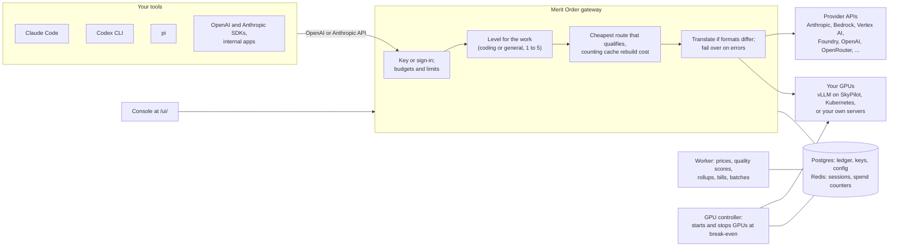

# Merit Order

A self-hosted LLM gateway that lowers what you spend on LLMs, without changing how people work. Your
tools keep their own API (OpenAI or Anthropic). For each request, Merit Order picks the cheapest model and
backend that is good enough for the task, and records what it cost.

> **Pre-production: version 0.0.1.** Most of Merit Order is tested only against mocks of each
> provider's API. Checked live so far: OpenRouter, Anthropic and OpenAI (smoke tests, `auto` routing,
> prompt caching, OpenRouter's recorded costs against its bill), Claude Code sessions through the gateway,
> the Docker Compose stack, GPUs on Kubernetes on a local kind cluster with a stand-in vLLM, and one
> SkyPilot replica on a Lambda GPU serving with real vLLM. Not yet checked live: the other providers, the rest
> of the GPU cycle on real clouds (scaling, preemption, the lease running out, prices against a bill), a real
> Codex CLI session, Entra and Google sign-in, the providers' batch APIs, their bills, and the learned router's and
> exploration's signals on real traffic. The full list is in [what's verified](docs/README.md#whats-verified-and-what-still-needs-live-accounts).
> Version 0.1.0 comes once those live checks pass ([ROADMAP.md](ROADMAP.md)).

## Why "Merit Order"

Power grids dispatch generators in **merit order**: the cheapest marginal cost first, with expensive
"peaker" plants switched on only when demand needs them. Merit Order does the same with tokens:

- **Routes** each session to the cheapest model and backend that meets the task's quality bar. It counts
  what it would cost to rebuild the prompt cache on another backend before it moves a session.
- **Runs open-weight models on your own GPUs** (SkyPilot, Kubernetes, or servers you run) when steady load
  makes that cheaper than paying per token, and stops them when it doesn't. Provider APIs (Anthropic,
  Bedrock, Foundry, Vertex AI, OpenAI, OpenRouter, DeepSeek, Mistral, ...) are always there for overflow.
- **Saves tokens** with automatic prompt caching, sticky sessions, compression of large tool outputs that
  keeps the prompt cache valid, batch prices for work that can wait, and an optional response cache.
- **Shows the money**: each request is recorded with what it cost and what it would have cost without Merit
  Order, by cause, user, team, project and day.

## How it fits together



A request that sends `model: "auto"` gets a level from what it asks for (its wording and tools, never its
length). Every model has a 1 to 5 score for each kind of work, from published benchmarks by default. The
cheapest model whose score meets the level, with room for the conversation, wins. A request that names a
model always gets that model; Merit Order only chooses where to run it. The full story, with real numbers,
is in [docs/00-how-it-all-works.md](docs/00-how-it-all-works.md).

## Quickstart (no keys needed)

Needs Python 3.12 or newer (the images and CI use 3.14) and [uv](https://docs.astral.sh/uv/).

```bash
uv sync
cp .env.example .env            # set MERITORDER_DEV_KEY (openssl rand -hex 24) and any provider keys you have
uv run meritorder check         # which backends and models are live
uv run meritorder serve         # http://localhost:8080 (MERITORDER_PORT); console at /ui/ once built
```

In a second terminal (`.env` is read by the gateway, not by your shell):

```bash
export MERITORDER_DEV_KEY=<the key you put in .env>
curl localhost:8080/v1/chat/completions \
  -H "authorization: Bearer $MERITORDER_DEV_KEY" -H "content-type: application/json" \
  -d '{"model": "auto", "messages": [{"role": "user", "content": "hello"}]}'
```

With no provider keys, requests go to the built-in mock backends (`mock-openai`, `mock-anthropic`), and the
reply says `[mock-small] You said: hello`. Cloud credentials already on your machine count as keys, though.
An AWS profile (`AWS_PROFILE` or `~/.aws`) turns on Bedrock, and gcloud's application-default login turns on
Vertex AI; requests then go there, at your cost. Run `uv run meritorder check` first to see what is live.
`MERITORDER_BEDROCK=false` and `MERITORDER_VERTEX=false` in `.env` keep those two off.

Without `MERITORDER_DATABASE_URL`, storage is in memory and is lost on restart. The console is a build
output: `cd ui && npm ci && npm run build` once (see [Development](#development)). For a real setup, use
Docker Compose.

## Run the full stack with Docker

```bash
cp .env.example .env            # set MERITORDER_DEV_KEY; provider keys are optional (mocks without them)
docker compose up -d            # migrate, then gateway + worker + Postgres + Redis; gateway on 127.0.0.1:8080
docker compose exec gateway meritorder accounts create you@example.com --role admin   # your console sign-in
docker compose exec gateway meritorder keys create --user you@example.com --role admin   # a key for harnesses
```

Then open http://localhost:8080/ui/ and sign in with your email address and password; invite the rest of your team
from the People page. Only `.env` counts
inside the containers: your shell's cloud credentials don't reach them. `MERITORDER_BIND=0.0.0.0` opens the
port to your network. A second copy on the same machine (another checkout) needs its own
`COMPOSE_PROJECT_NAME`, `MERITORDER_IMAGE` and `MERITORDER_PORT` in its `.env`, or the two share images.

Optional profiles: `--profile gpu` (the GPU controller), `--profile compressor` (model-based compression),
`--profile clickhouse` (a ClickHouse copy of the ledger), `--profile tls` (Caddy for HTTPS). Bedrock with your
AWS profile, SSO included: `docker compose -f compose.yaml -f compose.aws.yaml up -d`.

Kubernetes: `helm install mo charts/meritorder` (see [docs/07-deployment.md](docs/07-deployment.md)). The
release workflow publishes signed images to `ghcr.io/therick/meritorder` when a version tag is pushed. Until
then, build and push your own image and set `image.repository` and `image.tag`.

## Point your harness at it

Install the `meritorder` command on your laptop with `uv tool install .` in the clone (or use
`uv run meritorder` inside it).

```bash
meritorder login --gateway https://llm.example.com   # Entra or Google sign-in; or: meritorder use-key <key> --gateway ...
meritorder setup pi                                    # adds a "meritorder" provider to pi
meritorder setup claude-code                           # gateway URL, key helper, model auto
meritorder setup claude-code --config-dir ~/.claude-meritorder   # the same, in a separate Claude Code profile
meritorder setup codex                                 # Codex CLI: a "meritorder" provider over WebSocket, model auto
meritorder usage                                       # your spend and savings this month
```

By hand: OpenAI-compatible clients use the base URL `<gateway>/v1`. Claude Code uses
`ANTHROPIC_BASE_URL=<gateway>` and `CLAUDE_CODE_GATEWAY_HINT_HEADERS=1`, plus
`CLAUDE_CODE_MAX_CONTEXT_TOKENS` for a model name it doesn't know. Send `model: "auto"` to let Merit Order
choose, or name a model (`claude-sonnet`, `kimi-k3.1`, `qwen3-coder`, `deepseek-v4.1-flash`, ...) to pin it.
Each tool keeps its own API format; Merit Order translates when the chosen model speaks the other one.

| Request header | Effect |
|---|---|
| `X-Session-Id` | Groups requests into a session (pi sends it; Claude Code's and Codex CLI's own session ids are used; otherwise inferred) |
| `X-Route-Floor: coding:4` | Minimum level for `auto` routing |
| `X-Route-Hint: cheap` / `smart` | Moves the `auto` level one down or one up |
| `X-MeritOrder-Priority: cost` / `balanced` / `speed` | How much more a faster route may cost: 2%, 20% or 100% (`routing.priority_premium_pct`) |
| `X-MeritOrder-Tags: project=foo` | Cost-allocation tags for reports |
| `X-MeritOrder-Cache: on` / `off` | Use or bypass the response cache |
| `X-MeritOrder-Backend: <name>` | Admins only: pin a backend (testing, debugging) |

Replies carry `x-meritorder-model`, `x-meritorder-backend`, `x-meritorder-session`, `x-meritorder-floor`
(the level), and, when not streamed, `x-meritorder-cost-usd`, `x-meritorder-baseline-usd` and
`x-meritorder-savings-usd`. The full list is in [docs/02-request-flow.md](docs/02-request-flow.md). A model you
name is never swapped for another unless your team opted in to substitution when it can't run. Reasoning
effort you set is always passed through. Every routing and scaling rule, as diagrams:
[docs/10-how-it-decides.md](docs/10-how-it-decides.md).

## What's in the box

Everything below is built and tested in CI. Most of it is tested against mocks only; see the notice at the
top and [what's verified](docs/README.md#whats-verified-and-what-still-needs-live-accounts).

| Area | Built |
|---|---|
| APIs | OpenAI Chat Completions, OpenAI Responses over HTTP and WebSocket (stateless, chained on a WebSocket connection, or chained with `previous_response_id` and conversations in a team's opt-in stored mode; `compact` and `input_tokens` on every backend; Codex CLI's own tools, such as `apply_patch`, tool search and local shell, on every backend, with web search on Claude), Anthropic Messages (and `count_tokens`), embeddings, OCR (Mistral's API, plus file upload); streaming and not; PDFs and tool-result images translated between formats; a stream the client breaks off charged at an estimate; OpenAI's Batch API and Anthropic's Message Batches, sent to ten providers' batch APIs or run in running GPUs' spare capacity; pass-through when formats match, translation when they don't |
| Backends | Anthropic, Claude in Amazon Bedrock, Microsoft Foundry, Vertex AI (Claude and Gemini), the Gemini API, Azure OpenAI, OpenAI, xAI, OpenRouter (and its opt-in free tier), DeepSeek, Mistral, Moonshot, Z.ai, MiniMax, any OpenAI-compatible server (vLLM, SGLang, ...), and vLLM on your own GPUs |
| Models | Claude, GPT, Gemini, Grok, and an open-weight catalog: DeepSeek, GLM, Kimi, Qwen3-Coder, MiniMax, MiMo, Muse, Llama, Mistral and Devstral, Gemma, Nemotron, gpt-oss; embedding models |
| Routing | A rule-based level from the work (tools say it's coding, the task's wording how hard; hints), never from length, with configurable rules and a recorded reason for every request; by default the model with the lowest expected total cost to finish the task, counting what a failure puts at stake (a person's time, scaled by the level and the request's size), which on the routing simulator spends no more than the plain threshold on any kind of work (CI checks it on 1,000 tasks); the threshold or cost per success instead, per team; a marginal-cost router that counts cache rebuild cost; context-window checks against each model's real window (a session that outgrows its model moves to one with room); token counts calibrated per model from providers' reports; an opt-in cascade to a stronger model inside a failing task; an opt-in learned router that corrects levels from outcomes (shadow mode first), with opt-in judged labels; coding outcome signals from agents' tool results (tests, builds, fix loops, corrections); opt-in exploration (a few new tasks one level up or down) and a Levels report that says whether each level is too high or too low for the work; sticky sessions; fallback across backends and on refusals; live prices (OpenRouter's catalog and LiteLLM's price list, every 15 minutes); quality scores from Epoch AI's benchmark data by default, against a fixed bar, refreshed daily, or measured on your own tasks with `meritorder eval` |
| GPUs | A break-even controller (addressable demand, hysteresis); vLLM on plain SkyPilot clusters, one per replica, behind a keyed gate with a lease that deletes the machine if the controller goes away (on AWS, GCP, Azure, Lambda, RunPod, Nebius, Kubernetes and CoreWeave, Vast, Fluidstack, Paperspace, DigitalOcean, Mithril, Seeweb, and Slurm with Pyxis), Kubernetes (KServe or llm-d), or static servers; replica affinity (a session returns to the replica holding its KV cache); utilization from vLLM metrics; spill to APIs when full (a GPU that is the only route queues, bounded); cold starts timed phase by phase and paid back in the break-even, with an opt-in weights cache volume; a GPU with no known price never starts; Kubernetes resources stopped on a config change and swept when no deployment owns them; leases renewed through Postgres, Redis and SkyPilot outages; the console shows where each replica runs, uptime, burn rate and cost, with stop, drain, pin and stop-all controls and an activity log |
| Savings | Automatic prompt caching, lower reasoning effort for simple `auto` tasks (stable per session), deterministic tool-output compression, opt-in model-based compression (LLMLingua-2, its own service) with each result compressed once so the prompt cache holds, batch prices, opt-in response cache |
| Identity | Console sign-in with your own account: a password kept here (invite and reset links, for teams without an identity provider) or SSO, in an HttpOnly session cookie; virtual API keys for harnesses and services; Entra or Google Workspace device-code login with group-to-team and role mapping (Entra groups from the token, Google Groups read from Google, plus address and domain rules); SCIM provisioning; roles (user, team lead, finance, admin); a People page to move, pin or disable anyone (applies to existing keys within a minute; a person's record can lower a key's role, never raise it); a config saved from the console reads only allowed secrets |
| Spend | Organization, team and user monthly budgets, each one total (the ledger, running batches' reservations and, for the organization, GPU time, idle included); a GPU budget and fleet caps; a per-request cost ceiling; per-session spend caps; requests- and tokens-per-minute limits; allow and deny lists for models and backends; all editable on the console's Controls page |
| Console | At `/ui/` (dark by default). Dispatch (merit-order stack from real traffic, live request feed, backend health, GPU fleet, needs-attention), Reports (Overview, Breakdown, Requests, Batches, Levels, Bills, Learned router), GPUs (with what-if and controls), Controls, Backends, Models (Models and routes, Evals, GPU break-even), Teams, People, Keys, Config (forms for Teams, Models, Backends, Routing, Access and Reporting, plus raw YAML; validate, version history, restore; every gateway reloads it), My usage |
| Reporting | A ledger with savings by cause, self-hosting savings counted after what the GPUs cost (below zero when they cost more); spend split into APIs and GPUs; a request for a model with no known price refused, never served free; spend counters checked against the ledger; a reports API; CSV; JSONL, CSV or Parquet ledger export to a file or S3; bills from Anthropic, OpenAI, AWS (Cost Explorer or CUR 2.0), GCP and Azure (Cost Management or its exports) checked against the ledger; `meritorder usage`; Prometheus metrics and a Grafana dashboard; OpenTelemetry traces; budget and spike alerts and weekly digests to a webhook; an optional ClickHouse copy of the ledger for very large deployments |
| Deployment | Docker Compose, a Helm chart, CI (tests, audits, Helm lint and render checks, a Compose smoke test, console browser tests), a release workflow for signed multi-arch images |

Not built yet: resuming a Responses API background stream (`starting_after`), and batch embeddings on GPUs. The status of each area is in [docs/README.md](docs/README.md#status).

## Documentation

Start with [docs/00-how-it-all-works.md](docs/00-how-it-all-works.md). The [docs index](docs/README.md) lists
every doc in reading order, with a glossary:

- [01 Architecture](docs/01-architecture.md), [02 Request flow](docs/02-request-flow.md),
  [03 Routing](docs/03-routing.md), [04 Caching and sessions](docs/04-caching-and-sessions.md)
- [05 GPU autoscaling](docs/05-gpu-autoscaling.md), [06 Auth and spend](docs/06-auth-and-spend.md),
  [07 Deployment](docs/07-deployment.md), [08 Reporting](docs/08-reporting.md)
- [09 Decisions](docs/09-decisions.md), [10 How it decides](docs/10-how-it-decides.md), [11 Evals](docs/11-evals.md)
- [Feature sheet](docs/feature-sheet.md): what it saves and how, and how it compares, in 5 minutes

## Roadmap

[ROADMAP.md](ROADMAP.md) has the details. In short:

- **0.0.1 (now):** everything above is built; most of it is tested only against mocks.
- **0.1.0:** the live checks: each provider's smoke test, a full GPU cycle on SkyPilot, Entra and Google
  sign-in from real tenants, each provider's batch API and bills, and Kubernetes on real GPUs.
- **Next (planned):** request security, opt-in per team and in shadow mode first: secret scanning on prompts and
  responses, input normalization, prompt-injection signals in agent sessions, parallel moderation, and a sampled audit.
- **Later:** ideas the docs mention, such as resuming a background response's stream and batch embeddings on GPUs.

## Development

```bash
uv sync && uv run pytest                     # gateway (in-memory state and storage)
cd ui && npm ci && npm run build             # console (served at /ui/)
cd ui && npx playwright install chromium && E2E_DATABASE_URL=postgresql://… npm run e2e   # console browser tests
uv run python scripts/fake_vllm.py           # a stand-in vLLM server for the GPU path
uv run python scripts/smoke_providers.py --gateway http://localhost:8080 --key $MERITORDER_DEV_KEY   # every enabled provider (real requests, at your cost)
scripts/kind/setup.sh && uv run python scripts/kind/check.py   # GPUs on Kubernetes, on a kind cluster without GPUs
uv run python scripts/bench_ledger.py --help # a synthetic ledger, and the reports timed on Postgres and ClickHouse
cd ui && npm run build:demo && npm run preview:demo   # the console demo: sample data, no gateway (http://127.0.0.1:4174/)
uv run python scripts/build_demo_data.py     # its sample data again, from the real router and pricing
```

The console demo is the real console built with `--mode demo`: it answers its own API calls in the browser from
recorded sample data, so it can be hosted as static files. It runs at https://dev.meritorder.dev. See
[docs/07-deployment.md](docs/07-deployment.md#the-console-demo).

To also run the gateway, storage and state tests against real Redis and Postgres (CI does, with a 95%
coverage floor), point these at a throwaway Redis database and Postgres database. Both are wiped before
each test:

```bash
MERITORDER_TEST_REDIS_URL=redis://localhost:6379/15 \
MERITORDER_TEST_DATABASE_URL=postgresql://postgres:pw@localhost:5432/motest \
uv run pytest --cov
```

## Contributing

See [CONTRIBUTING.md](CONTRIBUTING.md). Report security problems as [SECURITY.md](SECURITY.md) describes, not
in public issues.

## License

Merit Order is licensed under the [GNU Affero General Public License v3.0](LICENSE) (AGPL-3.0). You may use,
change and share it. If you change it and let others use your changed version over a network, for example by
running it as a gateway for other people, you must offer those users the source code of your version under
the same license. The console's footer and `GET /about` link to the source, set by `console.source_url`
(`MERITORDER_SOURCE_URL`): if you run a changed version for others, point it at your source.
