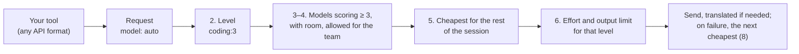
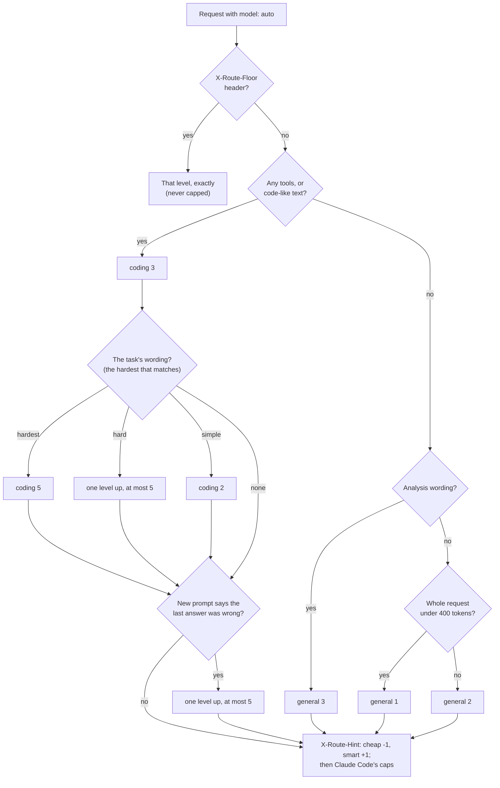
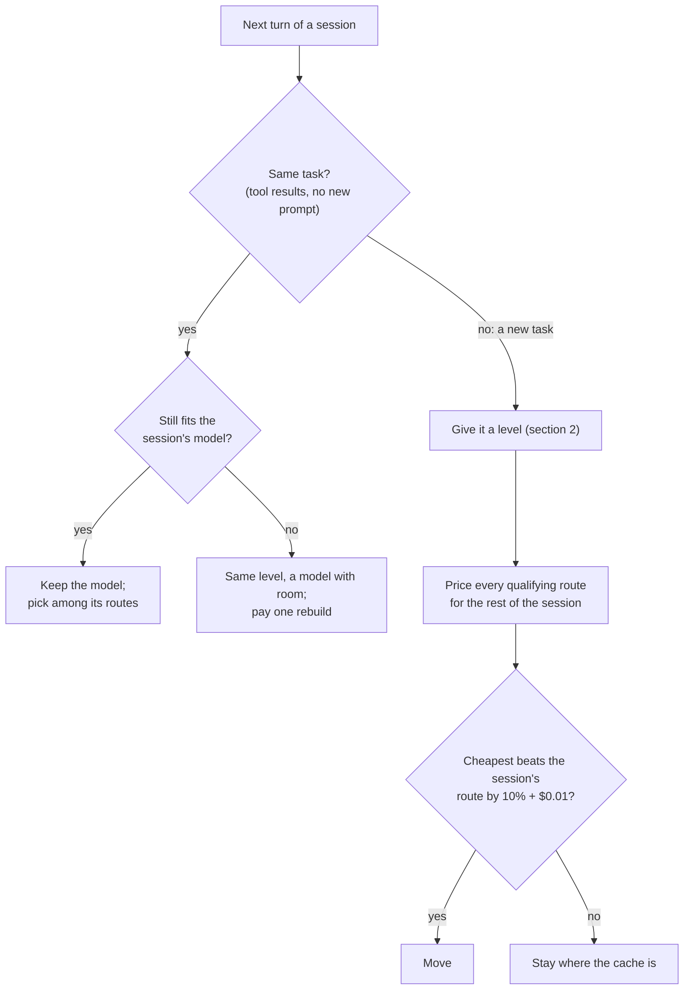
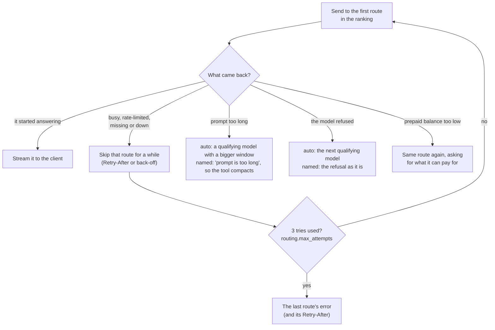
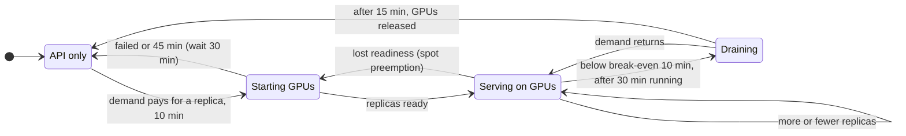

# 00 — How it all works (start here)

Merit Order sits between your tools and the model providers. Your tools keep speaking the API they
already speak; Merit Order translates when the chosen model speaks another. For every request sent with
the model name `auto`, it asks two questions:

1. **How hard is this?** The request gets a **level** for its kind of work: coding or general, 1 to 5,
   from what it asks for, never from how long it is.
2. **What's the cheapest model that's good enough?** Every model has a **score** for each kind of
   work, 1 to 5. Models scoring at least the level, with room for the conversation, qualify, and the
   cheapest of those wins, counting the whole rest of the conversation, not just this request. By default
   a dearer model wins only where its better chance saves more than it costs in what a failure would put at
   stake: on easy work (levels 1 and 2, questions, short chats) that's almost nothing, so the cheapest
   qualifying model goes; on hard work a person's time counts (section 5).

Everything else in this document is detail on those two questions: how tools connect, where the levels,
scores and prices come from, what "cheapest" really means, how long conversations are handled, what
happens when something fails, and when your own GPUs are worth switching on. The numbers come from the
shipped configuration and its price list (`config/prices.json`) on 11 and 12 November 2026. Prices and
scores refresh on their own, so yours will drift.

A request that **names a model** (`claude-opus`, `gpt-sol`, …) skips both questions: it always gets that
model, and Merit Order only chooses where to run it (section 10).



## 1. Your tools connect as they are

Point a tool's base URL at Merit Order and give it a Merit Order key. Nothing else about the tool
changes, because Merit Order speaks both common APIs:

| Your tool speaks | For example | Merit Order endpoint |
|---|---|---|
| Anthropic Messages | Claude Code, Anthropic SDKs | `/v1/messages` (and `/v1/messages/count_tokens`) |
| OpenAI Chat Completions | pi, Cursor, OpenAI SDKs, most other tools | `/v1/chat/completions` |
| OpenAI Responses | Codex CLI (over WebSocket, chaining on its connection); with a team's stored mode, clients that chain turns (Microsoft Agent Framework, the Agents SDK's `previous_response_id`) | `/v1/responses` (HTTP and WebSocket), `/v1/responses/compact`, `/v1/responses/input_tokens`, and `/v1/conversations` in stored mode |
| Embeddings | RAG pipelines | `/v1/embeddings` |
| Batches: work that can wait a day, about half price (near free on GPUs that are running with room) | OpenAI and Anthropic SDKs, `meritorder batch` | `/v1/files` + `/v1/batches`, `/v1/messages/batches` |

**The model's own format is Merit Order's problem, not the tool's.** Each provider speaks one of the two
formats. When the tool and the chosen provider speak the same one, the request passes through untouched,
so provider features such as Claude's cache markers and thinking signatures survive. When they differ,
Merit Order converts the request, the reply and the stream both ways: messages, tool calls, images,
streaming, usage and stop reasons. Two things don't cross: a model's reasoning from earlier turns (each
turn still works; the model just thinks again), and `temperature`/`top_p`, which current Claude models
reject. The Responses API is converted to Chat Completions inside the gateway; GPT models that need the
Responses API for tools with reasoning are converted on the way out, and so are Gemini backends that use
Gemini's native API (`api: gemini`, for thought summaries, cached-token counts and why a reply was blocked).

**The model name says what you want:**

- `auto`: Merit Order chooses (the rest of this document). A one-line question goes to the cheapest model that meets
  level 1, and "write unit tests" from an agent to the cheapest at coding level 2 (section 13).
- A model's name or one of its aliases: that model. Aliases cover the names tools already send, so
  `claude-sonnet-5-5`, `anthropic/claude-sonnet-5.5` and `sonnet` all mean Claude Sonnet.
- Anything else: an error saying the model isn't configured.

**The gateway doesn't keep conversations**, with one opt-in exception. Tools send the whole conversation every
turn, and Merit Order keeps only routing metadata. A team can turn on stored mode for the Responses API (Config →
Teams, with a retention it must choose): then clients may send only their new input with `previous_response_id`
or a conversation, and the gateway holds the conversation, sealed, and rebuilds the whole of it every turn, so `auto`
still picks the cheapest model for each turn ([Caching and sessions: stateful APIs](04-caching-and-sessions.md#stateful-apis)).

`GET /v1/models` lists `auto` and every model your team may use, with each one's context window.

**Every reply says what happened**, in headers: `X-MeritOrder-Model` (the model that answered),
`X-MeritOrder-Backend` (the provider), `X-MeritOrder-Session` and `X-MeritOrder-Request-Id`,
`X-MeritOrder-Floor` (the level, for `auto`), `X-MeritOrder-Max-Tokens` and `X-MeritOrder-Max-Tokens-Source`,
`X-MeritOrder-Failed-Over` when a provider failed first, `X-MeritOrder-Refused-By` when a model refused first,
`X-MeritOrder-Substituted-For` when a named model was replaced, and `X-MeritOrder-Queued` when it waited for a
full GPU. Replies that aren't streamed also carry `X-MeritOrder-Cost-Usd`, `X-MeritOrder-Baseline-Usd` and
`X-MeritOrder-Savings-Usd`. The console's Reports → Requests tab shows the
model, provider, level and cost of every request, and why it got that level and model. Setting up Claude
Code and pi is in section 11.

## 2. Every request gets a level

The level is how demanding the work is. It's worked out from the request itself, with simple rules
and no model call, so it's instant and free:

| The request | Level |
|---|---|
| Plain text | general 2 |
| Plain text, and the whole request is under ~400 tokens: a question on its own | general 1 |
| Plain text with words like analyze, compare, plan, strategy, trade-offs, evaluate or reason | general 3 |
| Any tools, or text that looks like code (code fences, `def`, `import`, stack traces, file names, "refactor", "bug", SQL, …) | coding 3 |
| Coding with simple wording and nothing harder (write tests, rename, typo, lint, docstring, explain, bump a version, …; not "quick fix") | coding 2 |
| Coding with "hard" wording (race condition, security, performance, migration, concurrency, multi-file, "under load", flaky, …) | one level higher for each sign, two at most; at most 5 |
| Coding with the hardest wording (architecture, "design a…", system design, prove, codebase-wide refactor, …) | coding 5 |
| A new prompt that says the last answer was wrong ("that's wrong", "still not working", "revert", …) | one level higher, at most 5 |

Tools say the work is coding; the task's wording says how hard. A coding agent such as Claude Code or Codex sends
dozens of tools with every request, whether it was asked to fix a typo or to redesign a service, so the number of tools
doesn't set the level (it did until decision 61, which made every agent task level 4 or 5; `agent_by_tools: true`
brings that back). Words are looked for in the text of the last two messages a person wrote (anything pasted into them
included), not in tool results, and not in what the harness adds to them (Claude Code's system reminders with your
CLAUDE.md, Codex's AGENTS.md): a user message made only of tool results or of that text is passed over. Where the
lists overlap, the hardest wins.



**Length never raises the level.** A long conversation isn't harder work; it needs a model with room for
it. So its length only rules out the models whose context window can't hold it plus the reply (section 7),
and the cheapest of the rest wins. The one place length counts is the short question, and there it can
only lower a level.

Clients can take over: `X-Route-Floor: coding:4` sets the level exactly, and `X-Route-Hint: cheap` or
`smart` moves it one level down or up. Every `auto` response says what it got (`X-MeritOrder-Floor`).

What that means in practice:

| Request | Level |
|---|---|
| "What's the capital of Portugal?" | general 1 |
| "Draft a reply to this customer email" (pasted) | general 2 |
| "Compare these three vendor proposals" | general 3 |
| "Why does this function return None?" with a code block | coding 3 |
| A coding agent (40 tools) asked to "write unit tests for the date parser" | coding 2 |
| The same agent asked to "add a --dry-run flag to the deploy command" | coding 3 |
| The same agent, 300,000 tokens into that task | coding 3, on a model whose window holds 300,000 tokens |
| The same agent asked to "fix the race condition in the scheduler" | coding 4 |
| The same agent asked to "design a plugin system for the importers" | coding 5 |

**A task keeps its level.** The level is set when a task starts (a new session, or a new prompt from the person) and
holds for every request of the task, so the model and its cache stay put while the agent works. A task that proves
harder than its wording goes up at the next prompt, never mid-task: a prompt that says the answer was wrong is one
level up, and the learned router and the outcome report (opt-in) learn from fix loops and failing tests which work
needs more.

**Claude Code's side jobs get lower levels.** Claude Code labels each request (when its hint headers are
on; section 11): a turn of the conversation, a subagent's turn, the summary it writes when it compacts a
long conversation, or a side request such as a session title or summary. Those last two don't need the
level of the work itself, so `auto` caps them:

| Claude Code request | Highest level |
|---|---|
| Side request (titles, summaries) | 1 |
| Compaction summary | 3 |
| Conversation or subagent turn | not capped |

An explicit `X-Route-Floor` is never capped. Auto mode's permission checks name Claude Sonnet, so they
never go through `auto` at all. The caps are under Config → Routing → Claude Code request types.

**A learned router can correct the rules** (opt-in; off by default). It learns from your own traffic which requests
are harder or easier than the rules say: each request's words (hashed, never stored as text) and facts such as its tool
count, and what followed the answer: the same request sent again, a raised `X-Route-Floor`, a stopped answer. In shadow
mode it only records what it would have chosen, and Reports → Learned router shows where it disagrees with the rules,
what that would cost, and the outcomes; in route mode its level is used when it's sure (at least 80%,
`routing.learned.min_confidence`), and the rules decide whenever it isn't, has no model, or its model is stale (older
than 30 days, `max_age_days`). It never second-guesses an `X-Route-Floor`. Train it with `meritorder router train`.
Details: [Routing: the learned router](03-routing.md#the-learned-router).

A team can also give it **judged labels** (off by default, per team, with a monthly cap that has no default): a small
sample of its requests (1%, and only while the learned router is on) is replayed on a stronger model in the background,
and a judge model from another family says whether the answer each one got was good enough. That sends those prompts
and answers to two more models, and the console says so, and shows the expected monthly cost, before it can be turned
on. Only the verdict is kept.
Details: [Routing: judged labels](03-routing.md#judged-labels).

**The rules are settings, and everyone can see them.** Reports → Levels shows each rule, its word lists,
and the models good enough for each level that your team may use. Reports → Requests shows why each
request got its level: the rule, and which listed word it found (never the text around it), for example
`classified coding:4 (coding: 40 tools; hard wording (race condition): +1)`. Admins
change the levels, the short-question size, the word lists, and whether a tool count makes an agent (Python
regular expressions, matched ignoring case) under Config → Routing → How requests get a level
(`routing.levels`). A rule that can't work is refused when the configuration is saved: a level outside
1–5, a pattern that isn't a valid regular expression, one that matches empty text and so every request, or
patterns that don't combine into one (inline flags such as `(?i)`; case is already ignored).

## 3. Every model gets a score for each kind of work

A score says how good a model is at a kind of work, **against a fixed bar**. It isn't typed in: the worker
works it out once a day from published benchmarks.

**What a score means.** By default (source `epoch`), each model's score is based on its chance of
solving a task as hard as **FrontierSWE**, a set of real, hard software-engineering tasks. A 5 is a fixed
chance, the **anchor**: what the best model, Claude Fable 5.2, solved when the scale was fixed (69.9% for
coding and 76.9% for general work, on 12 November 2026). Every model scores in proportion to it:
5 × its chance ÷ the anchor, at most 5, at least 1. One that solves 60% as many such tasks scores 3.

| Model | Chance on a FrontierSWE-hard task (coding) | Coding score | General score |
|---|---|---|---|
| Claude Fable 5.2 | 69.9% | 5.0 | 5.0 |
| Gemini 4 Carbon | 61.2% | 4.4 | 4.3 |
| GPT-6.1 Terra | 58.2% | 4.2 * | 3.8 |
| GPT-6 Astra | 57.7% | 4.1 | 4.1 |
| Claude Opus 5.5 | 57.2% | 4.1 | 4.0 |
| Claude Sonnet 5.5 | 54.8% | 3.9 | 3.5 |
| Gemini 4 Argon | 47.3% | 3.4 | 3.5 |
| GPT-6.1 Sol | 44.3% | 3.2 | 4.0 |
| Claude Haiku 5.5 | 40.7% | 3.0 † | 2.1 |
| GPT-6 Luna | 31.5% | 2.3 | 1.3 |
| Gemini 3.8 Flash | 24.3% | 1.7 | 1.7 |
| Gemini 3.5 Flash-Lite | 4.8% | 1.0 * | 1.0 |

**Why a fixed bar.** Until 15 November 2026 the best model you had was the 5 (`scale: best`). So a new,
stronger model lowered every other model's score though none of them got worse, and the same work moved to
dearer models with each release. A new model with a 95% chance would have taken GPT-6.1 Terra from 4.2 to 3.1 and
Claude Fable from 5.0 to 3.7, leaving only itself at level 4: every agent turn would have gone to it. With the
fixed bar, a new model scores 5 if it beats the anchor, and nobody else's score moves (decision 58).

\* Estimated from the model's general ability: no coding results published yet.
† Set by hand (`quality_override`). Epoch's refit of 12 November 2026 put it at 2.9, just under level 3,
which would send ordinary coding to GPT-6.1 Terra at about ten times the price; our own coding evals
had it pass 14 of 15 hard tasks.

**Where the numbers come from.**
[Epoch AI](https://epoch.ai/benchmarks) (CC BY 4.0) places every model on one ability scale, fitted
across about 40 benchmarks, and every benchmark on the same scale by difficulty. That's what makes
models comparable even when they were tested on different benchmarks, and lets a model's ability be
turned into a chance of solving tasks of a given difficulty. For coding, a model's own results on
FrontierSWE and FrontierCode refine its general ability, so coding strength counts; results at the
effort `auto` uses for hard work are preferred where published. A model with neither those results nor
a place on the scale (some open models) gets its coding score from older coding benchmarks (Terminal
Bench, GSO, MirrorCode); they come last because they predict FrontierSWE results less well than the
scale does.

The alternative source is the [Artificial Analysis](https://artificialanalysis.ai) Intelligence Index
(needs `ARTIFICIAL_ANALYSIS_API_KEY`). It's a single number per model, so coding and general get the
same score. The third option is scores written on each model by hand (`config`), for example from
your own eval runs ([Evals](11-evals.md)).

**Two choices shape the scores** (Config → Routing → Quality scores):

- **Scale.** `absolute` (default): a 5 is the anchor (`quality.anchor`, 0.6994 for coding and 0.7685 for
  general work), and the rest in proportion; a new model, weak or strong, changes nobody else's score. `best`:
  the best model is 5 and the rest in proportion, so each stronger release lowers everyone else. `range`: the
  weakest model with data is 1 and the best 5, which depends on which weak models you happen to have configured.
  A change of scale or anchor takes effect at once: the scores are worked out again from the stored chances.
- **Reference task.** A harder reference spreads models further apart and sends more work up the
  ladder. Against Remote Labor Index (real paid remote work, which Fable solves 37% of the time),
  Opus would score 2.8 for general work, and ordinary level-3 work would go only to Fable.
  FrontierSWE keeps level 3 within reach of models like Sonnet.

**Models the source doesn't cover** aren't picked by `auto`: a score nobody measured would compete
with measured ones, and because the cheapest qualifying model wins, an optimistic guess would win.
They still answer requests that name them. To put one back, give it a `quality_override` (Config →
Models), which always wins over the source; that's also how to record that your own evals disagree
with the benchmarks (Models → Evals → *Apply scores…* → *Write as override*). Measured scores use the
same 1–5 scale, so the Evals page shows them beside the ones in use. On 12 November 2026, 10 open models
weren't covered, among them Qwen3 Coder Next, Devstral 2 and both MiMo models (Qwen3 Coder has a 1.0 for
coding, from older coding benchmarks). The Models page lists them.

Hover a score on the Models page to see how it was worked out, and the model's chance of solving work at each
level (used when routing by cost per success, section 5).

## 4. Which models qualify

A model qualifies for a request when:

- its score for that kind of work is **at least the request's level**. A level-3 coding request can go
  to any model with a coding score of 3.0 or more; level 5 means FrontierSWE-hard work, which today only
  Fable meets;
- the conversation, plus room for the reply, **fits in its context window** (section 7). This is what a
  long conversation changes: it narrows the models, never raises the level; and
- the team is allowed to use it (Config → Teams → allowed models and backends).

With expected total cost (the default) or cost per success (opt-in), both at the end of section 5, a model below the
level can qualify too, when its chance of solving work at that level is at least 60%.

## 5. The cheapest qualifying route wins

Each qualifying model has one or more **routes**: the providers that serve it (Anthropic, Bedrock,
Vertex, OpenRouter, your own GPUs, …). Merit Order prices every route and picks the cheapest.

**Prices are live.** The worker refreshes them every 15 minutes: OpenRouter routes from OpenRouter's
catalog, direct provider APIs from the price list LiteLLM maintains, cross-checked against each other.
Long-prompt prices apply (Claude Haiku 5.5 costs five times as much above 100,000 prompt tokens), and a
price change, a list that can't be fetched, or two lists that disagree raises an alert.

**"Cheapest" means the rest of the session**, because in a conversation each turn resends everything
before it, and providers charge far less for the part they still have cached:

```
cost of a route = rebuild + expected turns × cost per turn

rebuild       = what it costs to get this conversation into the provider's cache:
                zero if this provider already holds it, else the context at the write price,
                less the cache-read price the first turn already counts
cost per turn = the cached part at the cache-read price
                + the new tokens at the write price: what the conversation grew by since its
                  last turn, or about 2,000 for a new session
                + about 600 output tokens at the output price
write price   = the input price, where the provider caches on its own (OpenAI, Gemini, most others);
                for Claude, where caching is explicit, the cache-write price; on a backend set to
                keep its cache an hour (cache_ttl_seconds: 3600), the 1-hour write price from a
                session's second turn (its first turn, rebuild included, is written for 5 minutes)
expected turns = the turns so far, kept between 3 and 30 (a long session will probably keep going)
```

The four Claude backends in the shipped config (Anthropic, Bedrock, Vertex AI, Foundry) are set to an hour.
A session's first turn there is written for 5 minutes, as the gateway sends it, so the rebuild and the first
turn cost the same as on Claude through OpenRouter, which keeps the 5-minute default. From the second turn the
router prices their writes at Claude's 1-hour write price (twice the input price, against 1.25 times for 5
minutes). What the hour buys is counted too: a later turn that comes after a pause of 5 to 60 minutes finds a
5-minute cache gone and writes the conversation again, and an hour's still there. The router expects such a pause
on the share of later turns your sessions have shown (by team, leaning on the organization's share and, with
little data, on one turn in ten), and adds that share of a rebuild to each later turn on routes whose cache lasts
under an hour (decision 60). At one turn in ten, a new Claude Haiku session is cheaper on the direct backends than
on OpenRouter, so it goes there at the default `cost` priority. Where sessions rarely pause, the hour's premium wins
again and OpenRouter is the cheaper start. Here's what that gives for a new coding session at level 3, 30,000 tokens
in, with pauses on one later turn in ten:

| Model (route) | Score | Rebuild | Per turn | 3 turns |
|---|---|---|---|---|
| **Claude Haiku 5.5 (Anthropic, Bedrock, Vertex, Foundry)** | 3.0 | $0.0032 | $0.0008, then $0.0010 | **$0.0060** |
| Claude Haiku 5.5 (OpenRouter) | 3.0 | $0.0032 | $0.0008, then $0.0011 | $0.0064 |
| GPT-6.1 Terra (Azure, OpenAI) | 4.2 | $0.027 | $0.006, then $0.009 | $0.051 |
| Gemini 4 Argon (Vertex, OpenRouter) | 3.4 | $0.053 | $0.013, then $0.018 | $0.102 |

And for a level-4 agent task (hard wording, such as "fix the race condition"), 80,000 tokens in:

| Model (route) | Score | Rebuild | Per turn | 3 turns |
|---|---|---|---|---|
| **GPT-6.1 Terra (Azure, OpenAI)** | 4.2 | $0.074 | $0.009, then $0.016 | **$0.116** |
| Gemini 4 Carbon (Vertex, OpenRouter) | 4.4 | $0.148 | $0.018, then $0.033 | $0.231 |
| Claude Opus 5.5 (Anthropic, Bedrock, Vertex, Foundry) | 4.1 | $0.374 | $0.038, then $0.044 | $0.499 |
| Claude Opus 5.5 (OpenRouter) | 4.1 | $0.374 | $0.038, then $0.075 | $0.562 |

The "then" columns are the later turns: on the direct Claude backends at the 1-hour write price; elsewhere with a
tenth of a rebuild for the pauses.

**Sessions stay put.** Once a session is on a route, the rebuild is already paid there, so moving it
must save at least 10% plus $0.01 over the rest of the session. Within a task (while the tool is sending
tool results back, before the next prompt from a person) the session keeps its model outright. In
practice a session moves only when a new task starts and something is clearly cheaper, its cache has
expired, the conversation was compacted, it no longer fits (section 7), or its model is busy or down on
every route (section 8). That's what keeps a session from bouncing between Bedrock and Anthropic and
paying to rebuild each time.

How long a cache lasts depends on the route. On Claude it's as long as the request's last cache marker
asked: when the gateway adds the markers (the client set none), 5 minutes after a session's first turn and an
hour from its second on a backend set to an hour. A client's own markers keep their own lifetime. Other
backends use their `cache_ttl_seconds` (5 minutes by default, 10 for the shipped GPU deployments).



**A session can hold several conversations.** Claude Code sends its subagents' turns and its side
requests under the main session's id. Each keeps its own routing state (model, level, cache), so a
subagent never resets the main conversation's; budgets, the per-session spend limit and reports still
count the session as one.

**Near-ties go to speed.** The same model often costs the same everywhere (Claude on Anthropic,
Bedrock and Vertex), so price alone can't choose. Routes within a small margin of the cheapest compete
on measured speed: 2% under the default `cost` priority (where a better model among them goes first),
20% under `balanced`, 100% under `speed`. A team or a single request (`X-MeritOrder-Priority`) can
choose differently. Every 10th new session may try a route within that margin whose speed is unknown
or out of date, so speeds stay known.

**Unpriced routes are never used**: an unknown price must never look free. `auto` passes them by, and a request that
names a model with only unpriced routes gets a 503 saying so (GPU routes excepted: they're charged by GPU time).

**Or: the cheapest per solved task.** The threshold treats a model just below the level as useless, though it
solves nearly as much. With `model_choice: cost_per_success` (Config → Routing, or per team; off by default),
`auto` picks on expected cost per solved task instead:

- Each model gets a chance of solving work at the level from its score. One exactly at the level solves it as
  often as a 5 solves FrontierSWE-hard tasks (the anchor: 69.9% for coding); better models more, weaker ones less.
- A failed try is still paid for, and the work is then redone on the model the threshold would pick:
  expected = cost + (1 − chance) × (that model's cost ÷ its chance).
- In the first example above, DeepSeek V4.1 Flash (coding 2.4: a 62% chance at level 3) costs $0.0018 a try
  and $0.0018 + 38% × $0.0086 = $0.0051 per success, against Claude Haiku's $0.0060 a try (on the direct
  backends) and $0.0060 ÷ 70% = $0.0086 per success. It wins.
- A model whose chance at the level is under 60% is never picked (`min_success_chance`), so a nearly free model
  that usually fails can't win. A client's `X-Route-Floor` keeps the threshold, and so does a model without a
  chance estimate.
- Warm caches, stickiness and the speed tie-breaks work as above, on the expected cost per success.

Every rule: [How it decides](10-how-it-decides.md#threshold-or-cost-per-success).

**Or: the lowest expected total cost to finish the task.** A redo costs more than tokens: someone notices the answer
was wrong, says so and waits. With `model_choice: expected_cost` (the default since decision 62; per team too), `auto`
counts that:

- Each model's expected cost is its try, plus its chance of failing times the person's cost a failure puts at stake,
  and with the cascade on, the next attempt: the same model again or a stronger one from a cold cache, whose chance is
  lower after a failure.
- The person's cost (`human_cost_usd`, $1 by default: a minute at $60 an hour, set per team on Controls) is for a failed
  level-5 agent task. Each level below 5 puts a third as much at stake (level 3: a ninth, level 1: 1/81), and a request
  under 8,000 tokens proportionally less, because a re-asked question costs seconds and a failed agent task minutes. After
  a correction ("that's wrong") the request counts as level 5 (decision 67). So level 1 and 2 work, questions and short
  chats go to the cheapest model that meets the level, as with the threshold.
- The chance comes from the benchmark at the task's difficulty and, once it has learned from your outcomes and beaten
  the benchmark on tasks it wasn't trained on, from a fitted layer: calibrated to what your traffic counts as success,
  with each model's own record, and offsets for your team, repository and project.
- In the first example, a 30,000-token coding:3 task at a $1 person's cost puts $0.11 at stake: Claude Haiku tries for
  $0.0060 with a 70% chance (~$0.055 expected with a redo); GPT-6.1 Terra for $0.051 with 82% (~$0.07). Haiku goes first.
  A level-5 task at 90,000 tokens puts the whole dollar at stake, and goes to Gemini 4 Carbon ($0.26 a try, 62%) rather
  than Claude Fable ($1.07, 70%).
- With the cascade on (`routing.cascade.max_escalations: 1`; off by default), inside the task, if tests keep failing after edits (three failed runs in a row), or the person says "that's wrong", the
  task's model's chance drops, and the task moves to a stronger model when continuing would cost more: on Haiku, a
  failing run and "that's wrong" take it from 70% to 24%, and continuing (~$1.00, the request now counted at level 5)
  loses to escalating to Terra (~$0.28, its cache rebuilt there); three failed runs alone (41%) aren't enough at level 3.
  A new prompt that's harder than the task is a new task at its own level. At most once or twice per task, never down
  inside a task, never past the team's models or a budget that's 90% spent. The failed attempt's cost is charged against
  routing savings, once.

On the routing simulator it spends 60% less per finished task than the threshold, no more than the threshold on any kind
of work, and finishes 0.2 points more ([03](03-routing.md#is-it-the-right-default)). Every rule: [How it
decides](10-how-it-decides.md#expected-total-cost); why: decisions [62 and 67](09-decisions.md).

## 6. Then: effort and output length

**Reasoning effort** follows the level, so every model works the same way for the same work (their own
defaults differ): low for levels 1–2, medium for 3, high for 4–5. A model that doesn't take that effort
keeps its default. The effort is set once per session on a model, because changing it would invalidate
the prompt cache. A client's own effort setting always wins; one sent in Anthropic's format (Claude
Code sends one) to a GPT or other OpenAI-format model goes over at the nearest level that model takes.

**Output length** isn't capped by a guess. A request without `max_tokens` may write as much as the model
can (128,000 tokens for current Claude and GPT models), less what wouldn't fit in the context window,
under the per-request cost limit (Controls), or within what a provider's prepaid balance covers. Only when
the model's maximum isn't known does it get `default_max_tokens` (16,000). A client's own `max_tokens` is
kept (lowered only to the model's maximum). The response says how much it
got and why (`X-MeritOrder-Max-Tokens`, `X-MeritOrder-Max-Tokens-Source`).

## 7. Context windows: long conversations

Every model has a **context window**: the most a conversation plus its reply can hold. The windows come
from the live price data, refreshed with the prices:

| Window | Models |
|---|---|
| about 1 million tokens | Claude (all), Gemini, DeepSeek, GLM, Kimi, MiniMax, MiMo, Muse Spark, Mistral Large 4, Qwen3.8 Flash, Nemotron 3.5 Super |
| 922,000 | GPT-6 and GPT-6.1 (Astra, Sol, Terra, Luna) |
| 524,288 | Llama 4 Maverick |
| 500,000 | Grok 4.7 |
| 262,144 | Qwen3 Coder (all three), Devstral 2, Mistral Small 4, Ministral 14B, Gemma 4 31B, Nemotron 3 Ultra |
| 131,072 | gpt-oss-120b, gpt-oss-20b |

Two parties decide what happens as a conversation grows: **the tool**, which decides when to compact
(summarize the history and start over from the summary), and **Merit Order**, which decides where the
conversation can still go.

**What Merit Order does:**

- **Models without room drop out, and that's all length does.** For `auto`, a model isn't a candidate
  when the conversation plus the reply the client asked for (its `max_tokens`; Claude Code asks for
  32,000) fills its window past 95%. The conversation is counted in that model's tokens (below), and the
  5% is a margin for what the count still gets wrong and for the reply when the client leaves its length
  to the gateway. The level stays what the work gives it (section 2), and the cheapest model at that level
  with room wins. A 300,000-token conversation never goes to gpt-oss or Qwen3 Coder; most qualifying
  models have about a million tokens, so something nearly always fits. The routing reason names the
  models ruled out, their windows and how the count was made, for example `ruled out gpt-oss-120b
  (131,072): window too small for about 300,000 tokens plus a 32,000-token reply (estimate ×1.08,
  calibrated from 210 replies)` (Reports → Requests). Over 85% of a window that still fits, it says
  "context window check close" with the same detail.
- **Too long for every model at its level:** it goes to the model with the largest window anyway (the
  count is an estimate), and the provider decides. A higher level wouldn't help: its models are a subset.
  If the provider refuses, the client gets "prompt is too long", which makes Claude Code compact.
- **A session that outgrows its model moves, even mid-task.** The next turn goes to a model with room at
  the same level, paying once to rebuild the cache there.
- **A provider that says "too long" isn't the end.** If a provider refuses a prompt as too long anyway
  (the estimate can be off), an `auto` request goes to a qualifying model with a bigger window. A
  request that names a model can't move; its error is worded the way Anthropic's API words it ("prompt
  is too long: …"), whichever provider refused, because that's what makes Claude Code compact.
- **The reply shrinks to fit.** When a request doesn't set `max_tokens`, the reply may use what's left of
  the window and no more, so the provider doesn't refuse prompt plus reply (section 6).

**How a conversation is measured.** Merit Order can't run every provider's tokenizer, and the same text
comes to different token counts on Claude, GPT and Gemini. So it estimates once, from what the text is
made of: prose comes to about 4 characters a token, code and JSON about 3, hashes and base64 about 2,
and Chinese, Japanese or Korean about one character a token. Images count the way the model's provider
counts them, from the image's size (a 1000 × 1000 screenshot is about 1,330 tokens on Claude and 765 on
GPT), not as the text of their bytes; PDFs count by their pages. Then the replies correct it: each
reply reports the real prompt size, and Merit Order keeps a running ratio for each model, so after a few
long prompts its counts for that model follow that model's tokenizer. A model that hasn't answered yet
starts from the ratio of its family (other Claude models, other GPT models). The window check, the cost
estimates and the reply's allowance all use the model's corrected count, and the Models page shows each
model's ratio under its context window. The details are in [Routing: counting tokens](03-routing.md#counting-tokens).

**What the tool does.** A tool compacts when the conversation nears the window it believes it has.
`/v1/models` reports each model's window, and for `auto` the largest window among the models `auto` can
pick for your team (1,048,576 tokens today). That's safe because models without room drop out: a long conversation
narrows the choice to the million-token models instead of failing.

- **pi**: `meritorder setup pi` writes each model's window into pi's model list.
- **Claude Code**: it knows the windows of Claude models by name. For a name it doesn't know, such as
  `auto`, it assumes 200,000 tokens unless told otherwise; `meritorder setup claude-code` tells it the
  gateway's window (section 11).
- **Other tools**: give them the window from `/v1/models`, or leave their default; a smaller window than
  the real one only means compacting earlier.

## 8. When something fails

Nothing reaches the client until the chosen route has started answering, so a failure moves the request
on:

- **Over capacity, rate-limited, missing, or down:** the next route in the cost ranking. For a named
  model, or a session in the middle of a task, that's another provider for the same model; for a new
  `auto` task, it's the next cheapest qualifying route, whatever its model. A request gets 3 tries at
  most (`routing.max_attempts`). An `auto` session whose model is busy or down on every route moves to
  another qualifying model at its next turn, even mid-task. The failing route is skipped for a while
  (the provider's `Retry-After`, or a growing back-off) and an alert says where its traffic went.
- **Too long for the model:** for `auto`, a qualifying model with a bigger window (section 7).
- **The model refuses:** for `auto`, the next qualifying model (the refusal is billed and logged; a team can
  turn this off with `refusal_fallback: false`); a named model's refusal is returned as it is.
- **A provider can't cover the whole reply on its prepaid balance:** the same route again, asking for
  what it says it can pay for.
- **Budgets and limits:** organization, team, person and session budgets, rate limits, and the
  per-request cost limit stop requests before they're sent, with a message saying which.



Every rule and timing is in [How it decides](10-how-it-decides.md).

**Work that can wait** can go through the providers' batch APIs at about half price, or run on your own GPUs for almost
nothing while they're running with room. Each request of a batch is routed as above, among the routes whose provider has a
batch API (at batch prices) and running GPU deployments (at their shadow price); the gateway splits the batch across
providers and GPUs, reserves its estimated cost against budgets, and joins the results back. GPU work runs at low priority
in the headroom only, and goes to a provider's batch API if it hasn't run in 12 hours; it never starts a GPU
([Request flow](02-request-flow.md#batches-work-that-can-wait)).

## 9. Your own GPUs: when they start and stop

Power grids run the cheapest generators all the time (baseload) and switch on expensive ones (peakers)
only for peaks. Merit Order does the same: your own GPUs, running an open model, are the baseload when
there's enough steady work to keep them busy, and the APIs are the peakers that are always there.

**A GPU deployment starts only when sustained demand pays for it.** Every minute the controller asks:
what does the traffic this model could serve cost me at API prices?

- **Traffic it could serve** means requests whose level its score covers. A model with a coding score of
  3.0 counts every coding request at levels 1–3, wherever it was actually sent.
- **At API prices** means what you're paying for that traffic today.
- One replica is worth starting when that spend, per hour, exceeds the replica's hourly price plus a
  20% margin, **continuously for 10 minutes**. The number of replicas follows the throughput (enough
  to run at 70% load), as long as each one pays for itself by the same rule.

A replica's hourly price is SkyPilot's cheapest offer in the allowed clouds, or on your own Kubernetes
cluster the price you set for its node type (`kubernetes.node_types`), or else the deployment's
`gpu_cost_per_hour`. For example, the shipped `gpu-qwen-coder` deployment runs Qwen3 Coder Next on four
H100s with a fallback price of $16 an hour. It starts once the work it could do would cost you more than
$19.20 an hour at API prices for 10 minutes straight. The controller starts GPUs through SkyPilot on cloud
GPUs, or through KServe or llm-d on your cluster.

**While it runs, it's the first choice.** A GPU you're already paying for costs almost nothing per
token while it has room, so the router prices it at 2% of the API price up to 60% load
(`routing.shadow_floor`, `routing.shadow_knee`), rising with the square of the load to the full API price
at 100%. Up to the knee it wins every request it qualifies for; past it, the APIs win more and more of the
work, and at 100% new work spills to them. Requests that only went to the GPU because it had room (a better
model than the level needed) don't count as demand, so idle capacity can't keep itself alive.


**A session goes back to the replica that holds its cache.** Each GPU replica has its own prompt cache, so a
conversation's next turn goes to the replica that served its last one, unless that replica is full, gone,
or busy enough that rebuilding the cache on an idle one costs less. Whether the cache is still there comes
from vLLM's cache events where they're turned on, otherwise from an estimate of how much the replica has
written into its cache since.

**It stops when demand no longer pays for it.** When the work it could do drops below break-even for 10
minutes, and it has been serving at least 30 minutes (`hold_minutes`), it **drains**: no new sessions,
existing ones finish, and after 15 minutes (`drain_minutes`) the GPUs are released. If demand comes back
while draining, it simply stays. Starting takes 10–20 minutes for a big model, and traffic stays on the
APIs meanwhile, so the delays and margins are there to avoid paying for start-ups that don't last. A start
that fails, or isn't ready within 45 minutes, is shut down and waits 30 minutes before the next try.



The GPUs page shows these states by the names above (in the API and logs: `api_only`, `provisioning`, `warm`,
`draining`). An admin's pin starts a deployment at once, and a stop either drains it or stops it at once.

**A self-hosted model needs a score.** Demand is counted by level, so a model the quality source doesn't
cover has none, and its GPUs never start for `auto` traffic. On 11 November 2026 that's the case for
Qwen3 Coder Next: give it a `quality_override` (Config → Models) to have the controller consider it.
Its window (262,144 tokens) also means a conversation goes to the APIs once it and the reply the client asks for
are over 95% of it, about 249,000 tokens: with Claude Code's 32,000-token replies, conversations over about 217,000.

**Whether a GPU can ever pay** shows on Models → **GPU break-even**. Each open-weight model gets a
machine whose GPUs hold its weights (sizes from Hugging Face), priced from SkyPilot's catalog, spot or
on-demand, across the clouds SkyPilot covers: of those, the one that pays from the least traffic. The
weights can be served as published, in FP8, or in 4 bits; quantizing changes what fits, not the quality
scores, so measure a quantized model with an eval before trusting its level. For each quality level and
each model it shows the traffic one replica needs (tokens per minute and about how many requests an
hour), your busiest hour of that traffic, and what the replica can serve. The price a GPU has to beat
at a level is the cheapest API model good enough for it, because that's where `auto` would send the
work otherwise.

On 11 November 2026, with spot prices, only level-1 work could pay: gpt-oss-20b on one L4 ($0.12 an hour)
from about 72,000 tokens a minute. The best level an open model could host was 2: Kimi K3.1 (coding 2.7),
published in 4 bits, fits on eight B300s. Level 3 starts at Claude Haiku's 3.0, and quantizing doesn't
change that, because the strongest open models already ship in 4 bits. *Get latest prices* has
SkyPilot download its catalogs again.

**A running GPU is spend whether it's busy or not.** The 2% shadow price is for choosing where a request goes; it
isn't what the GPU costs. Reports count the GPU at its hourly price for every hour it runs, starting and idle included,
and the self-hosting savings are the API cost the GPU's requests avoided less that. A GPU up all day for a handful of
requests shows as a loss: $1.62 of GPU time against $0.002 of API calls is "saved −$1.62", not "−95%". Teams are
charged their requests' shares of the GPU; the rest is the organization's, shown as "GPU idle, unallocated"
([08](08-reporting.md#gpu-time-in-spend)).

Admins can also stop a deployment (draining first or at once), pin a number of replicas, stop all GPUs,
or cap GPU spend per month, per hour, or in replicas (GPUs page and Controls). Details:
[GPU autoscaling](05-gpu-autoscaling.md).

## 10. Requests that name a model

A request for `claude-opus` gets Claude Opus, never another model. Merit Order still picks the route:
the cheapest of Anthropic, Bedrock, Vertex, Foundry and OpenRouter for the rest of the session, with the
same stickiness, speed tie-breaks and failover between them. If none of its routes can run, the request
fails with the reason for each, unless the team allows substituting a model at least as good. A named
model is never skipped for its window: a conversation it can't hold gets the provider's error, worded so
Claude Code compacts.

Claude Code sends Claude model names unless it's set to `auto`, so by default it gets exactly what it
asks for; `meritorder setup claude-code` sets it to `auto` (section 11).

## 11. Setting up Claude Code and pi

Log in once (`meritorder login`, or `meritorder use-key` with a key from an admin), then:

```bash
meritorder setup claude-code     # Claude Code
meritorder setup pi              # pi
```

**Claude Code** isn't tied to Anthropic or Foundry: any gateway that speaks Anthropic's API can stand in
via `ANTHROPIC_BASE_URL`, and Merit Order does. The setup command writes these into Claude Code's
settings file (`$CLAUDE_CONFIG_DIR/settings.json`, or `~/.claude/settings.json`):

| Setting | Value | Why |
|---|---|---|
| `ANTHROPIC_BASE_URL` | the gateway | Send every request to Merit Order |
| `apiKeyHelper` | reads `~/.config/meritorder/api_key` | Your Merit Order key; logging in again rotates it |
| `model` | `auto` | New sessions let Merit Order choose (`--model claude-sonnet-5-5` picks one; `--model none` leaves Claude Code's choice) |
| `CLAUDE_CODE_MAX_CONTEXT_TOKENS` | the gateway's window for that model | Claude Code would otherwise assume 200,000 tokens for `auto` and compact early |
| `ANTHROPIC_CUSTOM_MODEL_OPTION`, `ANTHROPIC_CUSTOM_MODEL_OPTION_NAME` | `auto`, `auto (Merit Order)` | Adds "auto (Merit Order)" to the `/model` picker |
| `CLAUDE_CODE_GATEWAY_HINT_HEADERS` | `1` | Claude Code labels side requests and compaction only when asked (section 2) |

With `--model` set to a Claude model name, it leaves out the window and `/model` settings (and removes
earlier ones): Claude Code already knows those names.

It changes every Claude Code session that uses that settings folder. To keep Merit Order in a separate
profile (for example, away from work that uses another account):

```bash
meritorder setup claude-code --config-dir ~/.claude-meritorder
CLAUDE_CONFIG_DIR=~/.claude-meritorder claude
```

What to expect:

- **Billing.** With the Merit Order key, Claude Code doesn't use your claude.ai login for these requests:
  subscription limits don't apply, and the cost is per token on the providers' accounts behind the
  gateway.
- **Non-Claude models.** `auto` can send Claude Code's turns to GPT, Gemini or open models, translated.
  It works, but Anthropic doesn't support running Claude Code on non-Claude models, so expect rough
  edges.
- **Cost display.** Claude Code's own cost figure guesses prices for a name it doesn't know (a test
  request it showed as $0.038 cost $0.0096). The gateway's numbers (My usage page, `meritorder usage`) are
  the real ones.
- **Reply length.** For a model name it doesn't know, Claude Code asks for up to 32,000 output tokens per
  reply. `CLAUDE_CODE_MAX_OUTPUT_TOKENS` raises it (to 128,000 at most); Merit Order lowers a request to
  the chosen model's own maximum when that's smaller.
- **Effort.** Claude Code sends its own reasoning effort (its `/effort` setting), and a client's setting
  always wins, so the per-level effort (section 6) doesn't apply to its turns.
- **A startup line** `[claude-code:unrecognized_model] {"model":"auto"}` is informational.
- **Subagents** each get their own routing thread within the session (section 5), and their own level.

**pi** gets a "Merit Order" provider listing `auto` and every model with its context window, sends its
session id so sessions stay on the backend that holds their cache, and adds cache markers that survive
translation. **Codex CLI**: `meritorder setup codex` adds a `meritorder` provider to `~/.codex/config.toml`
(or `$CODEX_HOME`, or `--config-dir`) on the Responses API over WebSocket, starting on `auto` with its context window,
the key read from the key file. Codex then sends each turn's new items only, and the gateway rebuilds the rest from
the connection ([04](04-caching-and-sessions.md#the-websocket-transport)). Other OpenAI-compatible tools need only the
base URL (`<gateway>/v1`) and the key.

## 12. Where everything is set

| What | Where in the console | In the config file |
|---|---|---|
| Quality source, scale, reference, refresh | Config → Routing → Quality scores | `quality:` |
| A model's score override, its name in benchmark data | Config → Models | `quality_override`, `benchmark_name` |
| The name that means "choose for me" | Config → Routing → Automatic routing | `routing.auto_model` |
| How much cheaper a move must be | Config → Routing → Automatic routing | `routing.switch_margin_pct`, `switch_margin_usd` |
| Expected turns and tokens per turn | Config → Routing → Automatic routing | `routing.min_expected_turns`, `max_expected_turns`, `est_new_tokens_per_turn`, `est_output_tokens` |
| How long a backend's prompt cache counts as warm | Config → Backends | `backends.*.cache_ttl_seconds` |
| Cost or speed, and how often a new session checks another route's speed | Config → Routing → Cost or speed; Config → Teams | `routing.priority`, `priority_premium_pct`, `speed_check_every`; team `priority` |
| Retrying a refusal on another model; substituting a named model that can't run | Config → Teams | team `refusal_fallback`, `substitute_unavailable` |
| Threshold, cost per success or expected total cost, and the lowest chance they accept | Config → Routing → Threshold or cost per success; Config → Teams | `routing.model_choice`, `min_success_chance`; team `model_choice`, `min_success_chance` |
| What a failed attempt costs a person; the success predictor's fitted layer; escalations per task | Config → Routing → Expected total cost; Controls (each team's cost) | `routing.human_cost_usd`, `success.mode`, `cascade`; team `human_cost_usd` |
| Effort by level | Config → Routing → Reasoning effort by task difficulty | `routing.effort_by_floor` |
| Levels for Claude Code's side and compaction requests | Config → Routing → Claude Code request types | `routing.request_class_levels` |
| GPU price curve | Config → Routing → Self-hosted pricing curve | `routing.shadow_knee`, `shadow_floor` |
| Which models and providers a team may use | Config → Teams | `allowed_models`, `allowed_backends` |
| Budgets, per-request cost limit | Controls; Config → Teams | `safeguards`, team budgets |
| Stored responses (Responses API): on, how long they're kept, who else may read them | Config → Teams | team `stored_responses`; `response_store` (its key) |
| Routes, prices you've negotiated | Config → Models | `routes[].price` (an override) |
| Context windows, output limits | live price data (Models page) | `context_window`, `max_output_tokens` (overrides) |
| The savings baseline; the output limit for a model whose own isn't known | Config → Routing → Savings baseline | `baseline_model`, `default_max_tokens` |
| GPU deployments | Config → Backends; GPUs page | `backends.*.serve` |
| How requests get a level | Config → Routing → How requests get a level (everyone sees them under Reports → Levels) | `routing.levels` |
| The learned router: off, shadow or route; how sure it must be; when its model is stale; retraining | Config → Routing → Learned router (its report: Reports → Learned router) | `routing.learned` |
| Judged labels for the learned router: per team, sample rate, stronger model, judges, monthly cap | Config → Routing → Judged labels | team `judged_labels` |
| Request screening (shadow): hidden Unicode, keys, risky tool calls | Config → YAML | team `screening.mode` |
| Cheaper models as a budget runs out, and a grace past it | Config → YAML | team `budget_step_down` |
| Pointing Claude Code, Codex CLI or pi at the gateway | not in the console: a CLI command | `meritorder setup claude-code` / `setup codex` / `setup pi` |

The Models page shows every model's live scores, prices and windows, with where each came from, and how
its prompt tokens compare with the gateway's estimate; Backends shows each route's measured speed and
anything being skipped.

## 13. What `auto` does today

`auto` routes by expected total cost (section 5, the default since decision 62, with what a failure puts at stake since
decision 67). For a new session on the price list of 12 November 2026, with nothing learned from your outcomes yet and
the default $1 person's cost: level 1 goes to GLM-5.3 Flash (or DeepSeek V4.1 Flash on a long prompt), coding level 2
("write tests", "fix the typo") to DeepSeek V4.1 Flash, general level 2 to Claude Haiku 5.5 (DeepSeek V4.1 Flash for a
short one, cheaper than the threshold's pick and just below the level). Ordinary coding (level 3) goes to Claude Haiku 5.5 (DeepSeek V4.1 Flash past
about 80,000 tokens), general level 3 to Claude Haiku 5.5 rather than GPT-6.1 Terra, agent work (level 4) to GPT-6.1
Terra, and the hardest coding (level 5) to Gemini 4 Carbon rather than Claude Fable. Below a level, a model goes only
where its chance there is at least 60% ([10](10-how-it-decides.md#expected-total-cost)).

With the threshold (`model_choice: threshold`), the cheapest qualifying model for a typical request at each level, on
11 November 2026:

| Level | Coding | General |
|---|---|---|
| 1 | GLM-5.3 Flash, gpt-oss-20b | GLM-5.3 Flash, gpt-oss-20b |
| 2 | DeepSeek V4.1 Flash, GPT-6 Luna, Claude Haiku 5.5 | Claude Haiku 5.5 |
| 3 | Claude Haiku 5.5 | GPT-6.1 Terra |
| 4 | GPT-6.1 Terra | Gemini 4 Carbon or GPT-6.1 Sol (the same price; Carbon scores higher, so it goes first) |
| 5 | Claude Fable 5.2 only | Claude Fable 5.2 only |

Level 1 also goes to free models (Gemma 4 31B, Nemotron 3 Ultra) when the opt-in OpenRouter free tier is on
(`MERITORDER_ALLOW_FREE_MODELS=true`).

A Claude Code or Codex task on `auto` gets the level of its wording: "write tests" or "fix the typo" is coding 2
(DeepSeek V4.1 Flash, GPT-6 Luna or Claude Haiku 5.5), ordinary feature work and bug fixes coding 3 (Claude Haiku 5.5),
hard wording ("fix the race condition", "optimize this query") coding 4 (GPT-6.1 Terra), and the hardest ("design a
plugin system") coding 5 (Fable), however long the conversation grows. Past about 840,000 tokens a level-4 task moves
from Terra (a 922,000-token window, less the margin and Claude Code's 32,000-token replies) to the cheapest level-4
model with a million-token window. Its titles and summaries go to level-1 models, and compaction summaries to level-3
models at most.

That's the threshold. With cost per success (section 5), on the price list of 12 November 2026,
ordinary coding (level 3) goes to DeepSeek V4.1 Flash, and level-5 coding to Gemini 4 Carbon: $0.85 per
success against Fable's $1.53 for a 90,000-token agent turn with hard wording. General level 2 goes to
DeepSeek V4.1 Flash and general level 3 to Claude Haiku 5.5. Level-4 coding stays on GPT-6.1 Terra.

## 14. Known gaps

- **The level rules are word lists.** They're visible (Reports → Levels) and adjustable (Config →
  Routing), but a listed word sets a coding task's level whatever it's about ("security" in "update the
  security page's footer" makes it level 4; "rename" in "rename the service across the codebase" would be level 2
  but for "across the codebase"), and a task described in other words gets the ordinary level 3. A client that knows
  better can send `X-Route-Floor` or `X-Route-Hint`.
- **A compacted conversation is levelled again from the summary.** Claude Code puts its summary of the conversation
  in a user message, so the summary's words can set the next task's level, often higher than the task had.
- **The learned router learns from weak signals.** It's off by default, and in shadow mode changes nothing. Most
  answers get no signal at all (nobody resends a fine answer, but nobody marks a bad one either), the signals it has
  are partly about clients rather than the work, and it assumes the rules are right on average, so it can move requests
  between levels but can't tell that every level is too low (exploration can: below). Coding agents add stronger
  signals from what the gateway already sees: tests failing after the last edit, a broken build, fix loops, and a
  "that's wrong" or "revert" in the next prompt. A model is used only if it beats the rules on requests it
  wasn't trained on, and how well it does on real traffic is what the shadow report is for. Judged labels (opt-in per
  team) add a label that says "good enough" or not, at a price and by sending sampled prompts to two more models; how well
  a judge's verdicts match what people do is measured, not assumed, and they've only been tested against mocks.
- **Whether a level is too high or too low is measured only where you explore.** Exploration (opt-in per team, off
  by default) sends about 4% of a team's task starts one level down or up at random, never mid-task, never for a named
  model or a client's floor, never past the team's models or a nearly spent budget. Reports → Levels compares how often
  each succeeds, weighted by each arm's chance, and recommends a change once each side has 200 task starts; an admin
  applies it, or the worker does when the learned router agrees. A model that becomes the cheapest at a level is tried
  first on a share of the level's work (a canary), and an alert says so. Until a team explores, the report shows the
  served level only. Tested against mocks.
- **Some scores are estimates.** A model without published coding results gets a coding score from its
  general ability (marked * on the Models page), and published results come from runs at different
  efforts.
- **Expected total cost rests on assumptions.** It's the default; the threshold (the cheapest model at or above the
  level) is simpler to predict. Its chances at each level are read from the quality scores, not measured level by
  level, until the fitted layer has learned from your outcomes; failures are taken as independent, though a task one
  model fails is likely harder for the next; and what a failure puts at stake (a third as much for each level below 5, less
  under 8,000 tokens) was tuned on the routing simulator, not measured on real failures. The minimum chance (60%)
  stands in for some of that. Cost per success (opt-in) shares these assumptions and doesn't price a person's time.
  GPU demand is still counted by the threshold: work a self-hosted model could take below its level doesn't count
  towards starting its GPUs.
- **Token counts for routing are estimates, corrected per model by its replies** (section 7). A model
  that hasn't answered any long prompts yet, or a conversation unlike its usual ones (a long Korean
  document in a session of code), can still be off near the limit, and an image given by URL is counted
  at the largest size. A provider's "too long" is the backstop, and when it says the prompt's real size,
  that corrects the model's ratio too.
