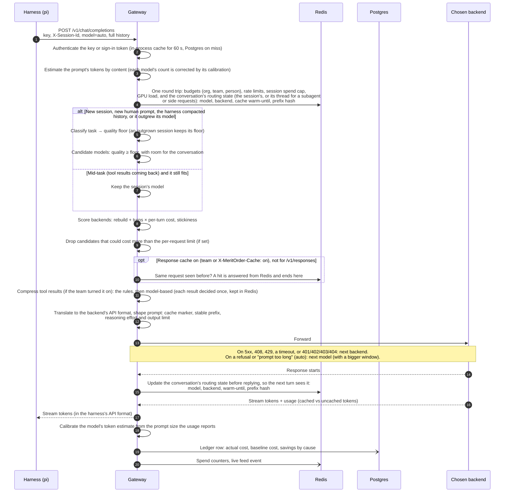
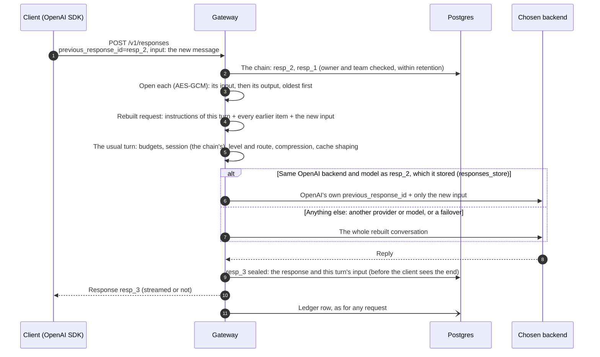
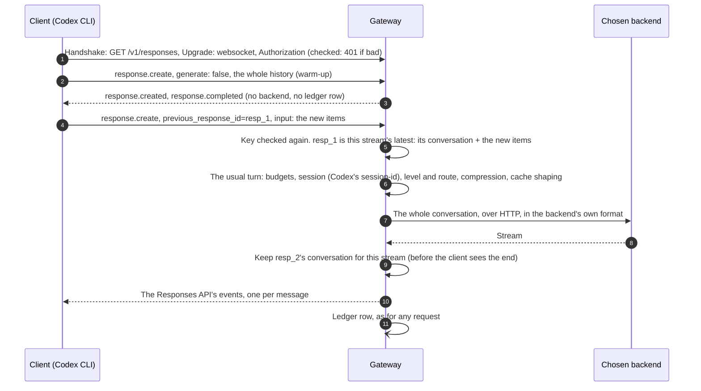
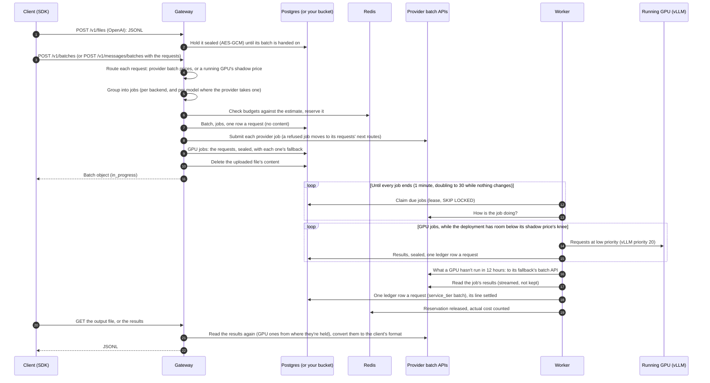
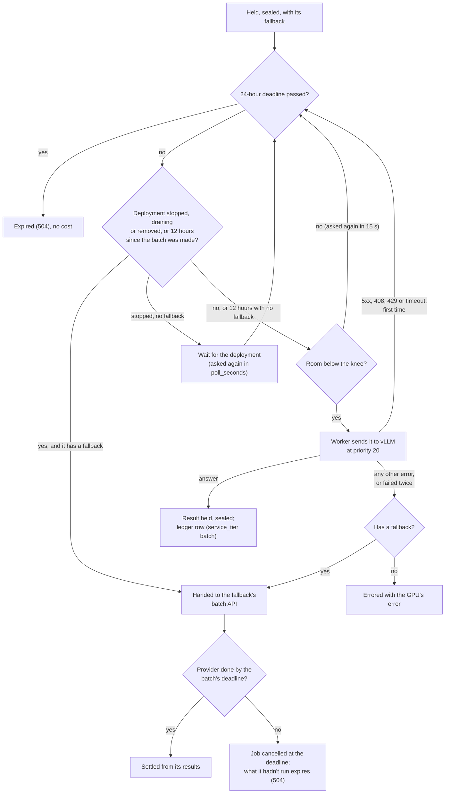
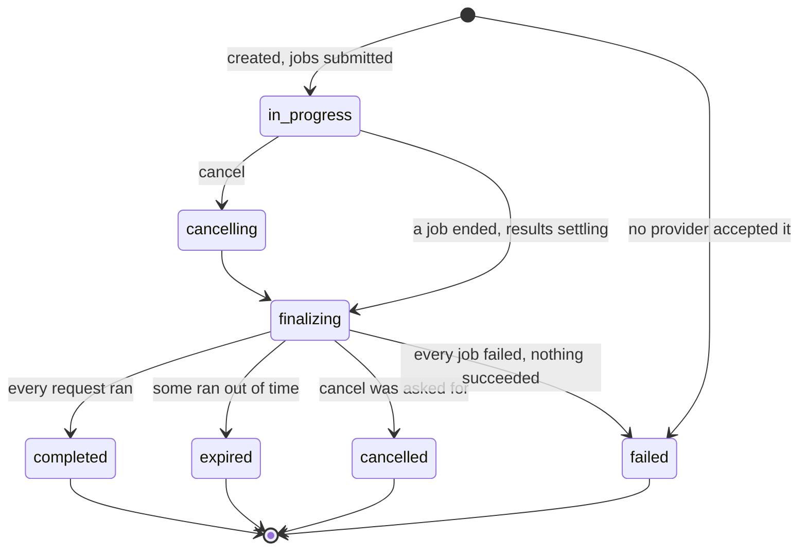

# 02 — Request flow

One turn of a pi session using `model="auto"` (`meritorder setup pi` points pi at the OpenAI Chat Completions API).



## Hot-path budget

The gateway should add **single-digit milliseconds** before the first byte goes upstream.
Everything on the hot path is in-memory or one Redis round trip:

| Step | Where it reads from |
|---|---|
| Key validation | In-process cache (60 s), Postgres on miss |
| Rate limit / budget | Redis counters (a missing spend counter is seeded from the Postgres ledger) |
| Session lookup | Redis, in the same round trip as the counters |
| GPU state and headroom | Published to Redis by the controller; each gateway reloads deployment state every 5 s and reads utilization with the session |
| Token estimate | In-memory: one pass over the request's text (sampled above 256K characters, about 5 ms for 4 MB), corrected per model by this process's calibration |
| Classifier | Rules; only on new sessions and task boundaries |
| Learned router (opt-in) | In-memory, pure Python, at the same points: hashing the ends of the latest prompt and six dot products, about 0.4 ms at the p99 on a long agent prompt. Its row (hashed features, no content) is written with the ledger row, after the response |
| Judged labels (opt-in per team) | At the team's sample rate (1%): a reference to the request's body is held, and the answer kept as text once it's complete. After the response, in the background, the replay on a stronger model and the judging run as requests of their own (the team's internal client, `judged-labels:<team>`); the client never waits. Only the verdict is written ([03](03-routing.md#judged-labels)) |
| Compression | The rules: deterministic and in-memory. Model-based: one Redis round trip for every result's stored decision; a result new on this turn waits for the compressor service at most the team's `deadline_ms` (1,000), then goes as it is |

Writes to Postgres (usage, ledger) are **async** and never block the response.

## What the harness sees

Nothing unusual. Same API it already speaks, streamed tokens, usage numbers. Response headers
tell curious users what happened:

```
x-meritorder-model: qwen3-coder-next          # the model that answered
x-meritorder-backend: gpu-qwen-coder          # where it ran
x-meritorder-floor: coding:3                  # what the classifier decided (auto)
x-meritorder-session: 3f9c…                   # the session it was counted under
x-meritorder-request-id: 6b1e…                # find it in the ledger
x-meritorder-cost-usd: 0.000400               # non-streaming responses: cost,
x-meritorder-baseline-usd: 0.031000           #   what it would have cost without Merit Order,
x-meritorder-savings-usd: 0.030600            #   and the difference
x-meritorder-max-tokens: 128000               # the reply's output allowance,
x-meritorder-max-tokens-source: model         #   and where it came from (client, model, context, …)
x-meritorder-failed-over: openai/gpt-6.1-terra 429   # only when a source failed first
x-meritorder-refused-by: claude-opus          # only when a model refused and another answered
x-meritorder-substituted-for: qwen3-coder     # only when a named model couldn't run (opt-in)
x-meritorder-queued: 1                        # only when it waited in a full GPU deployment's queue
x-meritorder-dropped-tools: web_search        # hosted or server tools this backend went without (Responses, Messages)
```

`x-meritorder-refused-by` and `x-meritorder-failed-over` list every model or source that was tried first, comma
separated. A request refused for a budget or the per-session cap (429) carries `x-meritorder-limit: budget`, so a client
can tell it from a rate limit, which carries `retry-after` instead.

The whole decision, rule by rule, is in [10: How it decides](10-how-it-decides.md).

## A chained Responses API turn (stored mode)

For a team with stored responses on ([04](04-caching-and-sessions.md#stateful-apis), decision 51), a client of
OpenAI's Responses API can send only its new input with `previous_response_id`. **This is where the gateway holds
conversation content**: sealed in Postgres, for the team's retention. The turn is rebuilt into the stateless
request it amounts to before anything else happens, so the pipeline above runs on it unchanged.



The client's input is stored as it sent it, before compression, so the next turn rebuilds the same history and
compression's stored decisions apply to it the same way. A stream is kept just before its `response.completed`
event goes out, since a client may chain the moment it sees it. If keeping it fails, the client still gets the
answer (a non-streamed one says `store: false`) and `meritorder_stored_responses_total{event="failed"}` counts it.
Conversations (`conversation`) work the same way, from the conversation's items, and add the turn's input and output
to it. `background: true` keeps the response as `queued` and answers at once; the same steps run in that gateway,
and the client polls `GET /v1/responses/{id}`.

| What | Where | Until |
|---|---|---|
| Each stored response: the object as the client got it, and the input sent with it | Postgres (`stored_responses`), sealed with `MERITORDER_RESPONSES_KEY` | `retention_days` after the chain's last turn, or the response, its owner, or their team's stored mode is deleted |
| Each conversation's metadata and items | Postgres (`stored_conversations`, `conversation_items`), each sealed | `retention_days` after it last changed, or it or its owner is deleted |
| Owner, chain, status, where it ran, the provider's response id, item ids, sizes | the same rows, in the clear | with them |
| A provider's copy (backends with `responses_store` only) | the provider (OpenAI: at least 30 days) | deleted there when the gateway deletes its own |

## A Responses API turn over WebSocket

Codex CLI keeps one WebSocket open to `/v1/responses` ([04](04-caching-and-sessions.md#the-websocket-transport),
decision 54) and, from its second turn, sends only the new items with `previous_response_id`. Without stored mode the
gateway holds the conversation for the connection only, in memory, and each turn becomes the stateless request it
amounts to, so the pipeline above runs on it unchanged.



A `previous_response_id` that isn't this stream's latest gets `previous_response_not_found`, and Codex sends
everything. In stored mode a stored response chains as in the section above, from any connection. Closing the
connection drops what it held and stops a running turn (ledger status 499).

## Responses API tools on any backend

A Responses API turn becomes a Chat Completions request inside the gateway, and from there goes to any backend. Plain
function tools carry over as they are. The other kinds, which Codex CLI sends, are translated both ways
(`formats/responses_tools.py`, decision 57), as OpenAI's Responses reference and Codex CLI's source (`codex-rs`, 15
November 2026) define them:

| Responses tool | On a Chat Completions or Claude backend | The model's call comes back as |
|---|---|---|
| `custom` (freeform), e.g. `apply_patch` with its Lark grammar | A function tool with one string argument, `input`. The description says to put the raw text there, and carries the grammar | `custom_tool_call` with the raw `input`, streamed as `response.custom_tool_call_input.delta` and `.done` |
| `namespace` (Codex's `collaboration`, MCP servers) | One function tool per tool inside, named `namespace__name` (`mcp__github__create_issue` for a namespace ending in `_`), the namespace's description first | `function_call` with its `namespace` and own name |
| `tool_search` with `execution: "client"` | A function tool with the same parameters; the tools a search finds join the request's tools from then on | `tool_search_call` with its `arguments` |
| `local_shell` | A function tool taking the exec action (`command`, `timeout_ms`, `working_directory`, `env`, `user`) | `local_shell_call` with that `action` |
| `additional_tools` input items (Codex's "Responses lite" mode) | Tools, merged with `tools`; a later definition replaces an earlier one | as above |
| Hosted: `web_search`, `image_generation`, `file_search`, ... | Claude (not on Bedrock) gets live web search as its own server tool (`web_search_20250305`, with the allowed domains and the user's location). Everything else is left out, named in `x-meritorder-dropped-tools` and logged: Codex's default search, cached-only (`external_web_access: false`), among them | Claude's search runs inside its reply; the answer comes back as text |

History converts the same way: `custom_tool_call`, `local_shell_call` and `tool_search_call` items become the assistant's
tool calls, with their arguments written as compact JSON, and their outputs become tool messages. The same input gives
the same bytes on every turn, so the prompt cache reads the conversation's prefix. A tool output's images (Codex's
`view_image`) can't go in a Chat Completions tool message, so they follow the turn's tool results as a user message;
Claude wants its tool results first in a turn, so that order suits both. A backend with `api: responses` gets the
tools and the items as the client sent them, `additional_tools` merged into `tools`, since the public API takes tools
there. Over WebSocket a turn has no response headers: the log line is all that says a tool was left out.

## Translating between API formats

When the client and the backend speak the same API, the request passes through untouched. When they don't,
`formats/translate.py` (Chat Completions and Anthropic Messages), `formats/responses.py` (the Responses API, on top of
Chat Completions) and `formats/responses_upstream.py` (Chat Completions to a backend with `api: responses`) convert
the request and the reply. The tests check each direction against the official `openai` and `anthropic` Python SDKs:
the streams accumulate in the SDKs' own stream handlers and the objects validate as the SDKs' types
(`tests/test_api_fidelity.py`). Followed: Anthropic's Messages, PDF support, tool use, thinking and preserved
thinking docs, and OpenAI's Chat Completions and Responses references, November 2026.

Nothing the request carries is dropped without a word: content goes across in the other API's own form, or the request
is refused with a 400 that says why.

| Content | Anthropic client, OpenAI-format backend | OpenAI client, Claude backend |
|---|---|---|
| PDF | A `document` (base64 or URL) becomes a `file` part. A base64 PDF goes as a `data:application/pdf` URL in `file_data`; a URL goes as the URL in `file_data`, which OpenRouter fetches (OpenAI's own API takes only base64 or an uploaded file, and says so with its own 400) | A `file` part becomes a `document`: a PDF data URL as base64, a URL as a URL source, base64 PDF without a data URL when the filename ends in `.pdf`, and a plain-text file as a text document. `filename` becomes the document's `title` |
| A file the other provider can't open | A `document` or `image` from Anthropic's Files API (`source.type: file`): 400 | A `file_id` (a file uploaded to OpenAI), or a file that isn't a PDF or text: 400 |
| Responses `input_file` | | Becomes a `file` part (`file_url` goes as `file_data`), so it reaches Claude as a document; a backend with `api: responses` gets it back as `input_file`, with `file_url` again |
| Images in a tool result | A tool message takes text only: the images and documents follow the run of tool messages as a user message ("Images returned by tool call …"), and the tool message says they follow. The same as a Responses tool output's images ([above](#responses-api-tools-on-any-backend)) | Images in a tool message's parts become image blocks in the `tool_result` |
| System prompt in blocks | Joined with a blank line between blocks, so sections don't run together. On Claude through OpenRouter, blocks with a `cache_control` marker stay separate parts and keep the marker | Text blocks, as they are |
| `cache_control` on a block | Kept on the part it was on, with the client's lifetime, on Claude through OpenRouter (which reads part-level markers); the gateway then adds no marker of its own. Left out elsewhere, where it would be an unknown field | Kept on text parts |
| Server tools (web search, bash, code execution…) | Only Claude runs them: left out, named in `x-meritorder-dropped-tools` and logged | |
| Forced tool choice | `any` becomes `"required"`, a named tool becomes that function; `disable_parallel_tool_use` becomes `parallel_tool_calls: false` | `"required"` becomes `{"type": "any"}` and a named function `{"type": "tool", "name": …}`, with `parallel_tool_calls: false` as `disable_parallel_tool_use`. Claude Opus 5.5, Sonnet 5.5, Fable 5.1 and 5.2 and Mythos 5.1 and 5.2 refuse a forced choice on every request, as does any model with manual (`enabled`) thinking (`FORCED_TOOLS_REFUSED`). There the choice becomes `auto`, and a line at the end of the system prompt says to call that tool (or one of the tools), which is what Anthropic suggests for those models. The others, Opus 5 and Haiku 5.5 among them, take the forced choice and answer it without thinking first |
| Thinking | Dropped: no Chat Completions field carries a signed thinking block back | |

Replies:

| | Claude backend, OpenAI client | OpenAI-format backend, Anthropic client | Chat backend, Responses client |
|---|---|---|---|
| Stop reason | `refusal` becomes `content_filter`, `tool_use` becomes `tool_calls` | `tool_use` whenever the reply called tools, also when the provider ended it with `stop` (Gemini's OpenAI endpoint and some vLLM parsers do). A `refusal` becomes text with `stop_reason: refusal` | `content_filter` and `length` end the response `incomplete` (`content_filter`, `max_output_tokens`) |
| Refusal | | | A refusal becomes a `refusal` content part, streamed as `response.refusal.delta` and `.done`. A `content_filter` stop with nothing said gets a refusal part saying the provider's filter stopped the response |
| Usage | Claude's `output_tokens_details.thinking_tokens` becomes `completion_tokens_details.reasoning_tokens` | | `input_tokens_details` has `cached_tokens` and `cache_write_tokens`; `output_tokens_details.reasoning_tokens` is the provider's count |
| An error in the stream | The error chunk, then `[DONE]`: no finish chunk after it | The `error` event ends the stream: no `message_delta` or `message_stop` after it | `error`, then `response.failed` with the error; no `response.completed` |

Either way the ledger records the failure (status 400 or more), and a stream that broke off is costed as in
[08](08-reporting.md#estimated-rows).

**Claude across platforms.** Failover can move a session between Anthropic's API, Bedrock and Vertex AI, which all take
the same Messages API. The gateway sends thinking blocks back as they came, signatures included, wherever the turn
goes: signatures work across platforms, a block the new platform's account or model can't read is dropped by the API
for that request without an error and isn't billed, and removing blocks yourself would lose that reasoning for good and
can break preserved thinking's prefix check. Blocks from Claude Sonnet 5.5, Haiku 5.5, Fable 5.2 and Mythos 5.2 work only
in the account that made them (on Bedrock the AWS account, on Vertex the Google Cloud project), so after such a move the
model answers without them. The automatic cache marker (a top-level `cache_control`) is accepted on all three; only
Bedrock's legacy `bedrock-runtime` integration rejects it for Opus 4.6 and earlier, and the gateway calls Bedrock's
Messages API endpoint (`bedrock-mantle`), not that one.

`/v1/messages/count_tokens` refuses a model that isn't configured with a 404, as `/v1/messages` does; `auto` (or no model)
counts for the models the team can use.

OCR (`/v1/ocr`, Mistral's OCR API or a multipart upload) is routed like embeddings and priced per page:
[03, Routing](03-routing.md#ocr).

## Batches: work that can wait

Every provider here charges less for requests that can wait up to 24 hours (about half): summarizing a backlog, labelling a
dataset, nightly evals. A GPU deployment that's already running does them for almost nothing while it has room. Clients
send them the way they would to the provider, and Merit Order routes each request on its own, splits the batch across
providers and GPUs, and joins the results back.

| Client | Endpoints |
|---|---|
| OpenAI SDK (Batch API) | `POST /v1/files` (purpose `batch`, JSONL), `GET /v1/files`, `GET /v1/files/{id}`, `GET /v1/files/{id}/content`, `DELETE /v1/files/{id}`; `POST /v1/batches`, `GET /v1/batches`, `GET /v1/batches/{id}`, `POST /v1/batches/{id}/cancel`. Lines may call `/v1/chat/completions`, `/v1/responses` or `/v1/embeddings` |
| Anthropic SDK (Message Batches) | `POST /v1/messages/batches`, `GET /v1/messages/batches`, `GET /v1/messages/batches/{id}`, `POST .../{id}/cancel`, `GET .../{id}/results`, `DELETE .../{id}` |
| CLI | `meritorder batch submit FILE [--endpoint URL] [--watch]`, `watch ID`, `list [--limit N]`, `results ID [--out FILE] [--errors-only]`, `cancel ID`, `storage` (admins) |

Both SDKs work unchanged (the tests drive them). Batch objects carry an extra `meritorder` field: the estimated cost,
what's still reserved, what the results cost and saved (the batch discount, and what GPUs took off the batch price), and
how many requests went to each provider or GPU; the create call's response also has `x-meritorder-estimated-cost-usd`.
Each line can name a model or use `auto`. `X-Route-Floor`, `X-Route-Hint` and `X-MeritOrder-Tags` on the create call
apply to every line.



### Routing a batch

Each request is routed like a live one, with these differences: only routes whose backend has a batch API qualify, and
running GPU deployments with room; provider routes are priced at batch prices for that one request (the prompt at the batch
input price, plus its `max_tokens`, or the router's usual reply size when it sets none), and GPU routes at their shadow
price for their load now; there's no session to keep warm; and speed doesn't count, since nobody is waiting. So a named
model goes to its cheapest route, and `auto` gives the request its level, takes the models at that level the team may use,
and picks the cheapest of their routes. Team policies (`allowed_models`, `allowed_backends`), the per-request cost limit
(at batch prices) and cost per success apply as they do live. Rate limits and the per-session spend cap don't: they're for
live load, and a batch isn't a session. Merit Order adds no cache markers to batch requests (there's no next turn to read
them); the client's own are passed on. With the learned router on, a batch request is leveled as a new live task is (the
learned level in route mode, when it's sure), but it records nothing for the router to learn from: no retry, raised floor
or stopped stream can follow it ([03](03-routing.md#batches)).

A request that nothing allows is refused on its own, with the reason in the batch's error file (or as an `errored` result),
and the rest go ahead; a batch where no request can go is refused outright. Refused requests never reached a provider, so,
like a live refusal, they aren't in the ledger. Requests then go into jobs: one per backend, and per model where the
provider takes one model a job (OpenAI, Azure, Moonshot, Mistral, OpenRouter, Gemini, Bedrock, Vertex AI), split within
each provider's limits. A group smaller than a provider's minimum (Bedrock's 100 records) moves to its requests' next
routes. A job a provider refuses moves to its requests' next routes once; what still can't go is refused with every
route's reason.

| Backend | Batch API | One job holds | Takes embeddings | Off the standard price | Needs |
|---|---|---|---|---|---|
| `api.anthropic.com` | Message Batches | up to 100,000 requests or 256 MB, any models | no | half | nothing more |
| `api.openai.com` | Batch API (Files, then Batches; Responses API lines for a backend with `api: responses`) | one model, 50,000 requests, 200 MB | yes | half | nothing more |
| `*.openai.azure.com` | Azure OpenAI global or data-zone batch on the v1 API (`/openai/v1/files`, `/openai/v1/batches`) | one deployment, 100,000 requests, 200 MB | no (Azure lists no embedding model for its batch deployments) | half | a Global-Batch or Data-Zone-Batch deployment, named in the route's `batch_model` |
| `api.mistral.ai` | Batch jobs: a JSONL file through its Files API, then `/v1/batch/jobs` | one model, 1,000,000 requests, 512 MB | yes | half | nothing more |
| `api.moonshot.ai` (Kimi) | OpenAI's calls, with a `1d` window | one model, 100 MB | no | 40% | nothing more (it refuses `temperature`, `top_p`, `n` and the penalties in a batch, so they're left out) |
| `api.x.ai` | Its own: a named batch, requests added in pieces of 500, results read in pages | any models | no | 20%, for the Grok models it lists | for others, a `price.batch` on the route (xAI charges them the standard price) |
| `openrouter.ai` | Its own: the requests inline, the results on the batch once it's done | one model, 200 MB | yes | about half | a model with a batch variant (others are refused, and their requests move to their next route) |
| The Gemini API (`api: gemini`) | Batch mode: a JSONL file through the Files API, then `models/{model}:batchGenerateContent`, or for embeddings `models/{model}:asyncBatchEmbedContent` (one Gemini request per input, joined back into one reply per request) | one model, 2 GB | yes | half | nothing more |
| Bedrock | Batch inference (`CreateModelInvocationJob`) with Claude's InvokeModel bodies | one model, 100 to 100,000 records, 1 GB | no | half | `batch.bucket: s3://...`, `batch.role_arn` (a role Bedrock assumes to read and write it), AWS credentials (SigV4), and the route's `batch_model` where batch inference takes another model id |
| Vertex AI (Claude, or Gemini with `api: gemini`) | Batch prediction (`batchPredictionJobs`) | one model, 200,000 requests, 1 GB | no | half | `batch.bucket: gs://...`; Claude runs in a region (`batch.region`; `us-central1` for a global backend) |
| A self-hosted GPU deployment (vLLM) | The gateway's own: the worker runs the requests in the deployment's headroom ([below](#batch-work-on-your-gpus)) | any number | no | its shadow price (2% of the route's price below the knee) | running (warm), `max_concurrency` set, and `MERITORDER_BATCH_KEY` (the requests are held sealed until they run) |
| Mock backends | In-process; answers at once (for trying batches with no keys) | anything | yes | half | nothing |

`batch.max_requests`, `max_bytes` and `min_requests` on a backend override these, for a quota that differs; `batch.discount`
changes the discount when the price list has no batch price. DeepSeek, Z.ai, MiniMax and Foundry's Claude have no batch API
(DeepSeek's off-peak hours are a lower live price, not a batch API), so their routes are skipped for batches; the console's
error for a model with none says why for each route.

### Batch work on your GPUs

A GPU deployment that's running is paid for by the hour, whatever it does, so a request that can wait costs it almost
nothing while it has room ([05](05-gpu-autoscaling.md), [10](10-how-it-decides.md#which-backend-gpu-or-api)). The router
prices a batch request on a running deployment at its shadow price for its load now: 2% of the GPU route's price (its
API-equivalent rate) while it's below the knee (`routing.shadow_knee`, 60%), rising toward the full price as it fills.
Against the providers' batch prices (about half), a GPU with room wins, for the model the request names, or for `auto` a
model at or above its level (a free upgrade, as live). A deployment that's full, draining, stopped or still starting
isn't a route. The request's next route with a provider batch API is kept as its fallback, shaped for that provider at
once, so the worker can hand it on without routing it again (Bedrock isn't a fallback: its jobs need 100 requests).

The requests can't wait at a provider, so the gateway holds them, sealed ([below](#what-the-gateway-holds-and-for-how-long)),
and the worker runs them, a slice of a minute at a time while it holds the job's lease:

- **Only in the headroom.** Batch requests fill a deployment up to the knee of `max_concurrency` × replicas, never past it,
  counting the gateways' live requests there and other workers' batch requests (each published to Redis every couple of
  seconds), and none while vLLM's own load, less the batch work it's running, is at the knee. So batch work never makes
  live traffic pay more than the shadow price's floor. Live routing doesn't count batch requests as load: they give way.
  A deployment without `max_concurrency` takes no batch work, since its free slots can't be counted.
- **Live traffic first.** Each request goes to vLLM with `priority: 20` (`batches.gpu.priority`; lower runs first), after
  free upgrades (10) and live requests (0). vLLM's priority scheduler preempts batch requests when live ones need the room.
- **Before the deadline.** What hasn't run 12 hours after the batch was made (`batches.gpu.handoff_hours`) goes to its
  fallback's batch API (providers finish most batches in minutes to a few hours). So does everything still waiting when
  the deployment stops, starts draining or leaves the configuration, and a request the GPU refuses (a 4xx) or fails twice.
  A request with no fallback (a model only on your GPUs) waits for the GPU until the batch's deadline, then expires; one
  the GPU can't run fails with the GPU's error.
- **The client's deadline holds.** A provider gives the handed-on job a fresh 24-hour window, which would end after the
  client's. So the worker checks a handed-on job again at the batch's deadline at the latest, cancels it there if it's
  still running, and what the provider hadn't run comes back expired (504), as from a provider whose window closed; what
  it ran is kept and billed. For that, a GPU's fallback is always a batch API the gateway can cancel: OpenRouter's has no
  cancel, so it's never one (the next route with a batch API is used, or none). Past the deadline nothing is handed on:
  what's still waiting for the GPU expires.
- **No GPU starts for it.** Batch work doesn't count toward starting or keeping a deployment: the break-even controller
  sizes GPUs on live demand only, and batch work only uses what that pays for (decision 49).

One request held for a GPU, slice by slice (`batches/gpu.py`):



Each request settles as soon as it's run: its result is held, then its ledger row is written (`service_tier: batch`, backend
the GPU), priced as live GPU work is, by the GPU time its tokens took at the deployment's hourly price. Its savings split
in two: the batch discount, what a provider's batch API would have taken off the model's API price (the fallback's batch
price, else the usual half), and self-hosting, what the GPU took off that batch price (negative if the GPU time cost more).
What's reserved against budgets is the fallback's estimate, since the request may end up there. The batch object's
`meritorder.providers` counts requests where they are now, so a handed-on request moves from the GPU to its provider.

### Prices and spend

A route's batch price is the live price list's (LiteLLM's `*_batches` prices, cache prices included where listed), else the
standard price less the provider's published batch discount (the table above; `batch.discount` changes it), or a
`price.batch` written on the route for a negotiated rate. Long-prompt tiers move with the input price.

- **Reserved when submitted.** The batch's estimated cost must fit every budget it counts against (organization, team,
  person), counting what's already spent and what running batches have reserved. A batch that doesn't fit is refused with
  429, saying which budget and what's left. The estimate is then added to the month's spend counters, so live requests and
  other batches see it. A counter seeded from the ledger adds what running batches have reserved.
- **Settled from the results.** The worker writes one ledger row per request when its job ends (`service_tier: batch`,
  `batch_id`), priced at the batch price the job was submitted at, and moves that request's estimate off the reservation.
  The row is stamped when it's written, so a job settled late (its results couldn't be read for a while) lands in the
  month whose spend counters count it, and in the hours the rollups look at again. GPU requests settle one by one, as they
  run. Failed, cancelled and expired requests get a row with their status (499 cancelled, 504 expired, else the
  provider's) and no cost. What's left of a reservation is released when the batch ends.
- **Savings.** The batch discount is its own cause (`savings_batch`): the served model at its live API price less the same
  tokens at its batch price. Routing savings are counted against live prices, as for any request, so the discount never
  shows up as routing. A client using a provider's batch API directly would get the same discount, which is why it's kept
  apart. On a GPU, what the GPU took off the batch price is self-hosting's (`savings_self_hosting`), as for live GPU work.

### What the gateway holds, and for how long

| What | Where | Until |
|---|---|---|
| An OpenAI-style upload (the JSONL) | Postgres (`batch_file_chunks`), or with `batches.storage.bucket` one object in your bucket; AES-GCM in 4 MB pieces, keyed by `MERITORDER_BATCH_KEY` | its batch is handed on; or `batches.retention_days` (7) if no batch uses it |
| Anthropic-style requests to providers | nowhere: they go from the request straight to the providers | |
| Requests for a GPU, with each one's fallback | Postgres (`batch_blobs`) or your bucket (`held/`), sealed the same way, in pieces of 500 | the request runs on the GPU or is handed to a provider |
| Results of GPU requests | the same place, sealed | `batches.retention_days` after the batch ends |
| Each request's routing: its custom_id, model, backend, level and why, estimated cost, how it ended | Postgres (`batch_lines`), never content | as long as the batch's record |
| Results from providers | at the providers (their output files and results), or in the backend's bucket (Bedrock, Vertex AI) | `batches.retention_days` after the batch ends; then the worker deletes them there (OpenAI's files are also set to expire then; Azure's no sooner than its 14-day minimum; xAI has no delete, so its results stay under xAI's own retention) |
| Results on their way to a client, or into the ledger | streamed through, line by line | not kept |

Without `MERITORDER_BATCH_KEY` a gateway on Postgres refuses uploads (503, saying why) and sends no batch work to GPUs (it
goes to the providers); Anthropic-style batches to providers need no key. An in-memory gateway (development) uses a random
key for the life of the process. Deleting an OpenAI batch's output or error file, or an Anthropic batch
(`DELETE /v1/messages/batches/{id}`), deletes its results at the providers (and what's held for its GPU work) at once.
Results a provider no longer has (Gemini's files last 48 hours) come back as errors saying so. A batch belongs to the
person who made it: others get 404; admins can see and cancel it, but not read or delete its results.

**In your bucket.** `batches.storage.bucket` holds uploads and GPU work in an S3 bucket, a Cloud Storage bucket or an Azure
Blob Storage container instead of Postgres, sealed all the same: large uploads stay out of the database, and the bucket's
own retention and encryption rules apply on top. Requests are signed with the credentials the backends use: those of the
backend `batches.storage.backend` names, else of the first enabled backend that signs in to that cloud (`aws_sigv4`,
`google`, `azure_ad`), else that cloud's default credentials (the AWS chain, Application Default Credentials, Entra ID's
for `https://storage.azure.com/.default`). A file uploaded before the setting changed is read from where it was put, as
long as that's still the storage bucket (or Postgres); the console says how many are held elsewhere.

**Rotating the key while uploads wait.** Every sealed piece names the key that sealed it (an 8-byte id derived from the key,
not the key). To rotate, set the new key in `MERITORDER_BATCH_KEY` and the old one in `MERITORDER_BATCH_KEY_PREVIOUS`
(or `batches.previous_key_file`) on every gateway and worker. New content is sealed with the new key; what the old one
sealed stays readable for `batches.key_grace_days` from when a gateway or worker first used the new key (recorded in the
store, so all count from the same moment). The default is the retention period plus two days, the longest anything sealed
before the rotation is kept (a batch's window, a fallback provider's, then retention), so nothing is lost if the old key
is simply left set that long. After that the old key isn't read: content still sealed with it says so. Reports → Batches
and `meritorder batch storage` show the key ids, until when the old one is read, and how many uploads still need it.
Content from before key ids existed is tried with each key.

### The worker

Jobs are claimed from Postgres with a lease per job (`FOR UPDATE SKIP LOCKED`, as eval runs are), so several workers share
them, and one that dies mid-job hands it on when its lease runs out (15 minutes). The first check comes
`batches.poll_seconds` (60) after a job is submitted, and the wait doubles while nothing changes, up to `max_poll_seconds`
(1,800). Provider errors back off the same way, honoring `Retry-After`, and alert after five in a row. A job the provider no
longer knows (404) fails its requests at no cost. The gateway gives a provider 20 minutes to take a job (counted from
when it starts sending it, not while it waits its turn), then counts it as refused. A job still "submitting" 30 minutes
after that start (the gateway stopped before the provider answered) fails too, and a provider job it may have made isn't
tracked. Settling reads the results once, in chunks of 500, each in one transaction with its ledger rows, so a restart
picks up where it stopped. A GPU job is worked on a slice at a time and asked again within seconds while it has requests
and the deployment has room (15 seconds when it has none); the worker follows the GPUs' state as the gateways do, from
what the controller publishes. Without Postgres
there's no worker, and the gateway checks on its own batches every 15 seconds.

**Metrics.** The worker counts each request it settles in Prometheus counters of its own, `meritorder_batch_requests_total`
(by model, backend, the API that ran it, and status), `meritorder_batch_tokens_total`, `meritorder_batch_cost_usd_total`,
`meritorder_batch_baseline_usd_total` and `meritorder_batch_savings_usd_total` (by cause), plus
`meritorder_batch_gpu_requests_total`, `meritorder_batch_handoffs_total` and `meritorder_batch_poll_errors_total`, served on
`MERITORDER_WORKER_METRICS_PORT` (`meritorder worker --metrics-port`; 9464 in Compose and the Helm chart) at `/metrics`,
behind `MERITORDER_METRICS_TOKEN` when it's set. Nothing is counted twice: a request is counted only by the call that
settles it (the database marks it settled in the same transaction), and only in the batch counters, never in the
gateways' live ones, so adding the two gives all spend ([08](08-reporting.md#prometheus-and-grafana)). Without Postgres the gateway
settles its own batches and serves the same counters on its `/metrics`.

Batch statuses, in OpenAI's words: `in_progress`, `cancelling`, `finalizing` (the providers are done; results are being
settled), `completed`, `cancelled` (what ran before it stopped is kept and billed), `expired` (a provider, or a GPU for a
request with no other route, didn't run everything in its window; what ran is kept and billed) and `failed` (no provider
accepted it). Anthropic's `processing_status` is `in_progress`, `canceling` or `ended`. OpenRouter has no cancel: a
cancelled batch there runs to its end, and what ran is billed.



Inside, a batch is `in_progress`, `finalizing` or `ended` with an outcome (`batches/poller.py`); the OpenAI and
Anthropic objects are made from that. A batch whose jobs all end with nothing left to settle goes straight to its outcome.

### Configuration

```yaml
batches:
  retention_days: 7               # then results at the providers, in buckets and held for GPUs are deleted, and unused uploads
  key_env: MERITORDER_BATCH_KEY   # seals uploads and GPU work while they're held (or key_file)
  previous_key_env: MERITORDER_BATCH_KEY_PREVIOUS   # after a rotation, read for key_grace_days (or previous_key_file)
  key_grace_days: 9               # default: retention_days + 2
  poll_seconds: 60                # the first check; the wait doubles while nothing changes
  max_poll_seconds: 1800
  storage:                        # leave out to hold uploads and GPU work in Postgres
    bucket: s3://my-bucket/meritorder   # or gs://..., or https://<account>.blob.core.windows.net/<container>/<prefix>
    backend: bedrock              # whose credentials sign its requests; region: for S3 (default: that backend's)
  gpu:
    enabled: true                 # running GPU deployments with max_concurrency take batch work in their headroom
    handoff_hours: 12             # then what hasn't run goes to its fallback provider's batch API
    priority: 20                  # vLLM priority for batch requests (lower runs first)
backends:
  bedrock:
    batch: {bucket: s3://my-bucket/meritorder, role_arn: arn:aws:iam::123456789012:role/bedrock-batch}
  vertex:
    batch: {bucket: gs://my-bucket/meritorder, region: us-east5}
models:
  gpt-terra:
    routes:
      - {backend: azure-openai, model: terra-prod, batch_model: terra-batch}   # its Global-Batch deployment
```

`batch: {enabled: false}` takes a backend out of batches (a GPU deployment too); `batch.api` names its batch API where the
address doesn't say. Reports → Batches lists every batch with its status, counts, where its requests went (GPUs marked),
estimated and actual cost and savings (admins can cancel there), and for admins where content is held and the key's state;
the ledger and every report include batch rows, and Reports → Bills matches the providers' batch-tier lines.

### Written from the providers' references, November 2026

Every provider call is tested against fakes shaped like the providers' API references as read on 13 November 2026: Anthropic
Message Batches (`anthropic-version` as the backend sets it, else `2023-06-01`), OpenAI's v1 Batch and Files APIs, Azure
OpenAI's v1 API, Moonshot's batch guide (platform.kimi.ai), Mistral's batch API (and its Python SDK 3.7.0 for what the
reference leaves out), xAI's batch API reference, OpenRouter's batch API guide, the Gemini API v1beta (batch mode and
`asyncBatchEmbedContent`; the Python SDK 3.3.0 still calls batch embeddings experimental), Bedrock's batch inference API,
Vertex AI v1, and the S3, Cloud Storage JSON v1 and Azure Blob Storage REST APIs (`x-ms-version` 2025-11-05). These still
need checking with real accounts:

- Anthropic: the content type of the results download (the SDK asks for `application/binary`).
- OpenAI: whether cancelled requests come back in the error file as `batch_cancelled` (only expired ones are documented),
  and the exact shape of a request that failed with 4xx or 5xx (both shapes are read).
- Azure: the batch's `endpoint` spelling on the v1 API (`/chat/completions` is sent; lines call `/v1/chat/completions`),
  the dotted `expires_after.*` form fields, Responses API lines, and its timestamps (some examples show ISO strings).
- Moonshot: whether `24h` is accepted as well as `1d` (`1d` is sent), the per-file request limit (none is published), and
  how files are deleted (OpenAI's `DELETE /v1/files/{id}` is sent).
- Mistral: the shape of a failed line in its error file (OpenAI's is read), and `DELETE /v1/batch/jobs/{id}`, which is in
  its SDK but not its reference (a 404 or 405 is fine).
- xAI: which models are discounted (20% is assumed for every route without a listed batch price), and whether a batch
  with requests still pending after its `expire_time` reports them as cancelled.
- OpenRouter: whether a batch variant is named by the plain model id (it's sent as the route's model, or `batch_model`),
  and the error type of an expired request.
- Gemini API: whether output lines echo `key`, the shape of an error line, how long output files last, and for
  embeddings which token count a line carries (`usageMetadata.promptTokenCount` or `tokenCount`; either is read, else 0).
- Bedrock: the S3 layout of the outputs (the gateway lists the job's folder), the `recordId` rules, and whether
  `bedrock-mantle` model ids are what batch inference takes (else set `batch_model`).
- Vertex AI: Claude's output line format, and whether a Gemini request's `labels` (where the key rides) are echoed.
- GPUs: that a vLLM server preempts `priority: 20` requests for live ones as its priority scheduler documents
  (`--scheduling-policy priority`, which Merit Order's provisioners set; a static server without it refuses the field,
  and its batch requests go to their fallbacks).
- Buckets: Azure's `x-ms-date` with an Entra token, and S3 regions other than the backend's (set `batches.storage.region`).

Looked at and not built: Bedrock's OpenAI-compatible batch API (on `bedrock-runtime`, for OpenAI's gpt-oss models only,
which no Bedrock route here serves, with the same S3 input as batch inference); Vertex AI has no OpenAI-compatible batch
endpoint (its batch prediction for open models takes OpenAI-format input lines, but its output format isn't documented);
Azure's embeddings batches (its docs list no embedding model for batch deployments); Z.ai (its international API has no
batch API; Zhipu's BigModel in China has one, at a different address), DeepSeek and MiniMax (none).

**Not built:** embeddings batch work on self-hosted GPUs; re-sealing held content with a new key (the grace period
covers everything sealed before a rotation instead); Gemini batch embeddings on Vertex AI.
