# 03 — Routing

The router (`src/meritorder/router.py`) answers: **which model, on which backend, for this request?** (Every rule
and default, as diagrams: [10, How it decides](10-how-it-decides.md).)
What it minimizes is a choice (`routing.model_choice`, per team too):

| Choice | Minimizes | Counts a failure as |
|---|---|---|
| `threshold` | **Marginal cost**: what this request and the rest of its session add to the bill now, among models whose score meets the task's level | nothing: every model at the level is taken as good enough |
| `cost_per_success` | The expected cost per solved task | its tokens, then the work redone on the threshold's pick ([below](#cost-per-solved-task-opt-in)) |
| `expected_cost` (the default) | **The expected total cost to finish the task** | the person's time the request puts at stake (`human_cost_usd` for level-5 work, a third as much for each level below, less for small requests), and the next attempt: the same model again or a stronger one from a cold cache, its chance lower after a failure; inside a task, opt-in, escalation when the evidence says so ([below](#expected-total-cost-to-finish-the-task)) |

All three keep the same floors, team policy, budgets and a client's `X-Route-Floor`, and the same marginal cost of each
route (cache rebuild included) is what a try costs.

## Decision flow

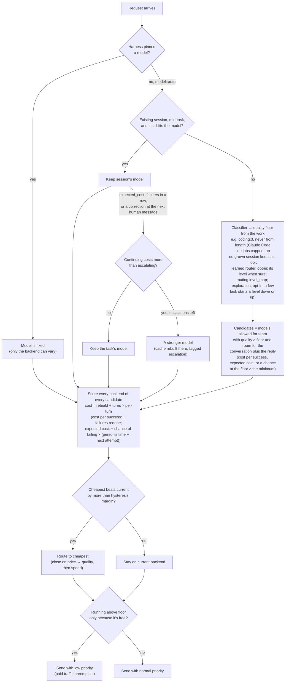

## The quality floor

The classifier (`classifier.py`) gives each `auto` request a floor, a task type and a level from 1 to 5,
from the work it asks for: the wording of the last two messages from the person (a user message made only of tool
results, as in an Anthropic-format agent loop, is passed over), the tools it sends, and
the client's `X-Route-Floor` or `X-Route-Hint`. The rules are `routing.levels` (defaults below), shown to
everyone under Reports → Levels and edited under Config → Routing → How requests get a level.

**Tools say the work is coding; the task's wording sets the level** (decision 61). Claude Code and Codex send
dozens of tools on every request, whether the task is a typo or a redesign, so a tool count says which client sent it,
not how hard the task is. Until decision 61, five tools or more made a request level 4; every coding agent's task
landed at 4 or 5, and the cheaper models never got the tests, renames and docstrings that make up much of an agent's
day. `agent_by_tools: true` brings that rule back for a team that wants it.

| Rule | Setting (default) | Floor |
|---|---|---|
| Plain text | `general` (2) | `general:2` |
| …and the whole request under `short_tokens` (400), no tools | `short` (1) | `general:1` |
| …with analysis wording | `analysis` (3), `analysis_words` | `general:3` |
| Any tools, or code-like text | `coding` (3), `coding_words` | `coding:3` |
| …and simple wording, nothing harder: tests, renames, typos, formatting and lint, docstrings and comments, "explain", version bumps | `simple` (2), `simple_words` | `coding:2` |
| …and hard wording: race conditions, deadlocks, concurrency, security, migrations, performance, multi-file or cross-cutting changes ("every caller", "behind an interface"), and symptoms of a cause not yet found ("under load", "at random", "on retry", "when two requests…", flaky) | `hard_raise` (1) for each distinct pattern, up to `hard_signals` (2); `hard_words` | +1 or +2, at most 5 |
| …and the hardest wording: architecture, "design a/the", system design, proofs, large-scale or codebase-wide refactors | `hardest` (5), `hardest_words` | `coding:5` |
| …and the newest prompt says the last answer was wrong ("that's wrong", "still not working", "revert", …) | `correction_raise` (1) | +1, at most 5 |
| …with at least `agent_tools` (5) tools, only with `agent_by_tools: true` | `agent` (4) | `coding:4`, and simple wording doesn't lower it |
| `X-Route-Hint: cheap` / `smart` from the client | | −1 / +1, kept within 1–5 |
| `X-Route-Floor: coding:4` from the client | | that floor, used as is |

When the wording matches more than one list, the hardest wins: "write tests for the deadlock fix" is hard wording
(level 4), not simple. Each sign of hard work counts: "the importer deadlocks under load" is two (level 5). Words for
how big a person thinks a task is ("quick fix", "small change", "one-liner") aren't on the simple list: on the routing
simulator ([How we measure routing](#how-we-measure-routing)), hard work described that way failed at level 2. The correction words are the coding outcomes' own list (`outcomes.CORRECTIONS`,
[Coding outcomes](#coding-outcomes)), read only in the newest message: a new prompt is a task boundary, so that's the
only time the level is set again. An empty word list switches its rule off, as does `hard_raise: 0` or
`correction_raise: 0`.

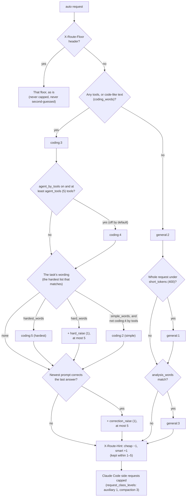

The word lists are Python regular expressions matched ignoring case, against the last two messages from the person
(their first 20,000 characters). What the harness adds to those messages is left out: Claude Code's system reminders
(`<system-reminder>`, which carry CLAUDE.md, todo lists and notices) and local command output, and Codex CLI's
`<environment_context>` and AGENTS.md instructions (`translate.HARNESS_TEXT`). They're the same on every task, and a
CLAUDE.md that says "run the tests" or "read the architecture doc" would otherwise set every task's level. A message
that's only that text is passed over, like one of only tool results. A level outside 1–5, a pattern that
doesn't compile or matches empty text (it would match every request), or a misspelt key is refused when
the configuration is loaded or saved.

What that gives a Claude Code or Codex session (dozens of tools on every request):

| Prompt | Level | Reason |
|---|---|---|
| "write unit tests for the date parser" | `coding:2` | `coding: 32 tools; simple task wording (write (unit )?tests): level 2` |
| "fix the typo in the README" | `coding:2` | `coding: 32 tools; simple task wording (typo): level 2` |
| "add a --dry-run flag to the deploy command" | `coding:3` | `coding: 32 tools` |
| "fix the race condition in the job scheduler" | `coding:4` | `coding: 32 tools; hard wording (race condition): +1` |
| "the importer deadlocks under load, fix it" | `coding:5` | `coding: 32 tools; hard wording (deadlock, under load): +2` |
| "write tests for the deadlock fix" | `coding:4` | `coding: 32 tools; hard wording (deadlock): +1` |
| "design a plugin system for the importers" | `coding:5` | `coding: 32 tools; hardest wording (design (a|the)): level 5` |
| "that's wrong, the tests still fail", after "write unit tests…" | `coding:3` | `…; simple task wording (…): level 2; the new prompt corrects the last answer (wrong): +1` |

**The level holds for the task.** The rules give a level only at a task boundary: a new session, a new human prompt,
or a history the harness compacted. Every request in between (tool results going back) keeps the session's model and
level outright ([Free upgrades](#free-upgrades-and-why-theyre-safe)), so a level never changes mid-task and the cache
stays where it is. A task that turns out harder than its wording is raised at the next boundary, never mid-task, and
never by its length: by the person's next prompt (a correction is +1; a new prompt with harder wording gets its own
level, and the two-prompt window carries a short follow-up such as "go on" at the level of the prompt before it), by
the learned router ([below](#the-learned-router)), whose labels include fix loops, failing tests and corrections, and by
the outcome report and exploration ([Exploration](#exploration)), which move a level whose work fails more than it
should.

With the learned router on ([below](#the-learned-router)), it predicts its own level next to the rules': in shadow mode
that's recorded and changes nothing; in route mode it's used when the model is sure, and the rules decide otherwise.

**Length never raises the floor.** A long conversation isn't harder work; it needs a model with room for
it, so length only rules out the models whose window is too small (see Context windows). A Claude Code
session on `auto` keeps its task's level (`coding:2` to write tests, `coding:4` to fix a race) however long it grows. Length counts in one place, and only to lower
a level: a request under 400 tokens in all is a question on its own, level 1 (decision 38 in
[09](09-decisions.md)).

**Every request says why.** The routing reason starts with the floor and the rules that set it, naming
the listed word that matched but never the text around it:
`classified coding:4 (coding: 32 tools; hard wording (race condition): +1)`. Mid-task
turns repeat the task's reason (`mid-task: keeping session model gpt-terra at coding:4 (coding: 32 tools; hard wording …)`).
A team routing by cost per success gets what was compared at the end: `…; cost per success: deepseek-v4.1-flash,
expected $0.0051 per success (62% at coding:3) vs $0.0086 (70%) on claude-haiku, the cheapest at the level`. A task start a
team explores says so: `…; exploring: one level down from coding:3 (2.0% of task starts)` ([Exploration](#exploration)).
The ledger keeps it (`route_reason`), and the console shows it under Reports → Requests and on the
Dispatch feed. A team routing by expected total cost gets both models' chances and costs, and an escalation what it
compared ([Expected total cost](#expected-total-cost-to-finish-the-task)).

### Named tiers

A caller can ask for a tier by name instead of a model: `frontier`, `standard`, `cheap` and `embed` by default
([decision 72](09-decisions.md#72-named-tiers-a-route-listing-and-a-callers-data-policy)). A chat tier is `auto` at a
fixed level (frontier 5, standard 3, cheap 1), with the task (coding or general) taken from the request unless the tier
sets one; an embedding tier is one model, by default the cheapest priced embedding model. The gateway owns the mapping:
change `tiers` in the config and every caller follows. A model with the same name as a tier wins. `X-Route-Floor` still
overrides a tier's level. The ledger records the tier's name as the requested model.

```yaml
tiers:
  frontier: {level: 5}
  standard: {level: 3}
  cheap: {level: 1}
  embed: {kind: embedding}            # or {kind: embedding, model: text-embedding-3-small}
  review: {level: 4, task: coding}    # your own
  pinned: {model: claude-sonnet}      # a fixed model
```

`GET /v1/routes` lists each tier's candidate models and where each can send a request: provider, price, and the data
facts in [06](06-auth-and-spend.md#data-policy).

## The cost function

For each candidate backend `b`, over the session's expected remaining turns:

```
cost(b) = rebuild(b) + expected_remaining_turns × per_turn(b)
```

**Per-turn cost by backend type**

| Backend state | `per_turn(b)` |
|---|---|
| API | cached tokens × cache-read price + new tokens × write price + output × output price |
| Self-hosted, plenty of headroom | ≈ 0 (2% of the route's API-equivalent price below 60% utilization: `shadow_floor`, `shadow_knee`) |
| Self-hosted, filling up | shadow price rises toward the route's API-equivalent price |
| Self-hosted, full | skipped while another route can take the request; otherwise it waits in vLLM's queue there (up to `max_waiting` per replica) |

Per turn, the router assumes the conversation grew by what it grew since the session's last turn (at least 200
tokens; `est_new_tokens_per_turn`, 2,000, for a new session) and that the reply is `est_output_tokens` (600) long.
The rest of the prompt is read from cache. The expected remaining turns are the session's turns so far, kept between
`min_expected_turns` (3) and `max_expected_turns` (30).

The write price is the cache-write price only where caching is explicit: Anthropic-format backends
(Anthropic, Bedrock, Vertex, Foundry) and Claude through OpenRouter, which gets a cache marker. Other
providers cache automatically and bill new tokens at the input price. A backend set to an hour
(`cache_ttl_seconds` 3600 or more, as the shipped Anthropic, Bedrock, Foundry and Vertex backends are) is priced at
Claude's 1-hour write price (`cache_write_1h`, default twice the input price) from a session's second turn on, which
is what the gateway asks for there ([04](04-caching-and-sessions.md#how-long-claude-keeps-a-cache)). A session's first
turn, and the rebuild that comes with it, is priced at the 5-minute write price, as the gateway sends it: a session
counts as new until it has had a turn (`turns` is 0). One that has come back and moves to such a backend rebuilds at
the 1-hour price. So a new Claude session costs the same to start on the direct backends as on OpenRouter, and the
hour's premium on the later turns (about 5% over three turns for Claude Haiku 5.5) is set against what the hour saves.

**Pauses (decision 60).** A later turn that comes 5 to 60 minutes after the one before finds a 5-minute cache gone,
and the conversation is written again; an hour's cache is still there. So each later turn on a route whose cache lasts
under an hour (`cache_ttl_seconds` below 3600: OpenRouter, every provider that caches on its own) also carries

```
pause share × cached tokens × (write price − cache-read price)
```

the rebuild such a pause costs, times how often one comes. Pauses over an hour rebuild everywhere, so they don't
change the comparison, and GPU deployments evict by pressure, not time, so they get none. The pause share is measured
(`pauses.py`): every gateway counts its sessions' later turns, and those that came 5 to 60 minutes after the last,
by team, halving the counts every 7 days, and saves them every minute in the store (`session_pauses`, one entry per
gateway, summed by all). A team's share leans on the organization's, and the organization's on a prior of one turn in
ten, each by 100 turns' worth:

```
organization = (paused + 100 × 0.10) ÷ (turns + 100)
team         = (team's paused + 100 × organization) ÷ (team's turns + 100)
```

At one turn in ten, a new Claude Haiku session at 30,000 tokens costs $0.0060 over three turns on the direct backends
and $0.0064 on OpenRouter, so it starts there at the default `cost` priority. A team whose sessions rarely pause (under
about one turn in twenty, at that size) goes back to OpenRouter, where the hour would cost more for nothing. The share
in use is the session's team's; batch requests have no session and count none.

**Rebuild cost**

| Situation | `rebuild(b)` |
|---|---|
| `b` already holds a warm cache for this session | 0 |
| API, cold | prefix tokens × (write price − cache-read price) |
| Self-hosted, cold | the same, at the shadow price |
| Self-hosted, part of the prefix probably evicted | the same for the part that's gone: × (1 − share still cached) |

On a GPU deployment the cache belongs to one replica, so the share still cached is per replica; how it's
known (vLLM's KV events, an estimate from its KV-cache metrics, or the cache TTL) is in
[04](04-caching-and-sessions.md#gpu-replicas-which-one-holds-the-cache).

A session only moves off its current backend when the cheapest route beats staying by more than the switch margin:
`switch_margin_pct` (10%) of what staying costs, plus `switch_margin_usd` ($0.01). Otherwise the reason says
`staying on <backend> (move would not pay for cache rebuild)`.

Illustrative, at Claude Sonnet 5.5's list prices in `config/prices.json` (12 November 2026: $2 input, $0.10 cache
read, $2.50 5-minute cache write, $4 1-hour cache write per million tokens): a 120k-token session costs about $0.012 a
turn in cache reads to stay. Moving it to another Claude backend set to an hour costs about $0.46 to rewrite the cache
(118k tokens × ($4 − $0.10)); to OpenRouter, which writes at the 5-minute price, about $0.28. A move has to save more
than that, plus the switch margin, over the rest of the session to be worth it.

## Cost per solved task (opt-in)

The threshold treats every model at or above the floor as equally good and every model below it as useless.
Quality data says more: each model's chance of solving work at each level. With `routing.model_choice:
cost_per_success` (or a team's `model_choice`), the router ranks routes by what a solved task is expected to
cost:

```
expected(b) = cost(b) + (1 − chance) × redo
redo        = cost(t) ÷ chance(t)
```

`cost(b)` is the cost function above, cache rebuild included. `chance` is the model's chance of solving work at
the request's level. A failed try is still paid for, and the work is then done again on `t`, the route the
threshold would pick (the cheapest that meets the floor), until it succeeds. For `t` itself that's `cost ÷
chance`. So a cheaper model below the floor wins when its saving on the try outweighs redoing its extra
failures, and a dearer, better model can win when it fails much less.

- **Chances** come from each model's score in use: the scale says what a score means on the reference task
  (FrontierSWE by default), and a model exactly at a level solves that level's work as often as a 5 solves the
  reference (the anchor: 69.9% for coding). Published scores, overrides, and measured scores applied
  from evals (with `quality.source: config`) all get chances; a model without one is judged by the threshold.
- **A minimum** (`min_success_chance`, default 0.6) keeps out any model whose chance at the level is lower, so a
  nearly free model that usually fails can't look cheap per success. If nothing reaches it, the threshold decides.
- **A client's `X-Route-Floor`** is a minimum it asked for: the threshold decides.
- **Levels don't change.** The level still comes from `routing.levels`; cost per success only changes which
  models can take a level's work. Reports → Levels lists, under each level, the models below it that are in
  reach for your team, with their chance.
- **Everything after works on expected cost**: the speed premium of the priority, stickiness, the speed checks.
  A warm cache still counts through `cost(b)`: a session warm on one model doesn't move to a cheaper one that would
  first pay to rebuild the cache, unless it's still cheaper per success after that.

Example, coding:3 with 30,000 tokens: Claude Haiku 5.5 meets the floor at $0.0060 a try and a 70% chance, so $0.0086
per success. DeepSeek V4.1 Flash scores 2.4, below the floor, but costs $0.0018 a try with a 62% chance:
$0.0018 + 38% × $0.0086 = $0.0051 per success, and it wins. Every rule, and more examples:
[10, How it decides](10-how-it-decides.md#threshold-or-cost-per-success).

## Expected total cost to finish the task

Cheap routing that has to be redone saves nothing, and a redo costs more than tokens: someone notices the answer was
wrong, says so and waits. With `routing.model_choice: expected_cost` (or a team's `model_choice`), each `auto` task
goes to the model with the lowest expected cost to finish it (decisions 62 and 67, `success.py`). It's the default since
the [routing simulator](#how-we-measure-routing) scored it against the threshold ([below](#is-it-the-right-default)):

```
E(m)            = try(m) + (1 − P(m)) × (H × stakes + next attempt)
stakes          = (1/3)^(5 − level) × min(1, prompt tokens / 8,000); level 5 after a correction
next attempt    = min over e of E(e | m failed), from a cold cache, while escalations are planned; else 0
```

- **try(m)** is the cost function above: the rest of the session on that route, cache rebuild, the 1-hour cache and
  pauses included.
- **H** is what a failed attempt at the top of the scale (a level-5 task, a full agent request) costs a person:
  `routing.human_cost_usd`, per team `teams.<name>.human_cost_usd` (Config → Routing → Expected total cost, and
  Controls). Minutes of their time times their rate; the default, $1, is one minute at $60 an hour. 0 counts only tokens.
- **The stakes** (`success.stakes`, decision 67) are the share of H a failure of this request puts at risk. Each level
  below 5 puts a third as much at stake (level 4 a third, level 3 a ninth, level 1 1/81): a re-asked question costs a
  person seconds, a failed agent task minutes of review and a redo, and the benchmark prior, measured at level 5 and
  read down to level 1 at the same gaps between models, overstates how often a cheap model fails easy work. A request
  under 8,000 tokens puts proportionally less at stake (coding agents send more than that from their first turn, so this
  scales questions and short chats). After a correction (the person's newest prompt says the last answer was wrong) the
  request counts as level 5. So a one-line question puts 1/400 of 1/81 of H at stake, and goes to the cheapest model that
  meets its level, as the threshold sends it.
- **The next attempt** after a failure is the same model again (the person resends, the agent carries on) or a
  stronger one (a different model with a higher chance) from a cold cache, whichever finishes for less. A task one model
  failed is harder for the next attempt too: every model's chance on a task moves with a hidden difficulty of the task's
  own, 1 log-odds wide (`SPREAD`), so the chance after a failure is conditioned on it. As many more attempts are
  planned as `routing.cascade.max_escalations` allows (0 by default: then a failure costs H and nothing more).

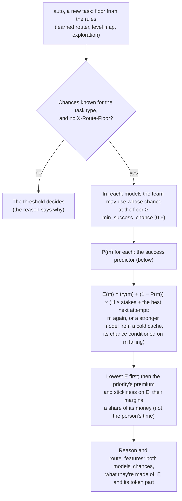

### The success predictor

`P(m)` is the chance that m's answer to the task needs no redo. It's built in layers, each used when it's there:

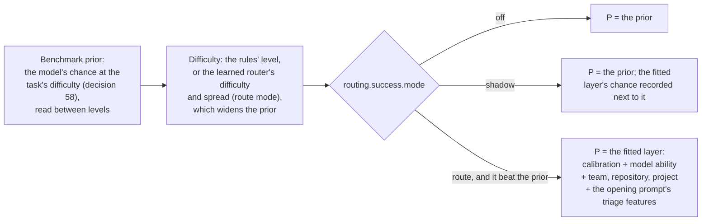

1. **The benchmark prior.** Each model's chance at each level (`config.apply_chances`, the fixed bar of decision 58),
   read between whole levels in log-odds, at the task's difficulty.
2. **The difficulty.** The level the task is routed at. With the learned router in route mode, its difficulty
   (`learned.Prediction.difficulty`, moved as the level was by Claude Code's caps, the level map and exploration) and its
   spread: the chance is averaged over the spread, which pulls it towards a coin toss where the difficulty is unsure.
3. **The fitted layer** (`routing.success.mode`, off by default; Config → Routing → Expected total cost). A logistic model
   on the learned router's rows, trained with it (`meritorder router train`, the worker, or *Train now*):

   ```
   logit P = prior logit + a + (b − 1) × prior logit + ability(model) + team + repository + project + opening prompt
   ```

   `a` and `b` calibrate the prior to what your outcomes count as success (most answers get no failure signal, so it's
   usually above the benchmark's chance). `ability` is each model's own record on your work: exploration's task starts a
   level down or up (decision 59) are what show a model off its level. The repository is the working directory Claude
   Code names in its system prompt or Codex in its `<cwd>`, and the project the client's `project` tag
   (`X-MeritOrder-Tags`), both kept only as keyed hashes of 8 hex characters. The opening prompt's triage features are
   its word triples (the learned router has the words and pairs) and the paths it mentions (their kind: test, docs,
   config or core; extension; directories), hashed into 16,384 buckets. Every part has a normal prior at zero, so a model,
   team or repository with few outcomes keeps the prior. It's fitted by coordinate-wise Newton steps (about 1 second per
   10,000 task starts on a laptop), compared with the prior alone on the newest fifth by paired Brier score, and used in
   route mode only if it was better by more than twice the standard error. In shadow mode its chance is recorded next to
   the prior, so Reports → Learned router can compare them before it routes anything.

Cold start, with nothing fitted, is the rules' level and the benchmark prior. The benchmark's chances are FrontierSWE's
(a model exactly at a level solves 70%), so until the fitted layer calibrates them, failures look likelier than your
traffic will show. The stakes keep that from buying strong models for easy work; at levels 4 and 5, where the prior is
closest to what it measured, a failure still costs most of H. Hence the recommendation below.

### Escalation inside a task

Off by default (`routing.cascade.max_escalations: 0`): on the simulator it finished 0.1 points more at the same total, counting failed attempts,
and a third more model spend ([below](#is-it-the-right-default)). Turned on (1 or 2), a task still keeps its model mid-task, and what its tool results show (coding outcomes, below)
moves the task model's chance, and the task moves up when continuing costs more than escalating:

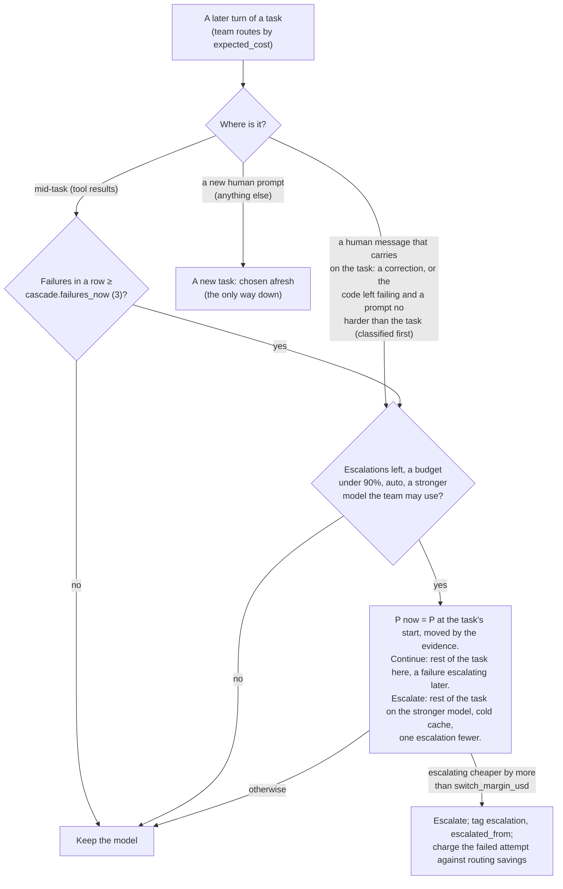

| Evidence (outcomes.py) | Log-odds on the task model's chance |
|---|---|
| Tests failing after the last edit | −0.6 |
| Build or type check broken after it (and no test passed) | −0.4 |
| Each failed run in a row after the first (at most 6) | −0.3 |
| A fix loop: three edits to one file, each right after a failed run | −0.8 |
| Each error tool result in a row after the first (at most 6) | −0.15 |
| A correction in the person's next prompt ("that's wrong", "revert", ...) | −1.4 |
| Each file touched beyond 5 (at most 8), each core file edited beyond 5 | −0.08, −0.05 |
| Tests passing after the last edit | +0.5 |

The gateway reads a team's tool results for this whether or not the learned router is on (only recording them needs it).
These are priors set from the outcome labels' weights; Reports → Learned router shows whether the chances they give
hold. The bounds: at most `cascade.max_escalations` (0 by default, at most 2) per task; never down inside a task; never for a named
model (decision 23); never past the team's allowed models; never once any budget that applies is 90% spent; never into a
refusal by `max_request_usd` (the request is routed as it would have been). The cache rebuild on the stronger model is in
the comparison, at Claude's 1-hour price where that applies (decision 53). An escalated model's chance is its own from
then on, and its failures in a row start again.

A human message after a failing run carries the task on only when it's a correction, or when the new prompt, classified
first, is the same kind of work at no higher a level than the task's (`Router.carries_on`): "keep going" does, "now
design the multi-region architecture" (coding:5) after a coding:3 task is a new task at its own level.

The routing reason says what was compared, either way. On the shipped price list, a $1 person's cost and the cascade on,
a 30,000-token coding:3 task on Claude Haiku: after three failed runs, `mid-task: keeping session model claude-haiku at
coding:3 (coding: 1 tool); claude-haiku's chance now 41% (was 70%: tests failing after the last edit -0.6, 3 failed runs
in a row -0.6); continuing ~$0.10 vs escalating to gpt-terra ~$0.12 (82%, cache rebuild included): continuing` (a ninth of
H is at stake at level 3); and when the person then says "that's wrong", the request counts as level 5:
`escalated at the next human message (1 of 1): claude-haiku's chance now 24% (was 70%: tests failing after the last edit
-0.6, corrected (wrong) -1.4); continuing ~$1.00 vs escalating to gpt-terra ~$0.28 (82%, cache rebuild included); at
coding:3 (coding: 1 tool)`. A task start's reason ends with both models' chances and costs and what's at stake:
`classified coding:3 (coding: 1 tool); expected total cost: claude-haiku ~$0.055 to finish: try $0.0060, chance 70%
(benchmark), difficulty 3.0 (level 3), a failure costs $0.11 of a person's time (of $1.00: 1/9 at level 3), then
claude-haiku again; deepseek-v4.1-flash ~$0.063, chance 62% (benchmark)`. With the fitted layer routing, each chance also
says what moved it: `86% (benchmark 82%; calibration +0.4, model ability +0.1)`.

### What's recorded, and savings

- The task's `route_features` row (the learned router has to be on) gets `predicted`: the chosen model's and the
  runner-up's chance, the benchmark's, the fitted layer's, the expected total and token costs, the person's cost at stake
  (`human_cost`) and its share of H (`stakes`), and the difficulty; `context`: the repository and project hashes; and `triage_features`. At the task's end (the next human
  prompt that isn't a continuation) its `coding` column gets what the task cost, its escalations and why.
- Every request of an escalated task carries the ledger tags `escalation` (`1` or `2`) and `escalated_from` (the model
  it left), which a client can't set; Reports → Breakdown → Tag → `escalation` shows what escalating cost.
- **Savings stay honest.** The failed attempt wouldn't have been made without Merit Order, so the escalation's first
  request takes that attempt's baseline cost off its own baseline and its routing savings (a negative routing saving on
  that row, once: on the answer's row, never a refused attempt's). The gateway knows it from
  two counters per conversation in Redis (`task:` for what it cost, `task-base:` for
  what it would have cost on the baseline model), read with the budgets in the same round trip.

Reports → Learned router → *Expected total cost* shows predicted against seen success (a reliability table, the Brier
score, by model, and the fitted layer's own), escalations (how often, whether the task then ended without a failure
signal, and what was charged), and expected against actual cost per finished task.

### Is it the right default?

On the [routing simulator](#how-we-measure-routing) (2,000 standard tasks, seed 1, a price of $15 per failed
attempt, the level rules of decision 61, `docs/routing-eval/scorecard.md`), against today's other choices.
A failed attempt costs someone time: noticing it, asking again, waiting, cleaning up; here that time has a price per
failed attempt, an assumption you can change. The total counts model spend plus failed attempts times that price: it's what the work costs, not time saved.

| Strategy | Success | Model spend per finished task | Time lost to failed attempts | Total, counting failed attempts (90% interval) | Analysis finished |
|---|---|---|---|---|---|
| Always Claude Opus | 97.7% | $1.43 | $2.53 | $3.95 ($3.57 to $4.35) | 89.7% |
| Always Claude Sonnet | 97.4% | $0.73 | $2.66 | $3.40 ($3.08 to $3.76) | 87.3% |
| `auto`, threshold (the default before decision 62) | 97.5% | $1.01 | $2.62 | $3.63 ($3.20 to $4.07) | 82.5% |
| `auto`, cost per success | 96.8% | $0.40 | $3.07 | $3.47 ($3.12 to $3.86) | 72.2% |
| `auto`, expected total cost, the full person's cost on every request (decision 62) | 97.9% | $0.51 | $2.37 | $2.88 ($2.56 to $3.21) | 89.7% |
| `auto`, expected total cost, the person's cost at stake (the default, decision 67) | 97.7% | $0.40 | $2.67 | $3.08 ($2.77 to $3.43) | 86.5% |
| …with its cascade (one escalation) | 97.8% | $0.54 | $2.54 | $3.08 ($2.77 to $3.45) | 86.5% |
| Oracle (lower bound) | 98.7% | $0.17 | $1.85 | $2.03 | 93.7% |

And what it spends per finished task, class by class, against the threshold (success in brackets):

| Class (tasks) | Threshold | Decision 62 | The default (decision 67) |
|---|---|---|---|
| Easy coding (559) | $0.053 (100%) | $0.094 (100%) | $0.027 (100%) |
| Ordinary coding (740) | $0.30 (100%) | $0.41 (100%) | $0.22 (100%) |
| Hard coding (128) | $13.29 (81.2%) | $5.03 (79.7%) | $4.90 (80.5%) |
| Very hard coding (10) | $54.12 (60%) | $17.77 (60%) | $17.55 (60%) |
| Short questions (159) | $0.000026 (100%) | $0.0014 (100%) | $0.000026 (100%) |
| Chat (278) | $0.0027 (100%) | $0.025 (100%) | $0.0022 (100%) |
| Analysis (126) | $0.043 (82.5%) | $0.095 (89.7%) | $0.033 (86.5%) |

The default spends 60% less per finished task than the threshold, and no more on any class: the cheapest model that meets
the bar on easy work, and less than it on hard work, where at level 5 it picks Gemini 4 Carbon over Claude Fable when
Carbon is cheaper to finish with, as cost per success does. It finishes 0.2 points more than the threshold, and in
total it costs 15% less than the threshold and 9% less than always using Sonnet (paired, $0.13 to $0.51 less per
finished task). Against decision 62, which charged every failure the full person's cost, it spends 20% less but costs
$0.20 more per finished task in total (paired, $0.09 to $0.32) and finishes 0.15 points fewer: decision 62 bought
analysis's 89.7% by sending every general request to stronger models (chat at 9 times the threshold's spend), since the
rules give an analysis and an email the same levels. No setting tried has both (decision 67). It costs least in total at a
price of $5 per failed attempt and ties the cascade at $15; at $50 the cascade costs less ($9.00 against $9.31), at $0 cost per
success (by 1%). On the sensitivity runs (400 tasks each) it's lowest in total on every mix, at no pause and
one turn in ten, within 1% of cost per success when 30% of turns pause, and level with always-Sonnet when the published
abilities are off by 3 points.

The cascade escalates 12% of tasks, 62% of them then finish, and it finishes 0.1 points more, at the same total, counting
failed attempts, and a third more model spend, so it's off by default. The CI check's baseline now runs 1,000 tasks (seed 7,
frozen prices) and the threshold beside the default, and fails if a class spends more than 10% over the threshold
(decision 67): decision 62 had $0.457 per finished task and $2.63 in total, counting failed attempts, at 98.0%; the default has
$0.358 and $2.86 at 97.7%.

The person's cost the router uses ($1 for level-5 work) is far below the simulator's $15, on purpose: the benchmark's
chances are FrontierSWE's (a model exactly at a level solves 70%), more pessimistic than the simulator's work and most
traffic, and a new session's try is priced for 3 turns, a tenth of what an agent attempt costs. With the stakes, $2 costs
2% less in total, counting failed attempts, on the simulator but spends 43% more than the threshold on analysis and 30% more on chat;
$3 and $5 spend more than the threshold on ordinary coding too; $0.50 costs 3% more. The fitted layer calibrates the
chances to your outcomes; raise the person's cost once it routes.

**The recommendation:** keep the default; turn the learned router and `routing.success.mode` to shadow, and set
`success.mode: route` once Reports → Learned router shows the fitted layer beat the benchmark prior; try the cascade on
one team (`cascade.max_escalations: 1`) and compare its escalations there.

**What only real traffic can tell:** how often the in-task evidence means the task will fail, client by client; whether a
stronger model finishes what a weaker one couldn't (the hidden difficulty's width); what a person's failed attempt really
costs a team; and how much the fitted layer's repository and opening-prompt parts add over the calibration. Request
overhead, measured with `scripts/bench_load.py` (`expected-cost` against `exploration`, both with the learned router in
shadow mode, on a laptop): a chat request (a new task each time) 0.72 → 0.82 ms of CPU, an agent turn that grows an
edit and a test run each request 3.50 → 3.55 ms.

## The learned router

The level rules are word lists: a listed word raises a task whatever it's about, and hard work described in other
words isn't recognized. The learned router (`learned.py`, `learned_jobs.py`, decision 44) learns from this
organization's own traffic which requests are harder or easier than the rules say. It's off by default
(`routing.learned.mode`, Config → Routing → Learned router), and the rules stay the default and the fallback.

| Mode | What happens |
|---|---|
| `off` (default) | Nothing is recorded or predicted |
| `shadow` | Gateways record each request's features and what followed its answer, predict a level next to the rules', and change nothing. Reports → Learned router compares the two |
| `route` | The same, and the learned level is used when the model is at least `min_confidence` (0.8) sure. Otherwise the rules decide |

For one request whose level comes from the rules (a new task without `X-Route-Floor`):

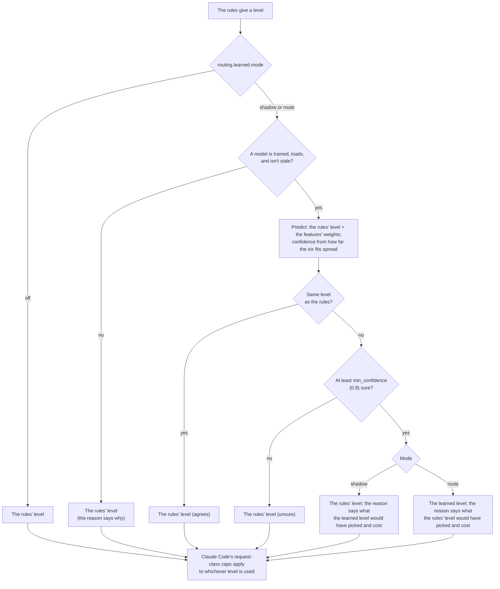

**What it predicts.** It corrects the rules' level rather than replacing it:

```
difficulty    = the rules' level + the weights of the request's features
learned level = difficulty rounded, 1 to 5
```

It's trained as an item response model, as Epoch places models and tasks on one scale: work of difficulty `d` sent to
a model scoring `q` (its score for the task type, the one routing uses) shows a failure signal with probability
`sigmoid(slope × (d − q) + intercept)`. The slope starts from what Epoch's ability scale implies (about 0.4 a level
for failures) and is fitted. The model then needs no traffic on a model to judge it: the scores say how good each model
is, the traffic says how hard each kind of request is.

Two things are fixed by construction, because the labels can't tell them apart from how often failures get noticed:

- **The rules stay right on average.** Over the training requests of each task type the corrections average to zero,
  so the model moves requests up or down relative to others the rules put at the same level. It can't raise every
  level at once, and it can't tell that every level is too low; the scores, cost per success and
  [exploration](#exploration) are for that.
- **The client isn't difficulty.** Tags about the client (`client:…`, `format:…`) only change how often a failure is
  noticed (a chat app has a regenerate button, an agent rarely resends), never a request's difficulty.

**Where it applies.** Only where the rules give a level: a new task (a new session or a new human prompt), or one the
harness compacted. Mid-task turns keep the session's model; a session that outgrows its model keeps its level; a
client's `X-Route-Floor` is never second-guessed; Claude Code's caps (`request_class_levels`) apply to whichever level is
used. Requests that name a model are recorded too, for training (a named model shows how a model scoring other than the
level does on such work), and never rerouted. A request of a batch is leveled like a new task, so route mode applies to
it, but it's never recorded: none of the signals below can follow it ([Batches](#batches)).

### What it learns from

Training data is this organization's own traffic. The ledger keeps no prompt text, and neither does this: each task
start gets a row in `route_features` with

| Field | What it is |
|---|---|
| Words | The words and word pairs of the text the rules read (the last two messages from the person), from its first and last 2,000 characters, hashed into 65,536 buckets with a key. Only bucket numbers are stored |
| Tags | Named facts: the rules' level and which rules fired (`rule:simple`, `rule:hard`, `rule:hardest`, `rule:correction`, …), the tool count (a band, and `rule:agent` at `agent_tools` or more, whatever set the level), the size band, the conversation's length, Claude Code's request class and subagent flag, a client-set effort, structured output, the API format and the client's product name from its User-Agent |
| Outcome | The model that answered and its score, the scores of models that refused, the status, and what followed |

**The key.** `MERITORDER_FEATURE_KEY` if it's set, else one generated once and kept in the store (`learned_router_key`).
Words are hashed with keyed BLAKE2b (a 128-bit key derived from it). A hash isn't encryption: whoever has the rows and the
key can check whether a word they guess was in a request (not read a request back). Set the variable to keep the key out
of the database. Changing it makes stored rows and models unusable (they're hashed differently), and the model is
reported stale. So are rows and models from before feature version 2 (13 November 2026), whose CRC32 hashing the key
didn't hide, and from before version 3 (15 November 2026), whose words came from user messages that were only tool
results (so mid-task they often had none), and from before version 4 (decision 61), whose words included Claude Code's
system reminders and Codex's AGENTS.md, and whose rules' level for a coding agent came from its tool count. Train again
after upgrading.

**The labels, and how weak each is:**

| Signal | Seen when | Weight | How weak |
|---|---|---|---|
| A raised floor | The next request of the conversation sends a higher `X-Route-Floor` (or `X-Route-Hint: smart`) | 1.0 | The client said the level was too low. Few clients send it |
| Sent again | The next request has every message unchanged after a successful answer: a regenerated answer | 0.6 | Some clients resend after a timeout of their own; a retry after an error doesn't count |
| Stopped | The client disconnected while the answer streamed (Esc in Claude Code) | 0.4 | Often a wrong direction, sometimes the person had read enough |
| Asked again elsewhere | The conversation's last answer, then the same person's first request in a new session within 15 minutes shares at least half its hashed words | 0.3 | Inferred, not seen; subagents and side requests are left out (their conversations end by design) |
| Corrected | The person's next prompt says the answer was wrong: "that's wrong", "undo", "revert", "you broke", "still failing", "not what I asked" ([coding outcomes](#coding-outcomes)) | 0.7 | A rule list over the prompt's first 1,000 characters: "revert the migration" as a new request matches too, and a polite "could you try another way" doesn't |
| Tests failing at the end | The last test run after the task's last edit failed (pytest, jest, vitest, go test, cargo test, npm test, ...) | 0.5 | Often the agent gave up; sometimes the person took over, or the test was already failing |
| Build broken at the end | The last build or type check after the last edit failed (tsc, mypy, cargo build, go build, make, ...), and no test passed after it | 0.4 | Agents usually fix their own build errors; one left at the end is the weaker sign |
| A fix loop | Three or more edits to one file, each right after a failed run, and no test passed after them | 0.3 | Hard work loops too; it says the model struggled, not that it failed |
| Tests passing at the end | The last test run after the last edit passed | cancels a broken build and a fix loop | The one sign an answer worked; it isn't a label of its own (no signal already counts as no failure) |
| Turns and tokens to the end of the task | Counted per task | not a label | Shown on the [outcome report](#the-outcome-report): what finishing cost |
| A refusal | A model refused and `auto` moved on | 0.2 | A policy decision more than a sign the work was too hard |
| A judged label (opt-in per team) | A judge, reading the answer next to a stronger model's, says whether it was good enough: a failure or a success | from how well verdicts agree with the signals above | A judge's view, not a person's: [judged labels](#judged-labels) |
| Errors, capacity failovers | | not a label | They say nothing about the work |
| Epoch scores, eval results | | the model's side | Each served model's score (Epoch's, an override, or eval scores applied as scores) is what a request's difficulty is compared with; the slope starts from Epoch's scale. They aren't per-request labels |

Most answers get no signal at all, and a missing signal isn't a success: the labels are rare and noisy, which is why
the model is checked against the rules before it's used and shadowed before it routes. A team can add a stronger
label, at a price and by sending a sample of its prompts to two more models: [judged labels](#judged-labels).

### Judged labels

Off by default, per team (`teams.<name>.judged_labels`, Config → Routing → Judged labels; decision 52 in
[09](09-decisions.md)). A small sample of the team's task starts is replayed on a stronger model, and a judge model reads
the conversation and both answers and says whether each was good enough. The label is whether the answer the request got
was good enough, given the stronger one. Unlike the outcome signals, it says so either way.

**Sampled prompts and answers are sent to two more models**: the stronger model and the judge, which the request's own
routing didn't choose (always within the team's allowed models and backends). Turn it on only for teams where that's
acceptable.

| Setting | Default | What it does |
|---|---|---|
| `enabled` | false | |
| `sample_rate` | 0.01 | The share of eligible task starts sampled. Small, so the cap is reached rarely, and it shows when it is |
| `stronger`, `stronger_level` | `auto`, 5 | A model's name, or `auto` at a level: what `auto` picks at that level for the request's task type |
| `judges` | `claude-opus`, `gpt-sol`, `gemini-carbon` | The evals' judges ([11](11-evals.md#four-kinds-of-task)): one per family, at the same tier |
| `max_usd_month` | none: required | The most the replays and judging may spend a month. The configuration refuses `enabled` without it |
| `window_seconds` | 60 | A replay that can't start this soon after its answer is dropped, prompt and all |
| `skip_classes` | `auxiliary`, `compaction` | Claude Code requests never sampled: side requests (titles, summaries) and compaction summaries |
| `min_level` | 2 | Requests the rules put lower aren't sampled: a short question on its own is level 1 |

**Which requests.** A task start the learned router records (so it's on, in shadow or route mode; eval traffic and
Claude Code's level-1 side requests never are), of a Claude Code class not in `skip_classes`, that the rules put at
`min_level` or above, without images or documents (the judge reads text), and whose answer came from a model scoring
below the stronger side (under `stronger_level` for `auto`; under the named model's score otherwise), picked at the sample
rate. A team without settings of its own uses the default team's, judged labels included, with a cap of its own.

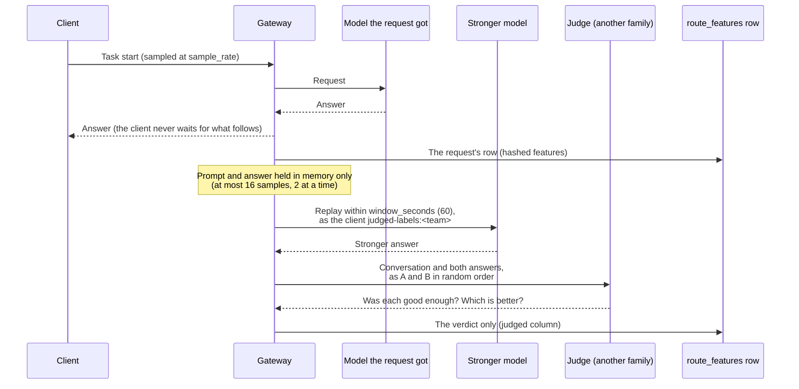

**What happens to the prompt.** The gateway keeps no prompts (decision 5), so the sample is taken when the request
arrives, while its prompt is in memory: the gateway holds a reference to it, and keeps the answer as text once it's
complete (the response, or the stream put together). When the request's row is written, the replay is scheduled in the
background; the client never waits for it. It has to start within `window_seconds` of the answer, or the sample is
dropped. A gateway holds at most 16 samples at a time and runs 2 at once; past 16, requests aren't sampled. Nothing of
the prompt or the answers is written anywhere: only the judge's verdict goes on the request's `route_features` row (the
`judged` column), next to its hashed features. The judge's reasons aren't kept, since they can quote the prompt. A
gateway that stops loses the samples it holds.

**What they spend.** The replay and the judging are ordinary requests through the gateway's own routing and metering, as
an internal client of the team, `judged-labels:<team>`. They're tagged `judged_label=replay` and `judged_label=judge` in
the ledger (Reports → Breakdown → Tag → `judged_label` splits them out; a client can't set the tag), counted against the
team's budget and the organization's, which stop them as they stop anyone, and never counted as savings. That client's
spend this month is the cap's: no sample starts once it's spent (its row says `capped`, and the report shows the team
at its cap), and a sample that started finishes, so a month can go over by what the samples running at that moment cost.
The worker alerts at 80% and 100% of the cap. Replays and judging are never recorded for training: the learned router
doesn't learn from its own requests.

**The replay** is the request as the client sent it, in its own API format, not streamed, with the response cache off, in
a session of its own. For `auto` it goes with `X-Route-Floor: <task>:<stronger_level>`, so the cheapest model at that
level the team may use takes it; a named stronger model gets it on its cheapest route. No output limit is added.

**The judge** is chosen as the evals choose theirs: the first of `judges` the team may use (with a route that can run)
whose family is neither answer's model's, else not the cheaper answer's, else the first; at high effort. It gets the
conversation as text (system prompt, tools with their parameters, messages, tool calls and results; thinking left out)
and the two answers as A and B in random order, so neither position is favoured, without saying which model wrote which.
It says whether each was good enough, using each to check the other, and which is better, if either. What's kept: whether
the cheaper answer was good enough, whether the stronger one was, which was better, which was shown first, the three
models and what it all cost. A replay or a judgement that fails, a judge's reply that isn't a usable verdict, or a replay
that went to the answer's own model drops the sample, and the row says why.

**In training,** each verdict is an observation of the model that answered: a failure (1) when the judge said its answer
wasn't good enough, a success (0) when it was. Its weight comes from how well verdicts agree with the outcome signals on
the same requests: of the judged answers with a failure signal, the share the judge also failed ("caught"), less the
share of the rest it failed anyway ("false alarm"). That difference (Youden's J) doesn't depend on how rare signals are;
since no signal isn't a success, it errs low. While few judged answers have a signal, it's shrunk towards 0.3, the
weakest signal's weight:

```
weight = (judged answers with a signal × max(J, 0) + 10 × 0.3) ÷ (judged answers with a signal + 10)
```

A judge that only guesses ends up near 0. A judged observation carries the tag `judged:pair` in place of its client's
tags: a judge looks at every answer, so how often it sees a failure isn't the client's. Like the client's tags, it moves
only how often a failure is seen, never a request's difficulty. The check against the rules (Training, step 4) stays on
outcome labels: judged labels count only if they help predict what people did. On synthetic traffic where a retry is
seen for one failure in ten, the outcome signals alone can't tell renames from Kubernetes work; with judged labels on half
the requests the model learns the known rule (`tests/test_judged_labels.py`).

**Before turning it on.** Config → Routing → Judged labels → *Turn on…* (or `POST /v1/admin/judged-labels/estimate`)
shows the expected monthly cost from the team's recorded task starts of the last 14 days: each eligible one at the sample
rate, as a replay at the stronger model's price for that request's size (long-context prices apply; the prompt written
to a fresh cache, twice the answer's output) and a judgement at the judge's price (the conversation, both answers and the
instructions read; 1,500 tokens written). It says real costs have run up to three times as much, as eval estimates do
([11](11-evals.md#cost)), names the models prompts would be sent to, and warns when the organization's budget is nearly
spent. The cap has no default, and above $1 a month the console wants an explicit "I understand". The estimate needs
recorded traffic, so turn the learned router to shadow mode first.

### Training

`meritorder router train` (needs Postgres), or the worker every `retrain_hours` (unset by default), or Reports → Learned
router → *Train now* (an admin asks; the worker trains within a minute). Training never runs in a gateway.

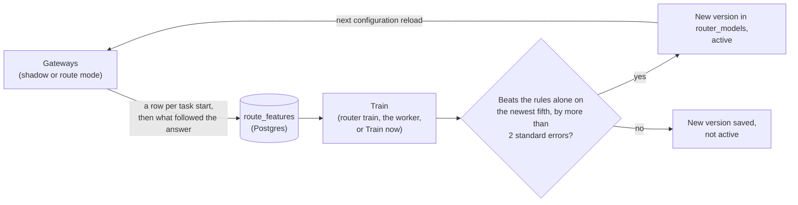

1. Read the last `train_days` (30) of rows hashed with the current key, at most the newest `train_requests` (20,000).
2. Need at least 200 requests with an outcome, and at least one signal.
3. Fit on the oldest four fifths, six times on different halves, and the rules alone (just the slope and intercept).
   Judged labels from those requests join the six fits at their weight, worked out on those requests only; the rules
   alone don't use them.
4. Compare them on the newest fifth, held out: each model's cross-entropy after one shift per task type (so neither wins
   by guessing how often failures would be noticed in the newest requests), paired request by request. The learned model
   is **used only if it's better by more than twice the standard error**. It also counts how many of those requests it
   would raise or lower at the confidence it needs.
5. Fit the six on all of it and save them as a new version in `router_models`, active if step 4 passed. Gateways load
   the active version on their next configuration reload (within seconds). `meritorder router use <version|none>` or the
   console's *Use this one* goes back to another.

The fit is pure Python: AdaGrad for the weights, Newton's method for each task type's slope and intercept, a normal
prior at zero on every weight. On a laptop it trains 6,000 short synthetic requests in about 4 seconds, and requests
with long prompts (1,000 hashed words each) at about 20 seconds per thousand, so 20,000 of them take about 7 minutes.
`train_requests` bounds that; it's the newest requests, since work and clients drift.

The worker also deletes rows older than `keep_days` (90), whatever the mode. Each row's words are stored as 2-byte
bucket numbers, so a row with a long prompt takes about 2 KB. Claude Code's side requests that are capped at level 1 aren't recorded
(nothing would change for them), nor is eval traffic (a run repeats the same prompts in new sessions).

### Confidence and fallbacks

The prediction is the six fits' mean. Its confidence is the chance the rounded level is right, from how far they spread
(their halves of the data disagree where evidence is thin) plus, for words and tags none of them saw, the spread a
weight has before any evidence. A request unlike anything seen is unsure, and the rules decide.

| When | What decides | The routing reason says |
|---|---|---|
| No model trained yet | The rules | `learned router: no model trained yet, so the rules decide` |
| The model is older than `max_age_days` (30; 0: never), the level rules changed since it was trained, or the feature key did | The rules | `learned router v4 is stale (trained 41 days ago, more than the 30 allowed), so the rules decide` |
| It's under `min_confidence` | The rules | `learned router v4: coding:4, 62% sure (wording +0.6), under the 80% it needs, so the rules decide` |
| It fails, or the stored model can't be loaded | The rules | `learned router v4 failed (ValueError), so the rules decide` |
| It agrees | Either | `learned router v4 agrees (coding:3, 91% sure)` |
| Shadow mode, it disagrees | The rules | `learned router v4 (shadow): coding:4, 86% sure (wording +0.7); not used in shadow mode; at coding:4 it would have picked gpt-terra (~$0.057 for the task) instead of claude-haiku (~$0.0057)` |
| Route mode, it's sure | The learned router | `classified coding:4 (learned router v4: 88% sure (wording +0.7); the rules said coding:3 (coding: 1 tool)); the rules' coding:3 would have picked claude-haiku (…) instead of gpt-terra (…)` |

The reason names the model version, the level, how sure it was, the biggest contributions (words count as "wording": a
hashed word can't be named) and why it was or wasn't used. The ledger keeps it (`route_reason`).

### The shadow report

Reports → Learned router (admins; team leads for their team), `GET /v1/reports/router?days=7`, and
`meritorder router report`:

- How many requests it saw, how many it predicted for, how often it agreed with the rules, and each outcome as the API
  and CLI name it: `agrees`, `shadow`, `used`, `unsure`, `stale`, `missing` (no model trained yet), `failed` and
  `named`. The console spells them out ("agreed with the rules", "no model yet").
- Where it disagreed, by task type and rules level → learned level: requests, how many it decided, its mean confidence,
  what each side's pick was estimated to cost for the task (the router's own estimate for the rest of the session, at
  that request), the outcome signals seen on the side that acted, and the model's own expected failure rate for each
  side's pick.
- The share of requests with a failure signal where it would have gone higher, lower, or agreed. If the rules' picks
  fail more often where it would have gone higher, that's evidence for it; the expected rates are its own estimate and
  can't confirm it.
- Judged labels: how many samples were taken and what came of each (judged, pending, dropped and why, skipped, not
  taken because the cap was spent), the verdicts by task type and level, what they cost in the period (from the ledger:
  replays and judging), each team's month so far against its cap, how far the verdicts agree with the outcome signals and
  the weight that gives them, the weight the model in use gave them, and two checks on the judge: how often it preferred
  the answer shown first (about half, if the order doesn't sway it) and how often the stronger one.
- The latest disagreements one by one, and (admins) the model versions, the last training, *Train now* and *Use this one*.

### What only real traffic can tell

The tests (`tests/test_learned_router.py`) show on synthetic traffic with mocked outcomes that training recovers a
known rule (Kubernetes deployments need level 4, changing a default value level 2, though the rules give both 3), that shadow mode never
changes a decision, and that every fallback works. What they can't show:

- how often each signal occurs, and how often it means the answer wasn't good enough, client by client;
- whether there's enough traffic on models above and below each level (named models, cost per success, free upgrades)
  for the slope to be learned rather than taken from Epoch's scale;
- whether the rules are right on average, which the model assumes;
- whether "asked again elsewhere" (15 minutes, half the words) means giving up;
- how well judges' verdicts agree with what people did, what samples really cost against the estimate, and whether the
  default stronger side (`auto` at level 5) is the right one to compare with (the tests mock every model call);
- training time and the size of `route_features` at real volume, and inference time on production machines (about
  0.4 ms at the p99 on a long agent prompt on a laptop).

## Your own traffic as the benchmark

Published scores say how good each model is on someone else's tasks. Whether a level is right for *your* work, and
whether a new model does as well on it, only your own traffic can say. Three parts make it measurable (decision 59):
coding outcomes (stronger signals from what the gateway already sees), exploration (a small random share of task starts
a level down or up, so the comparison is fair), and the outcome report, which compares them and recommends level changes.

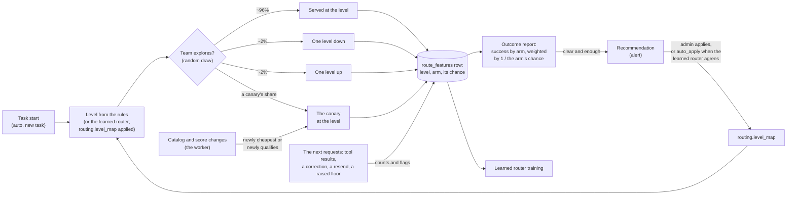

Everything here needs the learned router on (`routing.learned.mode` shadow or route): that's what records a row per task
start and what followed it. In shadow mode it changes no routing.

### Coding outcomes

An agent's next request carries the results of the tools its last answer called. The gateway already reads that request
to route it, so `outcomes.py` reads what's new since the session's last turn (the answer's tool calls and their results;
nothing older) and keeps, per task:

| Fact | How it's seen | Kept as |
|---|---|---|
| Edits | Claude Code's Edit, MultiEdit and Write; Codex's `apply_patch` (the files from its `*** Update File:` lines); pi's `edit` and `write`; and similar names | A count, and each file's path hashed to 8 hex characters (at most 20, in the session's routing state only) |
| Test runs | A shell call (Claude Code's Bash, Codex's `shell`/`exec_command`/`local_shell`, pi's `bash`) whose command runs pytest, jest, vitest, mocha, go test, cargo test, npm/pnpm/yarn/bun test, rspec, phpunit, tox, make test, mvn or gradle test, dotnet test or ctest | Counts of runs and failures, and whether the last run after the last edit passed |
| Builds and type checks | The same, with tsc, mypy, pyright, cargo build/check/clippy, go build/vet, make, a build or lint script, gcc, clang, javac, ruff check, eslint | The same |
| Pass or fail | The runner's summary in the last 4,000 characters of the output ("3 failed", "FAILED", "--- FAIL", "test result: FAILED", "Tests: 2 failed", a traceback; "5 passed", "ok", "PASS", "test result: ok."), else the exit code where the harness shows one ("Exit code 1", "exited with code 0", Codex's `metadata.exit_code`), else Claude Code's `is_error`. A build that prints compiler errors fails | |
| Fix loops | An edit to a file right after a failed run, counted per file | The most on one file; three is a loop |
| Turns and tokens | Each request of the task, and its prompt size | Two counts |
| A correction | The person's next prompt (a new task), matched against a short rule list | The rule's name: `wrong`, `undo`, `revert`, `broke`, `not working`, `not asked` |
| Failures in a row, and the scope | Failed test or build runs since the last pass; error tool results (Claude Code's `is_error`) since the last that wasn't one; files touched; characters the edits wrote; each edit's kind of file from its path's shape (test, docs, config or core) | Counts, and the kinds' counts: what [escalation inside a task](#escalation-inside-a-task) reads |

Nothing of a command, a path or an output is stored (a path's kind is worked out from it; only the kind is kept). The facts are written to the task's `route_features` row (the
`coding` column) when a test or build result changes them, when a fix loop starts, and when the task ends (the next
human prompt), with its turns, tokens and any correction. The signals they give, and their weights, are in
[the labels table](#what-it-learns-from). Requests that are sent again unchanged, and compacted ones, aren't read.

**Formats.** Claude Code speaks Anthropic's Messages API (tool_use and tool_result blocks); pi and other agents on Chat
Completions send tool_calls and tool messages; Codex CLI's Responses API items reach the router as Chat Completions
(`formats/responses.py`), with `apply_patch` as a one-string custom tool and shell output as text with "Exit code: N" or
as JSON with `metadata.exit_code`. All three are read the same way.

**What it costs per request.** Only the new turn is read, the last 4,000 characters of each result and the first 2,000
of each command, with precompiled patterns: about 20 microseconds for an agent turn with an edit and a test log of
5,000 lines (`tests/test_outcomes.py`). Measured with `scripts/bench_load.py` on 15 November 2026 on a laptop, one gateway
process, in-memory state, the learned router in shadow mode, against the code before this change: a chat turn 0.44 →
0.45 ms of CPU per request, and an agent turn that grows an edit and a test run each request (`agent-grow`, 28k tokens
of history) 2.39 → 2.45 ms. With the team exploring too: 0.46 and 2.47 ms. The histogram
`meritorder_outcome_seconds` on `/metrics` measures it in production.

### Exploration

Off by default, per team (`teams.<name>.exploration`, Config → Teams → Exploration). Off, because it knowingly sends some
work to a weaker model and some to a dearer one: a team should choose that. Turn it on for teams whose work is
representative and who can tolerate an occasional weaker answer (a person can always resend or raise the floor).

| Setting | Default | What it does |
|---|---|---|
| `enabled` | false | |
| `share` | 0.04 | The share of eligible task starts explored: half one level down, half one level up. At level 1 or 5 all of it goes the one way |
| `canary_share` | 0.2 | A [canary](#canaries)'s share of its level's task starts |

**When.** The arm is drawn once per task, where the router picks a model anyway: a new session, or a new task (a new
human prompt, or a compaction) in a session with no cache still warm anywhere. A task in a session that's warm keeps
its level as the rules give it, so no prompt cache is thrown away for an experiment. Mid-task turns keep the task's
model, as always.

**Never** for a request that names a model; one with a client's `X-Route-Floor`; a Claude Code side request or
compaction summary (the classes `request_class_levels` caps); a batch request, an eval run's, a pinned backend's, or the
gateway's own (judged labels). Never outside the team's allowed models: when nothing the team may use is at the drawn
level, the task isn't explored. Never up once any budget that applies (the organization's, the person's, the team's, the
session's) is 90% spent: up's half is then served as usual. And never past the per-request cost limit: a task drawn up
whose every route there would be refused is routed as it would have been.

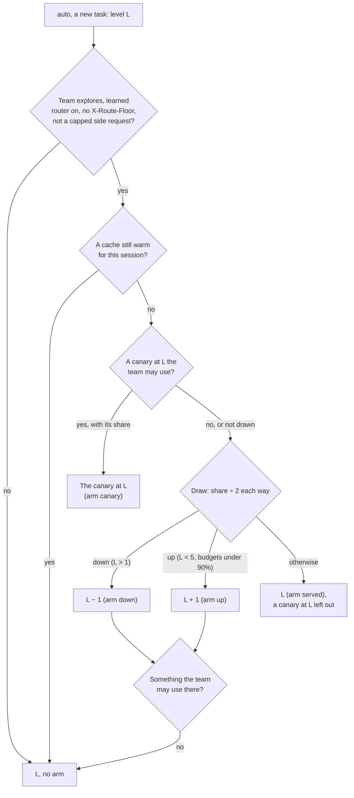

**Recording.** The draw's arm, the level the task would have had and the chance of that arm are kept on the task's
`route_features` row (`arm`, `arm_from`, `propensity`, and `level`, the level it got), and every request of an explored
task carries the ledger tags `explore` (`down`, `up` or `canary`) and `explore_from` (`coding:3`), which a client can't
set. Reports → Breakdown → Tag → `explore` shows what exploring cost. Served task starts of an exploring team are
recorded as arm `served` with their chance, so both sides of the comparison are known.

### Canaries

A model that becomes the cheapest at a level, or newly qualifies for one (a new model, a price cut, a better score), would
take that level's work at once. For teams that explore it's tried first: it serves only the canary share of the level's
task starts (20% by default), and none of the rest, until it has `routing.benchmark.canary_outcomes` (30) recorded task
starts there, or for `canary_days` (14). Then it takes the level as usual. Teams that don't explore aren't held back.

The worker looks every 15 minutes (`benchmark.Watcher`): it lists, per task type and level, the cheapest model that
qualifies (by its cheapest priced route's list price, input plus output, mocks left out) and every model that qualifies,
compares that with its last look, and keeps the canaries in the live catalog's `exploration` section, which every
gateway follows. A new cheapest model also raises an alert (the existing webhook alerts): "gpt-nova is now the cheapest at
coding:3 (was claude-haiku)".

### The outcome report

Reports → Levels → *Is each level right for the work?* (admins; team leads for their team), or
`GET /v1/reports/levels/outcomes?days=30`. Per task type and level:

- **Traffic and spend share**, from the ledger (requests by their level, and what they cost).
- **Success by arm**: served at the level, explored one level down, explored one level up, a canary. A task start's
  success is 1 minus the combined weight of its outcome signals (the labels table above, combined as for training); one
  with no signal counts as a success. Each arm's rate is weighted by the inverse of the arm's chance (a Hájek estimate:
  Σ success ÷ chance over Σ 1 ÷ chance), so teams exploring at different shares, and canaries, pool without bias; within
  one team and level the weights are equal and it's the plain rate. Only task starts of exploring teams count: their arm
  was drawn at random, so the arms differ only by the level.
- **Too high**: how often the level below does as well, as the ratio of their rates.
- **Too low**: how much more often the level above succeeds.
- **How sure**: each arm's task starts, its effective size after weighting (Σw)² ÷ Σw², and a 90% interval.
- **A recommendation** once each side has at least `routing.benchmark.min_outcomes` (200) task starts and the evidence
  is clear: *lower* when the level below's rate, less 0.95 (`as_well`) of the served rate, is above zero at the low end of
  its 90% interval; *raise* when the served rate, less 0.95 of the level above's, is below zero at the high end. It reads
  "coding level 3: level 2 does as well in 98% (n=412 explored, 9,870 served); consider lowering".
- **The trend**: spend per day, with the days the catalog or the scores changed marked (models added or removed, scores
  that moved by 0.1 or more, a new cheapest model, a canary done, a level moved).

**Applying one.** An admin's *Apply* (or `POST /v1/admin/levels/apply` with `task`, `level` and `to`) writes
`routing.level_map` (`{"coding:3": 2}`) as a new configuration version: the work the rules (or the learned router) put at
that level is routed at the new one, after Claude Code's caps, never for a client's `X-Route-Floor`, and the routing
reason says so (`coding:3 moved to 2 by routing.level_map (the outcome report)`). Levels already moved to it move with
it. Applying `to` equal to `level` takes a move back. With `routing.benchmark.auto_apply` (off by default), the worker
applies a recommendation itself when the learned router's model in use passed its held-out check (it predicted outcomes
better than the rules), isn't stale, and leans the same way on that level's served task starts more often than not; it
alerts either way, once per recommendation. It writes the change onto the newest configuration version, read just before
saving, so it never undoes an admin's save; if someone saves in between, it skips the recommendation until its next pass.

**Dismissing one.** An admin's *Dismiss* (or `POST /v1/admin/levels/dismiss` with `task`, `level`, `to` and `direction`;
`undo: true` takes it back) sets a recommendation aside. It's kept in its own setting (`routing_benchmark_dismissed`) and
holds until the evidence changes: the recommendation points another way (another direction or target level), or
`routing.benchmark.min_outcomes` more task starts have been explored on the level it compares with since it was
dismissed. That's the evidence a recommendation needs in the first place, so a dismissal never hides a new finding for
long. While it holds, the report shows the recommendation as dismissed under its level, leaves it out of the
`recommendations` list, and the worker neither alerts on it nor applies it.

**What only real traffic can tell.** The tests (`tests/test_benchmark.py`, `tests/test_exploration.py`,
`tests/test_outcomes.py`) use synthetic rows and mocked models: that the weighting pools teams fairly, that a level
below that does as well is recommended and one that fails more isn't, that canaries come and go, and that every
"never" holds. What they can't show: how often each coding signal occurs and means a failure on real agents; whether 4%
gives 200 task starts per arm soon enough at your volume (at 1,000 task starts a day on a level, about 10 days for the
down arm); and whether "success" (no failure signal) tracks what people would call good enough.

## How we measure routing

Routing can fail two ways: a model too weak for the work (a wrong answer, and a person's time to notice and ask again),
or one stronger than it needs (a right answer that cost more than it had to). The outcome report above measures both on
your own traffic, after the fact. The **routing simulator** (`src/meritorder/routing_eval.py`,
`scripts/routing_sim.py`) measures them before any traffic, for any strategy, without calling a model or spending
anything: a population of tasks with a known difficulty runs through each strategy, and the scorecard says what each
finished task cost, how often tasks failed, and the time lost to failed attempts, at a price per failed attempt. It's how a routing change
(a new classifier, routing v2) is judged before it merges, and CI uses it to stop changes that make the default worse
([11](11-evals.md#offline-vs-live)).

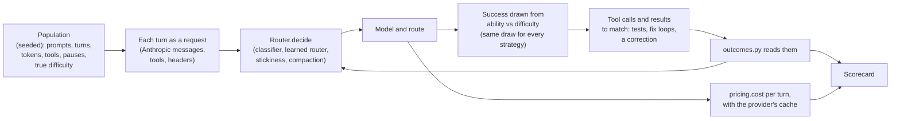

**What's real and what's simulated.** The routing is the gateway's: each turn is built as a request (Anthropic-format
messages with the client's tools and headers) and given to `Router.decide`, with the session kept as
`Gateway.update_session` keeps it (model, backend, level, turns, size, how long the cache is warm), pause gaps counted by
`pauses.py`, and a compaction starting a new task with every cache gone, as the gateway does. The tool calls and results
are read by `outcomes.py`, and every turn is priced by `pricing.cost` at the route's price. The backends are the shipped
configuration's direct APIs (Anthropic, OpenAI, Gemini, xAI) and OpenRouter, as base `Backend` objects that can't send
anything. What's simulated is only the outcome: whether the chosen model finishes the task, and the session it leaves
behind.

### The population

Every task has a class, a difficulty on Epoch's ability scale (the scale prices.json's quality section puts each model
on), an opening prompt, and a shape. Coding tasks come from Claude Code (16 tools, 75%), a lighter agent with 4 tools
(15%) or a chat client with the code pasted in and no tools (10%). Each client calls its own API (Claude Code the
Anthropic Messages API, the lighter agent, with Codex CLI's tools, the Responses API, chat clients Chat Completions: the
learned router's `client` feature) and asks for its own reply length (`max_tokens`: Claude Code 32,000, the lighter agent
none, chat 4,096, chat with code 8,192), so the router keeps that room in each model's window as it does for real
requests.

| Class | Difficulty (mean, spread) | Turns | Prompt at the start | Added per turn | Calibrated to |
|---|---|---|---|---|---|
| `coding-easy`: tests, renames, docs | 124, 8 | 4–14 | 16k–24k | 400–2,500 | SWE-bench Verified (below) |
| `coding-medium`: features, bugs | 136, 9 | 12–40 | 18k–30k | 600–3,000 | SWE-bench Verified |
| `coding-hard`: multi-file, concurrency, migrations | 165.5, 8.45 | 30–90 | 20k–40k | 800–3,500 | FrontierSWE |
| `coding-very-hard`: architecture | 173, 8 | 60–160 | 24k–45k | 900–4,000 | harder than FrontierSWE |
| `chat-short`: a question on its own | 100, 10 | 1 | 40–250 | | everyone solves it |
| `chat`: writing, explaining | 120, 10 | 1–4 | 600–4,000 | 100–800 | MMLU-like |
| `analysis`: compare, plan, recommend | 154.8, 14.3 | 1–4 | 2k–20k | 200–1,500 | GDPval |

Prompts come from templates with varied wording, and some are worded so the rules read them wrong: 30% of hard and
very hard tasks are sold as small ("quick fix: the job queue loses updates when two requests overlap"), 15% of easy ones
name a hard topic ("add tests for the concurrency helpers"), a quarter of analyses lack the words that mark one. 8% of
tasks are ambiguous: the first prompt doesn't say enough, the first attempt fails on any model, and the correction that
follows says what was meant.

**The standard mix** is 70% coding and 30% chat. Coding follows SWE-bench Verified's annotated time to fix (OpenAI,
August 2024: of 500 tasks, 196 under 15 minutes, 259 from 15 minutes to an hour, 42 from 1 to 4 hours, 3 over 4 hours),
as easy, medium, hard and very hard. Chat follows what people ask chat assistants (Chatterji et al., *How People Use
ChatGPT*, NBER working paper 34255, 2025): 30% short questions, 50% writing and explaining, 20% analysis. The 70/30
split is an assumption: a gateway in front of coding agents. The `easier`, `harder`, `coding-only` and `chat-only`
mixes, or any shares as JSON (`--mix '{"coding-hard": 0.5, "chat": 0.5}'`), change it.

### Success, and the evidence for it

A model of ability *a* finishes a task of difficulty *d* with chance

```
chance = sigmoid(0.25 × (a − d) + noise)
```

Epoch's logistic link (a benchmark's slope is shallower than one task's, because its tasks spread in difficulty; 0.25 is
one task's), with *a* the model's ability for the task type from prices.json (coding: from its FrontierSWE and
FrontierCode results; general: the Epoch Capabilities Index) and a model's luck on the task (noise, standard deviation
0.5 in log-odds) so models aren't ranked the same on every task. The draw is shared: on one attempt at one task, every
model and every strategy gets the same random number, so a stronger model succeeds whenever a weaker one does (give or
take that luck), and strategies are compared on the same luck.

**Calibration.** Epoch puts FrontierSWE at difficulty 165.48 with slope 0.1507 (`edi_scores.csv` in
`benchmark_data.zip`, fetched 15 November 2026). The hard class's mean and spread reproduce that curve: for every
model, the share of hard tasks it finishes on the first attempt is within 3 points of Epoch's FrontierSWE chance. For
SWE-bench Verified, Epoch's own runs of 31 models (`swe_bench_verified.csv`) against their capabilities index fit a
difficulty of 130.9 and a slope of 0.050, flat because some tasks fail for every model; the standard coding mix, with
the 8% ambiguous tasks, is within 7 points of that fit for abilities from 150 to 171. `check_calibration` checks both
(`tests/test_routing_eval.py`) and the scorecard prints them per model. The analysis class uses GDPval's difficulty and
spread from the same table (154.79, slope 0.1019).

**What a failure looks like.** An attempt that will succeed runs its turns: reads, then edits and test runs, some
failing early, the last passing. One that will fail runs half again as long, with tests failing more and more and edits
to one file after each failed run (a fix loop), or, 40% of the time, ends with passing tests and a wrong answer the
person finds later. The person's next prompt is a correction drawn from varied wording ("that's still not working",
"revert that", "hmm, can you look at it again?"), some of which `outcomes.py`'s rules catch and some they don't. A person
tries up to three times, coming back after 1 to 15 minutes when tests failed and 10 minutes to 2 hours when they passed
(or there were none), then gives up.

**Pauses.** Between agent turns, the reply's writing time and 2 to 40 seconds of tool time; in chat, a person reading and
typing. 10% of later turns come after a 5 to 60 minute pause (`pauses.py`'s prior) and 2% after more than an hour.

**Caching.** As the providers bill it, per turn. Claude (Anthropic's API, and Claude through OpenRouter with a cache
marker) writes what's new at the 5-minute price on a session's first turn and, on a backend set to an hour, at the
hour's price after (decision 53); everyone else bills what's new at the input price. A cache lasts its lifetime from its
last use and belongs to one model on one backend: a pause longer than that, a move to another model or backend, or a
compaction (at 160,000 tokens, to a 30,000-token summary, as Claude Code does on a 200K window) writes the whole prompt
again.

### Strategies

| Strategy | How it chooses |
|---|---|
| `always-opus`, `always-sonnet` | Names the model on every request; the router only picks its backend |
| `always-cheapest` | Names the model with the cheapest route for a typical agent turn among those with a known ability (DeepSeek V4.1 Flash with the November 2026 prices) |
| `auto-threshold`, `auto-cost-per-success` | `auto`, with the team's `model_choice` set to each value the configuration accepts. A new value on main (routing v2's) becomes a strategy by itself |
| `auto-threshold-escalate` | An example of an in-task cascade: the threshold, and once the task shows a fix loop, the rest of the attempt one level up, paying the cache rebuild. It exercises the escalation accounting; it isn't a recommendation |
| `auto-expected-cost-cascade` | Expected total cost with the router's own cascade (one escalation), kept as the gateway keeps it: the session's tool-result state folded from each request, a correction read from the retry's words, a task carried on only where `Router.carries_on` says, and the task's chance and its reset after an escalation from the gateway's own `success.track` |
| `oracle` | For each task, every model named for the whole task; the one with the lowest total, counting failed attempts. The lower bound |

A new classifier on main is picked up as it is: every `auto` strategy calls the real one. A strategy that isn't on main
yet plugs in as a `routing_eval.Strategy` subclass, from `--plugin module:attribute` or the
`meritorder.routing_strategies` entry point: `configure` changes the raw configuration it runs on (`routing.*`, the
team), `route` makes each turn's choice (by default `Router.decide` with its `requested` and headers), and `escalate`
may move the rest of an attempt to another model when the task's evidence (outcomes.py's state, passed in) says it's
going badly.

### The scorecard

Per strategy, for all tasks and per class:

| Measure | What it is |
|---|---|
| Success | Tasks finished within three attempts |
| Model spend /finished | Model spend ÷ finished tasks |
| Time lost to failed attempts | Failed attempts × the price per failed attempt (`--human-cost`, $15 by default: 10 minutes at $90 an hour, an assumption you can change). A failed attempt costs someone time: noticing it, asking again, waiting, cleaning up |
| Time lost /finished | Time lost to failed attempts ÷ finished tasks |
| Total /finished, counting failed attempts | (model spend + time lost) ÷ finished tasks: what routing should minimize. It's what the work costs, not time saved |
| Escalated, escalation helped | Tasks with a move to a more able model (within an attempt, or on a retry), and how often the attempt after the move succeeded |
| Too high | First attempts that succeeded while a model at least 10% cheaper would also have succeeded on that attempt |
| Too low | First attempts that failed while some model would have succeeded |
| Saves vs Sonnet, vs Opus | 1 − spend ÷ always-Sonnet's (always-Opus's) on the same tasks, on model spend alone and in total |
| Estimate ratio | The router's estimate at the first turn (the session from there) ÷ what the attempt cost |
| How sure | 90% intervals from a paired bootstrap over tasks |

Sensitivity runs repeat the main strategies with the easier and harder mixes, a pause share of 0, 10% and 30%, and a
quality error (each model's true ability 3 points off its published one, which the router doesn't know); the price per
failed attempt is varied on the main run ($0, $5, $15, $50). The output is `scorecard.md`, `scorecard.json` and, with
`--html`, `scorecard.html` (in the console's style), in `docs/routing-eval/` by default.

### Today's strategies

2,000 standard tasks (seed 1), the shipped configuration and the prices and scores of 12 November 2026, a price of
$15 per failed attempt (`docs/routing-eval/scorecard.md` has every class, the intervals and the sensitivity runs):

| Strategy | Success | Model spend per finished task | Time lost to failed attempts | Total, counting failed attempts | Model spend vs always-Sonnet (90% interval) |
|---|---|---|---|---|---|
| Always Claude Opus | 97.7% | $1.43 | $2.53 | $3.95 | +95% |
| Always Claude Sonnet | 97.4% | $0.73 | $2.66 | $3.40 | |
| Always the cheapest (DeepSeek V4.1 Flash) | 94.6% | $0.020 | $4.15 | $4.17 | −97% |
| `auto`, threshold | 97.5% | $1.01 | $2.62 | $3.63 | +38% (+21% to +53%) |
| `auto`, cost per success | 96.8% | $0.40 | $3.07 | $3.47 | −46% (−41% to −51%) |
| `auto`, expected total cost (the default, decision 67) | 97.7% | $0.40 | $2.67 | $3.08 | −45% (−40% to −50%) |
| `auto`, expected total cost with its cascade | 97.8% | $0.54 | $2.54 | $3.08 | −26% (−18% to −34%) |
| Oracle (lower bound) | 98.7% | $0.17 | $1.85 | $2.03 | −76% |

What it says, under these assumptions:

- **Tools no longer set the level, so easy and ordinary coding go down** (decision 61). Before it, every agent task was
  level 4 or 5 (the simulated Claude Code sends 16 tools). Now 369 of the 559 easy tasks are level 2 and most ordinary
  ones level 3, and first attempts on a dearer model than needed fell from 80% to 63% (threshold) and from 67% to 37%
  (cost per success). Easy coding costs a third of what it did per finished task, ordinary coding about half.
- **The threshold still costs more than always using Sonnet**, because hard work goes to level 5, which only Claude
  Fable meets: 94 tasks (5%) are 84% of the threshold's spend. Two signs of hard work in a prompt ("deadlocks under
  load", "migrate without downtime") make it level 5; one makes it 4. Against the rules before decision 61 the threshold
  finishes about as many tasks (97.5% against 97.4%) for 19% more spend and 4% more in total, counting failed attempts, all of it
  on hard tasks, which finish 81% of the time instead of 80%. Too-low first attempts rose from 1.8% to 2.1%: ordinary
  coding at level 3 now fails a first attempt on a cheap model where level 4 didn't, and hard work sold as a tidy-up has
  no hard word to find.
- **Cost per success spends 46% less than Sonnet** (level 5 goes to Gemini 4 Carbon, level 3 to DeepSeek V4.1 Flash) and
  finishes 96.8% of tasks, so in total it's within 2% of Sonnet, and better than before decision 61 on both
  counts ($3.47 against $3.52, 96.8% against 96.5%). It loses on analysis: 72% of analyses finished, against 83% for
  the threshold, because general level 3 goes to models whose chance there is just over the 60% minimum.
- **Time lost to failed attempts is most of the total.** At $15 per failed attempt, it's three to eight times the model spend for every
  strategy, and more than a third of it is the 7% of tasks whose first prompt was ambiguous, which no routing
  fixes. At $5 a failure the cheapest strategies lead; at $50, the ones that fail least.
- **The oracle is far ahead** ($0.17 per finished task, 98.7%): most easy and medium coding is finished by the cheapest
  models in this simulation, so the room left is in the hard tail and in medium coding sent up for a symptom word.
- **The router's estimate at a task's start is 10 to 15% of what the attempt costs**: a new session is priced for 3 turns
  (`min_expected_turns`), and agent tasks run 4 to 160. A short question alone is overestimated about 15 times.
- **Pauses matter where caches are short.** From no pauses to 30% of turns after one, the threshold's cost per finished
  task rises 44% and cost per success's 166% (their models are on OpenAI's and Google's 5-minute caches); always-Sonnet's
  rises 30% (Claude's hour).
- **Quality data that's 3 points off** (each model's true ability, unknown to the router) costs the threshold 13% more
  per finished task in total, counting failed attempts, and always-Sonnet nothing.

**Expected total cost**, the default, spends 45% less than Sonnet and 60% less than the threshold, no more than the
threshold on any class, and finishes 0.2 points more than the threshold, so it costs 15% less than the threshold in
total and 9% less than Sonnet. Decision 62's version, which charged every failure the full person's cost, cost
$0.20 less per finished task in total by sending all general work to stronger models ([Is it the right
default?](#is-it-the-right-default)).

The escalation example moves 11% of tasks up mid-attempt and the move finishes the attempt 65% of the time, but at
level 5 it moves to Fable, so it spends 51% more than Sonnet for two tenths of a point of success.

### What the simulator can't tell

- **The quality data is assumed right on average.** Success comes from the same published abilities the router's
  scores come from, so the simulator tests the routing logic given that data, not the data. The quality-error run shows
  what errors of a few points do; only real outcomes (the outcome report) can show the actual errors on your work.
- **Every model writes the same.** Turns, reply lengths and reasoning tokens are the task's, whichever model runs it. A
  weaker model that takes more turns, or a reasoning model that writes more, costs more than this says.
- **Cheap models look very good on easy and medium coding**, because their published coding abilities are close to
  the strong models' and SWE-bench-like work is mostly solved. Long-session reliability (tool-call errors, losing the
  thread after a compaction) isn't in the benchmarks or here.
- **No rate limits, outages, refusals, effort levels, compression or response caching.** The router's speed and
  capacity paths don't come into it (no speeds are measured, no GPU deployments run).
- **People are simple**: they always notice a failure on the next prompt, try at most three times, and never name a
  model themselves.

### Replay: real task starts

`routing_sim.py replay` scores level policies on task starts a team explored (decision 59), without running them. It
reads JSON lines, CSV or Parquet rows with the `route_features` columns (`task`, `level`, `arm`, `arm_from`,
`propensity`, the outcome columns: `coding`, `retried`, `floor_raised`, `status`) and either a `cost` per row or the
ledger export (`meritorder export`), from which each task start gets the session's spend until its next task start. A
row's success is its own `success` column where there is one, else 1 minus the weight of its outcome signals, as the
outcome report reads them (`learned_jobs.signals`).

A policy maps a task start's level (`arm_from`) to the level it would route at: `served` (as is), `one-down`, `one-up`,
or a level map as JSON (`{"coding:4": 3}`). Each row whose routed level is the one the policy would choose counts with
weight 1 ÷ its arm's chance (a Hájek estimate), so the few task starts explored a level down stand for every task start
the policy would send there. The output, per policy: rows used, effective sample size, success with its standard error,
cost per task start, cost per finished task, and the total counting failed attempts. Canary rows and rows without an arm (teams
that don't explore) are left out.

`routing_sim.py export` writes such rows from a simulated exploring run (a 50% share, the most a team can set), with the
truth alongside. `tests/test_routing_eval.py` checks that replay's estimate for one level down agrees with the simulator
running one level down for real. The export has the gateway's task starts: one per human prompt and one per compaction;
an explored arm lasts until the next compaction, which classifies the task again.

## Shadow price

Self-hosted tokens aren't literally free: capacity is finite. The shadow price makes spare
capacity attractive while protecting latency. A self-hosted route is priced at its API-equivalent price (the
`price` written on the route in the configuration, e.g. what the same model costs through OpenRouter; a route without
one is never picked by `auto`) times

```
multiplier(load) = floor                                                 up to the knee
                 = floor + (1 − floor) × ((load − knee) ÷ (1 − knee))²    from the knee to just under 100%
                 = full: takes nothing new while another route has room    at 100%
```

with `routing.shadow_floor` 0.02 and `routing.shadow_knee` 0.6 (`router.shadow_multiplier`). Load is the larger of
vLLM's KV-cache use (raised to at least 85%, plus 1.5 points per waiting request, while requests queue) and, with
`max_concurrency` set, the requests in flight from every gateway divided by `max_concurrency` × replicas.


## Which replica of a GPU deployment

When the gateway can address a deployment's replicas one by one (a static server's `static_urls`, SkyPilot's
clusters, one per replica, or Kubernetes pods when the gateways run in the cluster), the router prices each
replica like a route of its own and sends the request to the cheapest (`Router.place`):

```
cost(replica) = rebuild(share of the prefix it still holds) + expected_remaining_turns × per_turn(at its own load)
```

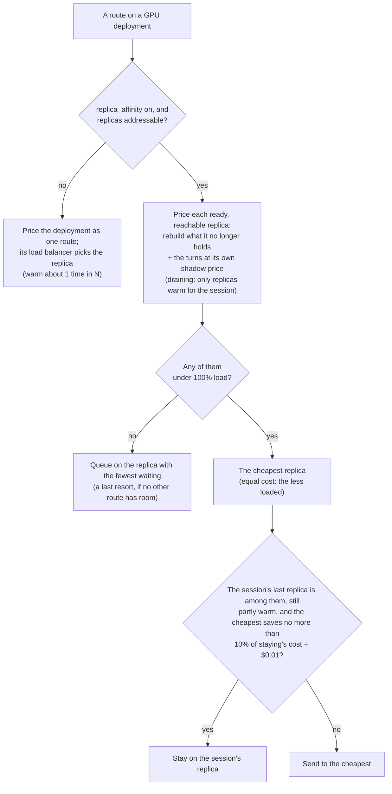

- **The session's replica** (the one that served its last turn) usually wins: it has nothing to rebuild.
  Below 60% load every replica has the same shadow price, so it always wins there; a new session goes to
  the least loaded one.
- **A busy warm replica can lose to an idle cold one.** Past the knee its shadow price rises with load, and
  over the rest of the session that can outweigh rebuilding the prefix on an idle replica. Moving needs the
  same margin as moving between backends (10% + $0.01 over the rest of the session), so a long session
  moves off a replica at around 75–90% load and a short one only when it's full. Example, at $1 input and
  $0.10 cache read per million tokens, 5 turns: a 200k-token session on a replica at 90% load moves to an
  idle one; a 10k-token session stays.
- **Gone, full or draining.** A replica that's no longer listed, or isn't `READY` (a SkyPilot cluster
  being torn down, a failed probe), is skipped, and so is one at 100% load while another has room. When
  every replica is full, the request queues on the one with the fewest waiting.
- **A draining deployment** only takes sessions that are warm on one of its replicas, and sends each to
  that replica.
- **Live load per replica.** With `max_concurrency` set, gateways count requests in flight to each replica
  (shared every 2 s), as they do per deployment; otherwise the controller's last sample of the replica's
  vLLM metrics.
- **A replica the gateway can't connect to** (a private address, a firewall) is skipped for 60 s and the
  request goes to the deployment's endpoint instead (the load balancer in front, if there is one; on SkyPilot,
  which has none, the first ready replica).

The routing reason says what happened: `gpu-qwen: staying on replica 2 (100% warm (estimate), 72% load)`,
`replica 3 (cold, 5% load) over replica 2 (100% warm (KV events), 91% load)`, `replica 1 is draining; …`.

`serve.replica_affinity: false` (the default behind llm-d, whose endpoint picker chooses the replica with the most of
the prompt cached), or replicas the gateway can't address, leave the choice to the load balancer. A plain load
balancer doesn't know sessions, so a session finds its cache there about one time in N replicas, and the router
counts that share as warm.

## Free upgrades (and why they're safe)

If a strong open model is running with headroom and the task only needs a medium model, the user
gets the strong model at ~zero cost. Three guardrails keep this from backfiring:

1. **Low priority.** Opportunistic requests use vLLM priority scheduling, so traffic that *needs*
   that model always goes first. Batch work on GPUs goes lower still (priority 20, after free upgrades' 10), and only
   fills a deployment up to the shadow price's knee ([02](02-request-flow.md#batch-work-on-your-gpus)).
2. **Doesn't keep GPUs alive.** The controller leaves upgraded traffic out of the demand it sizes
   GPUs by, so free traffic can't make a GPU look worth keeping. (See [05](05-gpu-autoscaling.md).)
3. **Only at boundaries.** Upgrades/downgrades happen at session start or task boundaries, so
   tool-calling behavior and caches stay stable. The only mid-task moves are forced ones: the
   conversation no longer fits the model, or the model can't run.

## Free moments to re-route

Moving costs nothing when the session's cache is already gone:

- Session idle longer than the cache TTL (on an API; on a GPU, see the next point).
- A GPU replica evicted the session's KV cache: seen in vLLM's KV events, or estimated from what the
  replica has written into its cache since the session's last turn
  ([04](04-caching-and-sessions.md#gpu-replicas-which-one-holds-the-cache)).
- The harness compacted history (prefix hash no longer matches).
- A natural task boundary.

And one move happens even mid-task, because staying would fail: the conversation has outgrown the
model's context window (below).

## Older model names

A request that names another version of a configured model, such as `claude-sonnet-4-5` from a settings file, a script
or an older client, matches the model through its aliases (`claude-sonnet-*`) and gets the model's current version
(`claude-sonnet-5-5`). The response says so: `x-meritorder-upgraded-from: claude-sonnet-4-5`. `routing.upgrade_versions`
(on by default; Configuration → Routing) turns it off: then only the model's name, aliases without a version
(`sonnet`) and the version its routes serve are accepted, and another version gets a 404 that names the current one.
To serve an older version on purpose, configure it as its own model.

Settings the current version refuses are fitted to it on the way out (formats/thinking.py). An old thinking budget
(`thinking: {type: enabled, budget_tokens}`), which Fable, Opus 4.7 and later, Sonnet 5 and later and Haiku 5.5 refuse,
becomes adaptive thinking; when the request names no effort, the budget sets one (under 4,096 tokens `low`, under 16,384
`medium`, under 32,768 `high`, otherwise `xhigh`, at the nearest level the model has). `thinking: {type: disabled}`,
which Fable, Opus 5.5 and Sonnet 5.5 refuse, becomes `between_tools` on Sonnet 5.5 and low effort on the others.
Models that take the settings as sent aren't touched.

## Context windows

Each model's context window comes from the live price data (`context_window`, overridable per model).

- **Candidates need room, and that's all length decides.** For `auto`, a model drops out when the prompt,
  in that model's tokens (below), plus the reply the client asked for (its `max_tokens`, lowered to the
  model's maximum output) is over 95% of its window (`router.fits`, `FIT_SHARE`). The floor stays what the
  work gives it, and the cheapest remaining model wins. The reason names what was ruled out, why, and how
  the count was made: `ruled out gpt-oss-120b (131,072): window too small for about 300,000 tokens plus a
  32,000-token reply (estimate ×1.08, calibrated from 210 replies)`. A model that fits with less than 15%
  to spare gets a note too, `context window check close: claude-haiku (912,000 of 1,048,576 tokens, 87%;
  estimate ×1.12, calibrated from 340 replies)`, and the gateway logs it.
- **Nothing at the floor has room.** A higher floor wouldn't help (its models are a subset), and a lower
  one is never used, nor is a mock model whose window isn't known. The request goes to the model(s) with
  the largest window anyway, since the count is an estimate, and the provider decides; the reason says
  `no model at coding:4 has room for about …: sent to the largest window, …`. A provider's refusal reaches
  the client as "prompt is too long: …", which makes Claude Code compact. A named model is always sent;
  its reason says its window may be too small.
- **Outgrowing mid-task.** A session normally keeps its model until the next human prompt. If the
  conversation no longer fits that model, the router re-routes at the session's floor, and the routing
  reason says "session outgrew X's context window".
- **"Too long" from a provider.** A 400/413 that says the prompt doesn't fit (Anthropic's "prompt is too
  long", OpenAI's "maximum context length", and the like) isn't a backend failure: for `auto` the request
  goes to a qualifying model with a bigger window (re-deciding when no remaining candidate has one, e.g.
  the session was keeping its model). For a named model, or when no bigger model qualifies, the error is
  returned, with the message starting "prompt is too long:" so Claude Code compacts.
- **The reply fits too:** without a client `max_tokens`, the allowance is cut to the room left
  (`x-meritorder-max-tokens-source: context`).

`/v1/models` reports each model's window, and `auto`'s as the largest among the models `auto` can pick for the team (scored ones); harness
setup passes it on ([00, How it all works](00-how-it-all-works.md#7-context-windows-long-conversations)).

## Counting tokens

The router needs a prompt's size before it picks a model, and every tokenizer counts differently, so
the gateway estimates once per request and then corrects the estimate for each model by what that
model's replies have reported (`src/meritorder/tokens.py`).

**The estimate counts what the text is made of.** One pass over the request's text counts ASCII
letters (0.28 tokens each), digits (0.4), punctuation and symbols (0.5), spaces (0.05), newlines and
indented lines (1 each), lower-to-upper case changes and letter-digit changes (0.5 and 0.4: both split
words in every tokenizer), and characters outside ASCII by their UTF-8 length (0.4, 1 and 1.5 for
2-, 3- and 4-byte characters, so a Chinese, Japanese or Korean character is about a token). That puts
prose near 4 characters a token, code and JSON nearer 3, hashes and base64 nearer 2, and CJK text
near 1. Each message adds 4 tokens of framing, each tool call or result 3, and a request with tools
300 for the instructions providers add. A text over 256K characters is measured on 512 evenly spaced
slices and scaled to its length, so a 4 MB conversation is counted in about 5 ms on a laptop. Below that,
each text of 1,000 characters or more is counted once per process and its counts kept (up to 16 million
characters' worth, the oldest dropped first): an agent resends its whole history every turn, and
counting it again was the most expensive thing a long turn did. The kept counts add up to exactly what
one pass over the request gives.

**Images, PDFs and audio aren't text.** Their bytes are never counted as characters. An image is
counted the way the model's provider counts it, from the width and height in its file header (PNG,
JPEG, GIF, WebP): Claude (and pixel-based models generally) at width × height / 750 after scaling to
1568 px on the long edge and 1092 × 1092 pixels' worth (at most about 1,600); OpenAI at 85 for low
detail, otherwise 85 + 170 per 512-px tile after fitting 2048 × 2048 and the short side to 768;
Gemini at 258 per 768-px tile, at most 1,120. An image given by URL is counted at the largest size. A
PDF is 2,000 tokens a page (560 for Gemini), pages counted from its page objects or, when those are
compressed, from its size; audio is 10 tokens a second (32 for Gemini).

**Calibration.** Every reply reports the real prompt size (`usage`). The gateway compares it with its
estimate of what was sent (after tool-output compression) and keeps a running ratio per model:

| Rule | Value |
|---|---|
| A prompt of at least this many estimated tokens counts as a full sample; smaller ones in proportion | 20,000 |
| Prompts too small to use (fixed overheads the estimate can't see dominate) | under 500 tokens |
| Requests that are mostly images or documents (media over 25% of the text) | not used |
| A sample outside 0.4–2.5 times the estimate (a broken count, not a tokenizer) | ignored |
| Once a model has 3 full samples, one sample counts at most this far from its ratio | ±25% |
| How fast the ratio follows new samples | a plain mean at first, then about the last 10 long prompts |
| A model with few samples of its own | leans on the other models of its family (`claude-*`, `gpt-*`, …), or on 1, by one sample's weight |

Also used: Anthropic's exact count when `/v1/messages/count_tokens` reaches a backend, and the real size
when a provider's "too long" error states it (Anthropic, OpenAI, vLLM and Gemini do). Not used: mock
backends, replies whose usage includes a server-side web search (its results add tokens the request
didn't carry), and failed or cancelled requests.

**Where the count is used.** Each candidate gets the prompt in its own model's tokens (the text times
its ratio, plus media as its provider counts them): the window check, long-prompt price tiers, the
cost estimate (and the growth since the session's last turn), the per-request cost limit and the
output allowance. The output allowance also leaves room for the count running low: a third of the
prompt until a model has 3 full samples, then 2.5 times the measured spread, at least 3%. The
short-question level rule, rate limits and session sizes use the model-neutral estimate.

**Where it's kept and shown.** Each gateway process keeps its ratios, hands them to the new router on a
configuration reload (as it does measured speeds), saves the models it learned about every minute and
on shutdown to the store's `token_calibration` setting, and loads them at startup. Gateways share the
setting model by model: each save keeps what others saved for models it hasn't seen. The console's
Models page shows each model's ratio under its context window; `/metrics` has
`meritorder_token_ratio{model}` and `meritorder_token_calibration_samples_total{model}`.

## Batches

A request of a batch is routed by the same `decide` with `batch=True`: only routes whose backend has a batch API, each
priced for that one request at its batch price (prompt at the batch input price plus the reply's `max_tokens`, or
`est_output_tokens`), with no rebuild, stickiness or speed ranking, since there's no session and nobody waiting. Running GPU
deployments with `max_concurrency` set qualify too, priced at the [shadow price](#shadow-price) for their load now: 2% of
the route's price below the knee, so a GPU with room beats every provider's batch price, and one near full doesn't. A full,
draining or stopped deployment isn't a route, and batch work never starts one. Levels, policies, context windows, the
per-request cost limit (at batch prices) and cost per success apply as live. How a batch is split, reserved, run on GPUs
and settled: [02, Request flow](02-request-flow.md#batches-work-that-can-wait).

Each request is a new task, so with the [learned router](#the-learned-router) on it gets the learned level in route mode
when the model is sure, and in either mode the level that didn't act is priced among batch routes too. Batch requests
get no `route_features` row, auto or named. The labels are what follows an answer (sent again, a raised floor, a stopped
stream, asking again in a new session), and none of that can follow a batch request: every one would look like a
success, and one followed by the same person's live request with similar words would look like someone giving up
(decision 45).

## When a model refuses

Some models decline requests through safety classifiers (Claude returns HTTP 200 with
`stop_reason: "refusal"`; OpenAI-style APIs use `finish_reason: "content_filter"`; Gemini's native API
blocks the prompt or stops with `SAFETY`, `RECITATION` and the like, which the gateway reads as
`content_filter`). For `auto` requests, Merit Order retries on the next eligible model:

- Streams are buffered only until the first content arrives, so a refusal before any content is
  retried invisibly; one that arrives after content has started streams through.
- The refused attempt is recorded in the ledger (it cost tokens), and the response carries
  `x-meritorder-refused-by`.
- A model the client named is never substituted. Teams can turn this off (`refusal_fallback: false`).

## Where quality scores come from

The 1–5 quality scores come from published benchmarks, refreshed by the worker every `quality.refresh_hours` (24;
`src/meritorder/quality_data.py`): by default Epoch AI's data (`quality.source: epoch`), where each score is a model's chance of solving a task as hard as
FrontierSWE, against a fixed bar: 5 × the chance ÷ `quality.anchor` (below). The Artificial Analysis
Intelligence Index is the alternative source (`source: artificial_analysis`, with a free key in
`ARTIFICIAL_ANALYSIS_API_KEY`); `source: config` uses the scores written in the
configuration (they also stand until a source has been fetched). A model a source doesn't cover isn't
picked by `auto` (it still answers requests that name it) unless it has a `quality_override`, which
always wins. Your own evals check them on your work; see [11, Evals](11-evals.md).

### A fixed bar, not the best model (decision 58)

Until 15 November 2026 the default scale was `best`: 5 × a model's chance on the reference ÷ the best configured
model's. That drifts. A new frontier model lowers every other model's score though none of them got worse, so the same
work moves to dearer models with each release, and cost creeps up. It reaches cost per success too: there a level's
chances are read from the scores (`apply_chances`), with a 5 standing for the best model's chance, so a stronger model
raised the bar every level is measured against.

A worked example (`tests/test_quality_drift.py`): three models with a 70%, 50% and 45% chance on FrontierSWE-hard tasks,
the 45% one the cheapest. On the `best` scale it scores 5 × 45 ÷ 70 = 3.2 and takes coding:3 work. Add a model with a 95%
chance and nothing else changes: it scores 2.4, the 50% one 2.6, the 70% one 3.7, and the same coding:3 request goes to
the 70% model at ten times the price.

So the default is now `scale: absolute`: 5 × the chance ÷ `quality.anchor`, a fixed chance per task type that a 5 stands
for, at most 5 and at least 1. The default anchors are what the best model, Claude Fable 5.2, solved when the bar was
fixed: 0.6994 for coding and 0.7685 for general work (12 November 2026), so every score came out as it was on the
`best` scale. Level L means the work a model with L/5 of the anchor's chance just meets, release after release; a new
model changes nobody's score but its own, and one above the anchor scores 5 and meets every level. Its chance at
level 5 is then counted as the anchor's, which undercounts it a little in cost per success.

| Scale | A 5 is | A new, stronger model |
|---|---|---|
| `absolute` (default) | `quality.anchor`: 0.6994 coding, 0.7685 general | Changes nobody else's score |
| `best` | The best configured model's chance | Lowers every other score |
| `range` | The best model's; the weakest is 1 | Lowers every other score, and a new weak model raises them |

Existing configurations keep working: one that sets `scale: best` or `range` keeps it. A change of scale or anchor takes
effect on the next configuration load, without waiting for the worker: the scores are worked out again from the chances
stored with them (`config.live_section`). The anchor is Epoch's FrontierSWE fit as of the date above; if Epoch refits the
benchmark's difficulty, a model's chance moves, and the anchor stays what it means: that chance on that benchmark. The
Artificial Analysis index isn't a chance; with it the anchor is a share of the index (0.6994: an index of 69.9 scores 5).
Measured scores from evals (`source: config`) are on their own scale, the best measured model's pass rate
(`measured_best_rate`), and are written when a run is applied, so they don't move by themselves.

## Harness overrides

| Harness sends | Behavior |
|---|---|
| `model: "claude-sonnet-5-5"` (explicit) | No model substitution. Router picks the cheapest *backend* for that model. |
| `model: "auto"` | Classifier + router choose. |
| `model: "auto"` + `X-Route-Floor: coding:3` | Harness sets the floor; router chooses above it, also when the team routes by cost per success. |
| `X-Route-Hint: cheap` / `smart` | Nudges the classifier's floor down / up. |
| `reasoning_effort` / `output_config.effort` | Passed through to a backend that speaks the client's format, and translated across formats: OpenAI's `reasoning_effort` becomes Anthropic's `output_config.effort`, and an Anthropic client's effort becomes `reasoning_effort` at the nearest level the model accepts (`effort_levels`; not sent where those aren't known, since some models reject the field). Merit Order only picks an effort for `auto` requests that don't set one: by floor level, low for 1–2, medium for 3, high for 4–5 (`routing.effort_by_floor`; levels 1 to 5, efforts minimal, low, medium, high, xhigh or max, anything else refused at load). |
| `max_tokens` (or none) | A client's own limit is kept (lowered only to the model's maximum). Without one, the reply may be as long as the model can write (`max_output_tokens`, from the price catalog), less what won't fit in the context window or under the per-request cost limit. `x-meritorder-max-tokens` and `x-meritorder-max-tokens-source` on the reply say how much was allowed and why. A request whose own limit could cost more than `safeguards.max_request_usd` ($25 in the shipped config) on every route is refused. |
| `X-MeritOrder-Backend: <name>` (admins, and eval runs) | Pins the backend, e.g. to test one provider. |
| `X-MeritOrder-Priority: cost` / `balanced` / `speed` | How much more a faster route may cost: 2%, 20%, or 100% ([how it decides](10-how-it-decides.md#which-backend-gpu-or-api)). Overrides the team's `priority`. |
| `x-claude-code-session-id` | Claude Code's session id; used as the session. |
| `x-claude-code-agent-id` | A subagent's turn: routed in its own thread of the session (own model, level, cache). |
| `session-id`; `thread-id` with `x-codex-parent-thread-id` | Codex CLI's session id, used as the session; a Codex subagent's turn, in its own thread. |
| `x-claude-code-request-class: auxiliary` / `compaction` | Side requests and compaction summaries: the floor is capped (`routing.request_class_levels`, default 1 and 3). Side requests also get their own thread. Claude Code sends this header to a gateway only with `CLAUDE_CODE_GATEWAY_HINT_HEADERS=1`, which `meritorder setup claude-code` sets. |

## When a model's GPUs are stopped

- `auto` traffic, including sessions in the middle of a task, moves to the next eligible model
  (the session's cache is rebuilt there). A stop that drains first (the default for one deployment)
  lets sessions whose cache is already there finish on the GPUs, on the replica that holds it, until the
  drain ends.
- A request that names a model whose only routes are stopped GPUs gets a 503 that says why for
  each route ("stopped by dana: cost review", "OPENROUTER_API_KEY is not set") and suggests `auto`.
  A named model is never silently swapped. Teams can opt in to substitution (`substitute_unavailable: true`, or
  Config → Teams): the request then goes to a model at least as good for the task (never a weaker
  one), and the response carries `x-meritorder-substituted-for`. Give open models an API route (OpenRouter, the vendor, Bedrock) to keep
  them available; the GPUs page warns which models have none before anyone stops a deployment.

Team policy (`allowed_models`, `allowed_backends`; data residency is set by allowing only backends in
the right regions) is applied **before** scoring, so an override can never escape policy.
