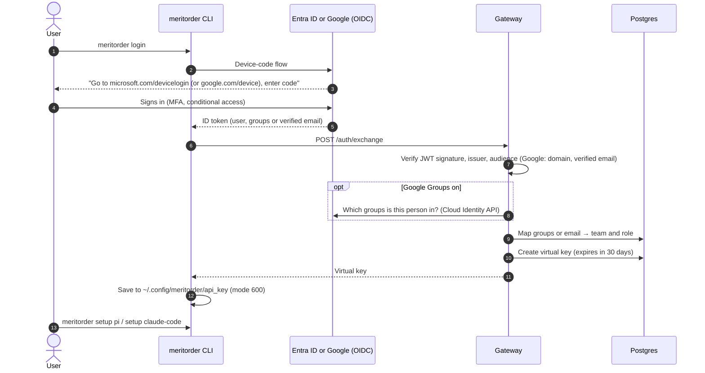
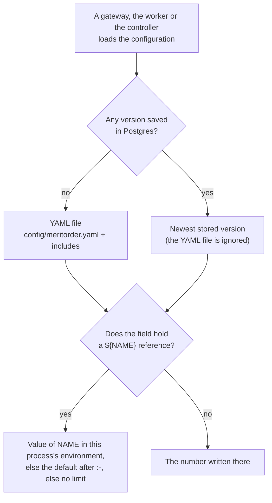
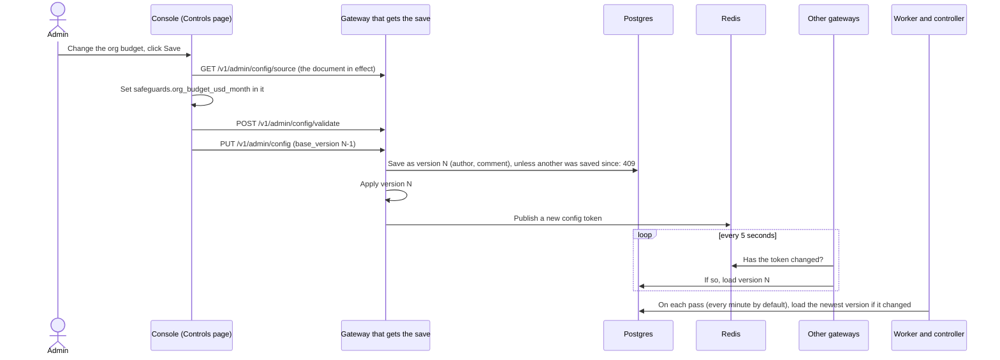
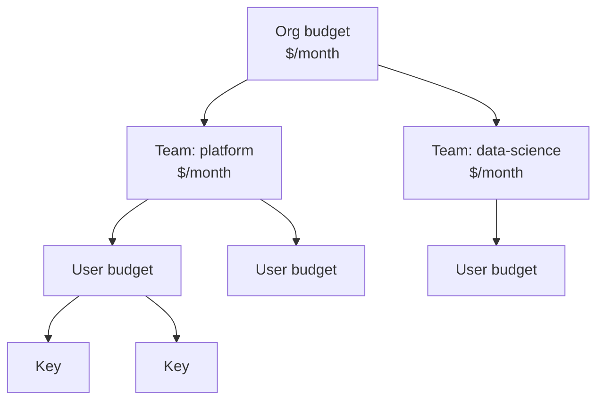

# 06 — Auth & spend

This doc covers who can call the gateway (keys, sign-in, teams and roles) and how spend is limited
(budgets, caps, safeguards) and recorded (the ledger).

**What's been checked.** Token verification runs in CI with a real signing key: expired, forged,
wrong audience or issuer, algorithm confusion, and tokens shaped like Google's. Budgets, limits and
safeguards are tested in CI against both in-memory storage and real Redis and Postgres. Sign-in,
group mapping and SCIM have **not** been run against a real Entra tenant, and Google sign-in and
Google Groups have not been run against a real Workspace domain. Those calls are written from the
providers' docs and tested against mocks.

## Getting a key into pi and Claude Code

Harnesses can't do interactive SSO, so people log in once with the CLI and get a short-lived
**virtual key** tied to their identity. The harness sends it like any API key.



```bash
meritorder login --gateway https://llm.example.com    # or: meritorder use-key <key from an admin>
meritorder setup pi            # adds a "meritorder" provider to ~/.pi/agent/models.json
meritorder setup claude-code   # points Claude Code at the gateway, starting sessions on auto
meritorder setup claude-code --config-dir ~/.claude-meritorder   # …in a separate Claude Code profile
```

The key is saved to `~/.config/meritorder/api_key` (under `$XDG_CONFIG_HOME` when that's set), with
mode 600, next to `credentials.json`, which also records the gateway URL. Both harness configs read
the key file at request time (`!cat ...` for pi, `apiKeyHelper` for Claude Code), so logging in again
rotates the key without touching them. pi is configured to send its session ID as `x-session-id` and
to add cache breakpoints, which Merit Order uses for sticky routing and caching. `setup pi` keeps the
previous `models.json` as `models.json.bak`.

`setup claude-code` writes to Claude Code's settings file: `$CLAUDE_CONFIG_DIR/settings.json` when that's
set, else `~/.claude/settings.json`, or the folder given with `--config-dir` (then start Claude Code
with `CLAUDE_CONFIG_DIR=<folder> claude`). It sets:

| Setting | Value |
|---|---|
| `env.ANTHROPIC_BASE_URL` | the gateway |
| `apiKeyHelper` | `cat ~/.config/meritorder/api_key` |
| `model` | `auto` (`--model <name>` for another model `/v1/models` lists for your key; `--model none` leaves Claude Code's choice) |
| `env.CLAUDE_CODE_MAX_CONTEXT_TOKENS` | the gateway's context window for that model (from `/v1/models`; for `auto`, the largest among the models `auto` can pick for your key), so Claude Code doesn't assume 200,000 for a name it doesn't know |
| `env.ANTHROPIC_CUSTOM_MODEL_OPTION`, `…_NAME` | `auto`, "auto (Merit Order)": adds it to the `/model` picker |
| `env.CLAUDE_CODE_GATEWAY_HINT_HEADERS` | `1`: Claude Code labels side requests and compaction summaries only when asked; Merit Order caps their level (`routing.request_class_levels`) |

For a Claude model name (`claude-…`) the window and picker entries are left out (Claude Code knows those
models) and removed if an earlier setup added them. The previous file is kept as `settings.json.bak`.
With the Merit Order key, Claude Code's requests don't use a claude.ai login: subscription limits don't
apply, and spend is counted here like any other key's.

How the gateway knows who's calling: every request carries a key (`Authorization: Bearer` or
`x-api-key`). The gateway hashes it, looks it up (cached for a minute), and gets the user, team,
and role, which drive budgets, policy, and reports. Unknown, revoked, or expired keys get a 401.

| Client | Auth |
|---|---|
| People in the console | Their account: a password kept here, or SSO ([below](#signing-in-to-the-console)) |
| People with harnesses | `meritorder login` → virtual key (above) |
| Services / apps | An Entra token directly as the bearer token, or a key from `meritorder keys create` |
| Local dev / quickstart | `MERITORDER_DEV_KEY` (static admin key from the environment), until the first admin account exists |

Sign-in switches on when `MERITORDER_OIDC_ISSUER` and `MERITORDER_OIDC_CLIENT_ID` are set. With Entra,
map group IDs to teams and roles in `auth.oidc` in the config; SCIM provisioning (below) disables
people when they leave. Google needs a little more: see [Signing in with Google](#signing-in-with-google),
and [Google Groups](#google-groups) to map Google groups the same way.

## Signing in to the console

People sign in to the console as themselves and get a session; keys are for harnesses, CI and services
([decision 69](09-decisions.md#69-people-sign-in-to-the-console-with-an-account-a-password-here-or-sso-not-a-pasted-key-keys-are-for-harnesses-and-services)).

| | Small team, no identity provider | Organization with Entra or Google |
|---|---|---|
| How people sign in | Email address and a password Merit Order keeps; `meritorder login` asks for them | The console's "Sign in with Microsoft / Google / your organization" button; `meritorder login` (device code) |
| How they join | An invite link from an admin or team lead (People → Invite someone) | The first time they sign in (or SCIM provisions them) |
| Forgotten password | An admin's or lead's reset link (People → Password link) | Their identity provider |
| Leaving | Disable them on the People page | Disable or remove them in the identity provider (with SCIM, at once) |
| Turning passwords off | | `auth.local.enabled: false` |

### SSO in the browser

With `auth.oidc` set, the console's sign-in page shows a "Sign in with …" button. It uses OIDC's authorization-code
flow with PKCE: the gateway sends the browser to your identity provider, takes the code back at
`/auth/sso/callback`, checks the ID token (signature, issuer, audience, expiry, the nonce it sent, and for Google the
Workspace domain), and opens a session for the person, created or updated from the same sign-in mappings as
`meritorder login`. A disabled person is refused. The answer is tied to the browser that asked (a short-lived
`mo_sso` cookie) and each sign-in attempt works once, within ten minutes.

| Provider | What to register |
|---|---|
| Entra | In the same app registration: Authentication → Add a platform → **Web**, redirect URI `https://<gateway>/auth/sso/callback`, and a client secret (Certificates & secrets) in `MERITORDER_OIDC_BROWSER_CLIENT_SECRET`. Or, without a secret, the redirect URI under **Mobile and desktop applications** (a public client; "Allow public client flows" is already on for `meritorder login`) |
| Google | A second OAuth client of type **Web application** (the device-login client can't do this), with that redirect URI as an authorized redirect URI. Its ID in `MERITORDER_OIDC_BROWSER_CLIENT_ID`, its secret in `MERITORDER_OIDC_BROWSER_CLIENT_SECRET`. Until both are set, the console doesn't show the button |
| Other OIDC providers | A client allowed the authorization-code flow with that redirect URI; its secret if it's confidential |

The gateway builds the redirect URI from the address the browser used (with `X-Forwarded-Proto` and
`X-Forwarded-Host` behind a proxy); set `auth.oidc.redirect_uri` if that isn't what you registered.
`auth.oidc.browser: false` hides the button. Where everyone should use SSO, set `auth.local.enabled: false`: the
password form and invite links go away, and keys still work for harnesses and services.

`meritorder login` signs in with the device-code flow where SSO is set up, and asks for the email address and password
where it isn't (or with `--password`); either way it saves a short-lived key for the harnesses.

**The first admin.** On a new install, either sign in once with the setup key (`MERITORDER_DEV_KEY` in `.env`:
"Sign in with an API key instead") and invite yourself and others from the People page, or create the account
directly:

```bash
docker compose exec gateway meritorder accounts create you@example.com --role admin   # asks for a password
docker compose exec gateway meritorder accounts create pat@example.com --link --url http://localhost:8080   # prints an invite link
docker compose exec gateway meritorder accounts reset pat@example.com --url http://localhost:8080          # prints a reset link
```

A static admin key from the environment or the config file keeps working after that. Outside a laptop, take it out
once people have their own accounts and restart the gateway: anyone who has it can do anything.

**Sessions.** A session is a random token in an `HttpOnly`, `SameSite=Strict` cookie: `mo_session` over plain HTTP,
and over HTTPS (directly or through a proxy that sets `X-Forwarded-Proto`) `__Host-mo_session`, marked `Secure`, which
no other subdomain can set, so a sibling site can't sign your browser in to an account of its choosing. The gateway keeps only its hash.
It lasts `auth.session_hours` (12 by default). Like a key, it acts as the person's record as it is now, at most a
minute old, so moving, demoting or disabling someone applies to their console sessions too. Signing out ends the
session on the gateway, not only in that browser. When a session ends while the console is open, its next call takes it back to the
sign-in page, which says why; signing in again returns to the page you were on. Changing your password (account menu → Change password) ends your
other sessions; a reset link ends all of them.

**Invite and reset links** work once, for `auth.local.invite_hours` (72 by default). Each person has at most one open
link; making a new one withdraws the old, and so does changing their team, role or access. Merit Order doesn't send
email: the person who makes the link sends it. Who may make one follows the rule for keys: an admin for anyone, a team
lead for new people and people on their own team with the user role. A password set through a team lead's link acts at
most as a user: if the person is promoted later, it stops signing in and they need an admin's link, so whoever chose
it can't follow them up. Open links are listed on the People page, where they can be withdrawn. The link's token goes
in the request body, never a URL, so access logs don't record it.

**Passwords are only for people invited by email.** Someone who signs in with SSO, or who only has a key, can't be
given one (People → Password link refuses, and so does inviting an address an SSO person already has), so removing
them in the identity provider or revoking their key is enough. Inviting someone by email in an organization that also
has SSO gives them a separate, local account; set `auth.local.enabled: false` where that shouldn't happen.

**Passwords** need at least 12 characters (`auth.local.min_password_length`) and no particular mix of characters:
length is what makes a password hard to guess. They're kept as scrypt hashes. Each attempt counts before it's checked
(a right one is taken back off), so after 10 failed sign-ins for one address in 15 minutes, or 30 from one client in a
minute, the gateway answers 429 until the window ends, however many attempts arrive at once. A wrong address gets the
same answer as a wrong password. The per-address limit means anyone can lock a known address out for 15 minutes;
that's the trade for stopping guessing. Behind a proxy, the gateway sees every client as the proxy's address unless
the proxy is trusted (`FORWARDED_ALLOW_IPS`, [07](07-deployment.md)): then the per-client limit applies to everyone at
once. Resetting or changing a password also revokes the keys `meritorder login` got with the old one.

### Two-factor sign-in

People with a password here can turn on two-factor (account menu → Two-factor sign-in): signing in then also takes a
six-digit code from an authenticator app (1Password, Apple Passwords, Google Authenticator, Authy and others), on the
console and in `meritorder login` ([decision 73](09-decisions.md#73-two-factor-sign-in-for-local-accounts-authenticator-codes-and-recovery-codes)).
People who sign in with SSO get two-factor from their identity provider instead.

- **Turning it on:** the console shows a QR code to scan, an `otpauth://` link (opening it on the phone or Mac with the
  app adds the account) and the key to type in; entering the code the app shows turns it on, ends your other sessions, and shows ten recovery codes,
  once. Each recovery code signs you in once in place of a code.
- **Codes:** the standard time-based kind (SHA-1, 6 digits, 30 seconds), accepted one step either side for clock drift;
  each code works once. A wrong code counts against the sign-in limit like a wrong password.
- **A forgotten password** doesn't turn it off: a reset link sets a new password, and the code is still asked for.
- **A lost device:** a recovery code, or an admin's **Reset two-factor** on the People page, which turns it off and ends
  the person's sessions. Team leads can't.
- **Storage:** the authenticator secret has to be read to check a code, so it's sealed (AES-256-GCM, tied to its person)
  with `MERITORDER_AUTH_KEY` when that's set, and stored as it is otherwise; recovery codes are stored as hashes.

**Keys in the console.** "Sign in with an API key instead" still works: the gateway checks the key and opens a
session tied to it, so the browser never stores the key, and revoking the key ends the session. A console that kept
a key from an earlier version trades it for a session the next time it opens, and forgets it.

**Requests the cookie can make.** A browser sends the cookie on its own, so a request made with it that changes
something (anything but `GET`) must also carry the console's `x-meritorder-console` header and, when the browser
says where it came from (`Origin`), come from the gateway's own address. Other sites can't send that header, and
`SameSite=Strict` already keeps the cookie off requests other sites start. Behind a proxy that changes the host
name, have it send `X-Forwarded-Host`. Requests with a key in the `Authorization` header don't need either, and
the proxy's own APIs (`/v1/chat/completions`, `/v1/messages`, …) never accept the cookie.

| Setting | Default | |
|---|---|---|
| `auth.local.enabled` | `true` | Password sign-in and invite links. Off: SSO and keys only |
| `auth.local.min_password_length` | `12` | 8 to 128 |
| `auth.local.invite_hours` | `72` | How long an invite or reset link works |
| `auth.session_hours` | `12` | How long a console sign-in lasts |
| `auth.oidc.browser` | `true` | The console's SSO button |
| `auth.oidc.browser_client_id` | `client_id` | The client the browser signs in with (Google: the Web application client) |
| `auth.oidc.browser_client_secret_env` | | The environment variable holding that client's secret (`MERITORDER_OIDC_BROWSER_CLIENT_SECRET` in the shipped config) |
| `auth.oidc.redirect_uri` | the browser's address + `/auth/sso/callback` | Set it if a proxy hides the gateway's public address |

## Data policy

Each backend says who receives what's sent to it and what your agreement with that provider says, so a caller can keep
some data away from some providers ([decision 72](09-decisions.md#72-named-tiers-a-route-listing-and-a-callers-data-policy)).

| Backend setting | |
|---|---|
| `provider` | Who receives the data. Default: from the address (`anthropic`, `bedrock`, `azure_openai`, `foundry`, `vertex`, `gemini`, `openai`, `openrouter`, `mistral`, `deepseek`, `xai`, `moonshot`, `zai`, `minimax`); your own GPUs are `self_hosted`; anything else is the backend's name |
| `zero_retention` | `true` if the provider keeps no prompts or outputs under your agreement (for example Anthropic's or OpenAI's zero-data-retention terms, if you have them); `false` if it keeps them; unset is unknown |
| `trains_on_data` | Whether the provider may train on what's sent; unset is unknown |

Merit Order never guesses these: retention depends on your contract, not on the provider's name. Your own GPUs keep
nothing and train on nothing.

A request can carry the caller's policy:

```
X-MeritOrder-Allowed-Providers: anthropic, bedrock
X-MeritOrder-Zero-Retention: required
```

Routes to other providers, or (with zero retention required) to providers not stated as zero-retention, are left out
of the choice, as a team's `allowed_backends` would be. If nothing is left, the request is refused with `403` and a
message starting `data_policy:` that names each route's reason. Embeddings follow the same rules. `GET /v1/routes`
shows each tier's candidates with their provider, price and these facts (with `source`: `config`, `self_hosted` or
`unknown`), so a caller can check its policy before sending; `GET /v1/capabilities` says both are offered.

## Request screening

Agents read web pages, run commands and edit files on someone's machine, and the gateway sees every tool call they
make and every result they send back. Request screening reads those and records what a security team would want to
know. It's per team (`screening.mode: shadow`, off by default) and, for now, shadow only: **nothing is blocked or
changed**, so it can run on real traffic to show what it would catch and how often it would be wrong before anything
acts on it ([decision 71](09-decisions.md#71-request-screening-starts-in-shadow-with-fixed-rules-on-what-agents-do-not-a-detector)).

Each request is read once: only what's new since the session's last turn, so an agent's tool calls and their results
are each looked at as they arrive. Fixed rules, no model; it takes well under a millisecond
(`meritorder_screening_seconds`).

| Kind | What it means |
|---|---|
| `unicode_tags` | Unicode tag characters: invisible to people, read by models ("ASCII smuggling") |
| `unicode_bidi`, `unicode_invisible` | Bidirectional overrides; zero-width characters (not the joiner emoji use) |
| `secret_in_tool_call` | A provider-prefixed key (`sk-ant-`, `ghp_`, `AKIA`, private key blocks and others) in a tool call the model made: it may be sending it somewhere |
| `secret_in_prompt` | Such a key in text going to the provider: a prompt or a tool result |
| `pipe_to_shell` | A download piped into a shell or interpreter (`curl … \| sh`) |
| `upload` | Data sent out: `curl -d/-F/-T`, `wget --post-*`, `nc host port` |
| `dns_exfil` | `ping`, `dig`, `nslookup`… with command substitution: a known way to leak data through DNS |
| `credential_read` | Reading `.env`, SSH keys, `~/.aws/credentials`, `.netrc`, `.git-credentials`, kube or Docker config |
| `config_write` | Writing agent, editor, git-hook, CI workflow or shell start-up configuration (`.claude/settings*.json`, `.mcp.json`, `.cursor/mcp.json`, `.git/hooks/*`, `~/.zshrc`…) |
| `md_image_url` | An image link with a query string in the model's own text: a way to leak data when a client renders it |
| `after_untrusted` | One of the risky kinds above after the session read untrusted content: the shape of a prompt injection |

Untrusted content is a result from a web fetch or search tool (`WebFetch`, `web_search`, browser tools, MCP fetch
tools), or from a tool of an MCP server registered with `untrusted_content: true` (see [MCP gateway](#mcp-gateway)).
Once a session has read some, its requests carry `screen_untrusted: 1`.

**Where it shows.** Each request with findings gets a `screen` ledger tag (the kinds, joined with `+`, for example
`after_untrusted+credential_read`), so Reports → Breakdown → Tag → `screen` lists them and the Requests view filters
by `tag=screen`. `meritorder_screening_findings_total` counts each kind by team for alerts. Only kinds and counts are
kept: never the text, the command, the path or the key. A finding about a tool call lands on the request after it,
which is when the gateway first sees the call. Clients and keys can't set or clear these tags.

**What it doesn't do yet.** Block or redact anything; detect injections in prose (published detectors miss most
injections against agents and flag up to a third of ordinary tool output, [decision 71](09-decisions.md));
read base64 or other encodings; scan responses as they stream. Each is a later step, and blocking will start from what
shadow mode shows on your traffic.

## MCP gateway

Agents use MCP servers for their tools: GitHub, an issue tracker, internal docs. Through the gateway, each server is
registered once, with the organization's credential for it, and people connect to `/mcp/<server>` with their Merit
Order key, as they do for models. The same people, teams and roles apply, and every tool call is logged
([decision 75](09-decisions.md#75-an-mcp-gateway-servers-registered-once-reached-with-a-merit-order-key-tools-pinned)).

```yaml
mcp:
  servers:
    github:
      url: https://api.githubcopilot.com/mcp/
      description: GitHub, as the org's app
      auth: {type: api_key, value_env: MERITORDER_MCP_GITHUB}   # the gateway's credential; never the caller's key
      pinning: enforce                 # a changed tool is hidden until an admin approves it
    linear:
      url: https://mcp.linear.app/mcp
      auth: {type: forward}            # each person's own token, sent in x-meritorder-mcp-authorization
      untrusted_content: true          # issues are other people's words (request screening marks the session)
  log_days: 90                         # how long the tool-call log is kept
teams:
  web:
    mcp:
      servers: ["*", "!github"]        # which servers the team may use
      tools: ["*", "!linear/delete_*"] # which tools, as server/tool globs
      calls_per_minute: 120            # each person's tool calls, across servers
      secrets: block                   # keys in tool arguments and results: off, shadow (default) or block
```

**Connecting an agent.** The console's Tools page shows each server's command. Claude Code:

```bash
claude mcp add --transport http github https://gateway.example.com/mcp/github \
  --header "Authorization: Bearer $MERITORDER_API_KEY"
```

Codex, in `~/.codex/config.toml`:

```toml
[mcp_servers.github]
url = "https://gateway.example.com/mcp/github"
bearer_token_env_var = "MERITORDER_API_KEY"
```

`GET /v1/mcp/servers` lists the servers the caller's team may use. Name a server in the agent as it's named here, so
request screening recognizes its tools (`mcp__<server>__<tool>`).

**How the gateway signs in to a server** (`auth.type`):

| Type | What the server gets |
|---|---|
| `api_key` | The gateway's own credential, from `value_env` (a saved configuration may read only `MERITORDER_MCP_*`) or `value_file`; in `header` (default `Authorization: Bearer`) |
| `forward` | Each person's own credential for that server, which their agent sends in `forward_header` (default `x-meritorder-mcp-authorization`) and the gateway sends on in `header` |
| `none` | Nothing: an internal server on a private network |

The caller's Merit Order key is never sent on, as MCP's authorization rules require. When a server refuses the
gateway (401 or 403), the agent gets a 502 that says so, not a 401 that would look like its Merit Order key was wrong.

**What the gateway checks.**

* **Who may use what.** Tools a team may not use are left out of its tool lists, and calls to them are refused.
* **Pinned tool definitions.** The first time a tool is listed, its name, title, description, schemas and annotations
  are hashed and kept. A server that later changes a tool (the "rug pull", where a description is rewritten to steer
  the agent) is recorded as `changed`. With `pinning: enforce` the changed tool is hidden, and calls to it refused, until
  an admin reviews the old and new definitions on the Tools page and approves the new one; with `new_tools: hold`, a
  tool first seen waits for approval too. `pinning: shadow` (the default) records and changes nothing.
* **Descriptions that address the model** (`<IMPORTANT>`, "don't tell the user", paths like `~/.ssh`), and hidden
  Unicode in them, are flagged on the Tools page.
* **Keys** (the same patterns as request screening) in a call's arguments or a tool's result. With `secrets: block`, a
  call whose arguments carry one is refused, and one in a result is replaced with `[key removed by Merit Order: <kind>]`.
* **A per-person limit** on tool calls a minute.
* **Sessions.** A server's session ID is bound to the person who opened it; anyone else presenting it gets a 404.

A refused call comes back as a tool result with `isError: true` and the reason, so the agent can read it and tell the
person, rather than as a protocol error.

**What's kept.** Every tool call is logged: when, who, which server and tool, how it went (ok, tool error, failed,
refused), how long it took, sizes, and the kinds of anything noticed. Never the arguments or the results. Admins see
every team on the Tools page; team leads see their own team's calls. `meritorder_mcp_calls_total`,
`meritorder_mcp_findings_total` and `meritorder_mcp_call_seconds` carry the same for alerts.

**Transport.** MCP's Streamable HTTP (2025-03-26 and later): POSTs answered with JSON or an event stream, the GET
stream for the server's own messages, and DELETE to end a session. Messages pass through as they are, except tool
lists, tool calls and tool results. Servers that only speak stdio need a bridge that serves them over HTTP.

**Not yet.** OAuth sign-in for agents (they send a key, as for models), the gateway signing in to servers with each
person's OAuth tokens, one endpoint that joins several servers' tools, and a per-tool limit.

## People and teams

| What | Where it's managed |
|---|---|
| Who exists, and their group membership | Your identity provider (Entra or Google). People are created in Merit Order the first time they sign in with `meritorder login`, when they're issued a key, or when Entra provisions them through SCIM. |
| Teams, with budgets, limits, and model policy | Merit Order: Config → Teams. An IdP has no notion of "$5,000 a month, these models only". |
| Which team and role someone gets | Entra groups, or with Google, Google groups (read by the gateway) and verified email addresses and domains, mapped to teams and roles in Config → Access. Re-read at each sign-in; Google groups also while people use the gateway. |
| Exceptions | The People page: an admin can move someone or change their role (either pins team and role, so later sign-ins and SCIM don't override them), hand them back to the sign-in mappings (Follow sign-in), set a monthly limit, or disable them. |

The user record decides a person's team, and it can lower what a key acts as but never raise it: a key
acts as the lower of the role it was issued with and the role on its person's record (`ROLE_RANK`: user,
team lead, finance, admin). Moving, demoting or disabling someone takes effect within a minute on every
gateway, including keys they already have and static keys from the config file. Promoting someone applies to
keys issued after it: their next `meritorder login`, or a key an admin issues. So a `user` key a team lead
issued for someone who hasn't signed in yet stays a user key when that person turns out to be an admin. The
Keys page shows each key's role and, where the person's record outranks it, what the key acts as.

A team lead issues and revokes keys only for themselves, for new people, or for people on their own team with
the user role; keys for anyone else (another team, a lead, an admin) need an admin. Their keys expire within
`expires_days` (default 90, at most 3650); only an admin can issue a key that never expires. A disabled person
can't sign in: `POST /auth/exchange` answers 403 and issues no key.

| Role | Sees | Can change |
|---|---|---|
| user | Their own usage | Nothing (`meritorder login` gets them a new key) |
| team lead | Their team: reports, requests, ledger export | Keys on their team (they issue only `user` keys) |
| finance | Every team, aggregated: no per-request rows, exports or live request feed (`/v1/reports/requests` and `/v1/console/feed` answer 403) | Nothing |
| admin | Everything, except the content of other people's stored responses | Everything |

No role reads another person's stored responses ([below](#stored-responses-who-holds-them-and-who-can-read-them))
unless their team lists that role in `stored_responses.readers`.

**SCIM provisioning** (`/scim/v2`, enabled by `MERITORDER_SCIM_TOKEN`): Entra pushes people and
group changes as they happen. Group membership recomputes team and role with the same mappings as
sign-in (an admin's pin still wins), and anyone deactivated or removed in Entra is disabled at once:
their keys stop working within a minute (spend history is kept), and anything they kept in the Responses
API's stored mode is deleted. SCIM's `active` flag works both ways: if Entra later sends the person as active
again, they are enabled again, even if an admin disabled them on the People page. To keep someone out, disable
or remove them in Entra too.

**Entra group overage.** A person in more than 200 groups gets a token without the `groups` claim (Entra
puts a pointer to Microsoft Graph in `_claim_names` instead). The gateway doesn't call Graph, so their group
mappings don't apply: they get the email mappings and `default_team`, and the gateway logs a warning naming
them. Configure the app registration to send only groups assigned to the application ("Groups assigned to the
application" in Token configuration), or map them by email, or provision them with SCIM.
Setup: Entra → Enterprise applications → your app → Provisioning → Automatic; Tenant URL
`https://<gateway>/scim/v2`, Secret token = `MERITORDER_SCIM_TOKEN`.

## Signing in with Google

Google sign-in uses the same `meritorder login` (device code) and the same `/auth/exchange` as Entra.
Google's tokens and login flow differ in a few ways, and the gateway handles each:

| | Entra | Google |
|---|---|---|
| Who can get a token | Members of your tenant: the issuer is per tenant | Anyone with a Google account: one issuer for everyone. `hosted_domains` limits sign-in to your Workspace domains, checked against the token's `hd` claim. It's required: the gateway won't start with the Google issuer and no domains |
| Groups in the token | Yes (`groups`) | None. The gateway can read them from Google ([Google Groups](#google-groups)); verified addresses and whole domains map too (`team_from_emails`, `role_from_emails`), and exceptions go on the People page |
| Email | `preferred_username`; not verified, so never used for mapping | `email` with `email_verified`. A token whose address isn't verified is refused |
| Who the person is | `oid` | `sub` (Google says addresses can change and be reused; `sub` never is) |
| Device login | A public client with no secret | An OAuth client of type "TVs and Limited Input devices". Its secret goes with every poll; Google treats it as public for that client type, so the gateway hands it to `meritorder login` |
| Scopes | `openid profile email offline_access` | `openid email profile`, set automatically (Google refuses `offline_access`, and its device login allows only these) |
| Issuer in tokens | As discovered | `https://accounts.google.com` or `accounts.google.com`; both are accepted |

Setup:

1. In the Google Cloud console, open **Google Auth Platform** (APIs & Services → OAuth consent screen) and
   set the audience to **Internal**, so only accounts in your Workspace can sign in at all.
2. **Clients → Create client**, application type **TVs and Limited Input devices**. Copy the client
   ID and secret.
3. On the gateways (`.env`, or the Helm secret):

   ```bash
   MERITORDER_OIDC_ISSUER=https://accounts.google.com
   MERITORDER_OIDC_CLIENT_ID=123456789012-abc.apps.googleusercontent.com
   MERITORDER_OIDC_CLIENT_SECRET=GOCSPX-...
   MERITORDER_OIDC_HOSTED_DOMAINS=example.com          # comma-separated if you have several
   ```

   The shipped config reads all four. If your configuration was already saved from the console
   before these fields existed, fill in the client secret and domains on Config → Access. The
   secret must stay a reference (`${MERITORDER_OIDC_CLIENT_SECRET}`), since secrets aren't stored.

4. Map teams and roles in `auth.oidc` (or Config → Access):

   ```yaml
   auth:
     oidc:
       team_from_emails:
         "@example.com": platform            # everyone in the domain
         "@research.example.com": research
         "bob@example.com": data-science     # one person
       role_from_emails:
         "carol@example.com": admin
         "dana@example.com": finance
       key_ttl_days: 7                       # see "Leavers" below
   ```

   A key with `@` in the middle is one address; `@example.com` or `example.com` is a whole domain.
   Team: the entry for the exact address, else a mapped group ([Google Groups](#google-groups)), else
   the address's domain, else `default_team`. Role: the highest any of them gives; everyone else is a
   user. Matching ignores case. These lists apply only to an `email` the token marks verified, which
   Google's are and Entra's aren't: with Entra, map groups.

5. People run `meritorder login`. It prints `https://www.google.com/device` and a code; they sign in
   with their Workspace account, and the gateway issues a key as with Entra.

Refusals: an account outside `hosted_domains` (a personal Gmail account, say) gets 403 "sign-in is
limited to accounts in example.com", and an unverified address gets 403 "this account's email address
isn't verified". Both checks also apply to a Google ID token sent directly as a bearer token. A Google
service account's ID token has no `hd`, so services use a key from `meritorder keys create`. If the issuer is
written another way (`https://accounts.google.com:443`, say) the start-up check doesn't see Google, so the gateway
also refuses every token Google's issuer signed while `hosted_domains` is empty.

**Leavers.** Google Workspace doesn't provision custom apps over SCIM, so a suspended account isn't
disabled here at once. It can't sign in again, and its keys stop when they expire (`key_ttl_days`,
30 by default; 7 is a reasonable choice with Google). To cut someone off now, disable them on the
People page. With Google Groups on, taking someone out of their groups also takes away the team and
role those groups gave, at the next refresh, while their keys still work.

### Google Groups

Google's ID tokens never include groups, so the gateway can read them itself from Google's Cloud
Identity Groups API (v1, as documented in November 2026) and map them as it maps Entra groups:
`team_from_groups` and `role_from_groups`, keyed by the group's address.

```yaml
auth:
  oidc:
    issuer: https://accounts.google.com
    # client_id, public_client_secret, hosted_domains as above
    google_groups:
      enabled: true          # the shipped config: MERITORDER_GOOGLE_GROUPS=true
      credentials_env: MERITORDER_GOOGLE_GROUPS_CREDENTIALS   # the service account's JSON key (or credentials_file)
    team_from_groups:        # the first group in this list someone is in sets their team
      "platform-team@example.com": platform
      "research@example.com": research
    role_from_groups:
      "gateway-admins@example.com": admin
      "finance@example.com": finance
    team_from_emails:
      "bob@example.com": data-science   # an exact address still wins over a group
      "@example.com": general           # the domain catches everyone in no mapped group
```

**Which mapping wins.** The team comes from, in order:

1. the person's exact address in `team_from_emails`;
2. the first group in `team_from_groups` they're in, directly or through nested groups;
3. their domain in `team_from_emails`;
4. `default_team`.

The role is the highest that any of their groups, their address or their domain gives; everyone else
is a user. Addresses match ignoring case. A team or role an admin set on the People page wins over all
of them. Map only groups whose membership your admins control: a group anyone in the organization can
join, mapped to a role, lets anyone take that role.

**Setup.** You need a Google Cloud project and a Google Workspace super admin.

1. Google Cloud console → **APIs & Services → Library** → **Cloud Identity API** → **Enable**.
2. **IAM & Admin → Service Accounts → Create service account**, for example `meritorder-groups`. It
   needs no IAM roles in the project. Copy its email address.
3. Give the gateways a way to act as it, one of:
   - **GKE Workload Identity** (no key to keep): let the gateways' Kubernetes service account act as it,

     ```bash
     gcloud iam service-accounts add-iam-policy-binding meritorder-groups@PROJECT.iam.gserviceaccount.com \
       --role roles/iam.workloadIdentityUser --member "serviceAccount:PROJECT.svc.id.goog[NAMESPACE/KSA]"
     ```

     and annotate it in the Helm values: `serviceAccount.annotations: {iam.gke.io/gcp-service-account:
     meritorder-groups@PROJECT.iam.gserviceaccount.com}`. Leave `MERITORDER_GOOGLE_GROUPS_CREDENTIALS`
     unset. A pod has one Google identity, so if the gateways already use a service account for Vertex,
     give that one the role in step 4 instead. Compute Engine and Cloud Run work the same way, through
     the service account attached to the VM or service.
   - **A key**: the service account → **Keys → Add key → Create new key → JSON**. Put the file's
     contents on one line (`jq -c . key.json`) in `MERITORDER_GOOGLE_GROUPS_CREDENTIALS`, in `.env` or
     the gateways' Secret. With `secrets.mountAsFiles` in Helm, also set `credentials_file:
     /run/secrets/meritorder/MERITORDER_GOOGLE_GROUPS_CREDENTIALS`, so a rotated key is used without a
     restart. If your organization blocks key creation (`iam.disableServiceAccountKeyCreation`), use
     Workload Identity.
4. In the Google Admin console (admin.google.com), signed in as a super admin: **Menu → Account →
   Admin roles**. Point to **Groups Reader**, click **Assign admin**, then **Assign service
   accounts**. Enter the service account's email address, click **Add**, then **Assign role**. To
   limit the role to security groups, choose that while assigning it and set
   `security_groups_only: true`. If multi-party approval is on for role changes, another admin
   approves it.
5. Set `MERITORDER_GOOGLE_GROUPS=true` (or switch on **Read Google Groups** on Config → Access) and map
   groups by address. `meritorder check` shows which key or identity the gateway will call Google as,
   without calling it; the first sign-in shows whether Google answers (People page, and an alert if not).

That's all: no domain-wide delegation and no scopes to authorize in the Admin console. The gateway asks
Google for one read-only scope, `https://www.googleapis.com/auth/cloud-identity.groups.readonly`. If
the metadata server gives a token with the broader `cloud-platform` scope instead (GKE Workload
Identity does), the Cloud Identity API accepts that too, and the service account can still only read
groups: that's all its role allows. Keys and tokens are never logged or stored.

**When groups are read.** At sign-in, and again for people using the gateway: anyone who made a
request since their groups were last read is read again once `refresh_seconds` (60) have passed, by
one gateway at a time. A removal reaches the user record then, and every gateway's key cache within a
minute after, as when SCIM brings an Entra group change: about two minutes in all by default. People
who stop using the gateway aren't read until they're back. Each reading is one call to Google per
person (and a page per 1,000 groups). People who signed in with Google before groups were turned on
are read the first time they use the gateway after that.

**Nested groups.** Google's transitive search (`searchTransitiveGroups`) lists every group someone is
in, through nested groups too, in one call. Google offers it on Workspace Enterprise Standard and
Plus, Enterprise for Education, and Cloud Identity Premium; other editions get a 403. The gateway then
lists direct groups (`searchDirectGroups`) and follows the nesting itself, one call per group, keeping
each group's parents for a refresh period. A group the service account can't see into (another
organization's, say) is left out and logged.

**When Google can't be reached.** Each person keeps the groups last read for them for
`keep_last_known_hours` (24). After that, their team and role come from the email and domain rules
alone, until Google answers again. Each step raises an alert on the console's attention list and the
webhook: Google Groups unavailable (for a setup problem, such as a missing role, scope or API, the
alert says what to fix), the fallback to the email rules, and the recovery. The last groups read live
in Redis with the rest of the gateways' shared state.

**On the People page**, a Google groups column shows each person's mapped groups (the one that set
their team filled, nested ones marked), the rest on hover, which mapping set their team and role, and
whether Google answered last time. Team leads see only the groups the mappings use. **Follow sign-in**
reads the person's groups at once and applies them.

## Stored responses: who holds them and who can read them

A team can turn on stored mode for OpenAI's Responses API (Config → Teams → Stored responses;
[04](04-caching-and-sessions.md#stateful-apis), decision 51). **Then the gateway holds conversation content**:
each response's input and output, and each conversation's items, sealed with `MERITORDER_RESPONSES_KEY`, for the
`retention_days` the operator set (required; there is no default). Elsewhere the gateway keeps none.

| Who | Can |
|---|---|
| The person whose key made it, on the team it was made in | Read it, list its input items, chain from it, cancel it (background), delete it |
| A role listed in the team's `stored_responses.readers` | Read and chain from it: admins from any team, the other roles on the same team. Not delete it |
| Anyone else, admins included | Nothing: it's 404 to them, as if it didn't exist |

- **A response belongs to its person and team.** Someone moved to another team can't read or chain from what they
  stored on the old one; it expires with the old team's retention.
- **Removing someone deletes what they stored.** Disabling them on the People page, or deactivating or deleting them
  through SCIM, deletes their stored responses and conversations at once, and the providers' copies (backends with
  `responses_store`). Enabling them again doesn't bring them back. Their ledger rows stay, as for anyone.
- **Spend is as for any request.** Each stored turn is one ledger row, checked against the organization, team, person
  and session budgets, rate limits and the per-request cost limit before it's sent. A chained turn is priced on the
  whole conversation it's rebuilt into, which is what the provider bills.
- **The console shows sizes, never content.** Config → Teams and the Teams page show, per team, how many responses,
  conversations and items are stored, their sealed size, for how many people, and since when. No page shows what
  they say.

## Secrets in a saved configuration

An admin who saves a configuration from the console chooses both where a backend's key comes from and the
backend's `base_url`, and the backend sends its key to that URL. So a saved configuration may read only what the
operator allows (the YAML file on disk is the operator's and isn't checked; `configstore.secret_problems`):

| Field | May read |
|---|---|
| A backend's or bill source's `auth.value_env`, or `${NAME}` in its `auth.value` | A provider's key variable the shipped configs use (`ANTHROPIC_API_KEY`, `OPENAI_API_KEY`, `OPENROUTER_API_KEY`, `GEMINI_API_KEY`, `AZURE_OPENAI_API_KEY`, `AZURE_FOUNDRY_API_KEY`, `XAI_API_KEY`, `DEEPSEEK_API_KEY`, `MISTRAL_API_KEY`, `MOONSHOT_API_KEY`, `ZAI_API_KEY`, `MINIMAX_API_KEY`, `ANTHROPIC_ADMIN_KEY`, `OPENAI_ADMIN_KEY`, `AZURE_EXPORT_SAS`), or any `MERITORDER_BACKEND_<NAME>` |
| The gateway's own secret fields | Only their own variable: `reporting.clickhouse.auth` `MERITORDER_CLICKHOUSE_PASSWORD`, `compressor.api_key_env` `MERITORDER_COMPRESSOR_KEY`, `auth.oidc.google_groups.credentials_env` `MERITORDER_GOOGLE_GROUPS_CREDENTIALS`, `auth.oidc.public_client_secret` `MERITORDER_OIDC_CLIENT_SECRET`, `batches.key_env` `MERITORDER_BATCH_KEY` (and `_PREVIOUS`), `response_store.key_env` `MERITORDER_RESPONSES_KEY` (and `_OLD_KEYS`). A static key's `key_env` may name any variable: its value is only compared with callers' keys |
| Any `*_file` field (`value_file`, `key_file`, `credentials_file`, ...) | A file inside `MERITORDER_SECRETS_DIR` (default `/run/secrets/meritorder`, the chart's `secrets.mountAsFiles`), with `..` refused and symlinks resolved, named for a variable the field may read |
| `${NAME}` anywhere else (a `base_url`, a region, a budget) | Only the variables the shipped config uses there (`AZURE_OPENAI_ENDPOINT`, `AWS_REGION`, `MERITORDER_ORG_BUDGET_USD`, ...; `configstore.PLAIN_ENVS`) |

Anything else (`MERITORDER_DATABASE_URL`, `MERITORDER_SCIM_TOKEN`, `MERITORDER_ALERT_WEBHOOK_URL`, any file
elsewhere) is refused with a message saying what the field may read. The operator adds names in the gateways'
environment: `MERITORDER_CONFIG_SECRET_ENVS` for secret fields and `MERITORDER_CONFIG_ENVS` for `${NAME}` elsewhere
(comma-separated, a trailing `*` for a prefix). Restoring an old version applies the same rules.

## Where budgets and limits are set

Every budget and limit below is a field in the configuration. There are two places a configuration
can come from, and only one is in effect at a time:

1. **The YAML file**, `config/meritorder.yaml` (or `MERITORDER_CONFIG`), with its `include:` files.
   It is in effect only until someone saves a configuration from the console.
2. **The newest version saved in Postgres.** The console saves one when an admin saves on the
   Controls page (**Save as new config version**) or the Config page (**Save and apply**), restores
   an old version (Config → History), or applies an eval run's scores. Once any version exists,
   every gateway, the worker and the controller use the newest one and ignore the YAML file.
   Editing the file after that has no effect, so make later changes on the console (the Config
   page's YAML tab takes the whole document).

**Two saves never undo each other.** Every save names the version it was made to (`base_version`: the
`version` that `GET /v1/admin/config/source` returned, `null` while the file is in effect). If someone
saved another version since, the gateway refuses with 409 ("someone else saved the configuration
(version N) since you opened version M; reload to see their change, then make yours again") and saves
nothing. The check and the insert are one step in Postgres (an advisory lock), so of two admins saving
together exactly one wins. Every console save sends it: Config (**Save and apply**, **Restore** in
History) and Controls. Changes the gateway or the worker writes for you (an eval run's scores, a level
from the outcome report, the worker's `auto_apply`) are made to the newest version, read just before
saving, and checked the same way; the worker skips a recommendation that loses the race and tries it on
its next pass. `base_version` is optional on `PUT /v1/admin/config` and
`POST /v1/admin/config/versions/{id}/restore`: a script that leaves it out saves over whatever version
is newest, as before.

The first save copies the whole running document into Postgres (the file with its `include:` files
merged in), with the fields you changed set to their new values. `${NAME}` references are copied as
written, not as their values. Each process fills them in from its own environment every time it
loads the configuration.



So the environment variables in the shipped file (`MERITORDER_ORG_BUDGET_USD` and the others under
[Organization-wide safeguards](#organization-wide-safeguards)) set a field only while that field
still holds its `${...}` reference. That is true of the file, and of stored versions in which nobody
has changed that field. When an admin sets the field on the Controls page, the saved version holds
the number instead, and the variable no longer has any effect on it. Clearing a field on the
Controls page removes it from the document, which means no limit, not the variable's value.

Saving needs Postgres (`MERITORDER_DATABASE_URL`). Without it the console can edit and validate,
but not save, and the YAML file stays in effect. If a stored version can't be loaded when a gateway starts, the
gateway logs the error and runs on the YAML file. The worker and the controller log it and keep
the configuration they already had (the YAML file, if they had just started).



| Setting | Where to change it |
|---|---|
| Organization budget, GPU budget, GPU burn rate and replica caps, per-request cost limit | **Controls** page (admins; finance can view it), or `safeguards:` in the file |
| Team budget, per-person default, per-session cap | **Controls** page or **Config → Teams**, or `teams:` in the file |
| Rate limits, model and backend policy, exploration | **Config → Teams**, or `teams:` in the file |
| A level moved by the outcome report (`routing.level_map`) | **Reports → Levels** → *Apply* (admins), **Config → YAML**, or `routing:` in the file |
| One person's own monthly limit | **People** page, or `PATCH /v1/admin/users/{id}`. Kept on the user record in Postgres, not in the configuration |

Each save is a new version with its author, time and comment. **Config → History** lists them and
restores any of them, which saves it again as the newest version.

## Budgets



- A request must fit **every** level above it: organization, team, and person.
- **Each person can have their own monthly limit.** Without one, the team's per-person default
  (`user_budget_usd_month`) applies. A person's own limit replaces that default, higher or lower;
  the team and organization budgets still apply on top. `$0` stops their requests. Set it in either
  place below; the People page wins when both are set, and changes apply within a minute on every
  gateway, keys already issued included:
  - The console's **People** page (admins), or `PATCH /v1/admin/users/{id}` with
    `{"budget_usd_month": 250}`. Send `null` to clear it and go back to the default.
  - `budget_usd_month` on a static key in the config file, for people who use one.
- A person's limit counts everything they spent this month, on whichever team they were on.
- Spend is checked before a request is sent and counted when it finishes (Redis counters seeded
  from the Postgres ledger, which stays the source of truth). A request that finishes after Redis lost a month's
  counter (a flush, a failover, eviction) doesn't start it again: the next request seeds it from the ledger. One that
  finishes while the ledger is being read for a seed is kept aside and added to it, so it isn't lost.
- **The worker checks the counters against the ledger** every cycle (a minute): this month's for the organization, each
  team and each person, recomputed from the ledger plus running batches' reservations, the same sum a seed uses. A
  counter that's off by the same amount on two cycles running is corrected by that amount (a request finishing between
  writing its counter and its ledger row makes a difference that's gone the next cycle). That covers a Redis restored
  from an old snapshot, whose counters exist but are behind; the compose file runs Redis without persistence so that
  doesn't happen ([07](07-deployment.md)).
- **A batch** is checked once, against its estimated cost at batch prices, and refused if that doesn't fit what's left of
  any budget it counts against. The estimate is reserved in the same counters (so live requests see it) until the worker
  settles each result at what it cost. A request sent to a GPU reserves its fallback provider's estimate, since it may end
  up there, and settles at the GPU time it took. Rate limits and `max_session_usd` don't apply to batches
  ([02](02-request-flow.md#batches-work-that-can-wait)). A reservation counts in every month it's outstanding: a batch made
  on the 31st that settles on the 1st is charged in the new month, so the new month's budgets hold room for it. A batch
  that can't be stored takes its reservation back at once.
- **Judged labels** (opt-in per team, [03](03-routing.md#judged-labels)) spend as an internal client of the team,
  `judged-labels:<team>`, which shows as its own line in reports by person. Its requests count against the team's and
  the organization's budgets and are refused at 100% like anyone's; no per-person limit applies to it. Its monthly cap
  (`judged_labels.max_usd_month`, required, no default) is checked when each sample starts: none starts once it's spent,
  and one that started finishes. The worker alerts at 80% and 100% of the cap.
- **Exploration** (opt-in per team, `teams.<name>.exploration`, Config → Teams → Exploration;
  [03](03-routing.md#exploration)) sends a few of the team's `auto` task starts a level down or up, while the learned
  router is on (shadow mode at least). A task explored up
  costs more, so exploring up stops once any budget that applies to the request (the organization's, the person's, the
  team's, the session's) is 90% spent; exploring down goes on. It never goes past the team's `allowed_models` or
  `allowed_backends`, or the per-request cost limit. Explored requests are ordinary requests of the person: they count
  against every budget, and the ledger tags them `explore` and `explore_from`.
- Alerts go out at 80% and 100%; at 100% requests are refused with a 429 that says which budget
  was reached.
- **Stepping down instead** (opt-in per team, `budget_step_down`, [decision 74](09-decisions.md#74-cheaper-models-as-a-budget-runs-out-not-only-a-refusal-at-100)):
  once any budget that applies to a request (the organization's, the team's, the person's, the session's) is `at`
  spent (80% by default), new `auto` and tier tasks go to models at `level` (1 by default) at most, even above a
  client's `X-Route-Floor`. A named model is served as asked, and a task already under way keeps its model (moving it
  would throw away its prompt cache). The ledger tags those requests `budget_step_down` (the level), so Breakdown → Tag
  shows what stepping down covered. At 100% requests are refused as before, unless `grace_share` lets stepped-down
  requests go on past the team's and the person's budgets by that share (0.1: 10% more); the organization's budget and
  `max_session_usd` stay hard limits.

  ```yaml
  teams:
    platform:
      budget_usd_month: 5000
      budget_step_down: {at: 0.8, level: 1, grace_share: 0.1}
  ```
- Policy lives alongside budgets, per team: `allowed_models` and `allowed_backends`, glob lists
  with `!` exclusions. For example `allowed_backends: ["*", "!deepseek"]` keeps a team's requests off
  the `deepseek` backend (DeepSeek's own API).

## Limits that stop runaway spend

| Setting (per team) | What it does |
|---|---|
| `budget_usd_month`, `user_budget_usd_month` | Monthly caps for the team, and the default for each person on it; requests are refused at 100% (alerts at 80%). A person's own limit replaces the per-person default ([Budgets](#budgets)) |
| `max_session_usd` | Stops one session (typically an agent stuck in a loop) once it has spent this much. A Claude Code session's subagents and side requests count toward it |
| `rate_limits: {user_rpm, user_tpm, team_rpm, team_tpm}` | Requests and prompt tokens per minute; 429 with `Retry-After` |

## Organization-wide safeguards

Hard limits for everyone. The console's **Controls** page shows each one next to this month's
spend and the pace it's on. An admin changes them there, which saves a new config version in
Postgres that every gateway picks up within seconds
([Where budgets and limits are set](#where-budgets-and-limits-are-set)).

The shipped `config/meritorder.yaml` fills them from environment variables, so a new install can
set its starting values in `.env` without editing the file:

| Field | Variable in the shipped file | If the variable is unset or blank |
|---|---|---|
| `org_budget_usd_month` | `MERITORDER_ORG_BUDGET_USD` | no limit |
| `gpu_budget_usd_month` | `MERITORDER_GPU_BUDGET_USD` | no limit |
| `max_gpu_usd_per_hour` | `MERITORDER_MAX_GPU_USD_PER_HOUR` | no limit |
| `max_gpu_replicas` | `MERITORDER_MAX_GPU_REPLICAS` | no limit |
| `max_request_usd` | `MERITORDER_MAX_REQUEST_USD` | 25 |

A variable is read only while its field still holds the `${...}` reference. Once an admin sets that
field on the Controls page, the stored number wins and the variable is ignored.

These are the fastest stop there is: they act on the gateway's own ledger, request by request.

**What "spent" means for a budget.** One total, `spend.budget_spend(store, cfg, kind, ident)`, is what every surface
shows for a budget: admission seeds its counters from it, and Controls, the console's attention panel and the budget
alerts show it. It is the month's ledger (from Postgres) plus what running batches have reserved (shown on its own as
"reserved by running batches"), and for the organization the GPU time no request paid for. A person's spend is across
every team they were on this month, as admission counts it. A team's and a person's GPU requests count at their shares
of the GPU's time; the idle time is the organization's alone, so a team's budget can't be used up by GPUs it didn't
start. Each gateway reads the organization's GPU time at most once a minute (the controller adds to it once a cycle).
Cloud budgets (AWS Budgets, Azure Cost Management) see spend hours later, and on their own only
send email, so treat them as a backstop for anything that doesn't go through the gateway.

| Setting | What it does |
|---|---|
| `org_budget_usd_month` | All LLM spend: the ledger, what running batches have reserved, and GPU time no request paid for (idle, starting, draining), so GPUs count at what they cost to run ([08](08-reporting.md#gpu-time-in-spend)). At 100% every request is refused until the month ends or it's raised |
| `gpu_budget_usd_month` | GPU time alone (replicas × hourly price), a cap of its own; the same time also counts in the org budget. At 100% running GPUs drain and none start, pins included |
| `max_gpu_usd_per_hour` | Burn-rate cap for the whole GPU fleet; deployments whose demand best covers their cost get capacity first. Each replica counts at its expected (cheapest) price, or, while it runs, at what it really burns when that's more (a pricier region, a spot price that moved). A GPU with no price is never started, so nothing escapes the cap |
| `max_gpu_replicas` | Replica cap across all deployments |
| `max_request_usd` | Per request. One that sets `max_tokens` is checked at its worst case (input tokens × input price + `max_tokens` × output price; self-hosted routes count as $0): cheaper candidates are used instead, and if none fit it's refused (400) with what it would have cost. One without `max_tokens` may write as much as the model can, less whatever wouldn't fit under the limit (the reply's `x-meritorder-max-tokens` header says how much it got, and `x-meritorder-max-tokens-source: cost limit` that it was trimmed); it's refused only if its input alone costs more |
| `alert_at` | Fractions of the org and GPU budgets that send alerts (default 80% and 100%) |

GPUs can also be stopped, pinned, or stopped all at once from the console; see
[05](05-gpu-autoscaling.md#controls-and-safeguards).

## What gets charged

| Backend | Charged to the user's budget |
|---|---|
| API | Provider cost of the cached, uncached, and output tokens at the route's live list price (OpenRouter's catalog or LiteLLM's price list, refreshed every 15 minutes) or its `price:` override. OpenRouter picks among providers whose prices differ, so for OpenRouter the ledger records what it billed (`usage.cost`; with your own provider key, its fee plus the provider's charge). Set `billed_cost: reported` or `catalog` on a backend to choose |
| Self-hosted | Chargeback: the GPU time the request's tokens take at `capacity_tokens_per_second`, at the replica's hourly price (SkyPilot's catalog price for the running replicas, or on Kubernetes their node type's configured price, else `gpu_cost_per_hour`), so it's not $0. Idle GPU time isn't charged to anyone; the GPU budget covers all GPU time |
| Server-side tools | Anthropic web search at $10 per 1,000 searches (`price.web_search_per_1k`), on top of tokens. Web fetch adds only tokens; code-execution container time isn't modeled |
| Batch requests | The route's batch price: the live list's batch price, else the provider's published discount (half; Moonshot 40%, xAI 20%), or the route's `price.batch`. On a GPU, the GPU time it took, like live GPU work |

**An unknown price is never served as free.** A route with no price (none in the live list yet, no `price:` override)
on an API backend can't be used: `auto` passes it by, and a request that names its model, an embedding request and a
batch request get a 503 that says so ("no price known for this route yet; set `price:` or wait for the price list"),
unless the model has another, priced route. The worker raises a critical alert for each such route, once a day. A
self-hosted route is charged by its GPU time, so a named request may use one without a price. Mock backends stand in for
an API and follow the same rule: give their routes a `price:` (the shipped config's mocks have one).

**OpenRouter's `usage.cost`** comes back on every response without asking: OpenRouter's usage accounting docs (November
2026) say `usage: {include: true}` is deprecated and has no effect, so the gateway doesn't send it. Streams ask for
usage with `stream_options.include_usage`, as for every OpenAI-format backend. A response without `usage.cost` is
charged at the catalog price.

Some `anthropic-beta` features change pricing (for example 1M-token context) in ways the cost model
doesn't track. To keep them off, list the betas a backend may forward: `anthropic_betas: [...]`
(prefix match; unset forwards everything the client sends).

Budgets use chargeback; the router uses marginal cost. They answer different questions.

These are computed costs. Reports → Bills checks them against each provider's own cost data (Anthropic's and
OpenAI's admin APIs, AWS Cost Explorer or its CUR 2.0 export, the Google Cloud billing export, Azure Cost Management
or its exports) and alerts when a day's bill and ledger drift apart; see
[08](08-reporting.md#checking-costs-against-the-bills).

## The savings ledger

One row per request, written async:

| Field | Example |
|---|---|
| user, team, key, session | |
| model requested / floor / served | `auto` / `coding:3` / `qwen3-coder-next` |
| backend | `gpu-qwen-coder` |
| tokens: uncached in / cache read / cache write / out | 2,100 / 118,000 / 0 / 640 |
| **actual cost** (`actual_cost`) | what budgets are charged: chargeback on a self-hosted backend |
| **served model at API prices** (`served_api_cost`) | the same tokens on the model's API route |
| **baseline cost** (`baseline_cost`) | the team's `baseline_model` at API prices, without caching Merit Order added |
| **list cost** (`list_cost`) | the served model at list price, no caching |
| savings by cause | routing, caching, self-hosting, batch discount, compression by the rules, compression by the model, response cache |
| service tier, batch | `batch` and the batch's id, for a request sent through a provider's batch API |
| upgraded for free? | yes |

Reports add these rows up: what was spent, what it would have cost, savings by cause, and how many
requests were upgraded for free. How savings are calculated and reported is in
[08, Reporting](08-reporting.md).
