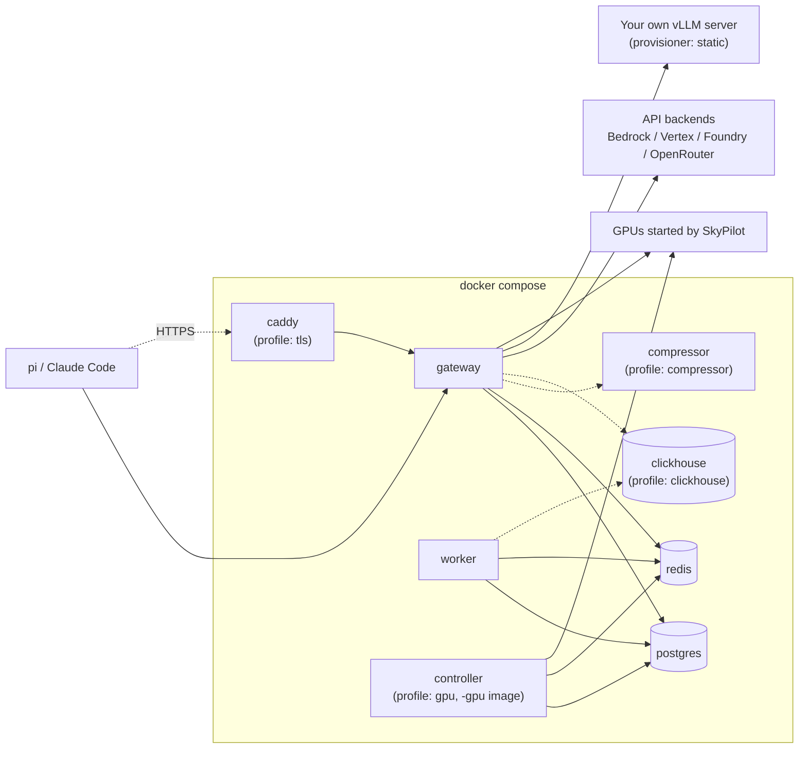
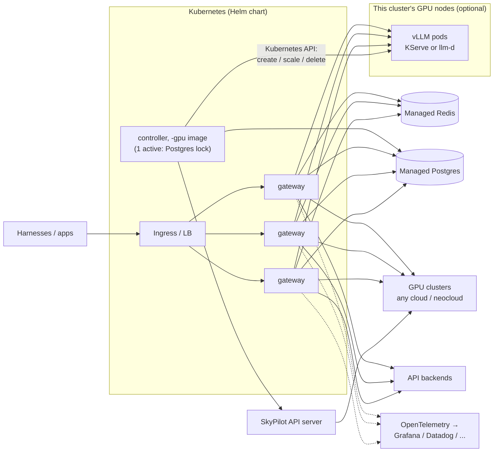

# 07 — Deployment

Goal: **clone, add one API key, `docker compose up`, point pi at it.** Everything else is an
opt-in layer.

## Two supported ways to run it

The same container images run under **Docker Compose** or **Kubernetes (Helm chart)**. Each
organization picks one.

| | Docker Compose | Kubernetes (Helm) |
|---|---|---|
| **For** | Trying it out, small teams, a single VM | Production at organizations with real spend |
| **Setup** | `docker compose up`, minutes | Needs a cluster and Helm |
| **High availability** | One machine | Multiple gateways, restarts, rolling upgrades |
| **Scaling** | Manual | Gateway autoscales |
| **Postgres / Redis** | Containers in the compose file | Usually managed cloud services |
| **Secrets** | `.env` | A Secret synced from your cloud's store by External Secrets ([Secrets](#secrets)) |

What keeps supporting both cheap:

- **Merit Order runs the same way under both.** Config is env vars plus one YAML file, health checks
  are plain HTTP (`/healthz`, `/readyz`), logs go to stdout. (The Kubernetes GPU provisioner is about
  where GPUs run, not how Merit Order itself runs.)
- **One active controller, enforced by a Postgres advisory lock.** Works the same under both.
- **Migrations are a command** (`meritorder migrate`): a one-off service in Compose, a pre-install /
  pre-upgrade hook in Helm.
- **CI checks both** on every change: a Compose smoke test (build, start, send requests) and a Helm
  lint plus schema validation of the rendered manifests (kubeconform).
- Nomad, ECS, Docker Swarm, etc. can be community recipes; they aren't officially supported.

Where GPUs run is a separate choice. SkyPilot can start GPU VMs on clouds and neoclouds, or target
an existing Kubernetes cluster with GPUs, from either deployment style. Or the controller can run vLLM
on your cluster itself, through KServe or llm-d ([GPUs on your Kubernetes cluster](#gpus-on-your-kubernetes-cluster)).

## Containers

One image runs every Merit Order process; the command picks which. It has two variants: `-gpu` adds SkyPilot for
the controller, and `-compressor` adds torch and llmlingua for the compressor. Docker Compose builds all three from the
repo (`meritorder:dev`, `meritorder:gpu` and `meritorder:compressor`; `MERITORDER_IMAGE` renames them).

**No images are published yet.** The release workflow (`.github/workflows/release.yml`) runs only when a `v*` tag is
pushed, and no tag exists yet. Until the first tag, build the images yourself (Compose does it for you; for
Kubernetes, build and push them to your own registry). From then on, tag `v0.0.1` publishes
`ghcr.io/therick/meritorder:0.0.1`, `:0.0.1-gpu` and `:0.0.1-compressor`, and moves `:latest`, `:latest-gpu` and
`:latest-compressor` to them ([Supply-chain security](#supply-chain-security)). The chart's default image tag is its
`appVersion`, `0.0.1`, so a default Helm install pulls what that tag publishes.

| Service | Image and command | Required? |
|---|---|---|
| gateway | `meritorder serve`: APIs, console at `/ui/`, reports, admin, SCIM | Yes |
| worker | `meritorder worker`: rollups, partitions, this month's spend counters checked against the ledger, alerts (routes with no known price among them), digests, live prices (every 15 minutes), quality scores (daily), providers' bills (every 6 hours, when `billing.sources` lists any), eval runs started on the console, the learned router's training (when asked, or every `routing.learned.retrain_hours`) and the deletion of its old request features, the providers' batch jobs (checked until they end, then settled into the ledger) and batch work on running GPUs, stored responses past their team's retention (deleted every minute, with the providers' copies) and their key rotation, the ledger's copy in ClickHouse (every 30 seconds, with `reporting.clickhouse`) | Yes, for reports, alerts, and live prices |
| migrate | `meritorder migrate`, once per upgrade | Yes |
| controller | `meritorder controller` on the **`-gpu` image variant**, which adds SkyPilot (with the extras of every cloud a replica can run on, `SKYPILOT_EXTRAS`: about 2.0 GB, half of it Azure's CLI; and the ssh and rsync clients it sets machines up with) in its own environment (`--build-arg SKYPILOT=<version>`; Compose and the release use 0.14.2). GPUs on Kubernetes alone don't need SkyPilot: the plain image will do | Only for the GPU tier |
| postgres | People, keys, config versions, prices and quality scores, ledger, GPU cost, eval runs | Yes |
| redis | Sessions, counters, GPU state, live feed. Persistence off (below) | Yes |
| compressor (profile: compressor) | `meritorder compressor` on the **`-compressor` image variant** (`--build-arg EXTRAS="--extra otel --extra compressor"`): LLMLingua-2 for model-based compression of tool results ([04](04-caching-and-sessions.md#model-based-llmlingua-2)). Only this image has torch and llmlingua; the model downloads on first start (2.2 GB for XLM-RoBERTa large, 0.7 GB for multilingual BERT) into the `hf-cache` volume. CPU, or one NVIDIA GPU (commented example in `compose.yaml`) | Only for teams with `compression.model` on |
| caddy (profile: tls) | HTTPS for single-machine installs | No |
| clickhouse (profile: clickhouse) | A copy of the ledger that long-range reports read, for very large deployments ([08](08-reporting.md#clickhouse-for-very-large-deployments)) | No |

**Redis keeps nothing on disk.** The compose file starts it with `--save "" --appendonly no`. The spend counters that
budgets read live in Redis, but the ledger in Postgres is the source of truth. A Redis that restarts empty seeds each
counter from the ledger on the next request. A Redis restored from an old snapshot (an RDB file, a replica that was
behind) would have counters that exist but are behind the ledger, and people over budget would get through. The worker
checks every counter of the month against the ledger each cycle and corrects one that's off by the same amount twice
running ([06](06-auth-and-spend.md#budgets)), so that heals in about two minutes, but with no snapshot it doesn't
happen at all. Nothing else in Redis needs to outlive it: sessions are routing hints, the response cache and the
compression decisions are caches, and alerts that were deduplicated there may be sent once more. With a managed Redis,
turn snapshots and AOF off, or accept the two minutes after a restore.

In the compose stack every Merit Order service but the compressor is built with SkyPilot in its own environment
(`SKYPILOT_VERSION`, default 0.14.2; empty leaves it out), so the gateway prices GPUs for the console's break-even itself;
price lookups use no credentials, so the gateway's image keeps the smaller `aws,gcp,kubernetes,lambda` extras. In the
Helm chart only the controller has SkyPilot, and it publishes those prices.

The SkyPilot controller needs cloud credentials and keeps state in `~/.sky`: mount them into the
controller ([SkyPilot GPUs](#skypilot-gpus)) or point it at a SkyPilot API server. For local
testing without a cloud, `scripts/fake_vllm.py` stands in for a GPU server (`provisioner: static`).
A real GPU cycle through SkyPilot (start, serve, scale, the lease running out, prices against the bill) has not been
run yet: it needs a cloud account, and `scripts/skypilot_check.py` does it ([05](05-gpu-autoscaling.md#checking-it-on-a-real-cloud)).

**The compressor.** `docker compose --profile compressor up -d`, then set
`MERITORDER_COMPRESSOR_URL=http://compressor:8090` in `.env` (every process reads it: they all validate
the config, and a team can't turn on model-based compression without it) and restart. Pick the model with
`MERITORDER_COMPRESSOR_MODEL` (the gateways ask for the same one), the device with
`MERITORDER_COMPRESSOR_DEVICE`, CPU threads with `MERITORDER_COMPRESSOR_THREADS` (default: the container's CPU
limit), and a shared secret with `MERITORDER_COMPRESSOR_KEY`, also in `.env`: the compressor checks it and the
gateways send it (`Authorization: Bearer`). Each process compresses one request at a time.
Measured ([04](04-caching-and-sessions.md#measured-on-the-published-models)): on a CPU, the default model
(XLM-RoBERTa large) takes about half a second per 512-token chunk even with 12 cores, so most results miss the
1-second deadline and go uncompressed; multilingual BERT on a CPU does every 4k-character result and most 16k ones
in time, and a GPU is the way to compress large ones. It needs 4–5 GiB of memory at its largest batch.
Outside Docker, in the clone (Merit Order isn't on PyPI): `uv sync --extra compressor`, then
`uv run meritorder compressor --model … --device cuda`.

## Topology: laptop / single VM



`docker compose up -d` starts postgres, redis, migrate (once), gateway and worker. The profiles add the rest. A dashed
line is used only with its profile on (and, for the compressor and ClickHouse, their URL set in `.env`).

## Quickstart

```bash
git clone https://github.com/therick/meritorder && cd meritorder
cp .env.example .env          # set MERITORDER_DEV_KEY; provider keys are optional (mock backends without them)
docker compose up -d          # gateway + worker + Postgres + Redis on :8080, UI at /ui/
docker compose exec gateway meritorder accounts create you@example.com --role admin   # your console sign-in
docker compose exec gateway meritorder keys create --user you@example.com --role admin       # a key for harnesses
curl localhost:8080/v1/chat/completions -H "authorization: Bearer <that key>" -H "content-type: application/json" \
  -d '{"model": "auto", "messages": [{"role": "user", "content": "hello"}]}'
```

Sign in to the console at http://localhost:8080/ui/ with your email address and password, and invite others from the
People page ([06](06-auth-and-spend.md#signing-in-to-the-console)). For the harnesses, install
the CLI on your laptop (`uv tool install .` in the clone), then `meritorder use-key <key> --gateway http://localhost:8080`
and `meritorder setup pi` or `setup claude-code`.

Several copies on one machine (two checkouts, say) each need their own `COMPOSE_PROJECT_NAME`, `MERITORDER_IMAGE` (the
images Compose builds, `meritorder:dev` and its `:gpu` and `:compressor` variants by default) and `MERITORDER_PORT` in
their `.env`. Otherwise each build replaces the other's images. Checked on a fresh clone on 2026-11-13: build, start,
a key, a request to the mock backends, every console page, `use-key` and `setup pi` / `claude-code`, and the
`gpu` and `clickhouse` profiles.

Turning on more:

```bash
docker compose -f compose.yaml -f compose.aws.yaml up -d   # use your ~/.aws profile (incl. SSO) for Bedrock
docker compose --profile gpu up -d                         # adds the GPU capacity controller
docker compose --profile tls up -d                         # adds Caddy for HTTPS on one machine
docker compose --profile clickhouse up -d                  # adds ClickHouse for very large ledgers (see below)
```

ClickHouse: set `MERITORDER_CLICKHOUSE_URL=http://clickhouse:8123` in `.env`, start the profile, then copy what the ledger
already holds with `docker compose exec worker meritorder clickhouse backfill`. The worker copies new requests from then on.
Compose gives the gateway, the worker and the profile's server the same user and password (`meritorder`, or
`MERITORDER_CLICKHOUSE_USER` and `MERITORDER_CLICKHOUSE_PASSWORD`). Without the URL, nothing changes.

Entra: set `MERITORDER_OIDC_ISSUER` and `MERITORDER_OIDC_CLIENT_ID` in `.env`. Google also needs
`MERITORDER_OIDC_CLIENT_SECRET` and `MERITORDER_OIDC_HOSTED_DOMAINS` ([06](06-auth-and-spend.md#signing-in-with-google)).
To map Google groups to teams and roles, also set `MERITORDER_GOOGLE_GROUPS=true` and a service account's key in
`MERITORDER_GOOGLE_GROUPS_CREDENTIALS` ([06](06-auth-and-spend.md#google-groups)).

Vertex AI (Claude and Gemini): set `GOOGLE_CLOUD_PROJECT` and `GOOGLE_APPLICATION_CREDENTIALS` (the
absolute path to a service-account JSON) in `.env`. Compose mounts that file read-only at
`/run/secrets/google-credentials.json` and points the variable there. `MERITORDER_VERTEX=false`
switches Vertex off. `MERITORDER_VERTEX_GEMINI_NATIVE=true` also reaches Gemini there through its native
API (the `vertex-gemini-native` backend). The Gemini API with a Google AI Studio key needs only
`GEMINI_API_KEY`.

## Topology: production (Kubernetes)



- Gateways are stateless; scale with HPA on CPU.
- One controller is active at a time, enforced by a Postgres advisory lock; a standby is fine.
- Very large deployments can add ClickHouse (ClickHouse Cloud, or one you run) for reports: `reporting.clickhouse.url`. The
  chart doesn't run it. The worker copies the ledger there; Postgres stays the record.
- Same images as Compose.
- What has been checked: CI renders the chart and validates it with kubeconform on every change, and
  `scripts/kind/` installed it by hand on a local kind cluster (14 November). It has not been installed on a managed
  cluster (EKS, GKE, AKS), or with External Secrets, Reloader and workload identity in a real cluster.

## GPUs on your Kubernetes cluster

The controller can run open models on the cluster's own GPUs (`provisioner: kubernetes`, through
KServe or llm-d; how it works is in [05, "Kubernetes"](05-gpu-autoscaling.md#kubernetes)). Setup:

1. **Install what serves the pods.** For `api: kserve`, KServe in Standard mode (no Knative). For
   `api: llm-d`, llm-d's router with its Gateway, `InferencePool` and endpoint picker, from llm-d's
   own charts; note the pool's name and the Gateway's address.
2. **Pick a namespace for the GPU pods**, ideally one of their own: the controller can create and
   delete Deployments there. Put a Secret with `HF_TOKEN` there for gated models, and optionally a
   PersistentVolumeClaim for the Hugging Face cache.
3. **Turn it on in the chart:**

   ```yaml
   controller:
     enabled: true
     imageSuffix: ""            # Kubernetes alone doesn't need the SkyPilot image
     kubernetes:
       enabled: true
       namespaces: [gpus]       # a Role in each; the first is the default for the config (MERITORDER_GPU_NAMESPACE)
       apis: [kserve]           # or [llm-d], or both (the default)
       readNodes: true          # optional: price each replica at the node type it landed on
   ```

4. **Configure the cluster and the deployment** (Config → YAML, or `config/meritorder.yaml`): the
   price of each GPU node type under `kubernetes.node_types`, and a backend with
   `serve: {provisioner: kubernetes, kubernetes: {...}}` and a priced route from its model.

With `controller.kubernetes.enabled`, the controller runs as its own ServiceAccount
(`<release>-meritorder-controller`), and only it is bound to these Roles. The gateways and the worker
keep the shared ServiceAccount, with no Kubernetes permissions.

What the controller may do, in each namespace in `namespaces`:

| Resources | Verbs | Why | When |
|---|---|---|---|
| `inferenceservices.serving.kserve.io` | get, create, update, patch, delete | One InferenceService per deployment: start, scale, stop, and replace one a restarted controller finds | `apis` has `kserve` |
| `deployments.apps` | get, create, update, patch, delete for `llm-d`; list for `kserve` | llm-d: the model server Deployment. KServe: list its predictor Deployment, for pods it can't create (quota) | Always |
| `inferencepools.inference.networking.k8s.io` (and `.x-k8s.io`) | get | The labels and port the pool expects its pods to have | `apis` has `llm-d` |
| `pods` | list | Where each replica runs, why one won't start, and its address for vLLM's metrics | Always |
| `nodes` (cluster-wide, a ClusterRole) | get | Each replica's node type, zone and spot label, for its price | `readNodes: true` |

These are exactly the calls the controller makes: no watches, no `events`, no `services`. The kind check
(`scripts/kind/check.py`, below) ran every lifecycle step and failure with this Role, for both APIs and for each alone,
and no call was refused.

The controller must reach the API server and the pods' port (8000, or the InferencePool's target
port) for metrics; allow that if NetworkPolicies restrict the namespace. Outside the cluster, for
development, it uses a kubeconfig (`kubernetes.kubeconfig`, `KUBECONFIG` or `~/.kube/config`), with a
token, a client certificate, or an exec plugin.

**Trying it without GPUs.** `scripts/kind/setup.sh` makes a kind cluster whose node advertises eight fake
`nvidia.com/gpu`, installs cert-manager, KServe (Standard mode) and the InferencePool CRD, a Service standing in for
llm-d's Gateway, Postgres and Redis, and Merit Order from this chart with the values in `scripts/kind/values.yaml`
(the controller with `kubernetes.enabled`, both APIs, `readNodes`). The model servers are `scripts/fake_vllm.py` in a
tiny image: it takes `vllm serve`'s command line and serves `/health`, `/v1/models`, chat and completions, and
`/metrics` with vLLM's metric names. `scripts/kind/check.py` then drives every step through the admin API and prints
what Kubernetes and Merit Order showed; `scripts/kind/setup.sh down` removes it all. It writes its own kubeconfig and
leaves `~/.kube/config` alone. What it verified, and what still needs real GPUs:
[05](05-gpu-autoscaling.md#checked-on-kind).

## SkyPilot GPUs

The controller launches one SkyPilot cluster per replica on your cloud accounts
([05](05-gpu-autoscaling.md#how-skypilot-runs-a-deployment)). Where it runs, it needs SkyPilot (the `-gpu` image has
0.14.2 with the extra of every cloud a replica can run on, plus ssh and rsync; the `SKYPILOT_EXTRAS` build argument
slims it, [05](05-gpu-autoscaling.md#which-clouds)), the clouds' credentials, and a writable `~/.sky` for SkyPilot's
state. Each replica deletes itself when the controller stops renewing its lease, so losing
`~/.sky` doesn't leave a GPU billing for long, but keep it: with it, a restarted controller sees and stops its clusters
at once, and the sweep can tear down anything left over.

What every Merit Order process needs to agree on, kept in Postgres and made once by the first process to need it (set
them in the environment instead to pin them):

| Setting | Environment | What it is |
|---|---|---|
| `gpu_install_id` | `MERITORDER_INSTALL_ID` | 8 characters in every cluster name, `mo-<install id>-...`: two installs on one cloud account never touch each other's clusters |
| `gpu_replica_secret` | `MERITORDER_GPU_KEY` | What each deployment's replica key is derived from: the controller and every gateway (and the worker, for batch work on GPUs) must have the same |

**Credentials.** Each cloud reads its own files from the controller's home (`/home/meritorder` in the images). Mount
only the clouds you launch on: SkyPilot copies every cloud's credentials it finds there to every replica, whichever
cloud it runs on, and on most clouds the replica deletes itself with that copy. Use keys made for SkyPilot alone,
which you can revoke ([05](05-gpu-autoscaling.md#which-clouds) has what each cloud's machines end up holding). The
controller logs a warning for each key SkyPilot will copy when it loads the config.

| Cloud | Files under the home | What goes in them | Compose volume (`controller`) | Helm Secret (`controller.skypilot.credentials`) |
|---|---|---|---|---|
| AWS | `.aws/credentials`, `.aws/config` | An access key for an IAM user SkyPilot can launch with (or none, with a role on the controller) | `~/.aws:/home/meritorder/.aws:ro` | `{secret: aws-files, path: .aws}` (`--from-file=credentials --from-file=config`) |
| GCP | `.config/gcloud/` | `gcloud auth application-default login`, or a service-account key with `GOOGLE_APPLICATION_CREDENTIALS` | `~/.config/gcloud:/home/meritorder/.config/gcloud:ro` | `{secret: gcloud-files, path: .config/gcloud}` |
| Azure | `.azure/` | `az login --service-principal` for a principal that is Contributor on one subscription (az writes here, so not read-only) | `~/.azure:/home/meritorder/.azure` | A Secret is read-only: run `az login --service-principal` in the pod once, with the home on a claim |
| Lambda | `.lambda_cloud/lambda_keys` | One line, `api_key = <key>` | `~/.lambda_cloud:/home/meritorder/.lambda_cloud:ro` | `{secret: lambda-keys, path: .lambda_cloud}` (`--from-file=lambda_keys`) |
| RunPod | `.runpod/config.toml` | `runpod config`, or `api_key = "<key>"` | `~/.runpod:/home/meritorder/.runpod:ro` | `{secret: runpod-files, path: .runpod}` |
| Nebius | `.nebius/credentials.json` and `NEBIUS_TENANT_ID.txt` | A service-account key, and the tenant id | `~/.nebius:/home/meritorder/.nebius:ro` | `{secret: nebius-files, path: .nebius}` |
| Kubernetes, CoreWeave | `.kube/config` | A kubeconfig whose context can make pods and services in the namespace (CoreWeave: your CKS cluster's) | `~/.kube:/home/meritorder/.kube:ro` | `{secret: kubeconfig, path: .kube}` (`--from-file=config`) |
| Vast | `.config/vastai/vast_api_key` | The API key | `~/.config/vastai:/home/meritorder/.config/vastai:ro` | `{secret: vast-key, path: .config/vastai}` |
| Fluidstack | `.fluidstack/api_key` | The API key | `~/.fluidstack:/home/meritorder/.fluidstack:ro` | `{secret: fluidstack-key, path: .fluidstack}` |
| Paperspace | `.paperspace/config.json` | `{"apiKey": "<key>"}` | `~/.paperspace:/home/meritorder/.paperspace:ro` | `{secret: paperspace-files, path: .paperspace}` |
| DigitalOcean | `.config/doctl/config.yaml` | `doctl auth init`, with a token scoped to droplets | `~/.config/doctl:/home/meritorder/.config/doctl:ro` | `{secret: doctl-files, path: .config/doctl}` |
| Mithril | `.config/mithril/config.yaml` | Mithril's CLI config, with its API key | `~/.config/mithril:/home/meritorder/.config/mithril:ro` | `{secret: mithril-files, path: .config/mithril}` |
| Seeweb | `.seeweb_cloud/seeweb_keys` | The API key | `~/.seeweb_cloud:/home/meritorder/.seeweb_cloud:ro` | `{secret: seeweb-keys, path: .seeweb_cloud}` |
| SkyPilot's own config | `.sky-config/config.yaml`, with `SKYPILOT_GLOBAL_CONFIG=/home/meritorder/.sky-config/config.yaml` | `remote_identity` per cloud, to keep keys off the replicas ([05](05-gpu-autoscaling.md#which-clouds)) | `./sky-config.yaml:/home/meritorder/.sky-config/config.yaml:ro`, and the variable in `.env` | `{secret: sky-config, path: .sky-config}`, and the variable in the env Secret |

Then `sky check` in the controller (`docker compose exec controller sky check`) lists the clouds it can use. OCI, Cudo,
Shadeform, SCP, vSphere, IBM, Hyperbolic, PrimeIntellect, Verda and Yotta can't run a replica (no Docker images, or no
autodown, in SkyPilot 0.14.2), so their extras aren't in the image and a deployment naming them is refused.

**Docker Compose.** Uncomment the `volumes:` of the `controller` service in `compose.yaml`: a named volume for
`~/.sky` (`sky-state`) and the credentials of your clouds from the table. If a replica's port can't be reached and the
controller tunnels to it (always on Vast and Mithril, [05](05-gpu-autoscaling.md#reaching-the-replicas)), put
`MERITORDER_TUNNEL_HOST=controller` in `.env` so the gateways reach the tunnel in the controller's container. The
tunnels listen only on the address that name resolves to in the controller's container (loopback for `127.0.0.1` or
`localhost`), not on every interface; `MERITORDER_TUNNEL_BIND` sets another address.

**Helm.** The pods' root filesystem is read-only, so `controller.skypilot` gives the controller a writable home at
`/home/meritorder` (where `~/.sky` and the SSH configs SkyPilot writes live) and mounts credentials inside it:

```yaml
controller:
  enabled: true
  skypilot:
    home:
      persistence: true        # a 1 Gi claim the chart makes (kept on uninstall); or existingClaim: <yours>
    credentials:                                     # one per cloud, from the table above
      - {secret: lambda-keys, path: .lambda_cloud}   # kubectl create secret generic lambda-keys --from-file=lambda_keys
      - {secret: aws-files, path: .aws}              # --from-file=credentials --from-file=config
```

Without `persistence` or `existingClaim` the home is an emptyDir: it works, but a restarted pod forgets its clusters
until their leases run out. With a ReadWriteOnce claim keep `controller.replicas: 1`, or the standby can't mount it.
Instead of credential files, a cloud identity on the controller's own ServiceAccount
(`controller.kubernetes.serviceAccountAnnotations`, with `controller.kubernetes.enabled`) or a SkyPilot API server
you run (`SKYPILOT_API_SERVER_ENDPOINT` in the env Secret) also work; with a remote API server, the credentials (and
what SkyPilot copies to the replicas) are the API server's. The gateways must be able to reach each replica's port
(8000, or the address SkyPilot maps it to on Kubernetes and RunPod) from the cluster; NetworkPolicies that limit egress
need to allow it.

## Performance and scaling

Measured against zero-latency mock backends with real Postgres and Redis (one laptop, Apple M4 Max),
so the numbers are Merit Order's own work. The benchmark is in `scripts/bench_gateway.py`.

**Added latency per call** (before the request goes upstream; the same for time to first token on
streams):

| Request | Merit Order's own time |
|---|---|
| Chat with a short or 2k-token prompt | ~0.6 ms |
| Agent turn: 30k tokens of history + tools | ~2 ms |
| Agent turn: 120k tokens of history + tools | ~6.5 ms (mostly parsing and hashing a ~500 KB body) |

Add the network hop to the gateway, and **two Redis round trips** (one pipeline for budgets, rate
limits, session, and GPU load and in-flight counts; one to save the session). With a managed Redis in the same zone,
that should be about 0.5–2 ms (an estimate: load against Redis and Postgres over a real network hasn't been measured). Ledger writes, spend counters, and telemetry happen after the response, in
one more pipeline. For comparison, models take 0.3–2 s to first token, and many seconds to prefill
120k tokens.

**Throughput:** about **1,100 requests/s per process** (one CPU core); it scales nearly linearly
with processes (7,100 requests/s with 8 on one machine that was also running Redis, Postgres,
and the load generator). Gateways share nothing but Redis and Postgres, so add pods or
`--workers` (`MERITORDER_WORKERS`) to scale. Long streams are cheap to hold open: what limits a
process is CPU per request, not open connections.

**With each feature on.** Measured again on 14 November with `scripts/bench_load.py`, which starts a
gateway per feature and loads it with 64 connections, on the same laptop, with in-memory state and
storage (no Redis or Postgres; then a process does about three times as many requests, the Redis
client being most of the difference, so compare the rows with each other, not with the numbers above).
The load average was about 5 when it started (the machine runs other work). One process each:

| Turned on | Short chat turn: requests/s, CPU per request | Agent turn, 12 tool results (100 KB): requests/s, CPU |
|---|---|---|
| Nothing, the code of 9 November (`6b5886c`) | 3,703, 0.27 ms | 508, 1.98 ms |
| Nothing, today | 2,951, 0.34 ms | 540, 1.87 ms |
| Token counts calibrated (ratios learned for both models) | 2,932, 0.34 ms | 534, 1.89 ms |
| `routing.levels` with three times the word lists | 2,784, 0.36 ms | 523, 1.93 ms |
| `model_choice: cost_per_success` | 2,885, 0.35 ms | 521, 1.93 ms |
| Learned router, shadow mode, with a trained model | 2,172, 0.46 ms | 520, 1.94 ms |
| Learned router, route mode | 2,047, 0.48 ms | 506, 1.99 ms |
| Rule-based compression | | 508, 1.98 ms |
| Model-based compression (a stub service that answers at once), results already decided | | 476, 2.11 ms |
| Model-based compression, a new result in every request | | 219, 4.55 ms |
| A GPU deployment (mock, two replicas), replica affinity off / on | 2,846 / 2,809, 0.35 / 0.36 ms | |

Eight processes at once weren't measured cleanly this time: each try met a load average of 30 or more
from other work. Processes still share nothing but Redis and Postgres, so they scale as before.

- **Agent turns** cost two thirds more CPU than on 9 November before this measurement (285 requests/s):
  the token estimate, which counts what text is made of ([03](03-routing.md#counting-tokens)), counted the whole body on
  every turn. Each long text's counts are now kept per process, and a request's texts counted one by one
  (they add up to exactly the joined text's, so the estimate is the same); the rules' output is kept per
  text the same way. Agent turns are now a little cheaper than on 9 November.
- **Short turns** cost about a quarter more CPU than on 9 November, spread across what was added since
  (configurable levels, the checks of features that are off, the body-limit and security-header
  middleware, more ledger fields), none of it more than a few percent.
- **The learned router** adds 35–40% to a short turn's CPU (its features are hashed with a key, an
  ensemble predicts, and a feature row is written per request); on an agent turn it's lost in the rest.
  It now hashes the level rules once per configuration rather than per request.
- **Model-based compression** adds 13% when the results are already decided, and more than doubles the
  CPU of a turn that brings a new result (the call to the service and storing its decision; the model's
  own time comes on top, see [04](04-caching-and-sessions.md#measured-on-the-published-models)). That
  happens once per result; later turns apply the stored decision.
- Calibrated token counts, configured levels, cost per success and replica affinity are within the
  noise.
- **Expected total cost** (decision 62), measured on 15 November against the learned router in shadow mode with the
  team exploring (`bench_load.py all --features exploration,expected-cost`, 15 seconds each, the same laptop under
  other load): a chat turn, a new task every request, 0.72 → 0.82 ms of CPU (the plan over every route and the opening
  prompt's triage buckets); an agent turn that grows an edit and a test run each request (`agent-grow`) 3.50 → 3.55 ms.

A rough sizing for 10,000 requests/s: 10–16 gateway cores, one Redis node (~20 commands per
request in three pipelines), and Postgres taking 10,000 ledger inserts/s, the first part that would
need work (batched inserts) at that scale. For perspective, an organization spending $300k a month
on LLMs makes about 5–50 requests/s. The other part that grows with traffic is reporting over months of rows: there, a
ClickHouse copy of the ledger answers the long ranges and tag breakdowns ([08](08-reporting.md#clickhouse-for-very-large-deployments)).

Connection pools, all per process:

| Pool | Default | Setting |
|---|---|---|
| Upstream, per backend (each stream holds one connection) | 500 | `MERITORDER_UPSTREAM_MAX_CONNECTIONS`, `MERITORDER_UPSTREAM_KEEPALIVE` (100) |
| Redis (waits for a free connection rather than failing) | 200 | `MERITORDER_REDIS_MAX_CONNECTIONS` |
| Postgres | 10 | `MERITORDER_DB_POOL_SIZE`; with many processes, put PgBouncer in front |

Request bodies are capped at 32 MB (`MERITORDER_MAX_BODY_MB`; Anthropic's own limit), 64 KB for
sign-in, and 1 MB for SCIM; batch uploads get the providers' own limits (512 MB on `/v1/files`, 256 MB on
`/v1/messages/batches`). Larger ones get a 413 before the handler reads them (at once when the
`Content-Length` says so, or as soon as a body sent without one passes the limit). An ingress in front needs room for those too
(nginx: `nginx.ingress.kubernetes.io/proxy-body-size`). A backend's answer is capped the same way, at the largest of
those (512 MB once decompressed, whole or as a stream): past it the gateway drops the connection and treats it as a
broken one, so a backend at a `base_url` an admin set can't make a gateway hold more.

## Ingress and TLS

Merit Order is a plain HTTP service. It runs behind whatever the organization already uses: a cloud
load balancer, an existing ingress controller, NGINX, Envoy. Nothing requires a proxy in front of
it. Single-machine installs that want HTTPS can enable the Caddy profile (`MERITORDER_DOMAIN` is
the hostname it gets a certificate for); the Helm chart can create an Ingress (`ingress.enabled`).

What's exposed: Docker Compose publishes the gateway on `127.0.0.1` (set `MERITORDER_BIND=0.0.0.0`
to open it to your network). Behind a public ingress, `/metrics` is reachable too; it shows spend
and traffic totals, not prompts or users, but set `MERITORDER_METRICS_TOKEN` (and Helm
`metrics.tokenKey`) to require a token. The console is served with a strict Content-Security-Policy
and refuses to be framed. It loads nothing from elsewhere: its fonts (Geist and Geist Mono) are bundled with it, so it
works offline.

Behind a proxy, have it pass the `Host` header through. The links the gateway writes into its own answers (a batch's
`results_url`) use the request's `Host` and scheme. It never reads `X-Forwarded-Host`, which any client can send;
`meritorder serve` applies `X-Forwarded-Proto` and `X-Forwarded-For` only from the proxies uvicorn trusts
(`FORWARDED_ALLOW_IPS`, default `127.0.0.1`; set it to your load balancer's addresses).

**Network policies.** With `networkPolicy.enabled` (off by default; it needs a CNI that enforces policies, such as
Calico, Cilium or the cloud's), the chart adds NetworkPolicies that limit who may connect: the gateways' port 8080
from `networkPolicy.gatewayFrom` (NetworkPolicy peers, e.g. the ingress controller's namespace; empty: any source,
that port only), the worker's metrics port from `networkPolicy.metricsFrom`, and the worker, controller and
compressor only from the release's own pods. Outbound traffic isn't limited, since the gateways call providers,
Postgres, Redis and GPU replicas wherever those are.

```yaml
networkPolicy:
  enabled: true
  gatewayFrom:
    - namespaceSelector: {matchLabels: {kubernetes.io/metadata.name: ingress-nginx}}
```

## Configuration

`config/meritorder.yaml` (plus `include:`d files and environment variables for secrets) describes
everything. The image ships the default config. Compose mounts the repo's `config/` over it
(read-only); in Helm, override files with `--set-file configFiles.<name>=...`.

API prices are not typed in. The worker refreshes them every 15 minutes from OpenRouter's catalog
(OpenRouter routes) and LiteLLM's price list (direct provider APIs); `price:` on an API route only
overrides the list, e.g. for a negotiated discount. Quality scores come from Epoch AI's benchmark
data by default (`quality.source`; `artificial_analysis` needs `ARTIFICIAL_ANALYSIS_API_KEY`),
refreshed daily. The `quality:` written on a model is used with `quality.source: config`, and until a
source has been fetched. A model the source doesn't cover isn't picked by `auto` unless it has a
`quality_override`.

```yaml
baseline_model: claude-sonnet          # counterfactual for savings reports
include: [models-open.yaml, models-embeddings.yaml]   # open-weight catalog, direct vendor APIs, embeddings
quality: {source: epoch}               # where `auto` gets 1-5 quality scores

backends:
  bedrock:
    format: anthropic
    base_url: https://bedrock-mantle.${AWS_REGION:-us-east-1}.api.aws/anthropic
    auth: {type: aws_sigv4, service: bedrock-mantle, region: "${AWS_REGION:-us-east-1}"}

models:
  claude-sonnet:
    aliases: ["claude-sonnet-*"]
    quality: {coding: 5, general: 4}   # used with quality.source: config, or until a source is fetched
    routes:
      - {backend: anthropic, model: claude-sonnet-5-5}           # price from the live list
      - {backend: bedrock, model: anthropic.claude-sonnet-5-5}

teams:
  platform:
    budget_usd_month: 20000
    user_budget_usd_month: 500
    allowed_models: ["*"]
    allowed_backends: ["*", "!openrouter-free"]
    compression: {enabled: true}
```

Useful commands:

| Command | What it does |
|---|---|
| `meritorder check` | Which backends and models are usable with the current credentials; with Google Groups on, which key or identity it would call Google as (nothing is sent) |
| `meritorder prices refresh` | Write the live prices, context windows, output limits, and quality scores to `prices.json` (the worker keeps the stored ones current on its own) |
| `meritorder models discover` | List the model IDs each enabled backend serves |
| `meritorder keys create / list / revoke` | Manage API keys |
| `meritorder login` or `use-key <key>`, then `meritorder setup pi` / `claude-code` | Sign in with Entra or Google (or save a key you were given) and point a harness at the gateway; `setup claude-code --config-dir <dir>` writes a separate Claude Code profile |
| `meritorder usage [--bills]` | Your own spend; `--bills` (finance and admins): the ledger against the providers' bills ([08](08-reporting.md#checking-costs-against-the-bills)) |
| `meritorder batch submit FILE [--watch]`, `watch`, `list`, `results ID --out FILE`, `cancel`, `storage` | Send work that can wait to the providers' batch APIs and running GPUs (OpenAI or Anthropic JSONL) and get the results; `storage` (admins): where uploads and GPU work are held and the batch key's rotation |
| `meritorder eval --models a,b [--apply]` | Measure quality scores with graded tasks (asks before spending) |
| `meritorder export --out file.jsonl` or `s3://…` (`--format csv` or `parquet`; Parquet needs the `parquet` extra) | Export the ledger |
| `meritorder worker --backfill` | Rebuild hourly report rollups from the raw ledger |
| `meritorder clickhouse backfill [--start] [--end]` | Copy existing ledger rows to ClickHouse (`reporting.clickhouse`); run again, it copies only what's missing |
| `meritorder clickhouse status` | Whether ClickHouse is reachable, how far the copy has got, its rows and size on disk, and whether reports read it |
| `meritorder controller [--once] [--interval 60]` | Run the GPU capacity controller |
| `meritorder gpu volumes [list \| delete <name> --yes]` | The weights cache volumes (`serve.weights_cache: volume`), what they cost a month and what uses them; delete one. Nothing else deletes them ([05](05-gpu-autoscaling.md#the-weights-cache-volume)). Runs where the controller does |
| `meritorder compressor [--model …] [--device auto] [--port 8090]` | Run the LLMLingua-2 service for model-based compression (the `compressor` extra) |
| `meritorder router train [--days N] [--dry-run]` | Train the learned router on the recorded requests (default: the last `routing.learned.train_days`, 30); it's used only if it beats the rules on the newest fifth (needs Postgres) |
| `meritorder router report [--days 7]` | Where the learned router and the rules disagree, what each would cost, and the outcomes |
| `meritorder router use <version or none>` | Choose the learned-router model gateways use |

Once the first configuration is saved from the console, the stored version (in Postgres) is what
gateways, the worker, and the controller use; the YAML file is the starting point and the format
for import and export.

## Secrets

Merit Order never stores provider keys. It reads them from the environment (`value_env`) or from a
file (`value_file`), and a configuration saved from the console is refused if it contains a literal
key, so keys never reach Postgres or the config history. A saved configuration may also read only the
variables and files the rules in [06](06-auth-and-spend.md#secrets-in-a-saved-configuration) allow, so an
admin can't point a backend at their own server and have it send the database URL. Those rules don't apply to
the YAML file on disk. The operator widens them with three variables on the gateways and the worker:

| Variable | What it does |
|---|---|
| `MERITORDER_CONFIG_SECRET_ENVS` | More variables any secret field (`value_env`, `key_env`, ...) may read: comma-separated names, a trailing `*` for a prefix (`CORP_LLM_KEY,VAULT_*`) |
| `MERITORDER_CONFIG_ENVS` | More variables `${NAME}` may name outside secret fields (a `base_url`, a region) |
| `MERITORDER_SECRETS_DIR` | Where `*_file` fields may read from. Default `/run/secrets/meritorder`, where the chart's `secrets.mountAsFiles` mounts the Secret |

Where each secret lives:

| Secret | Where | How |
|---|---|---|
| Provider keys | Environment or a mounted file | Supplied by the platform from your secret store |
| Google Groups service-account key (optional) | Environment (`MERITORDER_GOOGLE_GROUPS_CREDENTIALS`) or a mounted file | Same Secret; none with GKE Workload Identity |
| `MERITORDER_DATABASE_URL`, `MERITORDER_REDIS_URL` | Environment | Same Secret as the provider keys |
| `MERITORDER_CLICKHOUSE_PASSWORD` (only with ClickHouse) | Environment or a mounted file | Same Secret; the shipped config also reads `/run/secrets/meritorder/MERITORDER_CLICKHOUSE_PASSWORD` (Helm `secrets.mountAsFiles`), so a rotation needs no restart |
| Merit Order keys (`mo-…`) for people and harnesses | Postgres | Shown once; stored only as a SHA-256 hash (random 256-bit tokens, so a slow hash isn't needed) |
| Entra / Google / OIDC tokens | Not stored | Verified against the issuer's signing keys (and, for Google, the Workspace domain and a verified email), then exchanged for a short-lived `mo-` key |
| `MERITORDER_FEATURE_KEY` (optional) | Environment, the same on every gateway and the worker | The key the learned router hashes words with. Unset, one is generated and kept in Postgres, where whoever can read the database can check guessed words against the stored hashes; set it to keep it out. Changing it makes recorded features and models unusable |
| `MERITORDER_BATCH_KEY` | Environment (the same on every gateway and the worker) | Seals uploaded batch files while they wait to be submitted, and batch work held for GPUs ([02](02-request-flow.md#what-the-gateway-holds-and-for-how-long)). Any long random string (`openssl rand -base64 32`). Without it, a gateway on Postgres refuses uploads and sends no batch work to GPUs. To rotate it, move the old value to `MERITORDER_BATCH_KEY_PREVIOUS`: what it sealed is read for `batches.key_grace_days` (the retention period plus two days), then the old key can go. Changing it without that makes waiting uploads unreadable |
| `MERITORDER_AUTH_KEY` (optional) | Environment, the same on every gateway | Seals the authenticator secrets of people with two-factor sign-in ([06](06-auth-and-spend.md#two-factor-sign-in)). Any long random string. Without it they're stored as they are; passwords stay hashed, so the database alone still doesn't sign anyone in. Changing it leaves existing two-factor users needing a recovery code or an admin's reset |
| `MERITORDER_RESPONSES_KEY`, `MERITORDER_RESPONSES_OLD_KEYS` | Environment or a mounted file (`response_store.key_file`), the same on every gateway and the worker | Seals what teams in the Responses API's stored mode keep ([04](04-caching-and-sessions.md#stateful-apis)). Any long random string. Without it, a gateway on Postgres refuses requests that would be stored (503). To rotate, move the old key to `MERITORDER_RESPONSES_OLD_KEYS` (comma-separated) and set the new one; the worker seals everything again, and Config → Teams says when the old key is no longer needed. Dropping a key that still seals something makes that unreadable |

`MemoryState` (no `MERITORDER_REDIS_URL`) is for development, tests and a single gateway: it never evicts
anything, so its memory grows with traffic until the process restarts. Production runs on Redis, where keys expire.

**The best key is no key.** For each cloud's own models, use the workload's identity instead:

| Models | Config | Identity |
|---|---|---|
| Claude in Bedrock | `auth: {type: aws_sigv4, service: bedrock-mantle, region: …}` | IRSA or EKS Pod Identity: a role allowed to invoke the Bedrock models you route to |
| Claude and Gemini on Vertex | `auth: {type: google}` | GKE Workload Identity: a Google service account with `roles/aiplatform.user` |
| Azure OpenAI, Foundry | `auth: {type: azure_ad}` | AKS Workload Identity: a managed identity with *Cognitive Services OpenAI User* (or the Foundry equivalent) on the resource |

Batches through Bedrock and Vertex AI need a bucket (`batch.bucket` on the backend). Bedrock: the workload's role needs
`bedrock:CreateModelInvocationJob`, `GetModelInvocationJob`, `StopModelInvocationJob`, `iam:PassRole` on `batch.role_arn`,
and `s3:PutObject`, `GetObject`, `ListBucket`, `DeleteObject` on the bucket's prefix; the role Bedrock assumes
(`batch.role_arn`) needs to read and write the same prefix. Vertex AI: the service account needs
`roles/aiplatform.user` and `roles/storage.objectAdmin` on the bucket (Vertex's own service agent reads and writes it too).
The other batch APIs use the backend's own key.

`batches.storage.bucket` holds uploads and GPU batch work in your own bucket instead of Postgres, signed with a backend's
credentials (`batches.storage.backend`, else the first that signs in to that cloud, else that cloud's defaults). The
workload needs to put, get, list and delete objects under the prefix: S3 `s3:PutObject`, `GetObject`, `ListBucket`,
`DeleteObject`; Cloud Storage `roles/storage.objectAdmin`; Azure Blob Storage *Storage Blob Data Contributor* on the
container (an Entra token for `https://storage.azure.com/.default`).

The worker serves the batch requests it settles as Prometheus metrics on `MERITORDER_WORKER_METRICS_PORT` (Compose and the
Helm chart: 9464, `worker.metricsPort`; the chart adds a Service, and its ServiceMonitor scrapes it next to the gateways).

The image includes the Google and Azure identity libraries. In Helm, put the identity on the
service account (`serviceAccount.annotations`; AKS also needs the pod label
`podLabels: {azure.workload.identity/use: "true"}`). Third-party providers (Anthropic direct,
OpenAI, the Gemini API, OpenRouter, xAI, DeepSeek, Moonshot, Z.ai, MiniMax, Mistral) always need a key.
Reading Google Groups for sign-in works keyless the same way: GKE Workload Identity with a Google service account
that has the Groups Reader admin role in the Google Admin console ([06](06-auth-and-spend.md#google-groups)).

### Kubernetes: three ways to provide the Secret

Every component reads its environment from one Secret. Set exactly one of these (the chart refuses
more than one):

| Value | What it does | Use for |
|---|---|---|
| `externalSecret.enabled` | The chart creates an `ExternalSecret`; [External Secrets Operator](https://external-secrets.io) syncs it from AWS Secrets Manager, GCP Secret Manager, Azure Key Vault, Vault, … | Production (recommended) |
| `existingSecret` | Use a Secret you create and manage some other way (Sealed Secrets, SOPS, CSI sync, by hand) | Production |
| `secretEnv` | The chart creates the Secret from Helm values | Trying it out only: the values end up in Helm's release history (one Secret per revision) and in whatever values file you passed |

The `ExternalSecret` is a pre-install/pre-upgrade hook, because the migration hook needs
`MERITORDER_DATABASE_URL` before anything else starts. Its synced Secret is kept across upgrades;
delete it by hand after `helm uninstall`.

### Rotating keys

| Approach | Values | What happens when a key changes |
|---|---|---|
| **Rolling restart** (default) | `secrets.reloadOnChange: true` and [Stakater Reloader](https://github.com/stakater/Reloader) installed in the cluster | Reloader rolls the gateways, worker, and controller; pods start with the new environment. Works for every secret, including the database and Redis URLs |
| **No restart** | `secrets.mountAsFiles: true`, and `value_file:` on each backend's `auth` | The Secret is also mounted as files under `/run/secrets/meritorder/`; Kubernetes refreshes them about a minute after the Secret changes, and the next request uses the new key. Provider keys only |

With External Secrets, a rotation in the cloud store reaches the Secret within
`externalSecret.refreshInterval` (default 1 h; lower it, or annotate the ExternalSecret with
`force-sync` to pull at once). For zero-restart rotation of provider keys:

```yaml
# values.yaml
secrets: {mountAsFiles: true, reloadOnChange: false}
```

```yaml
# meritorder.yaml: the file when it's there, the environment otherwise (so the same config works locally)
backends:
  openrouter:
    auth: {type: api_key, value_file: /run/secrets/meritorder/OPENROUTER_API_KEY, value_env: OPENROUTER_API_KEY}
```

Keep the old key valid until the new one is everywhere (most providers allow two keys at once),
then revoke it.

### AWS: Secrets Manager

One JSON secret holding every variable:

```bash
aws secretsmanager create-secret --name meritorder/prod --secret-string '{
  "MERITORDER_DATABASE_URL": "postgresql://…", "MERITORDER_REDIS_URL": "rediss://…",
  "ANTHROPIC_API_KEY": "…", "OPENROUTER_API_KEY": "…"}'
```

```yaml
# Once per cluster. ESO's own service account has an IRSA role allowed to read meritorder/*.
apiVersion: external-secrets.io/v1
kind: ClusterSecretStore
metadata: {name: aws-secrets-manager}
spec:
  provider:
    aws: {service: SecretsManager, region: us-east-1}
---
# values.yaml
externalSecret:
  enabled: true
  secretStoreRef: {kind: ClusterSecretStore, name: aws-secrets-manager}
  dataFrom:
    - extract: {key: meritorder/prod}       # every JSON key becomes an environment variable
serviceAccount:
  annotations: {eks.amazonaws.com/role-arn: arn:aws:iam::123456789012:role/meritorder}  # keyless Bedrock
```

Without Kubernetes (ECS), put the same secret ARNs in the task definition's `secrets`
(`valueFrom`) and give the task role the Bedrock permissions.

### GCP: Secret Manager

Secret Manager holds one value per secret, so map each one:

```bash
printf '%s' "$ANTHROPIC_API_KEY" | gcloud secrets create meritorder-anthropic-api-key --data-file=-
```

```yaml
apiVersion: external-secrets.io/v1
kind: ClusterSecretStore
metadata: {name: gcp-secret-manager}
spec:
  provider:
    gcpsm: {projectID: my-project}          # ESO authenticates with its own Workload Identity
---
# values.yaml
externalSecret:
  enabled: true
  secretStoreRef: {kind: ClusterSecretStore, name: gcp-secret-manager}
  data:
    - {secretKey: MERITORDER_DATABASE_URL, remoteRef: {key: meritorder-database-url}}
    - {secretKey: MERITORDER_REDIS_URL,    remoteRef: {key: meritorder-redis-url}}
    - {secretKey: ANTHROPIC_API_KEY,       remoteRef: {key: meritorder-anthropic-api-key}}
serviceAccount:
  annotations: {iam.gke.io/gcp-service-account: meritorder@my-project.iam.gserviceaccount.com}  # keyless Vertex
env: {GOOGLE_CLOUD_PROJECT: my-project}
```

Without Kubernetes (Cloud Run), use `--set-secrets ANTHROPIC_API_KEY=meritorder-anthropic-api-key:latest`
and run the service as a service account with `roles/aiplatform.user`.

### Azure: Key Vault

Key Vault secret names allow only letters, digits, and dashes, so map them to variable names:

```bash
az keyvault secret set --vault-name my-vault --name anthropic-api-key --value "$ANTHROPIC_API_KEY"
```

```yaml
apiVersion: external-secrets.io/v1
kind: ClusterSecretStore
metadata: {name: azure-key-vault}
spec:
  provider:
    azurekv:
      vaultUrl: https://my-vault.vault.azure.net
      authType: WorkloadIdentity
      serviceAccountRef: {name: external-secrets, namespace: external-secrets}
---
# values.yaml
externalSecret:
  enabled: true
  secretStoreRef: {kind: ClusterSecretStore, name: azure-key-vault}
  data:
    - {secretKey: MERITORDER_DATABASE_URL, remoteRef: {key: meritorder-database-url}}
    - {secretKey: MERITORDER_REDIS_URL,    remoteRef: {key: meritorder-redis-url}}
    - {secretKey: ANTHROPIC_API_KEY,       remoteRef: {key: anthropic-api-key}}
serviceAccount:
  annotations: {azure.workload.identity/client-id: 00000000-0000-0000-0000-000000000000}  # keyless Azure OpenAI
podLabels: {azure.workload.identity/use: "true"}
```

Without Kubernetes (Container Apps), add each secret as a Key Vault reference
(`--secrets name=keyvaultref:<secret-uri>,identityref:<identity>`) and map it to an environment
variable.

### Locally

`.env` (git-ignored) is plain text on your disk: fine for development, not for shared machines.
Compose reads it into every Merit Order container (not Postgres, Redis, ClickHouse, or Caddy).

## Helm values worth knowing

| Value | Default | Notes |
|---|---|---|
| `image.repository`, `image.tag` | `ghcr.io/therick/meritorder`; `""` (the chart's `appVersion`) | The default tag, `0.0.1`, is what release tag `v0.0.1` publishes; a chart from a later release defaults to that release's images. Until the tag is pushed, build and push the images yourself and point these at them |
| `env` | `{}` | Non-secret environment for every component. `MERITORDER_GATEWAY_URL` (how the worker reaches the gateway to run evals started on the console) defaults to the chart's gateway Service; set it here to override |
| `externalSecret` | off | Sync the env Secret from a cloud secret store via External Secrets Operator ([Secrets](#secrets)) |
| `existingSecret` | `""` | A Secret you manage with provider keys, `MERITORDER_DATABASE_URL`, `MERITORDER_REDIS_URL` |
| `secretEnv` | `{}` | Chart-made Secret from values: for trying it out only |
| `secrets.reloadOnChange` | `true` | Reloader annotation: roll pods when the Secret changes |
| `secrets.mountAsFiles` | `false` | Also mount the Secret as files, for `value_file:` keys that rotate without a restart |
| `configFiles` | `{}` | Files mounted over `/app/config/<name>` |
| `gateway.autoscaling` | on, 2 to 10 pods at 70% CPU | HPA on CPU; `gateway.podDisruptionBudget.minAvailable` is 1 |
| `worker.metricsPort` | `9464` | The worker's batch metrics, with a Service the ServiceMonitor scrapes; `0` turns it off |
| `controller.enabled` | `false` | Turn on with self-hosted backends; extra replicas stand by |
| `controller.imageSuffix` | `-gpu` | The controller runs the image variant with SkyPilot; `""` for GPUs on Kubernetes alone |
| `controller.kubernetes.enabled` | `false` | GPUs on this cluster: the controller's own ServiceAccount and a Role in each GPU namespace ([GPUs on your Kubernetes cluster](#gpus-on-your-kubernetes-cluster)) |
| `controller.kubernetes.namespaces` | `[]` (the release namespace) | Where GPU deployments run; the first becomes `MERITORDER_GPU_NAMESPACE` |
| `controller.kubernetes.apis` | `[kserve, llm-d]` | What the Role allows |
| `controller.kubernetes.readNodes` | `false` | A ClusterRole to read nodes, to price each replica at its node's type |
| `controller.kubernetes.serviceAccountAnnotations` | `{}` | For the controller's own ServiceAccount (e.g. a cloud identity SkyPilot needs too) |
| `controller.skypilot.enabled` | `true` | A writable home for SkyPilot's `~/.sky` in the controller ([SkyPilot GPUs](#skypilot-gpus)); `false` with GPUs on Kubernetes alone |
| `controller.skypilot.home` | an emptyDir | `existingClaim`, or `persistence: true` (with `size`, `storageClass`) for a claim the chart makes and keeps on uninstall |
| `controller.skypilot.credentials` | `[]` | Secrets mounted read-only at `/home/meritorder/<path>`: `{secret: lambda-keys, path: .lambda_cloud}` |
| `compressor.enabled` | `false` | `meritorder compressor` on the `-compressor` image, with a Service; every component then gets `MERITORDER_COMPRESSOR_URL` and `MERITORDER_COMPRESSOR_MODEL`. A shared secret, `MERITORDER_COMPRESSOR_KEY`, goes in the env Secret, which the compressor pod and every gateway read |
| `compressor.model`, `compressor.revision`, `compressor.device` | XLM-RoBERTa large, unpinned, `auto` | `auto` uses a GPU when the pod has one: add `nvidia.com/gpu: 1` to `compressor.resources.limits` and a `compressor.nodeSelector`. Without a GPU, use the multilingual BERT model: XLM-RoBERTa large is too slow on a CPU for the 1-second deadline ([04](04-caching-and-sessions.md#measured-on-the-published-models)) |
| `compressor.cache.existingClaim` | `""` (an emptyDir) | A PersistentVolumeClaim for the model's files (`HF_HOME`), so a restart doesn't download them again |
| `compressor.replicas`, `compressor.resources` | 1; 2 CPUs, 4–6 GiB | One request at a time per pod. On a CPU it uses a thread per CPU of its limit (all the node's cores without one), and more cores make it faster |
| `migrations.enabled` | `true` | `meritorder migrate` as a pre-install/pre-upgrade hook |
| `serviceAccount.annotations`, `podLabels` | `{}` | Workload identity (IRSA, GKE, AKS) for keyless Bedrock, Vertex, and Azure OpenAI |
| `metrics.serviceMonitor` | `false` | Prometheus Operator scraping `/metrics` |
| `metrics.tokenKey` | `""` | The env Secret's key that holds `MERITORDER_METRICS_TOKEN`, so the ServiceMonitor scrapes with it |
| `metrics.grafanaDashboard.enabled` | `false` | A ConfigMap with the Grafana dashboard, for Grafana's sidecar ([08](08-reporting.md#prometheus-and-grafana)) |
| `ingress.enabled`, `ingress.host`, `ingress.tls` | `false`, `meritorder.example.com`, `[]` | An Ingress for the gateway Service |
| `reporting.clickhouse.url`, `.database`, `.user` | `""`, `meritorder`, `default` | An external ClickHouse for the ledger's copy (no ClickHouse is bundled); sets `MERITORDER_CLICKHOUSE_URL`, `_DATABASE` and `_USER` on every component. The password goes in the env Secret as `MERITORDER_CLICKHOUSE_PASSWORD` |

## The console demo

A static copy of the console, with sample data and no gateway, so people can click through every page. It runs at
[dev.meritorder.dev](https://dev.meritorder.dev). It is the real console (`ui/`), built with `vite build --mode demo`:

- **No server.** `ui/src/demo/` replaces the gateway in the browser. It answers every call the console makes from
  `ui/src/demo/data.json`. It signs in as a demo admin (Alex Morgan, `alex.morgan@example.com`) and shows a
  "Demo: sample data" line above every page, with links to meritorder.dev and GitHub.
- **Changes work for the session.** Saving configuration, budgets, GPU controls, new keys, people, Apply on a level
  recommendation, starting an eval: each works in memory until the page is reloaded. A note says nothing is saved.
- **It moves.** A new request, modelled on a recorded one, arrives every two to four seconds: the live feed, Dispatch's
  totals and Reports → Requests grow.
- **Its clock.** The demo's clock starts at the moment the data was recorded and runs from there, so "this month", the
  period presets and "5 minutes ago" read as they did then.
- **Nothing of it in the gateway's console.** The demo is behind `__DEMO__`, a constant Vite writes in (false in the
  normal build), so the production bundle has none of its code or data. The demo workflow checks this on every run.

### The sample data

`scripts/build_demo_data.py` writes `ui/src/demo/data.json` (about 2 MB, committed). It doesn't make up numbers. It
builds a gateway in memory from `config/meritorder.yaml`, its models, `prices.json` and quality scores, and adds an
invented organization: four teams (platform, mobile, data-science, support-bots), 17 people at example.com, keys,
budgets, three GPU deployments and three bill sources. Then it sends six weeks of invented traffic through the real
router (levels, exploration, the learned router in shadow mode) and the real pricing (savings by cause), and calls
every endpoint the console uses as an admin, writing the answers down. So the figures are what Merit Order would show
for that traffic: savings by cause add up, the level report's recommendations come from the exploration arms, and the
learned router's disagreements are its own.

Other parts are set up directly, the way the gateway, worker and controller would leave them: the GPU fleet (one
deployment running on spot with two replicas and their leases, one starting on Kubernetes and pinned on, one stopped)
and its activity log, batches, the providers' bills, two eval runs scored by the real scoring, configuration versions
and alerts. Nothing leaves the machine while it runs: no provider keys, connections out are refused, and `HOME` points
at an empty directory. The same `--seed` gives the same organization; timestamps follow the day it runs.

```bash
uv run python scripts/build_demo_data.py            # after a change to what the console shows
cd ui && npm run build:demo && npm run preview:demo  # http://127.0.0.1:4174/
npm run e2e:demo                                     # every page and tab, no console error, no failed request
```

A page whose call has no recorded answer shows "The demo has no sample answer for …": run the script again, and add the
call to `Demo.calls()` if it takes a new query.

### Hosting it: dev.meritorder.dev on AWS

The demo runs at **https://dev.meritorder.dev**, from Merit Order's AWS account. `deploy/aws/demo-site.yaml` is one
CloudFormation stack (`meritorder-demo-site`, us-east-1) with everything it needs, and no servers:

- **A private S3 bucket** with the build: all public access blocked, encrypted (SSE-S3), versioning off.
- **CloudFront** in front, reading the bucket through Origin Access Control. HTTP/2 and HTTP/3, gzip and Brotli,
  PriceClass_100. `/` serves `index.html`. Pages are addressed by hash (`/#gpus`), so the only other paths are links
  or refreshes on a path such as `/gpus`: S3 answers those with 403, and CloudFront sends `404.html` (status 404),
  which goes on to `/#gpus`.
- **Headers on every answer:** HSTS (two years), `nosniff`, `X-Frame-Options: DENY`,
  `strict-origin-when-cross-origin`, and a Content-Security-Policy that allows only what the console uses: scripts,
  styles, fonts and fetches from the site itself, Mantine's inline styles, and the `data:` favicon. `404.html`'s
  redirect is a file of its own (`404.js`), so no inline script is needed. `vite preview --mode demo` sends the
  same policy, so `npm run e2e:demo` fails on anything it blocks. `tests/test_demo_site.py` keeps the two the same.
- **Caching:** files in `/assets/` have a content hash in their names and are kept a year (`immutable`). `index.html`,
  `404.html`, `404.js` and the notices are `no-cache`: browsers check for a new copy on each load, so a deploy shows at
  once.
- **A certificate** for `dev.meritorder.dev` (ACM, validated by DNS in the `meritorder.dev` hosted zone) and **A and
  AAAA alias records** to the distribution.
- **A deploy role for GitHub Actions**, through GitHub's OIDC provider (the stack creates it; pass
  `CreateGitHubOidcProvider=false` if the account already has one). It trusts only pushes to `main` of the
  repositories in the stack's `GitHubSubjects` parameter (`therick/meritorder`). It may only list, write and
  delete objects in the bucket and invalidate the distribution.

To create or change the stack, see [deploy/aws/README.md](../deploy/aws/README.md).

**The pipeline.** `.github/workflows/demo.yml` runs on pushes to `main` that touch `ui/`, `src/`, `config/` or
`scripts/build_demo_data.py`, on the 1st of every month (so "this month" in the demo is the current month), by hand
(Run workflow), and on every PR. Each run makes the sample data again, dated that day. Then it builds the demo, runs
its smoke test, and checks the production bundle has no demo code. On `main` it then assumes the deploy role, uploads
the build and invalidates CloudFront. The upload goes in three steps: hashed assets first (so the new `index.html`
never points at a file that isn't there yet), then the rest, then old files are removed. PRs build and test without
deploying. The role, bucket and distribution come from the repository variables `DEMO_DEPLOY_ROLE_ARN`, `DEMO_BUCKET`
and `DEMO_DISTRIBUTION_ID` (not secrets). Without them the deploy job is skipped. The regenerated data isn't
committed: `ui/src/demo/data.json` in the repository is what local builds use.

To run the smoke test against the live site: `cd ui && DEMO_URL=https://dev.meritorder.dev/ npm run e2e:demo`.

**Costs**, at a demo's traffic: about **$0.50 a month**, the Route 53 hosted zone, which the domain has anyway.
CloudFront's always-free tier covers 1 TB out and 10 million requests a month. A first visit is about 0.7 MB
compressed, so that is over a million visits. S3 holds about 3.5 MB (a fraction of a cent), the certificate is free,
and an invalidation of `/*` counts as one of the 1,000 free paths a month. Past the free tier, CloudFront costs about
$0.085 per GB and $0.01 per 10,000 HTTPS requests in North America and Europe (AWS's prices in November 2026). The
domain's registration is billed separately.

**Elsewhere.** Any static host works: serve `ui/dist-demo`, send unknown paths to `404.html`, and send the CSP above.
On GitHub Pages as a project page (`<owner>.github.io/meritorder/`), build it with
`DEMO_BASE=/meritorder/ npm run build:demo`.

## Open-source hygiene

- **License: AGPL-3.0** (GNU Affero General Public License, version 3). You can run, change and redistribute Merit
  Order. If you change it and let people use your changed version over a network (your organization's gateway
  counts), you must offer those users the source of your version under the same license. If you give copies to others,
  changed or not, the source and the license go with them. Running it unchanged inside your organization adds no
  obligations. `LICENSE` has the full text. The console's footer and `GET /about` (no key needed) link to the source (`console.source_url`,
  `MERITORDER_SOURCE_URL` in the shipped config: in `.env`, or the chart's `env`). Point it at your own repository if you
  run a changed version. The footer also links to the third-party notices of the packages the console bundles
  and fonts (`/ui/third-party-notices.txt`, written by the build; the fonts are under the SIL Open Font License 1.1).
- The `-compressor` image includes NVIDIA's CUDA libraries, which PyTorch's Linux wheels bring as Python packages
  (`nvidia-*`). They're under NVIDIA's own license, not the AGPL ([NOTICE](../NOTICE)). The other images don't have them.
- Version 0.0.1 is pre-production. Most of it is tested only against mocks; docs/README.md's "What's verified" table
  lists what has run against live accounts and what hasn't.
- Multi-arch images (amd64 and arm64) on GHCR, from the release workflow. None are published until the first `v*` tag
  ([Containers](#containers)).
- No telemetry phone-home. Metrics stay with the operator: Prometheus `/metrics` and their own
  OpenTelemetry endpoint. The worker downloads public data on a schedule (OpenRouter's catalog,
  LiteLLM's price list, and Epoch AI's benchmark data or Artificial Analysis's index, whichever is
  the quality source) and sends nothing about your traffic. With `billing.sources` set, it also reads
  your own cost data from the providers you list, with the credentials you give it.
- Works with zero cloud accounts beyond one API key; each cloud is a backend in the config, switched
  off until its credentials are set.

## Supply-chain security

A gateway holds every provider credential an organization has, so a compromised dependency or image would be costly.
These are the rules the repo follows:

| Area | Policy |
|---|---|
| **Dependencies** | A small set: FastAPI, uvicorn, httpx, pydantic, PyYAML, redis, asyncpg, PyJWT + cryptography, botocore; optional extras for google-auth, azure-identity, OpenTelemetry, pyzmq + msgpack (`kv-events`, for the controller to follow vLLM's KV-cache events; in the image), and pyarrow (`parquet`, for `meritorder export --format parquet` and for reading Parquet bill exports (`aws_cur`, `azure_export`); not in the image, which reads gzipped CSV exports), and llmlingua (`compressor`, which brings torch and transformers; only in the `-compressor` image). ClickHouse, when set up, is reached over its HTTP interface with httpx: no driver. SkyPilot (~150 packages) lives only in the controller's `-gpu` image, in its own environment (the compose stack also builds it into the local image, for GPU prices). The Kubernetes provisioner uses httpx, not a Kubernetes client library. Adding a dependency needs a written justification in the PR. |
| **Lockfile** | `uv.lock` with hashes. `exclude-newer` in `pyproject.toml` is a fixed cutoff date, set a few days back and bumped deliberately, so a new release isn't used until it has been out that long: the window in which most malicious releases are caught and pulled. |
| **Updates** | Renovate waits 7 days before proposing a new version; `pip-audit` and `npm audit` in CI. The UI's npm dependencies are pinned exactly and install scripts are disabled. CI's own tools are pinned too: `pip-audit` to a version (`uvx pip-audit==2.10.1`), and the kubeconform image to its digest. |
| **Our releases** | `.github/workflows/release.yml` runs on a pushed `v*` tag. It builds three images for linux/amd64 and linux/arm64 with Docker Buildx and pushes them to `ghcr.io/therick/meritorder`, tagged with the version without the `v`: `<version>` (the gateway, worker and migrate image), `<version>-gpu` (adds SkyPilot 0.14.2) and `<version>-compressor` (adds llmlingua and torch, no SkyPilot). Each also moves its own `latest`: `latest`, `latest-gpu` and `latest-compressor` (the variants' `flavor` sets `onlatest=true`, so the suffix applies to `latest` too and a variant never overwrites the main image's). Each push carries an SBOM and build provenance (`provenance: mode=max`) as attestations, and each image digest is signed with cosign, keyless, through GitHub's OIDC token (Sigstore). Every action is pinned to a commit hash. The workflow then verifies what it published, as below, and fails if a signature, an SBOM or the provenance is missing. The workflow doesn't publish the Helm chart or a PyPI package: install the chart from `charts/meritorder` in the repo. |
| **Images** | Slim base image (`python:3.14-slim`; the package itself supports Python 3.12 and newer), non-root user (uid 10001). The Helm chart runs it with a read-only root filesystem and all capabilities dropped. |
| **Reporting issues** | `SECURITY.md`: report privately through GitHub's private vulnerability reporting. |

### Verifying an image

Before you run an image, check that this repository's release workflow built and signed it, from a `v*` tag, and look at
what's inside it. With [cosign](https://docs.sigstore.dev/cosign/system_config/installation/) 2 and Docker Buildx:

```bash
IMAGE=ghcr.io/therick/meritorder:0.0.1      # or -gpu, -compressor; better, the digest (…@sha256:…) you deploy
cosign verify "$IMAGE" \
  --certificate-identity-regexp '^https://github.com/therick/meritorder/\.github/workflows/release\.yml@refs/tags/v' \
  --certificate-oidc-issuer https://token.actions.githubusercontent.com
docker buildx imagetools inspect "$IMAGE" --format '{{ json .SBOM }}'        # the packages inside (SPDX)
docker buildx imagetools inspect "$IMAGE" --format '{{ json .Provenance }}'  # how and from which commit it was built (SLSA)
```

`cosign verify` fails unless the signature comes from that workflow file in this repository on a version tag, so an
image built anywhere else (a fork, a developer's machine) doesn't pass. Kubernetes clusters can require it at admission
with Sigstore's policy-controller or Kyverno's `verifyImages`, using the same identity and issuer.
