# 10 — How it decides

Every decision Merit Order makes, in the order it makes them, with the exact rules and defaults.
Each rule names the setting that controls it. The code is the source of truth:
`proxy.py` (request pipeline), `router.py` (model and backend choice), `classifier.py` (levels), `learned.py` and
`learned_jobs.py` (the opt-in learned router), `success.py` (expected total cost: the success predictor and the cascade),
`tokens.py` (prompt sizes),
`config.py` (each model's chance of success at each level), `backends/base.py` (skipping failing backends),
`affinity.py` (which GPU replica holds a session's cache), `gpu.py` and `controller.py` (GPU scaling),
`batches/gpu.py` (batch work on running GPUs).

- [A request, start to finish](#a-request-start-to-finish)
- [Which model](#which-model)
- [Which backend: GPU or API](#which-backend-gpu-or-api)
- [When a backend fails or a model refuses](#when-a-backend-fails-or-a-model-refuses)
- [When GPUs start, scale, and stop](#when-gpus-start-scale-and-stop)
- [When a GPU is full](#when-a-gpu-is-full)
- [What happens when…](#what-happens-when)
- [Every threshold in one table](#every-threshold-in-one-table)

## A request, start to finish

Checks run in this order. The first one that fails ends the request with the error shown.

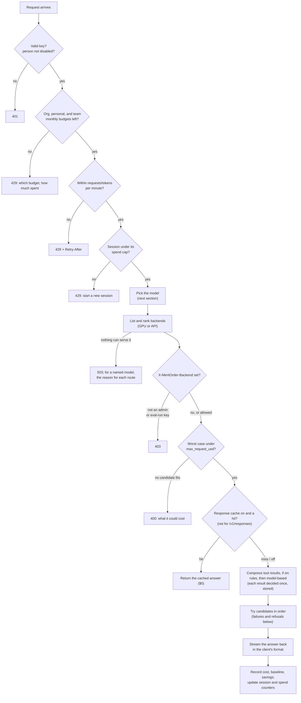

## Which model

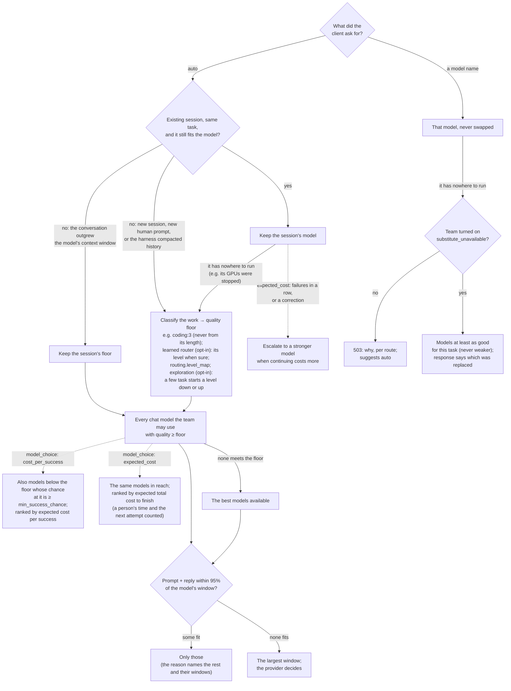

**The classifier** (rules, no model call; `routing.levels`, Config → Routing → How requests get a level,
shown to everyone under Reports → Levels):

| Request | Floor | Setting |
|---|---|---|
| Has tools or code-like text (code fences, `def`, `import`, file names, "refactor", "bug", SQL, …) | `coding:3` | `coding`, `coding_words` |
| …and simple wording, nothing harder (write tests, rename, typo, lint, docstring, explain, bump, …) | `coding:2` | `simple`, `simple_words` |
| …and "hard" wording (race condition, security, performance, migration, multi-file, "under load", flaky, …) | +1 for each distinct match, up to 2; at most 5 | `hard_raise`, `hard_signals`, `hard_words` |
| …and the hardest wording (architecture, "design a", system design, prove, codebase-wide, …) | `coding:5` | `hardest`, `hardest_words` |
| …and the newest prompt says the last answer was wrong ("that's wrong", "revert", …) | +1, at most 5 | `correction_raise` |
| …with 5+ tools, only with `agent_by_tools: true` (off: tools say it's coding, not how hard) | `coding:4`, simple wording ignored | `agent_by_tools`, `agent`, `agent_tools` |
| Anything else | `general:2` | `general` |
| …the whole request under 400 tokens (no tools) | `general:1` | `short`, `short_tokens` |
| …analysis wording (analyze, compare, trade-offs, plan, …) | `general:3` | `analysis`, `analysis_words` |
| `X-Route-Hint: cheap` / `smart` | −1 / +1 | |
| Claude Code side request (`x-claude-code-request-class: auxiliary`) | at most 1 | `request_class_levels` |
| Claude Code compaction summary (`compaction`), and the summary the gateway writes for `POST /v1/responses/compact` | at most 3 | `request_class_levels` |
| `X-Route-Floor: coding:4` | exactly that, skipping the rules (never capped) | |
| The learned router, in route mode, at least `min_confidence` (0.8) sure | its level instead of the rules' (Claude Code's caps still apply) | `routing.learned` |

Wording is looked for in the last two messages from the person: tool results aren't read, and a user message made
only of tool results (Anthropic's agent loops send one per step) is passed over, so the prompt behind a task counts
mid-task. What the harness adds is left out too: Claude Code's system reminders (CLAUDE.md) and Codex's AGENTS.md and
environment context. Where lists overlap, the hardest wins. Coding agents send dozens of tools on every request, so the
tool count no longer sets the level (decision 61): "write tests" from Claude Code is `coding:2`, "fix the race
condition" `coding:4`, "design a plugin system" `coding:5`. The level is set at a task boundary and held until the next
one. The word lists are Python regular expressions, matched ignoring case; a pattern that doesn't compile, or matches empty
text and so every request, is refused when the configuration is saved, as is a level outside 1–5.

**Length never raises the floor.** It only rules out models whose window can't hold the prompt plus the
reply (the flowchart above, and the table under [Which backend](#which-backend-gpu-or-api)). The one length
rule left, the short question, can only lower a level. The routing reason, kept in the ledger and shown
under Reports → Requests, names the rules that set the floor and the models ruled out by their windows.

The Claude Code caps are `routing.request_class_levels` (Config → Routing → Claude Code request types);
other classes (`main`, `subagent`, `workflow`) aren't capped. Claude Code sends the header to a gateway
only with `CLAUDE_CODE_GATEWAY_HINT_HEADERS=1`, which `meritorder setup claude-code` sets. The Responses API's
compaction endpoint routes its summary as a `compaction` request, whichever client called it
([04](04-caching-and-sessions.md#compaction)).

**The learned router** (`routing.learned`, off by default; [03, Routing](03-routing.md#the-learned-router)) predicts a
level next to the rules' wherever they give one, from the request's hashed words and named facts, trained on what
followed earlier answers. In `shadow` mode that's recorded with what it would have picked, and nothing changes; in
`route` mode it's used when it's sure. The rules decide whenever there's no model, the model is stale (older than
`max_age_days`, the level rules changed, or the feature key did), it's under `min_confidence`, or it fails; a client's
`X-Route-Floor` is never second-guessed. The routing reason says what it predicted, how sure it was, its version, and
why it was or wasn't used. It's asked only when an `auto` request is classified (a new task); a request that names its
model only has its features recorded, as training data.

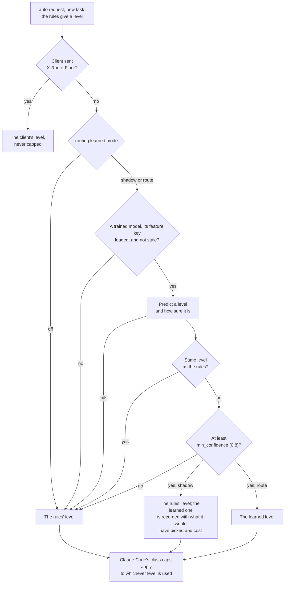

Quality scores (1–5 per task type) come from published benchmarks, refreshed daily (`quality:`;
see [00, How it all works](00-how-it-all-works.md#3-every-model-gets-a-score-for-each-kind-of-work)).
A model the source doesn't cover isn't a candidate for `auto` unless it has a `quality_override`.

**What the client can force**

| Client sends | Effect |
|---|---|
| A model name | That model; only the backend varies |
| `reasoning_effort` / `output_config.effort` | Passed through, translated across formats (an Anthropic client's effort reaches an OpenAI-format model at the nearest level it accepts). Merit Order only picks an effort for `auto` requests that don't set one |
| `X-Route-Floor`, `X-Route-Hint` | Changes the floor for `auto` when it classifies (mid-task, the session's floor stands) |
| `X-MeritOrder-Priority: cost` / `balanced` / `speed` | How much more a faster route may cost (below); anything else is a 400 |
| `X-MeritOrder-Backend` | Pins the backend (admins and eval-run keys only; anyone else gets a 403) |
| `X-MeritOrder-Cache: on` / `off` | Uses the response cache even where the team has it off, or skips it |
| `X-Session-Id` (or `X-MeritOrder-Session`) | Names the session; otherwise it's inferred from the conversation |
| `x-claude-code-session-id`, `x-claude-code-agent-id` | The session, and a subagent's own thread within it (own model, level, cache; spend still counts the session) |
| Codex CLI's `session-id`, and `thread-id` with `x-codex-parent-thread-id` | The same, for Codex: the session, and a subagent's own thread |

Team policy (allowed models and backends) applies before any of this, so nothing above can escape it.

### Threshold or cost per success

`routing.model_choice` (or a team's `model_choice`) sets how `auto` chooses among models for a new task:

| Choice | Picks |
|---|---|
| `threshold` | The cheapest route of a model whose score is at least the level |
| `cost_per_success` | The lowest expected cost per solved task, among models whose chance of solving work at the level is at least `min_success_chance` (0.6), whatever their score |
| `expected_cost` (default) | The lowest expected total cost to finish the task, among the same models: the try, plus the chance of failing times what a failure costs (the person's time the request puts at stake, `human_cost_usd` scaled by its level and size, and the next attempt); and escalation inside the task ([below](#expected-total-cost)) |

**A model's chance at each level** comes from its score in use (`apply_chances` in `config.py`). The scale says
what a score means on the reference work (`absolute`, the default: 5 × the model's chance ÷ the anchor; `best`: ÷ the best
model's), so a score read back
gives its chance there, and a level gives the chance of a model scoring exactly that level. Level-L work is taken
to be as much easier than the reference as a model scoring L is weaker than a 5: a model exactly at a level
solves that level's work as often as a 5 solves the reference work (the anchor: 69.9% for coding and 76.9% for general,
what Claude Fable 5.2 solved of FrontierSWE-hard tasks on 12 November 2026). Every other model sits by its distance from the
level on Epoch's logistic ability scale:

```
chance at level L = sigmoid( logit(chance of its score) − logit(chance of a score of L) + logit(chance of a 5) )
```

Level 5 is the reference work itself. For coding, that gives:

| Model | Coding score | Level 1 | 2 | 3 | 4 | 5 |
|---|---|---|---|---|---|---|
| Claude Fable 5.2 | 5.0 | 97% | 93% | 88% | 81% | 70% |
| Gemini 4 Carbon | 4.4 | 96% | 91% | 84% | 75% | 62% |
| GPT-6.1 Terra | 4.2 | 95% | 90% | 82% | 72% | 59% |
| Claude Sonnet 5.5 | 3.9 | 94% | 88% | 79% | 69% | 55% |
| Claude Haiku 5.5 | 3.0 | 91% | 81% | 70% | 57% | 42% |
| DeepSeek V4.1 Flash | 2.4 | 88% | 75% | 62% | 48% | 34% |
| GPT-6 Luna | 2.3 | 87% | 74% | 60% | 46% | 32% |
| gpt-oss-20b | 1.0 | 70% | 49% | 34% | 23% | 14% |

Reading the chance from the score rather than from the published chance keeps the threshold's own rules: an
override counts, and the floor of 1 still makes every model fit for level-1 work. Where the chances come from:

| Quality source | What a 5 solves | Scores that get chances |
|---|---|---|
| `epoch` | `quality.anchor` (scale `absolute`), or the best configured model's published chance on the reference (`best`) | The source's own, and overrides |
| `config` | `quality.measured_best_rate`: the best measured model's pass rate on hard eval tasks, written when an eval run's scores are applied as `quality` | The configured scores, and overrides |
| `artificial_analysis` | Nothing: the index isn't a chance | None |

A model without a chance (a mock, a score written in the config while a live source is in use, a task type with
no measured rate) is judged by the threshold: it's a candidate only at or above the level, and counts at the chance
of a model exactly at it. With no chances for the task type at all, the threshold decides.

**Expected cost per success.** One try costs the route's estimate (below: the session from here, with its warm
cache or rebuild) and succeeds with the model's chance at the level. A failed try is still paid for, and the work
is then done again on the **redo route**: the one the threshold would pick (the cheapest route of a model that
meets the level; if none does, the most likely to succeed), tried until it succeeds.

```
redo     = redo route's cost ÷ its chance
expected = cost + (1 − chance) × redo
```

For the redo route itself that's its cost ÷ its chance. A model below the level wins only when the try it saves on
costs less than redoing its extra failures: cost < chance × redo. Failures are assumed independent, and the time a
person spends noticing one isn't counted; the minimum chance is what guards against both.

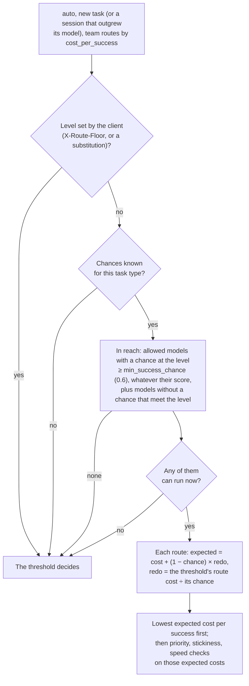

**The rules around it:**

- **The minimum holds for every model with a chance**, at the level too. A model exactly at the level has 70%
  for coding, so the default 0.6 only rules out models below the level; a minimum above 70% leaves only models
  above it.
- **The threshold steps in** when no model reaches the minimum, or none that does can run right now.
- **A level the client sets** (`X-Route-Floor`, also how a named model is substituted) is a minimum it asked for:
  the threshold decides.
- **Mid-task the session keeps its model**, as always. Cost per success changes where a new task goes, and where a
  session that outgrew its model moves.
- **Everything after compares expected costs per success**: the priority's premium (2%, 20%, 100%), stickiness
  (a move must save 10% + $0.01), and the speed checks. Cache warmth counts through each route's cost: a warm
  session's rebuild is zero, so a cheaper model elsewhere has to beat it after paying to rebuild there.
- **Effort and the output limit follow the level**, whichever model wins.
- **Teams** set their own `model_choice` and `min_success_chance`; blank uses the organization's.
- **Levels are untouched**: `routing.levels` still sets them. Reports → Levels shows, for a team routing by cost
  per success, the models below each level that are in reach, with their chance there.

The routing reason (the ledger's `route_reason`, shown on Reports → Requests) ends with what it compared:
`classified coding:3 (coding: 1 tool); cost per success: deepseek-v4.1-flash, expected $0.0051 per success (62% at
coding:3) vs $0.0086 (70%) on claude-haiku, the cheapest at the level`. When the threshold decides instead, it says
why (`cost per success: no chances of success for coding, so the threshold decides`).

What it changes, for new sessions on the shipped configuration and price list of 12 November 2026 (minimum 0.6), with
pauses on one later turn in ten (the prior, [below](#which-backend-gpu-or-api)):

| Request | Threshold | Cost per success |
|---|---|---|
| coding:3, 30,000 tokens | Claude Haiku 5.5 (Anthropic): $0.0060 a try, 70%, so $0.0086 per success | DeepSeek V4.1 Flash: $0.0018, 62%, $0.0051 |
| coding:4 (hard wording), 40,000 tokens | GPT-6.1 Terra: $0.064, 72%, $0.089 | the same (Gemini 4 Carbon: $0.15) |
| coding:5 (the hardest wording), 90,000 tokens | Claude Fable 5.2 (Anthropic): $1.07, 70%, $1.53 | Gemini 4 Carbon: $0.26, 62%, $0.85 |
| general:2, 2,000 tokens | Claude Haiku 5.5: $0.0016, 78%, $0.0021 | DeepSeek V4.1 Flash: $0.0009, 67%, $0.0015 |
| general:3, 3,000 tokens | GPT-6.1 Terra: $0.016, 84%, $0.019 | Claude Haiku 5.5: $0.0018, 65%, $0.0086 |

### Expected total cost

With `model_choice: expected_cost` (decisions 62 and 67; [03](03-routing.md#expected-total-cost-to-finish-the-task)),
the models in reach are the same as cost per success's, and each route is ranked by

```
E(m)         = try(m) + (1 − P(m)) × (H × stakes + next attempt)
stakes       = (1/3)^(5 − level) × min(1, prompt tokens / 8,000); counted at level 5 after a correction
next attempt = the cheapest of: m again, or a stronger model e (a higher chance) from a cold cache,
               each E(· | m failed) with one attempt fewer left; nothing once max_escalations are planned
```

| Part | What it is | Setting (default) |
|---|---|---|
| try(m) | The route's cost for the rest of the session, as above (warm cache or rebuild, the 1-hour cache, pauses) | |
| H | What a failed attempt at the top of the scale (a level-5 agent task) costs the person: their minutes times their rate | `routing.human_cost_usd` ($1); team `human_cost_usd`; Config → Routing → Expected total cost, Controls |
| stakes | The share of H a failure of this request puts at risk: a third for each level below 5 (level 3: 1/9, level 1: 1/81), times the prompt's size up to 8,000 tokens; the whole level-5 share after a correction ("that's wrong", "revert") | fixed (`success.STAKES_LEVEL`, `STAKES_TOKENS`) |
| P(m) | The benchmark prior at the task's difficulty, read between levels; widened by the learned router's spread in route mode; the fitted layer in its place once it's routing and beat the prior | `routing.success.mode` (off) |
| A failure's effect on the next attempt | Each model's chance on the task moves with a hidden difficulty 1 log-odds wide, so a task one model failed is harder for the next too | fixed (`success.SPREAD`) |
| Attempts planned after the first | None by default: a failure costs the person's time; with the cascade on, as many as it may escalate | `routing.cascade.max_escalations` (0; up to 2) |

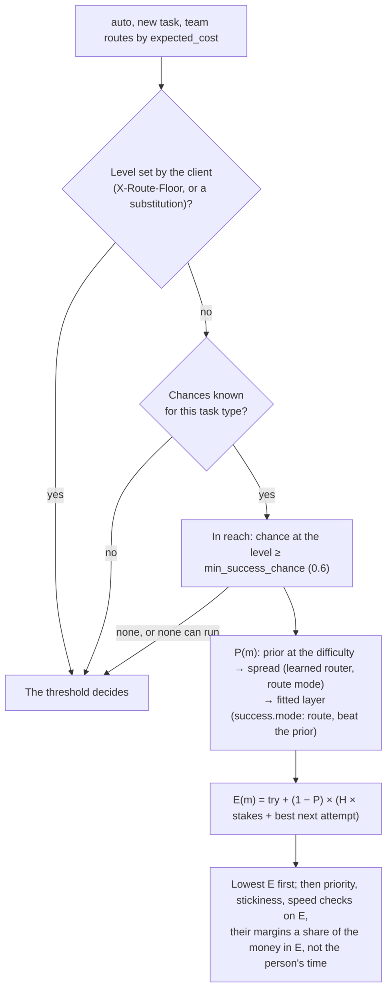

**Inside a task**, with the cascade on (`routing.cascade.max_escalations` 1 or 2; off by default, since on the routing
simulator it saved nothing in total, counting failed attempts at a price per failed attempt, for a third more model spend), a team routing by `expected_cost` may escalate:

| When | What's compared |
|---|---|
| Mid-task, after `failures_now` (3) failures in a row (failed test or build runs, or error tool results) | Continuing: the rest of the task on its model, at its chance now (its chance at the task's start moved by the evidence, table in [03](03-routing.md#escalation-inside-a-task)), a failure there escalating later. Escalating: the rest of the task on a stronger model from a cold cache, one escalation fewer left. Escalates when that's cheaper by more than `switch_margin_usd` ($0.01) |
| At a human message that carries on the task: a correction, or the code left failing (the last run after the last edit failed) and a prompt that, classified first, is the same kind of work at no higher a level than the task's | The same; the task, its row and its evidence go on. A correction puts the level-5 share of H at stake, so it's where an escalation most often pays |
| At any other human message | A new task, chosen afresh: the only way a task goes back down |

Never for a named model, never past the team's models, never once a budget is 90% spent, never more than
`max_escalations` per task, never into a refusal by `max_request_usd`. Every request of an escalated task is tagged
`escalation` and `escalated_from`; its first request (the answer's row, once) takes the failed attempt's
baseline cost off its routing savings.

The reason says what was compared, and what's at stake: `classified coding:3 (coding: 1 tool); expected total cost:
claude-haiku ~$0.055 to finish: try $0.0060, chance 70% (benchmark), difficulty 3.0 (level 3), a failure costs $0.11 of a
person's time (of $1.00: 1/9 at level 3), then claude-haiku again; deepseek-v4.1-flash ~$0.063, chance 62% (benchmark)`,
and for an escalation (cascade on), at the person's "that's wrong" after a failing run: `escalated at the next human
message (1 of 1): claude-haiku's chance now 24% (was 70%: tests failing after the last edit -0.6, corrected (wrong) -1.4);
continuing ~$1.00 vs escalating to gpt-terra ~$0.28 (82%, cache rebuild included); at coding:3 (coding: 1 tool)`.

What it picks for new sessions on the shipped configuration and price list of 12 November 2026, with the benchmark prior
alone (nothing fitted yet; a try's cost and the model's chance at the level):

| Request | Threshold | Expected total cost, H = $0.25 | H = $1 (default) | H = $5 |
|---|---|---|---|---|
| general:1, 20 tokens ("What's the capital of Portugal?") | GLM-5.3 Flash, $0.00038, 77% | GLM-5.3 Flash | GLM-5.3 Flash | GLM-5.3 Flash |
| coding:2, 20,000 tokens ("write unit tests", an agent) | DeepSeek V4.1 Flash, $0.0015, 75% | DeepSeek V4.1 Flash | DeepSeek V4.1 Flash | Claude Haiku 5.5, $0.0046, 81% |
| coding:3, 30,000 tokens | Claude Haiku 5.5, $0.0060, 70% | DeepSeek V4.1 Flash, $0.0018, 62% | Claude Haiku 5.5 | GPT-6.1 Terra, $0.051, 82% |
| coding:4 (agent), 40,000 tokens | GPT-6.1 Terra, $0.064, 72% | GPT-6.1 Terra | GPT-6.1 Terra | GPT-6.1 Terra |
| coding:5 (agent, hard wording), 90,000 tokens | Claude Fable 5.2, $1.07, 70% | Gemini 4 Carbon, $0.26, 62% | Gemini 4 Carbon | Gemini 4 Carbon |
| general:2, 2,000 tokens | Claude Haiku 5.5, $0.0016, 78% | DeepSeek V4.1 Flash, $0.00085, 67% | Claude Haiku 5.5 | Claude Haiku 5.5 |
| general:3, 3,000 tokens | GPT-6.1 Terra, $0.016, 84% | Claude Haiku 5.5, $0.0018, 65% | Claude Haiku 5.5 | GPT-6.1 Terra |

Under decision 62 alone (the full H on every request) the default sent the first three rows and both general rows to
GPT-6.1 Terra or Gemini 4 Carbon, at 2 to 40 times the threshold's try. The benchmark's chances are FrontierSWE-scaled,
more pessimistic than most traffic, and the stakes keep that from buying strong models for easy work; at levels 4 and 5 a
failure still costs most of H. On the routing simulator the default $1 spends no more than the threshold on any task
class; $2 and up spend more on analysis and chat ([03](03-routing.md#is-it-the-right-default)). Turn
`routing.success.mode` to shadow (with the learned router on), and to route once Reports → Learned router shows the
fitted layer beat the prior.

### Exploration and the level map

A team that explores (`teams.<name>.exploration`, off by default) has a few of its task starts routed a level down or
up from the level they'd get, at random, so Reports → Levels can say whether each level is too high or too low for the
work ([03](03-routing.md#your-own-traffic-as-the-benchmark)). Before that, a level the outcome report's recommendation
moved is applied (`routing.level_map`, e.g. `{"coding:3": 2}`).

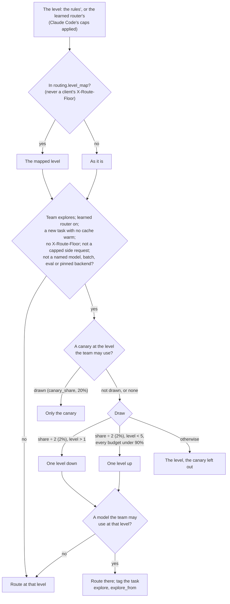

| Arm | Its chance (default share 4%, a canary's 20%) | Recorded |
|---|---|---|
| served | 96% (with a canary at the level: 76.8%) | `arm` served, `propensity` |
| down, up | 2% each (with a canary: 1.6%); at level 1 or 5 the whole 4% one way; up's half stays served near a budget | `arm`, `arm_from`, `propensity`, ledger tags `explore`, `explore_from` |
| canary | 20% of the level's task starts, until it has 30 there or 14 days pass | `arm` canary |

The report weights each task start by 1 ÷ its arm's chance, so arms and teams with different shares compare fairly. A
recommendation ("coding level 3: level 2 does as well in 98% (n=412 explored, 9,870 served); consider lowering") needs
200 task starts on each side and a difference clear at 90%; it raises an alert once, and an admin applies it (or the
worker, with `routing.benchmark.auto_apply`, when the learned router's model in use beat the rules and leans the same way).

## Which backend: GPU or API

Each candidate model lists its routes (backends that serve it). A route is dropped when:

| Dropped when | Why |
|---|---|
| The backend isn't enabled (no key, no URL) or the team may not use it | Policy and credentials |
| The backend is being skipped after failures (see [When a backend fails](#when-a-backend-fails-or-a-model-refuses)) | Bad credentials or a network-level outage: the whole backend. Retried when the wait is up |
| This model is being skipped on this backend: over capacity (429/503/529), its deployment doesn't exist there (404), or it failed 3 times in a row (408/409/425/500) | Only that model there; the backend's other models are unaffected. A busy route is kept as a **last resort** if nothing else can take the request |
| It's a GPU deployment that isn't warm (not started, starting, or stopped now) | Nothing to send to |
| It's draining and this session has no warm cache there (on any of its replicas) | Draining only finishes sessions already there |
| It's a GPU at 100% (see [When a GPU is full](#when-a-gpu-is-full)) | Saturated: new work spills to other routes. Kept as a **last resort** if nothing else can take the request |
| It's a saturated GPU whose queue is also full | No room to wait either |
| `auto` and the route has no known price | An unknown price must never look free |
| The model's context window is too small (prompt plus the client's `max_tokens` > 95% of it) and other models fit | Avoid a guaranteed error. Mid-task too: a session that outgrows its model moves to one with room, at the same floor. When nothing at the floor fits, only the largest window is kept and the provider decides |
| `auto` and it's a mock backend while real ones exist | Mocks are for trying things out |
| A batch request, and the backend has no batch API; or it's a GPU that's full or draining, or `batches.gpu.enabled` is off | Batch work only goes where it can wait at batch prices |

The rest are ranked by **what this session will cost from here**:

```
cost = rebuild + expected_remaining_turns × per_turn
rebuild   = cached context × (cache-write − cache-read price) × the share of it the backend no longer holds
            (0 when it holds this session's cache; on a GPU, the share is the replica's, see below)
per_turn  = cached context × cache-read + new tokens × cache-write + ~600 output tokens × output price
            (new tokens: ~2,000, or for a known session what the prompt grew since its last turn, at least 200;
             cached context: the rest of the prompt.
             cache-write is the input price except where caching is explicit and writes cost extra:
             Anthropic-format backends (Claude on Anthropic, Bedrock, Vertex, Foundry) and Claude through
             OpenRouter, which gets a cache marker; on a backend whose cache_ttl_seconds is 3600 or more,
             the 1-hour write price. Elsewhere caching is automatic.)
          + after the first turn, where the cache lasts under an hour (cache_ttl_seconds < 3600):
            pause share × cached context × (cache-write − cache-read)
            (a pause of 5 to 60 minutes rebuilds a 5-minute cache, not an hour's; the share is the team's own,
             leaning on the organization's and a prior of 1 in 10, from pauses.py; GPUs get none)
turns     = turns so far, clamped to 3…30 (a long session is expected to keep going)
prices    = the route's live price (or its `price:` override) at this prompt's length (long-prompt tiers apply)
```

A **GPU's price is a shadow price**: what one token "costs" given how busy the GPU is. It scales the
`price:` written on the GPU route, which is set to the model's API-equivalent rate (GPUs have no live
price list); a GPU route without one is never used by `auto`.

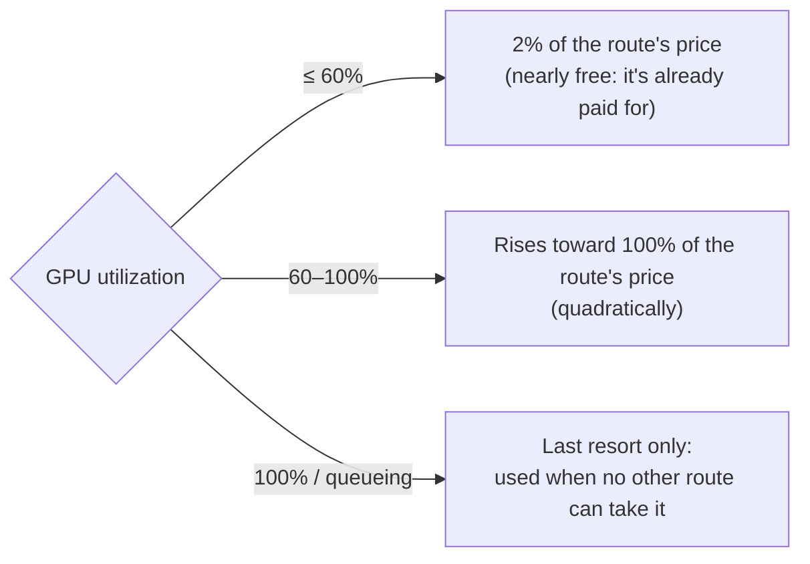

So GPUs win whenever they have room, even for a **better** model than the task needs (a "free
upgrade", sent at low vLLM priority so traffic that needs that model goes first). As they fill up,
APIs win again.

**Batch requests** are priced the same way against the providers' batch prices (about half): a running
GPU with room wins, at its shadow price for its load now. The worker then runs them only in the
headroom below the knee (60% of `max_concurrency` × replicas, less live requests), at vLLM priority 20,
below free upgrades, and hands what hasn't run after 12 hours to the request's provider batch route
([02](02-request-flow.md#batch-work-on-your-gpus)).

**Then the tie-breakers:**

1. **Close on price, then quality and speed.** The same model often costs the same everywhere
   (Claude on Anthropic, Bedrock, Foundry and OpenRouter), so price alone can't choose. Routes that
   cost at most the priority's premium more than the cheapest compete on speed instead:

   | Priority | A faster route may cost up to | Within that range |
   |---|---|---|
   | `cost` (default) | 2% more (a tie) | the higher-quality model (`auto`), then the faster route |
   | `balanced` | 20% more | the faster route, then the higher-quality model |
   | `speed` | 100% more | the faster route, then the higher-quality model |

   With expected total cost the range is the premium of the cheapest route's money (the tokens in its expected
   total), not of its total with the person's time, so a 2% tie stays 2% of what's spent (decision 67).
   The organization default is `routing.priority`; a team can set its own (`priority`), and a request
   can send `X-MeritOrder-Priority: cost|balanced|speed`. Speed is the expected time for a typical
   reply (`routing.est_output_tokens`, 600 tokens): time to the first token plus the writing time, both
   moving averages of real replies on that route (backend + upstream model). Timing starts when the
   route is called, so a route that took over after a failure isn't charged for it. A route is trusted
   after 2 replies; until then it ranks after measured ones, keeping cost order.
2. **Measuring the alternatives.** Otherwise the first route measured would win forever. Every 10th
   new session (`routing.speed_check_every`; 0 turns it off) can go to a route in that price range
   that hasn't been measured, or not in the last 10 minutes. Never mid-session, so no cache is lost.
3. **Stickiness:** a session stays on its current backend unless the cheapest one saves more than
   10% + $0.01 over the rest of the session (with expected total cost, the difference in expected totals has to beat
   10% of the current route's money plus $0.01), which is usually only true once its cache has expired
   (as long as the request's last cache marker asked: 5 minutes, or an hour for the gateway's own markers from a
   session's second turn on the shipped Claude backends; `cache_ttl_seconds` per backend). That's what stops a session bouncing
   between Bedrock and Anthropic and paying to rebuild its cache each time. Speed never moves a
   session either: a warm cache is cheaper, and usually faster, than any other route.

Each gateway process learns speeds from its own traffic. The console's **Backends** page shows them
per model (first token, tokens per second).

**Which replica of a GPU deployment.** Each replica has its own KV cache. When the gateway can reach
replicas one by one (SkyPilot's clusters, Kubernetes pods, or a static server's `static_urls`), it prices each with the
same formula, at that replica's load and with the share of the session's prefix that replica probably still
holds, and sends the request to the cheapest:

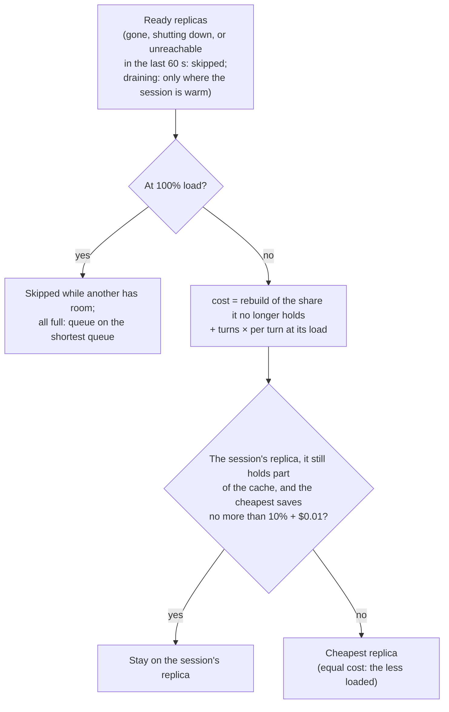

The share still held comes from vLLM's KV events (`serve.kv_events`), else an estimate from the replica's
KV-cache metrics (what it has written since the session's last turn against what it had free), else the
cache TTL ([04](04-caching-and-sessions.md#gpu-replicas-which-one-holds-the-cache)). Behind a load balancer
that doesn't know sessions, it's divided by the number of replicas. A replica the gateway can't connect to
is skipped for 60 s, and the deployment's endpoint is used.

## When a backend fails or a model refuses

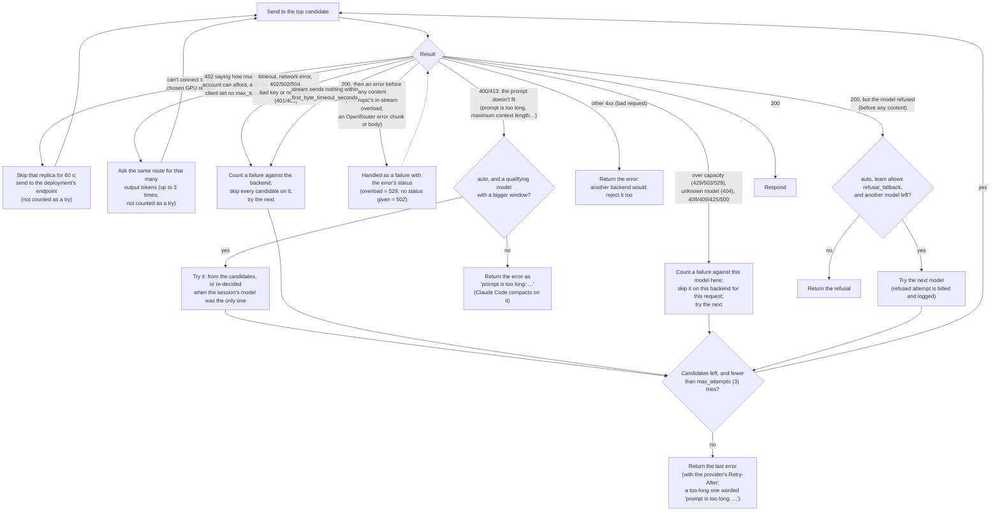

The gateway reads the start of every stream, up to its first content, before passing it on. So an error
that arrives after a `200` still goes to the next source, and nothing reaches the client twice. Once
content has started, an error is passed through: switching then would repeat output. The ledger records that
request with the provider's error and status, and the tokens it billed. A too-long prompt
isn't counted against the backend, and with `X-MeritOrder-Backend` set it isn't re-decided.

How long a failing backend or model is skipped:

| Failure | Skipped | For |
|---|---|---|
| Over capacity (429, 503, 529) | That model on that backend | The provider's `Retry-After` if it sends one, else 10 s doubling; at most 5 min either way. Still tried as a last resort |
| Model or deployment not found (404) | That model on that backend | 5 min, doubling to 1 hour while it stays missing (a model not deployed there yet is checked less and less often). Turn a backend off in `.env` (`MERITORDER_BEDROCK=false`, `MERITORDER_FOUNDRY_CLAUDE=false`) until its models exist |
| Credentials rejected (401, 403) | The backend | 1 min doubling to 10 min |
| Anything else (5xx, timeouts, network) | The model (408, 409, 425, 500) or the backend (402, 502, 504, network) | After 3 in a row: 5 s doubling to 60 s. A `Retry-After` on a retryable error (not 402) applies at once, up to 5 min |

When something starts being skipped, an alert goes to the console's "needs attention" list, the log,
and `MERITORDER_ALERT_WEBHOOK_URL`. It says why and where its traffic goes meanwhile. That's at most once
per backend and model every 30 minutes, with a second alert when it works again. The Backends page shows
what's skipped and for how long. `meritorder_failovers_total{backend,status}` counts every failed
attempt except bad requests (other 4xx and too-long prompts), and responses served after one carry
`X-MeritOrder-Failed-Over: backend/model status` (or `prompt too long`).

A request gets at most `max_attempts` (3) tries in all: failovers, moves to a bigger window, and
refusal retries count; asking a route again for what its credit covers (HTTP 402) doesn't, and neither does
sending a request to a deployment's endpoint after its replica couldn't be reached. Once a
stream has started sending content to the client, a failure can't be retried: the client gets an
error event, and the partial usage is still recorded.

## When GPUs start, scale, and stop

The capacity controller (`meritorder controller`) runs every 60 s and wakes within 2 s when an admin changes a GPU
control. It needs Postgres, and only one is active at a time (a Postgres advisory lock); a second one stands by.

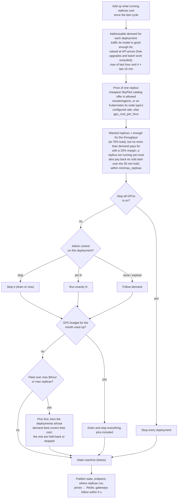

**The state machine** (per deployment):

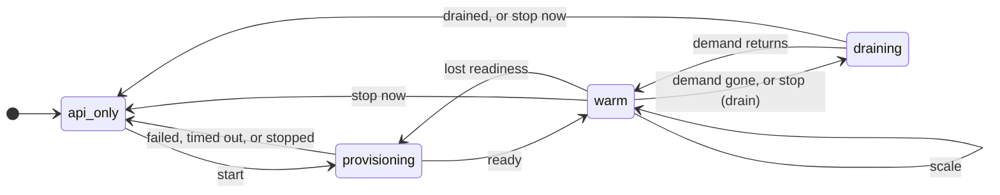

| Transition | Exactly when |
|---|---|
| **start** | Wanted ≥ 1 continuously for 10 min and not in a cooldown. At once when an admin pins replicas (ignoring any cooldown from before the pin) or `min_replicas > 0` (once any cooldown is over) |
| **ready** | The replicas answer `/v1/models` |
| **failed, timed out** | The start call fails, every replica's SkyPilot launch fails (or a cluster dies before vLLM was ever ready), Kubernetes refuses the pods for good (a quota or policy, an image that can't be pulled, a missing Secret, vLLM crashing three times, credentials the cluster rejects, the resource deleted outside Merit Order), or 45 min pass; the replicas are shut down and the deployment cools down for 30 min. A start whose teardown fails too stays tracked as starting (and billing), and the teardown is tried again every cycle. The reason is in the activity log |
| **stopped** (while starting) | An admin stop, Stop all GPUs, the GPU budget, or a fleet cap: provisioning is cancelled at once |
| **scale** | Wanted changes while warm: on SkyPilot a cluster launched or torn down per replica, on Kubernetes a patch of the replica count. A scale that fails keeps the replicas that ran, and is tried again next cycle |
| **demand gone** | Wanted = 0 for 10 min, and the deployment has been warm at least 30 min |
| **stop (drain)** | An admin stop with "drain first", the GPU budget, or a fleet cap. Skips the 30-minute hold |
| **stop now** | An admin stop with "stop now", or Stop all GPUs (unless set to drain) |
| **lost readiness** | Replicas stop answering (e.g. a spot preemption: the controller launches the SkyPilot cluster again, or Kubernetes replaces the pod); traffic goes to APIs until they're back |
| **demand returns** | Wanted ≥ 1 again while draining, unless it was stopped |
| **drained** | 15 min after draining started |

| State | Gets traffic? | Billing? |
|---|---|---|
| `api_only` | No; its models' traffic goes to APIs (or other models for `auto`) | No |
| `provisioning` | No | Yes, from the moment the provisioner starts it (the SkyPilot launches, or the Kubernetes resource is created) |
| `warm` | Yes, first choice while it has headroom | Yes |
| `draining` | Only sessions whose cache is already there | Yes |

## When a GPU is full

**How "full" is measured.** Two signals; a backend is saturated when either reaches 100%:

| Signal | Source | How fresh |
|---|---|---|
| vLLM's own load: KV-cache use, pushed to 100% by ~10 waiting requests | The controller reads `/metrics` once per cycle | Up to one cycle (60 s) old |
| Requests in flight ÷ (`max_concurrency` × replicas) | Every gateway counts its own requests to the backend and publishes the count to Redis every 2 s | Live for this gateway, ≤ 2 s for others |

The second signal only exists when the backend sets `max_concurrency` (vLLM's `--max-num-seqs`, or
what its KV cache fits). Without it, a burst can pile up in vLLM for up to a minute before the
gateways notice. Set it.

**Where requests wait.** Merit Order has no queue of its own, in Redis or anywhere else: LLM calls
are interactive and streaming, so the gateway forwards each request at once and holds the
connection open. The only queue is **vLLM's scheduler**, on the GPU.

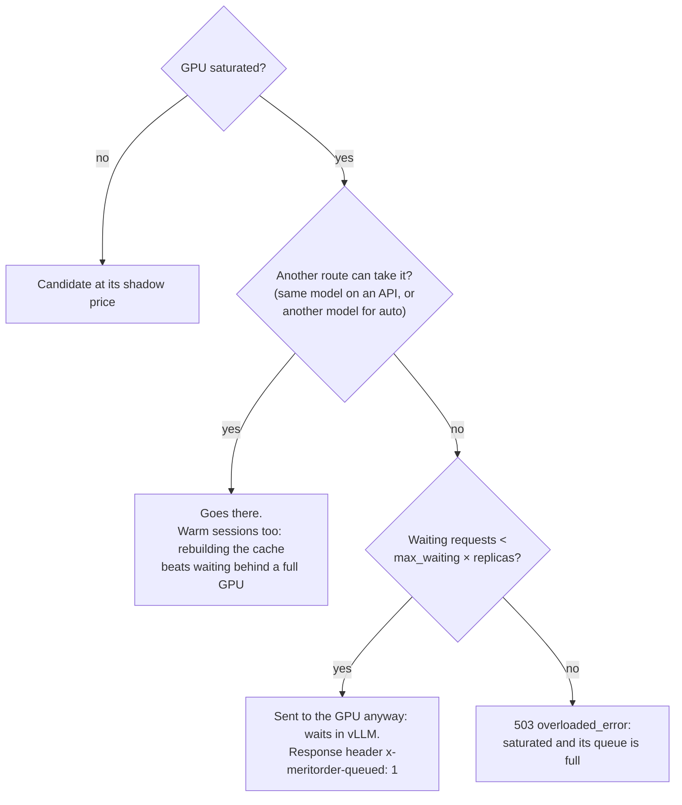

Waiting requests are in-flight requests beyond `max_concurrency × replicas`; without
`max_concurrency`, the controller's last count of vLLM's waiting requests is used. When that count is
more than 5 minutes old (the controller stopped, say), every request the gateways have in flight there
counts as waiting, so the bound still holds; it may then turn requests away before vLLM's queue is
really full. Meanwhile the controller sees the demand and adds replicas (after
`scale_up_after_minutes`, up to `max_replicas`).

## What happens when…

| When | What happens |
|---|---|
| **A GPU is saturated** | New requests go to an API route for the same model, or (for `auto`) another model; sessions on it move too and rebuild their cache. If nothing else can take a request, it waits in vLLM's queue (`x-meritorder-queued: 1`) |
| **A GPU is saturated, it's the only route, and its queue is full** | 503 `overloaded_error` saying so; the client retries. The controller adds replicas if the demand lasts |
| **A burst hits a GPU** | With `max_concurrency` set, gateways see it within 2 s and spill the excess; without it, up to a minute of requests queue in vLLM first |
| **Demand drops** | After 10 min below break-even (and 30 min warm), the deployment drains for 15 min, then stops |
| **A batch arrives while a GPU has room** | Its requests for models the GPU serves (or, for `auto`, levels it meets) go there, near free; the worker runs them in the headroom at low priority. Batch work never counts as demand, so it never starts or keeps a GPU |
| **A GPU hasn't run a batch's requests 12 hours in, or it stops or drains** | What's left goes to each request's provider batch route (handed on, at about half price), as does a request the GPU failed twice; a request with no such route waits for the GPU until the batch's 24-hour deadline, then expires |
| **Demand rises** | After 10 min above break-even, GPUs start; traffic stays on APIs until they're ready (10–20+ min for big models) |
| **An admin stops a GPU (drain)** | No new sessions there at once; warm sessions finish for up to 15 min; then it's shut down |
| **An admin stops a GPU (now)** | Gateways stop sending to it within seconds; the next request in each session goes elsewhere and rebuilds its cache there; shutdown starts within seconds (the cloud takes a few minutes) |
| **An admin pins N replicas** | Started at once (no 10-min wait, no cooldown), kept regardless of demand, until unpinned or the pin expires; safeguards still apply. A start that fails while pinned cools down for 30 min; pinning again retries at once |
| **Stop all GPUs** | Every deployment stops, none start, until someone resumes |
| **An `auto` session's model has nowhere to run** | It's routed again from scratch to another model meeting the floor |
| **The learned router is in shadow mode** | Each new task's features and the learned level are recorded with what that level would have picked and cost; routing is exactly what the rules give. Reports → Learned router compares them |
| **The learned router has no model, or it's stale, unsure, or fails** | The rules decide, and the routing reason says why. A model is stale once it's older than `max_age_days` (30), the level rules change, or the feature key does |
| **A new learned-router model is trained** | It's used only if it predicts the newest fifth of the requests better than the rules alone by more than chance; gateways load it within seconds. `meritorder router use` goes back to another version |
| **A team routes by cost per success** | New tasks may go to a cheaper model a little below their level, when its chance there is at least the minimum and it costs less per solved task; with no chances to go on, or nothing in reach that can run, the threshold decides |
| **A named model has nowhere to run** | 503 explaining each route ("stopped by dana: cost review", "OPENROUTER_API_KEY is not set") unless the team turned on `substitute_unavailable`; then a model at least as good, with `x-meritorder-substituted-for` |
| **The GPU budget runs out** | All GPUs drain and none start until next month or the budget is raised; traffic goes to APIs |
| **The fleet hits max $/hour or max replicas** | Lower-value deployments are held to fewer replicas or stopped |
| **The org budget runs out** | Every request gets a 429 until next month or it's raised |
| **A team or person hits their budget** | Their requests get a 429; everyone else is unaffected |
| **An agent loops** | The session stops at `max_session_usd`; a spend-spike alert fires when someone's hour is 5× their norm (and at least $5) |
| **A provider's account can't cover the reply (HTTP 402)** | If it says how much it can (OpenRouter: "can only afford N tokens") and the client didn't set `max_tokens`, the same route is asked again for N (`x-meritorder-max-tokens-source: provider credit`), up to three times, since requests in flight reserve credit too and N can shrink between tries; otherwise the next backend |
| **A request could cost more than `max_request_usd`** | With `max_tokens` set: cheaper candidates are used; if none fit, a 400 says what it could have cost. Without: the reply is allowed only as many tokens as fit under the limit |
| **Provisioning fails or takes > 45 min** | Shut down, 30-min cooldown, alert; traffic stays on APIs. On Kubernetes, waiting for a GPU node isn't a failure (a cluster autoscaler may be adding one) until the 45 min pass |
| **A spot replica is preempted** | The controller launches its SkyPilot cluster again (or the Kubernetes Deployment replaces the pod); if no replica is ready, the deployment shows "starting" and traffic goes to APIs meanwhile |
| **A SkyPilot launch fails** (no capacity in any allowed cloud or region) | Whatever it made is torn down; that replica is tried again after 10 min. When every wanted replica failed, it's a failed start: 30-min cooldown |
| **A stop fails at the cloud** | The deployment stays marked running and the controller keeps retrying; the console shows it in red |
| **The Kubernetes API stops answering** | A warm deployment whose replicas still answer stays warm; one that is starting keeps waiting (the 45-minute limit still applies) |
| **The controller isn't running** (or can't reach its replicas: its machine sleeps, the network dropped, `~/.sky` was lost) | Nothing scales them. Each SkyPilot replica stops vLLM when its lease runs out (`lease_minutes`, 15) and SkyPilot deletes the machine `autostop_minutes` (5) later; Kubernetes replicas stay as they are. Gateways keep using the last published state; the console flags it if GPUs are up |
| **A SkyPilot cluster no deployment wants** (a renamed or removed backend, a teardown that failed, a crash halfway through a scale) | Torn down by the next controller cycle's sweep (and the first one after a start), and logged in the activity log |
| **A provider is over capacity** (429/529, or overloaded inside a stream) | The next candidate: the same model on another backend (e.g. Anthropic → Bedrock), or, for `auto`, another model. Mid-task the session keeps its model while any of its routes can answer; once every route for it is over capacity, the session moves to another qualifying model, and the busy routes are tried only if nothing else can take it. That model is skipped there for `Retry-After` (or 10 s doubling); its other models keep working; alert |
| **A provider is down** (timeouts, connection errors, 5xx) | Same: next backend; skipped after 3 failures in a row; alert, and another when it recovers |
| **A provider accepts a stream but never answers** | Abandoned after `first_byte_timeout_seconds` (120 s; off for self-hosted GPUs) and sent to the next backend |
| **A provider rejects the key (401/403)** | Next backend; the backend is skipped for a minute (doubling). Fix the key; `meritorder check` shows what's usable |
| **A model refuses** (`stop_reason: refusal`, `content_filter`) | `auto`: retried on the next model, refusal billed and logged. Named model: the refusal is returned |
| **The harness compacts history** | Every cache for that session is dead, so it's a free moment to re-route |
| **A conversation outgrows its model** (prompt plus the client's `max_tokens` > 95% of the window) | `auto`: the next turn moves to the cheapest model with room at the same floor, even mid-task, and rebuilds its cache there. The floor never rises with length. A named model is sent anyway; the provider decides |
| **A conversation is too long for every model at its floor** | `auto`: sent to the largest window anyway (the count is an estimate); if the provider refuses, the client gets "prompt is too long: …" and Claude Code compacts |
| **A provider says the prompt is too long** | `auto`: a qualifying model with a bigger window, if there is one. Otherwise, and for a named model: the error, worded "prompt is too long: …" so Claude Code compacts |
| **Claude Code runs a subagent or a side request** | Routed in its own thread of the session, so the main conversation's model and cache are untouched; side requests at level ≤ 1, compaction summaries ≤ 3 |
| **A session's cache expires** (idle > 5 min) | Moving is now free, so it may move to a cheaper backend |
| **A stream breaks midway** | The client gets an error event; partial usage is recorded |
| **Redis is down** | Requests fail (sessions, budgets, and rate limits live there). Use a managed Redis with failover |
| **A burst exceeds the Redis connection pool** | Requests wait for a free connection (up to 10 s) rather than failing |
| **Postgres is down** | Static keys keep working, and cached keys for up to a minute; new sign-ins and key lookups fail; ledger rows that can't be written are logged and lost |
| **Someone saves a bad config** | It's rejected on save; gateways, the worker, and the controller keep the last good version |

## Every threshold in one table

| What | Default | Setting |
|---|---|---|
| How `auto` chooses among models | expected_cost (the lowest expected total cost to finish the task; threshold before decision 62) | `routing.model_choice`; team `model_choice` |
| Lowest chance at the level that cost per success and expected total cost accept | 0.6 | `routing.min_success_chance`; team `min_success_chance` |
| What a failed attempt costs a person (expected total cost) | $1 (a minute at $60 an hour) for a level-5 agent task; a request puts a share at stake: a third for each level below 5, less under 8,000 tokens, all of it after a correction | `routing.human_cost_usd`; team `human_cost_usd` |
| The success predictor's fitted layer | off (`shadow`: trained and recorded; `route`: used once it beat the benchmark prior on the newest fifth by more than twice the standard error); needs 200 task starts with an outcome | `routing.success.mode` |
| Escalations per task (expected total cost) | 0, off (up to 2); when on, mid-task only after 3 failures in a row, else at a human message that carries on the task; never once a budget is 90% spent | `routing.cascade.max_escalations`, `failures_now` |
| The learned router | off (`shadow`: compare, change nothing; `route`: use it when sure) | `routing.learned.mode` |
| How sure the learned router must be for its level to be used | 0.8 | `routing.learned.min_confidence` |
| A learned-router model is stale after | 30 days (0: never), or once the level rules or the feature key change | `routing.learned.max_age_days` |
| Training the learned router | when asked (`meritorder router train`, Reports → Learned router → Train now); on the last 30 days, at most the newest 20,000 requests | `routing.learned.retrain_hours`, `train_days`, `train_requests` |
| Training needs; a model is used if | 200 requests with an outcome, at least one of them with a signal; it beats the rules on the newest fifth by more than twice the standard error | fixed (`meritorder router train --min-examples`) |
| What the learned router reads | the first and last 2,000 characters of the text the rules read, hashed into 65,536 buckets; named facts about the request | fixed |
| Recorded request features are kept | 90 days | `routing.learned.keep_days` |
| Judged labels for the learned router | off; on: 1% of a team's eligible task starts, replayed on `auto` at level 5 and graded by the evals' judges, under a monthly cap with no default, starting within 60 seconds or dropped | team `judged_labels` |
| What a quality score of 5 stands for | `absolute`: a fixed chance on the reference, 0.6994 for coding and 0.7685 for general | `quality.scale`, `quality.anchor` |
| Exploration | off; on: 4% of a team's eligible task starts, half a level down and half up; a canary takes 20% of its level's | team `exploration` |
| Request screening | off; `shadow`: findings recorded as ledger tags and metrics, nothing blocked | team `screening.mode` |
| Budget step-down | off; on: new `auto` and tier tasks capped at level 1 once a budget that applies is 80% spent; no grace past 100% | team `budget_step_down` |
| Exploring up stops when a budget is | 90% spent | fixed |
| A canary is done after | 30 recorded task starts at its level, or 14 days | `routing.benchmark.canary_outcomes`, `canary_days` |
| A level recommendation needs | 200 task starts on each side, and a clear difference at 90%: the level below at least 95% as good, or the level above clearly better | `routing.benchmark.min_outcomes`, `as_well` |
| Recommendations applied | by an admin (or automatically when the learned router agrees) | `routing.benchmark.auto_apply`; `routing.level_map` |
| Share of later turns expected after a 5–60 minute pause | measured per team; with little data the organization's, then 0.10, each counting as 100 turns; counts halve every 7 days | fixed (`pauses.py`) |
| What a measured 5 solves, for chances with `quality.source: config` | not set (no chances: the threshold) | `quality.measured_best_rate`, written when eval scores are applied |
| Stickiness margin to move a session | 10% + $0.01 | `routing.switch_margin_pct`, `switch_margin_usd` |
| Expected turns for cost estimates | 3–30 | `routing.min_expected_turns`, `max_expected_turns` |
| Tokens per turn for cost estimates | ~2,000 new (a known session: the prompt's growth, at least 200); 600 output | `routing.est_new_tokens_per_turn`, `est_output_tokens` |
| How much more a faster route may cost | cost 2%, balanced 20%, speed 100% | `routing.priority`, `priority_premium_pct`; team `priority`; `X-MeritOrder-Priority` |
| Checking an unmeasured or stale route's speed | every 10th new session; stale after 10 min | `routing.speed_check_every` |
| GPU shadow price below the knee | 2% of API price | `routing.shadow_floor` |
| GPU utilization where the shadow price starts rising | 60% | `routing.shadow_knee` |
| How full batch work may fill a GPU | up to the knee: 60% of `max_concurrency` × replicas, less live requests and other workers' batch requests; none once live load reaches the knee, and none on a deployment without `max_concurrency` | `routing.shadow_knee`; `batches.gpu.enabled` |
| vLLM priority of batch work on GPUs | 20 (free upgrades 10, live traffic 0; lower runs first) | `batches.gpu.priority` |
| When batch work waiting for a GPU goes to a provider's batch API | 12 hours after the batch was made, at once if the deployment stops or drains, or after the GPU fails a request twice | `batches.gpu.handoff_hours` |
| How long the previous batch key is read after a rotation | the retention period plus 2 days (9) | `batches.key_grace_days` |
| Tries per request (failovers, bigger-window moves, refusal retries) | 3 | `routing.max_attempts` |
| Room a model needs for `auto` | prompt + the client's `max_tokens` ≤ 95% of its context window, the prompt in that model's tokens (estimated by content, corrected by its replies; [counting tokens](03-routing.md#counting-tokens)); over 85% is noted in the routing reason | `models.*.context_window` (from the price catalog); 95% fixed |
| Correcting token estimates per model | from every reply's reported prompt size: a 20,000-token prompt is a full sample, none under 500; samples outside 0.4–2.5× ignored, capped at ±25% after 3 full samples; saved every minute | fixed |
| Level rules | coding 3 (any tools), simple wording 2, hard wording +1 a sign (up to 2), the hardest wording 5, a correction +1 (tool count only with `agent_by_tools`); general 2, short question 1 (< 400 tokens), analysis 3 | `routing.levels` |
| Levels for Claude Code side requests and compaction summaries | at most 1 and 3 | `routing.request_class_levels` |
| Reasoning effort for `auto` by floor | 1–2: low, 3: medium, 4–5: high | `routing.effort_by_floor` |
| Output allowed when a request doesn't set `max_tokens` | The model's maximum (`max_output_tokens`), less what won't fit in the context window or under `max_request_usd` | `models.*.max_output_tokens` (from the price catalog); `default_max_tokens` (16,000) only where the maximum isn't known |
| Streaming from the provider for a non-streaming request | When its output limit is over 21,333 tokens (or unset), so a long reply can't hit an idle-connection timeout | fixed |
| How long a backend keeps a session's cache warm | What the request's last cache marker asked for (300 s, or 3600 s for the gateway's markers on the shipped Claude backends from a session's second turn); else the backend's `cache_ttl_seconds` (300 s by default); on a GPU, until its KV events or KV-cache metrics say it's evicted (the TTL only without either) | `backends.*.cache_ttl_seconds` |
| Sending a session back to the GPU replica that holds its cache | on, where replicas can be addressed | `serve.replica_affinity`, `serve.static_urls` |
| Following vLLM's KV events | off (port 5557) | `serve.kv_events`, `serve.kv_events_port` |
| A session counts as warm on a replica | at least half its prefix still cached there | fixed |
| Skipping a GPU replica the gateway can't connect to | 60 s | fixed |
| Skipping a failing backend or model | See [When a backend fails](#when-a-backend-fails-or-a-model-refuses) | fixed; `Retry-After` from the provider |
| Waiting for a stream to start | 120 s for APIs; none for self-hosted unless set | `backends.*.first_byte_timeout_seconds` |
| Demand before starting GPUs, and below break-even before draining | 10 min | `serve.scale_up_after_minutes` |
| Minimum time warm before draining | 30 min | `serve.hold_minutes` |
| Draining time | 15 min | `serve.drain_minutes` |
| Provisioning timeout | 45 min (then 30 min cooldown) | `serve.provision_timeout_minutes` |
| Break-even margin | 20% | `serve.margin` |
| Cold start a new replica must pay back over `hold_minutes` (paid, not serving) | the average of the deployment's last 10 starts; 12 min before one is measured; 0 for `static` | `serve.cold_start_minutes` |
| Target load per replica | 70% | `serve.target_utilization` |
| Replicas | 0–4 | `serve.min_replicas`, `max_replicas` |
| Requests one replica runs at once (live saturation) | not set (64 on the shipped GPU backends) | `backends.*.max_concurrency` |
| Requests allowed to wait per replica when a saturated GPU is the only route | 32 | `backends.*.max_waiting` |
| Gateways share in-flight counts | every 2 s | fixed |
| Controller cycle | 60 s (wakes early on admin changes) | `meritorder controller --interval` |
| Gateways pick up GPU state and config | ≤ 5 s | fixed |
| Budget alerts | 80%, 100% | `safeguards.alert_at` (org, GPU); fixed for teams and people |
| Spend spike alert | an hour at 5× the person's hourly average over the past week, and at least $5 | fixed |
| Where the console's "Source" link and `GET /about` point (the AGPL's offer of the source to people using the gateway) | `https://github.com/therick/meritorder` | `console.source_url` (`MERITORDER_SOURCE_URL` in the shipped config) |
